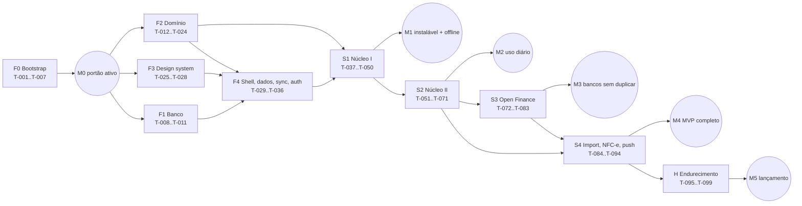

# TASKS — cadeia de tarefas do OakFinance

Este é o único plano que as sessões seguem. Regras de uso estão no `CLAUDE.md` §3–§5.

- **Status:** `todo` · `done` · `blocked: <motivo>`.
- **Tamanho:** P ≈ 1 h, M ≈ 1–2 h de sessão.
- **Cliente:** `não`, ou `sim — SETUP-xx` (ver `docs/SETUP.md`).

Toda tarefa termina com `pnpm ci:local` verde. A linha "Verificar" lista só os comandos específicos da tarefa.

## Ordem por fases

| Fase | Tarefas | Semana | Entrega |
|---|---|---|---|
| F0 Bootstrap | T-001..T-007 | S1 | Monorepo, tooling, CI com 8 checks, guard, varredura de segredos, ruleset ativo |
| F1 Banco | T-008..T-011 | S1 | Migrações 01–07, RLS, pgTAP, sync no banco, cron |
| F2 Domínio puro | T-012..T-024 | S1 | Todas as RN puras testadas (faturas, parcelas, recorrências, painel, reserva, regras, conciliação, imports, QR, lembretes) |
| F3 Design system | T-025..T-028 | S1 | Tokens Aero, marca, componentes, styleguide |
| F4 Shell e dados | T-029..T-036 | S1 | Rotas, PWA e SW, Dexie, outbox, sync, login, seeds, primeiro deploy |
| S1 Núcleo I | T-037..T-050 | S1 | Instalação, contas, cartões, lançamento rápido, lista, detalhe, offline, faturas, salário |
| S2 Núcleo II | T-051..T-071 | S2 | Parcelas, contas fixas, regras, painel, 50/30/20, reserva, avisos, push, onboarding, export, backup |
| S3 Open Finance | T-072..T-083 | S3 | Pluggy, conciliação, conferência, fechar o mês |
| S4 Importação e push completo | T-084..T-094 | S4 | OFX, CSV, NFC-e, lembretes completos, excluir conta |
| H Endurecimento | T-095..T-099 | S4 | E2E completo, acessibilidade, desempenho, operação, lançamento |

## Grafo de dependências (por fase)

## Marcos de validação humana (opcionais, não bloqueiam a cadeia)

| Marco | Atingido quando | O cliente valida |
|---|---|---|
| M0 — Portão ativo | T-007 `done` | Nada além do SETUP-04 |
| M1 — App instalável com lançamento offline | T-036, T-037, T-045 e T-050 `done` + SETUP-10 | Instalar nos dois celulares, entrar com Google, lançar em modo avião e reabrir (HANDOFF §6) |
| M2 — Uso diário começa | T-071 `done` + SETUP-11 | Painel, faturas, parcelas, reserva, lembrete diário e de fatura por push |
| M3 — Bancos entram sozinhos sem duplicar | T-083 `done` + SETUP-13 | Conectar BB e Nubank dentro do trial; conferir a conciliação |
| M4 — MVP completo | T-094 `done` | OFX, CSV, NFC-e, todos os lembretes, excluir conta |
| M5 — Lançamento | T-099 `done` | Checklist final, licença, marca |

## Índice

| ID | Título | Depende de | Status |
|---|---|---|---|
| T-001 | Tooling da raiz e documentos base | — | done |
| T-002 | Esqueleto dos workspaces e configs de teste | T-001 | done |
| T-003 | Supabase local, pgTAP e Edge Functions | T-002 | done |
| T-004 | CI com 8 jobs e varredura de segredos | T-003 | done |
| T-005 | Workflows de deploy, preview, nightly, keepalive, backup | T-004 | done |
| T-006 | Guard do portão e catraca de cobertura | T-005 | done |
| T-007 | Portão: ruleset de main ativo | T-006 | done |
| T-008 | Migrações 01–02 e tipos gerados | T-007 | done |
| T-009 | Migrações 03–04: integrações, sync e RPCs | T-008 | done |
| T-010 | Migrações 05–06: RLS e cadastro fechado | T-009 | done |
| T-011 | Migração 07 e integração do sync no banco | T-010 | done |
| T-012 | Domínio base | T-007 | done |
| T-013 | Domínio: faturas | T-012 | done |
| T-014 | Domínio: parcelas | T-013 | done |
| T-015 | Domínio: recorrências | T-013 | done |
| T-016 | Domínio: renda e 50/30/20 | T-014, T-015 | done |
| T-017 | Domínio: Disponível para gastar | T-016 | done |
| T-018 | Domínio: reserva | T-016 | done |
| T-019 | Domínio: categorização e seeds | T-012 | done |
| T-020 | Domínio: conciliação I | T-013, T-015 | done |
| T-021 | Domínio: conciliação II | T-020, T-014 | done |
| T-022 | Domínio: importação OFX/CSV | T-020 | done |
| T-023 | Domínio: QR da NFC-e | T-012 | done |
| T-024 | Domínio: lembretes devidos | T-017, T-018 | done |
| T-025 | Tokens, fontes, ambiente, i18n e marca | T-007 | done |
| T-026 | Componentes de base | T-025 | done |
| T-027 | Componentes de entrada | T-026, T-012 | done |
| T-028 | Componentes de dados e styleguide | T-027 | done |
| T-029 | AppShell, rotas e CSP | T-028 | todo |
| T-030 | PWA instalável e Service Worker | T-029 | todo |
| T-031 | Dexie, mappers e erros de armazenamento | T-011, T-029 | todo |
| T-032 | Outbox, repositórios e relógio híbrido | T-031 | todo |
| T-033 | Motor de sync | T-032 | todo |
| T-034 | Login Google, allowlist e sessão | T-033 | todo |
| T-035 | Seeds no primeiro login e isolamento | T-034, T-019 | todo |
| T-036 | Primeiro deploy staging e produção | T-030, T-034 | todo |
| T-037 | Boas-vindas e instalação guiada | T-030, T-034 | todo |
| T-038 | Contas | T-035 | todo |
| T-039 | Cartões com prévia da fatura | T-038, T-013 | todo |
| T-040 | Lançamento rápido de despesa | T-039, T-019, T-027 | todo |
| T-041 | Mais detalhes, edição e receita variável | T-040 | todo |
| T-042 | Transferência, estorno e rascunho | T-041 | todo |
| T-043 | Lista de lançamentos | T-041 | todo |
| T-044 | Detalhe, exclusão com desfazer e histórico | T-043 | todo |
| T-045 | Offline ponta a ponta e estados de sync | T-044, T-030 | todo |
| T-046 | Ocultar valores | T-043 | todo |
| T-047 | Cartões e faturas (C01/C02) | T-040 | todo |
| T-048 | Pagamento de fatura e saldo credor | T-047 | todo |
| T-049 | Categorias | T-035 | todo |
| T-050 | Salário como receita fixa | T-041, T-015 | todo |
| T-051 | Editar e arquivar contas e cartões | T-047 | todo |
| T-052 | Compra parcelada | T-048, T-014 | todo |
| T-053 | Editar e cancelar parcelada | T-052 | todo |
| T-054 | Contas fixas, assinaturas e Futuro | T-050, T-047 | todo |
| T-055 | Editar, pular e encerrar recorrências | T-054 | todo |
| T-056 | Regras que aprendem | T-044, T-049 | todo |
| T-057 | Gerenciar regras (I06) | T-056 | todo |
| T-058 | Painel Disponível para gastar | T-017, T-054, T-048 | todo |
| T-059 | Orçamento 50/30/20 e limites | T-058 | todo |
| T-060 | Reserva de emergência | T-058, T-018 | todo |
| T-061 | Ajustes do cálculo (S06) | T-059 | todo |
| T-062 | Central de avisos (H02) | T-045 | todo |
| T-063 | Ativar notificações push | T-062, T-030 | todo |
| T-064 | reminders-tick: diário e faturas | T-063, T-024, T-011 | todo |
| T-065 | Onboarding completo | T-064, T-060, T-050, T-039, T-037 | todo |
| T-066 | Exportar lançamentos em CSV | T-043 | todo |
| T-067 | Estados vazios e erros completos | T-065 | todo |
| T-068 | Tema escuro e reduzir movimento | T-029 | todo |
| T-069 | Análise do mês no computador | T-059 | todo |
| T-070 | Backup e restauração | T-066 | todo |
| T-071 | Diagnóstico, telemetria e saída | T-045 | todo |
| T-072 | Conector Pluggy e mock | T-011, T-019 | todo |
| T-073 | Conectar e vincular item | T-072 | todo |
| T-074 | Sincronização pluggy-sync | T-073, T-013 | todo |
| T-075 | Webhook e desconexão | T-074 | todo |
| T-076 | Telas de conexão (I01/I02) | T-075, T-045 | todo |
| T-077 | Estado da conexão e reconexão | T-076, T-064 | todo |
| T-078 | Conciliador no aparelho | T-074, T-021, T-033 | todo |
| T-079 | Conferir importados (I05) | T-078, T-056 | todo |
| T-080 | Parcelas, contas fixas e pagamentos do banco | T-079, T-053, T-055 | todo |
| T-081 | Desfazer conciliação | T-079 | todo |
| T-082 | Fechar o mês (P04) | T-079, T-059 | todo |
| T-083 | Validação real da Pluggy | T-077 | todo |
| T-084 | Importar OFX | T-022, T-078 | todo |
| T-085 | OFX real do BB anonimizado | T-084 | todo |
| T-086 | Importar CSV | T-084 | todo |
| T-087 | Presets Nubank confirmados | T-086 | todo |
| T-088 | nfce-fetch e fallback | T-023, T-011 | todo |
| T-089 | Leitor de QR e fluxo da nota | T-088, T-078 | todo |
| T-090 | Parser da NFC-e com páginas reais | T-089 | todo |
| T-091 | Lembretes de contas fixas e receitas | T-064, T-055 | todo |
| T-092 | Alertas de limite e resumo semanal | T-091, T-059 | todo |
| T-093 | Preferências de notificação | T-092 | todo |
| T-094 | Excluir conta | T-070, T-075 | todo |
| T-095 | Auditoria E2E E01–E20 | T-094, T-093, T-089, T-086, T-082, T-081, T-080 | todo |
| T-096 | Acessibilidade completa | T-095 | todo |
| T-097 | Desempenho | T-095 | todo |
| T-098 | Operação e resiliência | T-095, T-036 | todo |
| T-099 | Checklist de lançamento | T-096, T-097, T-098 | todo |

---

## F0 — Bootstrap

### T-001 — Tooling da raiz e documentos base
| Status | Semana | Tam. | US | RN | Depende de | Cliente |
|---|---|---|---|---|---|---|
| done | S1 | P | — | — | — | não |

**Escopo:** `package.json` (`packageManager` pnpm, `engines` node 24), `pnpm-workspace.yaml`, `.nvmrc`/`.node-version` (24), `tsconfig.base.json` (tech §2.3), `biome.json` (§2.4), `lefthook.yml`, `commitlint.config.ts`, `.editorconfig`, `.gitignore` (bloqueia `.env*` exceto `.env.example` e `supabase/.env.test`), `.env.example` (só nomes da §9.8), `.github/pull_request_template.md` (CLAUDE.md §7), `README.md`.

Também cria `docs/DECISIONS.md` com:
- D-001: Apêndice A da 02-tech-spec como registro de implementação;
- D-002: branch `task/T-xxx-slug`, que prevalece sobre o `feat/` da §2.5;
- D-003: merge só depois de observar o CI verde;
- D-004: modo bootstrap do guard;
- D-005: timeout da NFC-e de 10 s (RN-84) prevalece sobre os 20 s da tech §6.2.3;
- D-006: issue `Setup do cliente` como canal do cliente.

Cria o "Apêndice A — Registro de implementação" vazio em `docs/specs/02-tech-spec.md` e a issue `Setup do cliente` com a lista SETUP-01..SETUP-17 em checkboxes.

**Pronto quando:**
- `pnpm install` gera o lockfile;
- `pnpm biome ci .` passa;
- uma mensagem fora do padrão é recusada pelo commitlint;
- `docs/specs/01..04` estão presentes (se faltarem: `blocked: specs ausentes em docs/specs`).

**Verificar:** `pnpm install --frozen-lockfile && pnpm biome ci . && echo "x" | pnpm commitlint` (deve falhar).

### T-002 — Esqueleto dos workspaces e configs de teste
| Status | Semana | Tam. | US | RN | Depende de | Cliente |
|---|---|---|---|---|---|---|
| done | S1 | M | US-03 | — | T-001 | não |

**Escopo:**
- `packages/domain` e `packages/nfce-parser`: `src/index.ts`, `vitest.config.ts` com os limiares da §8.1 e teste smoke;
- `apps/web`: Vite 8 + React 19 + TS 6.0.3 fixado + Tailwind 4; `vitest.config.ts` com happy-dom, fake-indexeddb, MSW bloqueando rede e `--allowOnly=false`; `playwright.config.ts` literal da §8.4; `e2e/fixtures/base.ts` (listener de `securitypolicyviolation`, timezone `America/Sao_Paulo`); `e2e/smoke.spec.ts`;
- `scripts/mock-pluggy.ts` mínimo (`/health` na porta 54400);
- `scripts/vendor-shared.ts` (com `--check`);
- `coverage-baseline.json` inicial e os scripts da §2.4.

Todos os arquivos que serão protegidos pelo guard (vitest e playwright configs) nascem aqui.

**Pronto quando:** `pnpm typecheck`, `pnpm test`, `pnpm build` e `pnpm e2e` (android, iphone, desktop) passam; `pnpm vendor --check` ok.

**Verificar:** `pnpm verify && pnpm e2e`.

### T-003 — Supabase local, pgTAP e Edge Functions
| Status | Semana | Tam. | US | RN | Depende de | Cliente |
|---|---|---|---|---|---|---|
| done | S1 | M | US-02 | — | T-002 | não |

**Escopo:**
- `supabase/config.toml`: serviços mínimos da §8.2, login por e-mail só local, `verify_jwt` por função;
- `supabase/seed.sql`: só `@example.test`;
- `supabase/tests/database/000-setup.test.sql`: helpers basejump vendorizados;
- `supabase/tests/database/001-smoke.test.sql`;
- `supabase/functions/deno.json`, `_shared/http.ts` (CORS, formato de erro), `_shared/errors.ts` e teste Deno;
- `supabase/.env.test` (valores locais, sem segredo);
- scripts `test:db` e `test:fn`.

**Pronto quando:** `supabase start`, `pnpm test:db` e `pnpm test:fn` passam; `deno check` e `deno lint` limpos.

**Verificar:** `pnpm test:db && pnpm test:fn`.

### T-004 — CI com 8 jobs e varredura de segredos
| Status | Semana | Tam. | US | RN | Depende de | Cliente |
|---|---|---|---|---|---|---|
| done | S1 | M | — | RN-101 | T-003 | não |

**Escopo:**
- `.github/workflows/ci.yml` (§8.6): `guard`, `secrets`, `lint-types`, `unit`, `db`, `fn`, `e2e` (3 projetos, sharding 3) e `build`; `concurrency`, `permissions: contents: read`, timeouts, sem segredos; o `guard` roda `scripts/ci-guard.ts` só se o arquivo existir (senão imprime "bootstrap");
- `scripts/ci-secrets.ts` (e-mail fora de `@example.*`/`noreply@`, CPF com DV, Luhn 13–19, chave NFC-e com DV válido fora de `fixtures/`, `*.ofx`/`*.csv`/HTML/JSON Pluggy fora de `fixtures/`, `fixtures/` sem README, `.env*` indevido) com testes que geram os casos em tempo de execução;
- `.gitleaks.toml`;
- `scripts/check-build.ts`: varredura de `dist/` (`sb_secret_`, `service_role`, `PLUGGY_`, `VAPID_PRIVATE`, `data-e2e-login`) e orçamento de 250 KB gzip;
- greps proibidos do `lint-types` e o script `pnpm ci:local`.

**Pronto quando:** os 8 checks aparecem verdes no PR; os testes do scanner cobrem positivos e negativos.

**Verificar:** `pnpm ci:secrets && pnpm vitest run scripts && pnpm ci:local`.

### T-005 — Workflows de deploy, preview, nightly, keepalive e backup
| Status | Semana | Tam. | US | RN | Depende de | Cliente |
|---|---|---|---|---|---|---|
| done | S1 | M | US-05 | — | T-004 | não |

**Escopo:**
- `deploy.yml` (backup → staging → produção → smoke, Environments `staging`/`production`; termina com aviso e sucesso quando `vars.SUPABASE_PROD_REF` está vazio);
- `preview.yml` (informativo; pula sem vars);
- `nightly.yml` (E2E `--repeat-each=3`, Stryker do domínio, gitleaks no histórico, `pnpm audit`, checagem do keepalive de 48 h, abre issue `regressão:`);
- `keepalive.yml` (`ping` e `ops_health` com `::add-mask::`);
- `backup.yml` (dump cifrado);
- `.github/dependabot.yml` (semanal, agrupado);
- `packages/domain/stryker.config.json`.

Passos que chamam scripts ainda inexistentes usam scripts do `package.json` que imprimem "pendente T-xxx".

**Pronto quando:** `actionlint` limpo; nenhum `pull_request_target`; nenhum workflow com segredo dispara em `pull_request`; sem `set -x` nem echo de secrets.

**Verificar:** `actionlint .github/workflows/*.yml`.

### T-006 — Guard do portão e catraca de cobertura
| Status | Semana | Tam. | US | RN | Depende de | Cliente |
|---|---|---|---|---|---|---|
| done | S1 | M | — | — | T-005 | não |

**Escopo:**
- `scripts/ci-guard.ts` (§8.6 item 1): caminhos protegidos; contagem de testes não cai; proibições `.only`/`.skip`/`todo`/`xit`/`@ts-nocheck`/`biome-ignore` sem motivo/`skip(` no pgTAP; migrações imutáveis e sem DDL destrutivo; drift de contrato atendido pelo Apêndice A; `fix:` exige teste; título convencional e `T-\d+` no corpo; PR de fork falha; modo bootstrap enquanto o guard não existe em `origin/main`;
- `scripts/coverage-ratchet.ts` (`pnpm coverage:ratchet`, só sobe);
- testes com repositório git temporário.

Depois desta tarefa, qualquer mudança em caminho protegido exige o rótulo `needs-owner`.

**Pronto quando:** cada regra tem teste; o PR desta tarefa passa em modo bootstrap; o HANDOFF pede o SETUP-04.

**Verificar:** `pnpm vitest run scripts && pnpm ci:guard`.

### T-007 — Portão: ruleset de main ativo
| Status | Semana | Tam. | US | RN | Depende de | Cliente |
|---|---|---|---|---|---|---|
| done | S1 | P | — | — | T-006 | sim — SETUP-04 |

**Escopo:** só docs. `gh api repos/silveiralh/oakfinance/rules/branches/main` confirma PR obrigatório, os 8 checks, branch atualizada, histórico linear e bloqueio de force-push e de exclusão.

**Pronto quando:** a conferência está registrada no HANDOFF. Sem ruleset: `blocked: aguarda cliente — SETUP-04`; nenhuma outra tarefa anda.

**Verificar:** `gh api repos/silveiralh/oakfinance/rules/branches/main`.

## F1 — Banco

### T-008 — Migrações 01–02 e tipos gerados
| Status | Semana | Tam. | US | RN | Depende de | Cliente |
|---|---|---|---|---|---|---|
| done | S1 | M | US-02 | RN-01, RN-05, RN-07, RN-09 | T-007 | não |

**Escopo:** `supabase/migrations/20261105000001_base.sql` e `…02_core.sql` (DDL literal da §3.2–3.3, com os índices de cursor), `scripts/gen-db-types.sh`, `apps/web/src/data/db-types.ts`, `supabase/tests/database/010-core-checks.test.sql` (§8.3 item 9), Apêndice A.

**Pronto quando:**
- `supabase db reset` limpo;
- `supabase db lint --level error` ok;
- drift de tipos zero;
- valor ≤ 0, cartão sem fatura, transferência sem contraparte e parcela fora da faixa são recusados.

**Verificar:** `pnpm test:db && pnpm db:types && git diff --exit-code`.

### T-009 — Migrações 03–04: integrações, sync, histórico e RPCs
| Status | Semana | Tam. | US | RN | Depende de | Cliente |
|---|---|---|---|---|---|---|
| done | S1 | M | US-04 | RN-95..RN-99 | T-008 | não |

**Escopo:**
- migração 03 (§3.4);
- migração 04 (§3.5 + §4.7): `sync_tables`, `writable_columns`, `tg_sync_row`, `v_sync_rows`, `sync_push`, `sync_pull`, helpers `mutation_seen`/`record_mutation`/`touch_device`/`get_horizon`, `get_row_history`, `map_external_account`, `upsert_push_subscription`/`delete_push_subscription`, `log_events`, `ping` (anon);
- `020-sync.test.sql` (§8.3 itens 5–6, casos de banco da §4.10).

**Pronto quando:** `applied`, `duplicate`, `stale` (com `row_history`), `rejected`, `TABLE_NOT_WRITABLE`, ordem pai→filho e paginação com `has_more` têm teste; o trigger respeita `client_updated_at` futuro limitado e `user_id`/`created_at` imutáveis.

**Verificar:** `pnpm test:db`.

### T-010 — Migrações 05–06: RLS e cadastro fechado
| Status | Semana | Tam. | US | RN | Depende de | Cliente |
|---|---|---|---|---|---|---|
| done | S1 | M | US-01, US-02 | RN-101, RN-102 | T-009 | não |

**Escopo:** migrações 05 e 06, hook `before_user_created` ligado no `config.toml` local, `030-rls.test.sql` (§8.3 itens 1–5, 7 e 8, com dois usuários `@example.test`).

**Pronto quando:**
- toda tabela de `public` tem RLS forçada (teste com tabela temporária sem RLS falhando dentro de transação);
- B não lê, não altera e não insere dados de A;
- `anon` não lê nada; FK composta cruzada → `foreign_key_violation`;
- o hook recusa e-mail fora da allowlist com "Este app é de uso privado.".

**Verificar:** `pnpm test:db`.

### T-011 — Migração 07 e integração do sync no banco
| Status | Semana | Tam. | US | RN | Depende de | Cliente |
|---|---|---|---|---|---|---|
| done | S1 | M | US-04, US-05 | RN-96..RN-99 | T-010 | não |

**Escopo:**
- migração 07 (§3.7): `invoke_function`, `enqueue_pluggy_sync`, `purge` (capturando `foreign_key_violation` por tabela e registrando em `job_runs`), `cron.schedule` e `ops_health()` (só `service_role`, §7.3);
- `040-purge.test.sql` (§8.3 item 10);
- `apps/web/test/integration/sync-db.int.test.ts` (§8.2): ponta a ponta, `reset_required` após `purge` com retenção 0, concorrência de 2 clientes com 50 iterações e cursor sem buracos.

**Pronto quando:** os jobs do cron estão registrados localmente; todos os testes passam no job `db`.

**Verificar:** `pnpm test:db`.

## F2 — Domínio puro (`packages/domain`, tech §5)

### T-012 — Domínio base
| Status | Semana | Tam. | US | RN | Depende de | Cliente |
|---|---|---|---|---|---|---|
| done | S1 | M | — | RN-01, RN-02, RN-03 | T-007 | não |

**Escopo:** `types.ts`, `money.ts`, `dates.ts`, `ids.ts` (namespaces v5 gerados uma vez e fixados), `errors.ts` (`DomainError`), `index.ts`; cópia por `pnpm vendor` para `_shared/domain`; Apêndice A.

**Pronto quando:**
- `parseBRL`/`formatBRL` com U+2212 e "R$ ••••";
- `splitEven`, `applyBp` (meio para cima), `clampDay` (31/02 → 28/02/2027, 30/02 → 29/02/2028), `todayIn` como único uso de `Date`;
- propriedades da §5.1 com fast-check (200 execuções);
- cobertura ≥ 95/90.

**Verificar:** `pnpm --filter domain test`.

### T-013 — Domínio: faturas
| Status | Semana | Tam. | US | RN | Depende de | Cliente |
|---|---|---|---|---|---|---|
| done | S1 | M | US-17, US-18, US-19 | RN-09..RN-18 | T-012 | não |

**Escopo:** `invoices.ts` (§5.2).

**Pronto quando:**
- os 9 casos da RN-12 (inclusive a regra `same` e o 30/04/2027) e os 6 exemplos da §5.2 passam;
- precedência de status da RN-14, com "sem valor a pagar" contando como `paid`;
- `carryOverCredit` idempotente (RN-15);
- recálculo respeita `invoicePinned` (RN-17/RN-18);
- propriedades: monotonicidade e partição dos períodos.

**Verificar:** `pnpm --filter domain test -- invoices`.

### T-014 — Domínio: parcelas
| Status | Semana | Tam. | US | RN | Depende de | Cliente |
|---|---|---|---|---|---|---|
| done | S1 | M | US-20, US-21 | RN-20..RN-25 | T-013 | não |

**Escopo:** `installments.ts` (§5.3).

**Pronto quando:**
- os 5 casos da RN-21;
- 10× em 05/11/2026 → dez/2026..set/2027; 3× em 02/11/2026 → nov, dez e jan;
- `startInstallment`;
- 3×→2× = `[5000, 5000]`; `INSTALLMENTS_LOCKED` com fatura paga;
- `cancelRemainingInstallments` no cenário da US-21 (15/01/2027).

**Verificar:** `pnpm --filter domain test -- installments`.

### T-015 — Domínio: recorrências
| Status | Semana | Tam. | US | RN | Depende de | Cliente |
|---|---|---|---|---|---|---|
| done | S1 | M | US-23, US-25, US-26 | RN-26..RN-29 | T-013 | não |

**Escopo:** `recurrence.ts` (§5.4).

**Pronto quando:**
- dia 31 mensal, semanal a cada 2, anual 29/02 e `maxOccurrences` passam;
- projeção até o fim de M+12;
- `materializeOccurrence` com id v5 e fatura (streaming em 15/11 → dez/2026);
- pausadas e excluídas não projetam; `dueAutoPosts` funciona.

**Verificar:** `pnpm --filter domain test -- recurrence`.

### T-016 — Domínio: renda e 50/30/20
| Status | Semana | Tam. | US | RN | Depende de | Cliente |
|---|---|---|---|---|---|---|
| done | S1 | M | US-23, US-24, US-31, US-32 | RN-32..RN-46 | T-014, T-015 | não |

**Escopo:** `budget.ts` (§5.5).

**Pronto quando:**
- Base da RN-38 nos 3 estados da RN-33;
- RN-35 (VR/VA desligado tira as duas pontas);
- meta da RN-44 (R$ 333,33 × 50% = R$ 166,67);
- "já foi" e "vai sair" da RN-45; grupo "Sem faixa"; transferências nunca contam;
- `budgetMonthOf` nos dois modos; `thresholdCrossings`; `resolveBudgetConfig`.

**Verificar:** `pnpm --filter domain test -- budget`.

### T-017 — Domínio: Disponível para gastar
| Status | Semana | Tam. | US | RN | Depende de | Cliente |
|---|---|---|---|---|---|---|
| done | S1 | M | US-30, US-34 | RN-47..RN-51 | T-016 | não |

**Escopo:** `spendable.ts` (§5.6).

**Pronto quando:**
- referência da RN-47: 121000, 7562/dia, `on_track`; exemplo da §5.6: 134000;
- US-30: débito → 116000; cartão → linha futura +15000; prevista → +24000;
- US-34: competência 226000, sem poupança 217000, VR/VA;
- negativo → `over`; zero → `attention`; sem renda → `no_income`; virada do mês;
- 5.000 transações em < 200 ms.

**Verificar:** `pnpm --filter domain test -- spendable`.

### T-018 — Domínio: reserva
| Status | Semana | Tam. | US | RN | Depende de | Cliente |
|---|---|---|---|---|---|---|
| done | S1 | P | US-33 | RN-52..RN-56 | T-016 | não |

**Escopo:** `reserve.ts` (§5.7).

**Pronto quando:** sugestão R$ 18.000,00; provisória R$ 17.400,00; `null` sem Base; progresso R$ 2.400 → 13%; negativo → 0 com aviso; `achieved`; `eta` nulo com menos de 2 meses.

**Verificar:** `pnpm --filter domain test -- reserve`.

### T-019 — Domínio: categorização e seeds
| Status | Semana | Tam. | US | RN | Depende de | Cliente |
|---|---|---|---|---|---|---|
| done | S1 | M | US-01, US-27, US-28 | RN-40, RN-41, RN-57..RN-64 | T-012 | não |

**Escopo:** `categorization.ts`, `defaults.ts` (lista da §3.8 idêntica à RN-40/RN-64, lembretes e orçamento padrão), mapa Pluggy→slug.

**Pronto quando:**
- normalização da RN-57 e a tabela da US-28 (IMPOSTO não casa);
- TIM casa só como token inteiro;
- precedência da RN-60;
- `learnFromCorrection` ("BAR" não cria regra; a última correção vence; `manual` intocada);
- exemplo da §5.8.

**Verificar:** `pnpm --filter domain test -- categorization`.

### T-020 — Domínio: conciliação I
| Status | Semana | Tam. | US | RN | Depende de | Cliente |
|---|---|---|---|---|---|---|
| done | S1 | M | US-48 | RN-65..RN-68, RN-72 | T-013, T-015 | não |

**Escopo:** `reconcile`, `planMerge` e `importedDedupKey` em `reconciliation.ts` (§5.9).

**Pronto quando:** as 7 linhas da US-48; os dois cafés; o empate; a descrição do manual preservada; a duplicidade 1:1 entre fontes; OFX `fitId|data|valor`; CSV com ordinal.

**Verificar:** `pnpm --filter domain test -- reconciliation`.

### T-021 — Domínio: conciliação II
| Status | Semana | Tam. | US | RN | Depende de | Cliente |
|---|---|---|---|---|---|---|
| done | S1 | M | US-50 | RN-19, RN-69..RN-71 | T-020, T-014 | não |

**Escopo:** `detectInvoicePayments`, `detectInternalTransfers` e `linkImportedInstallment`.

**Pronto quando:** cenários da US-50 (parcela 2/10, série nova 1/6, parcial 4/10, COPEL variável, PAGTO FATURA NUBANK, "Pagamento recebido" → `ignored`, transferência sugerida) e regex `k/n` com n ≤ 48.

**Verificar:** `pnpm --filter domain test -- reconciliation`.

### T-022 — Domínio: importação OFX/CSV
| Status | Semana | Tam. | US | RN | Depende de | Cliente |
|---|---|---|---|---|---|---|
| done | S1 | M | US-52, US-53 | RN-65, RN-75, RN-76 | T-020 | não |

**Escopo:** `imports/ofx.ts` e `imports/csv.ts` (§5.10). Fixtures **sintéticas** em `packages/domain/test/fixtures/` com README: SGML 1252, XML 2.x, FITID repetido, `[-3:BRT]`, vírgula decimal e CSV Nubank provisório.

**Pronto quando:** "PAGAMENTO CONTA ÁGUA" decodificado certo; `OFX_INVALID` com a linha; `sniffCsvProfile` e `mapCsvRows` com erros por linha.

**Verificar:** `pnpm --filter domain test -- imports`.

### T-023 — Domínio: QR da NFC-e
| Status | Semana | Tam. | US | RN | Depende de | Cliente |
|---|---|---|---|---|---|---|
| done | S1 | P | US-54, US-55 | RN-82, RN-84, RN-85 | T-012 | não |

**Escopo:** `nfce/qr.ts` (§5.10).

**Pronto quando:** v2 online e offline, v3, DV módulo 11, `NFCE_QR_INVALID`/`NFCE_KEY_DV`, UF ≠ 41 e hosts `*.fazenda.pr.gov.br` passam. As chaves de teste usam CNPJ fictício e são geradas em tempo de execução.

**Verificar:** `pnpm --filter domain test -- nfce`.

### T-024 — Domínio: lembretes devidos
| Status | Semana | Tam. | US | RN | Depende de | Cliente |
|---|---|---|---|---|---|---|
| done | S1 | M | US-39..US-43 | RN-86..RN-94 | T-017, T-018 | não |

**Escopo:** `notifications.ts` (§5.11), `ProfileSettings` com padrões.

**Pronto quando:**
- cada `kind` e cada `dedupe_key` do contrato estão cobertos;
- textos exatamente iguais aos do UX §6.7 (título ≤ 40, corpo ≤ 120, sem "!" e sem emoji);
- `hideValues` aplicado; janela de 15 min; D−3/D0, D−1, D+1;
- RN-93 com a versão curta.

**Verificar:** `pnpm --filter domain test -- notifications`.

## F3 — Design system

### T-025 — Tokens, fontes, ambiente, i18n e marca
| Status | Semana | Tam. | US | RN | Depende de | Cliente |
|---|---|---|---|---|---|---|
| done | S1 | M | US-62 | RN-103 | T-007 | não |

**Escopo:**
- `src/styles/tokens.css` (UX §4.2 literal) e `base.css`;
- `@fontsource-variable/manrope` e `inter` (`latin` e `latin-ext`);
- script inline de `data-theme`/`data-glass`/`data-motion`/`data-perf`/`data-values` e o hook `useEnvironment`;
- `i18n/pt-BR.ts` com teste "sem ! e sem emoji";
- `src/brand/*.svg` (§4.11.7) e `scripts/build-icons.mjs` (sharp: ícones, maskable, apple-touch, badge, favicon).

**Pronto quando:** o teste de contraste dos pares da §4.3 (luminância calculada a partir dos tokens) passa; os ícones são gerados no build.

**Verificar:** `pnpm --filter web test -- tokens i18n`.

### T-026 — Componentes de base
| Status | Semana | Tam. | US | RN | Depende de | Cliente |
|---|---|---|---|---|---|---|
| done | S1 | M | US-62 | — | T-025 | não |

**Escopo:** UX §5.1–5.7 e §5.14, §5.22–5.26, §5.34, §5.35: Button, IconButton, FAB, GlassCard, AppBackdrop, Badge, MoneyText, TextField/Select/Switch, SegmentedControl, Skeleton, EmptyState, Banner, Toast (fila; 4 s, ou 8 s com ação) e BrandLogo.

**Pronto quando:** testes de estados e papéis ARIA; alvo de toque ≥ 48 px; MoneyText com sinal U+2212 e máscara.

**Verificar:** `pnpm --filter web test -- components`.

### T-027 — Componentes de entrada
| Status | Semana | Tam. | US | RN | Depende de | Cliente |
|---|---|---|---|---|---|---|
| done | S1 | M | US-12, US-20 | RN-01, RN-20 | T-026, T-012 | não |

**Escopo:** AmountInput (estilo caixa eletrônico, máximo 99999999, colar "R$ 1.234,56"), NumericKeypad, CategoryChip/CategoryPicker, PaymentMethodPicker, InstallmentStepper (até 48, Total/Parcela), DateChip, BottomSheet (`<dialog>`, foco preso, `confirmClose`) e Dialog.

**Pronto quando:** testes de teclado, foco e `aria-live` do valor.

**Verificar:** `pnpm --filter web test -- components`.

### T-028 — Componentes de dados e styleguide
| Status | Semana | Tam. | US | RN | Depende de | Cliente |
|---|---|---|---|---|---|---|
| done | S1 | M | US-62, US-65 | RN-50 | T-027 | não |

**Escopo:** PaceIndicator, BudgetRing, ProgressBar, GoalProgress, InvoiceCard/InvoiceMini, TransactionRow, SyncBadge, TopBar/TabBar e InstallGuide; rota `/__styleguide` só no build E2E; snapshot visual inicial dos tokens (`maxDiffPixelRatio: 0.01`). Atualizar esse snapshot depois exige `needs-owner`.

**Pronto quando:** os 4 estados do PaceIndicator com textos da RN-50; nada depende só de cor.

**Verificar:** `pnpm --filter web test && pnpm e2e -- styleguide`.

## F4 — Shell, dados, sync e autenticação

### T-029 — AppShell, rotas e CSP
| Status | Semana | Tam. | US | RN | Depende de | Cliente |
|---|---|---|---|---|---|---|
| todo | S1 | M | US-62, US-64 | — | T-028 | não |

**Escopo:**
- React Router 8 em modo SPA, com as rotas do UX em lazy;
- AppShell (TopBar, TabBar, FAB, região `aria-live`, landmarks, barra lateral no `lg`);
- ErrorBoundary G09; títulos "{Tela} · OakFinance";
- `lib/env.ts` (zod), `public/_redirects`, `_headers.template` + `scripts/gen-headers.ts` (CSP da §7.1).

**Pronto quando:** E14 sem `securitypolicyviolation`; G09 com "Tentar novamente".

**Verificar:** `pnpm e2e`.

### T-030 — PWA instalável e Service Worker
| Status | Semana | Tam. | US | RN | Depende de | Cliente |
|---|---|---|---|---|---|---|
| todo | S1 | M | US-03 | RN-95 | T-029 | não |

**Escopo:**
- vite-plugin-pwa em `injectManifest`, manifest (UX §4.11.5) e ícones;
- `src/sw/sw.ts` (§4.8): precache, NavigationRoute, CacheFirst para fontes e ícones, NetworkOnly para Supabase, `SKIP_WAITING`, handlers `push`/`notificationclick` com teste unitário;
- toast G07 "Nova versão disponível." sem recarregar com rascunho aberto;
- `check-build.ts` passa a validar manifest, `sw.js`, `_headers` e precache ≤ 3 MB.

**Pronto quando:** E15 passa; o reload offline no android e no desktop serve o shell; a abertura offline leva < 1,5 s.

**Verificar:** `pnpm build && pnpm e2e -- sw`.

### T-031 — Dexie, mappers e erros de armazenamento
| Status | Semana | Tam. | US | RN | Depende de | Cliente |
|---|---|---|---|---|---|---|
| todo | S1 | M | US-04, US-64 | RN-95, RN-100 | T-011, T-029 | não |

**Escopo:** `data/db.ts` (§4.2), `schemas.ts` (zod a partir de `db-types`), `mappers.ts`, `storage.persist()` e `estimate()`, `QuotaExceededError` → G11 (rascunho preservado), IndexedDB indisponível → G12 (modo só online).

**Pronto quando:** testes com fake-indexeddb cobrem os dois erros; leituras filtram `deleted_at`, `cancelled` e `review_state` (§4.2).

**Verificar:** `pnpm --filter web test -- data`.

### T-032 — Outbox, repositórios e relógio híbrido
| Status | Semana | Tam. | US | RN | Depende de | Cliente |
|---|---|---|---|---|---|---|
| todo | S1 | M | US-04 | RN-95, RN-97, RN-99 | T-031 | não |

**Escopo:** `sync/outbox.ts` (coalescência, `inflight`), `repositories/*` (gravação na mesma transação Dexie, cascata cartão → faturas e transações, série → parcelas, recibo → itens), `sync/clock.ts` (`hlcNow`) e `device_id` v7.

**Pronto quando:** cobertura do data layer ≥ 85/80.

**Verificar:** `pnpm --filter web test -- data`.

### T-033 — Motor de sync
| Status | Semana | Tam. | US | RN | Depende de | Cliente |
|---|---|---|---|---|---|---|
| todo | S1 | M | US-04 | RN-96..RN-100 | T-032 | não |

**Escopo:**
- `sync/engine.ts`, `push.ts` e `pull.ts`: Web Locks, lotes de 200 × 10, backoff 5 s/15 s/1 min/5 min ±20%;
- tratamento de `stale`, `rejected` e `duplicate`; proteção da edição local no pull; `reset_required`; cursor gravado na transação da página;
- gatilhos da §4.8; fila de telemetria em `kv` + `log_events`;
- `test/integration/client-sync.int.test.ts` com dois clientes.

**Pronto quando:** todos os casos da §4.10 do lado do cliente têm teste.

**Verificar:** `pnpm --filter web test -- sync && pnpm test:db`.

### T-034 — Login Google, allowlist e sessão
| Status | Semana | Tam. | US | RN | Depende de | Cliente |
|---|---|---|---|---|---|---|
| todo | S1 | M | US-01, US-02 | RN-100, RN-101 | T-033 | não |

**Escopo:**
- `lib/supabase.ts` (PKCE, `persistSession`), ON03, `/auth/callback`, guarda de rota;
- G14 "Este app é de uso privado. Esta conta Google não tem acesso.";
- G05 com fila preservada;
- sair com G16 (Enviar e sair / Sair e descartar, `Dexie.delete`);
- formulário de login de teste só com `VITE_E2E` (o `check-build` garante a ausência de `data-e2e-login`).

**Pronto quando:** E20 passa; abrir offline com sessão anterior não mostra login.

**Verificar:** `pnpm e2e -- auth`.

### T-035 — Seeds no primeiro login e isolamento
| Status | Semana | Tam. | US | RN | Depende de | Cliente |
|---|---|---|---|---|---|---|
| todo | S1 | P | US-01, US-02, US-27 | RN-40, RN-64, RN-102 | T-034, T-019 | não |

**Escopo:** `ensureSeeds(userId)` numa transação (categorias, regras, lembretes, orçamento 5000/3000/2000 e reserva), idempotente e sem ressuscitar tombstone.

**Pronto quando:** a parte de seeds do E01 (relogar não duplica) e o E11 (B não vê A pela UI nem por URL direta) passam.

**Verificar:** `pnpm e2e -- seeds isolation`.

### T-036 — Primeiro deploy staging e produção
| Status | Semana | Tam. | US | RN | Depende de | Cliente |
|---|---|---|---|---|---|---|
| todo | S1 | P | US-05 | — | T-030, T-034 | sim — SETUP-05..09, SETUP-12 |

**Escopo:** acionar o `deploy.yml` com as vars e secrets já existentes; `e2e/smoke.spec.ts` contra a URL de produção; `_headers` com o host real vindo de variável; HANDOFF com as instruções do SETUP-10 e o checklist de aparelho do M1.

**Pronto quando:** deploy verde em `main`; smoke ok; `gh workflow run keepalive.yml` verde.

**Verificar:** `gh api "repos/silveiralh/OakFinance/actions/workflows/deploy.yml/runs?per_page=1"`.

## S1 — Núcleo I

### T-037 — Boas-vindas e instalação guiada
| Status | Semana | Tam. | US | RN | Depende de | Cliente |
|---|---|---|---|---|---|---|
| todo | S1 | M | US-06, US-07 | RN-86 | T-030, T-034 | não |

**Escopo:** ON01, ON02a/b/c com as variantes do InstallGuide; detecção de `isIOS`/`standalone`; no iPhone o guia vem antes do login; "Continuar no navegador por enquanto" + card no Início; `beforeinstallprompt`/`appinstalled`; `persist()` após instalar; texto para iOS < 16.4; "Abra este link no Safari" com Copiar link.

**Pronto quando:** E16 passa.

**Verificar:** `pnpm e2e -- install`.

### T-038 — Contas
| Status | Semana | Tam. | US | RN | Depende de | Cliente |
|---|---|---|---|---|---|---|
| todo | S1 | P | US-09 | RN-07 | T-035 | não |

**Escopo:** S03 contas: tipos corrente, carteira, VR e VA; formas Pix/Débito/Boleto/TED-DOC/Outro; saldo inicial; nome único entre as ativas ("Você já tem uma conta com esse nome").

**Pronto quando:** os cenários da US-09 passam.

**Verificar:** `pnpm --filter web test -- accounts`.

### T-039 — Cartões com prévia da fatura
| Status | Semana | Tam. | US | RN | Depende de | Cliente |
|---|---|---|---|---|---|---|
| todo | S1 | P | US-10 | RN-09..RN-12 | T-038, T-013 | não |

**Escopo:** S03 cartões: fechamento e vencimento 1–31 ("Escolha um dia entre 1 e 31"); switch da regra do dia do fechamento; prévia "Compras de hoje vão para a fatura de dez/2026, que vence em 10/12/2026"; nota do dia 31; aviso quando fechamento = vencimento; conta que paga.

**Pronto quando:** os cenários da US-10 passam com o relógio em 05/11/2026.

**Verificar:** `pnpm --filter web test -- cards`.

### T-040 — Lançamento rápido de despesa
| Status | Semana | Tam. | US | RN | Depende de | Cliente |
|---|---|---|---|---|---|---|
| todo | S1 | M | US-12, US-17 | RN-01, RN-05, RN-06, RN-12, RN-104 | T-039, T-019, T-027 | não |

**Escopo:**
- Q01 em modo Despesa (`?novo=despesa`), 5 chips (sem histórico: Mercado, Restaurantes e delivery, Transporte, Combustível, Farmácia), último meio usado;
- "Entra na fatura de <mês>, vence <dd/mm>" e criação da fatura v5;
- "Lançar" desativado com o motivo; confirmação em < 300 ms; toast "Lançamento salvo." com Desfazer;
- evento `lancamento_salvo` com `duracao_ms`; menu do toque longo no FAB.

**Pronto quando:** 3 toques além dos dígitos; os casos da RN-12 aparecem via UI.

**Verificar:** `pnpm e2e -- quick-entry`.

### T-041 — Mais detalhes, edição e receita variável
| Status | Semana | Tam. | US | RN | Depende de | Cliente |
|---|---|---|---|---|---|---|
| todo | S1 | M | US-13, US-24 | RN-04..RN-06, RN-33, RN-34, RN-61 | T-040 | não |

**Escopo:**
- Mais detalhes: descrição sugere categoria sem sobrescrever a escolhida; confirmação para data a mais de 60 dias; agendada vira efetivada na data (RN-05, ao abrir);
- modo Receita: "Já caiu na conta?" e "Contar antes de receber" (Recebida, A receber, Prevista);
- edição pelo Q01 ("Editar lançamento" / "Salvar alterações");
- aviso "Confirmar {descrição}" para receita vencida.

**Pronto quando:** os cenários da US-13 e da US-24 passam.

**Verificar:** `pnpm --filter web test -- quick-entry`.

### T-042 — Transferência, estorno e rascunho
| Status | Semana | Tam. | US | RN | Depende de | Cliente |
|---|---|---|---|---|---|---|
| todo | S1 | P | US-16, US-22, US-64 | RN-04, RN-08, RN-37 | T-041 | não |

**Escopo:** "Outro tipo": transferência (origem ≠ destino, sem cartão como destino) e estorno no cartão (fatura da data, reduz a categoria); rascunho em `kv` por 24 h com G17; "Descartar este lançamento?".

**Pronto quando:** a transferência não altera o painel nem o 50/30/20; o estorno de R$ 80,00 aparece na fatura de dez/2026.

**Verificar:** `pnpm --filter web test -- quick-entry`.

### T-043 — Lista de lançamentos
| Status | Semana | Tam. | US | RN | Depende de | Cliente |
|---|---|---|---|---|---|---|
| todo | S1 | M | US-15 | RN-05, RN-74 | T-041 | não |

**Escopo:** T01: seletor de mês; resumo Entradas/Saídas/Guardado; grupos por dia com totais; chips de filtro + painel Filtros (conta, faixa, categoria, status) com total filtrado; busca sem acento e por valor ("45,90"); virtualização; selos do TransactionRow; deslize com alternativa `DotsThree`.

**Pronto quando:** com 5.000 linhas, a busca responde em < 300 ms.

**Verificar:** `pnpm e2e -- transactions`.

### T-044 — Detalhe, exclusão com desfazer e histórico
| Status | Semana | Tam. | US | RN | Depende de | Cliente |
|---|---|---|---|---|---|---|
| todo | S1 | M | US-13, US-14, US-04 | RN-97..RN-99 | T-043 | não |

**Escopo:** T02 para lançamentos avulsos: `<dl>`, Editar, Excluir com toast de 8 s; histórico via `get_row_history` ("Disponível com conexão" offline); Restaurar esta versão; G06. Exclusões de série e de recorrência ficam para T-053 e T-055.

**Pronto quando:** E06 passa.

**Verificar:** `pnpm e2e -- conflict history`.

### T-045 — Offline ponta a ponta e estados de sync
| Status | Semana | Tam. | US | RN | Depende de | Cliente |
|---|---|---|---|---|---|---|
| todo | S1 | M | US-04, US-64 | RN-95, RN-96, RN-100 | T-044, T-030 | não |

**Escopo:** SyncBadge ligado ao motor; banners G01, G04 (depois da 3ª falha, com Tentar novamente), G05, G15, G18 (pendência há mais de 24 h) e G08 ("Recuperando seus dados…"); selo "Não sincronizado".

**Pronto quando:** E03 completo passa.

**Verificar:** `pnpm e2e -- offline`.

### T-046 — Ocultar valores
| Status | Semana | Tam. | US | RN | Depende de | Cliente |
|---|---|---|---|---|---|---|
| todo | S1 | P | US-57 | RN-103 | T-043 | não |

**Escopo:** botão olho com `aria-pressed`; `data-values`; "R$ ••••" e "Valor oculto" para leitor de tela; preferência em `profiles.settings.hideValues` e no aparelho; valor em digitação continua visível.

**Pronto quando:** E13 passa.

**Verificar:** `pnpm e2e -- hide-values`.

### T-047 — Cartões e faturas (C01/C02)
| Status | Semana | Tam. | US | RN | Depende de | Cliente |
|---|---|---|---|---|---|---|
| todo | S1 | M | US-17, US-18 | RN-10..RN-15, RN-18 | T-040 | não |

**Escopo:**
- C01: carrossel de InvoiceCard, próximas 3 faturas, limite usado;
- C02: status, navegação de mês, itens por dia, "Fecha em … · Vence em …", estado vazio;
- `ensureInvoices`; mover item para outra fatura (`invoice_pinned`); saldo credor exibido.

**Pronto quando:** os cenários da US-18 passam com o relógio em 15/11/2026.

**Verificar:** `pnpm e2e -- invoices`.

### T-048 — Pagamento de fatura e saldo credor
| Status | Semana | Tam. | US | RN | Depende de | Cliente |
|---|---|---|---|---|---|---|
| todo | S1 | P | US-19 | RN-14..RN-16 | T-047 | não |

**Escopo:** Registrar pagamento (transfer com `counterpart_card_id`; valor = saldo; fatura padrão = fechada ou vencida mais antiga); parcial "R$ 700,00 em aberto"; pagamento acima do total gera saldo credor idempotente; toast "Pagamento da fatura de {mês} registrado.".

**Pronto quando:** E04 (à vista + pagamento → paga) passa.

**Verificar:** `pnpm e2e -- invoices`.

### T-049 — Categorias
| Status | Semana | Tam. | US | RN | Depende de | Cliente |
|---|---|---|---|---|---|---|
| todo | S1 | P | US-27 | RN-39..RN-42 | T-035 | não |

**Escopo:** S04: lista por faixa; criar e editar (nome, ícone, faixa obrigatória); trocar faixa com o aviso "Isso muda os totais de todos os meses"; arquivar; excluir pedindo destino (move lançamentos, recorrências e regras); categorias de sistema bloqueadas e fora do seletor manual.

**Pronto quando:** os cenários da US-27 passam.

**Verificar:** `pnpm --filter web test -- categories`.

### T-050 — Salário como receita fixa
| Status | Semana | Tam. | US | RN | Depende de | Cliente |
|---|---|---|---|---|---|---|
| todo | S1 | M | US-23 | RN-26..RN-28, RN-32, RN-34, RN-38 | T-041, T-015 | não |

**Escopo:** receita fixa em S05 e em "Repetir todo mês" do Q01; projeção; confirmar com valor real (R$ 4.870,00); "Não recebi este mês" (cancelada); idempotência v5 entre dois aparelhos (teste de integração).

**Pronto quando:** os cenários da US-23 passam.

**Verificar:** `pnpm --filter web test -- recurrences && pnpm test:db`.

## S2 — Núcleo II

### T-051 — Editar e arquivar contas e cartões
| Status | Semana | Tam. | US | RN | Depende de | Cliente |
|---|---|---|---|---|---|---|
| todo | S2 | P | US-11 | RN-07, RN-17 | T-047 | não |

**Escopo:** mudar fechamento, vencimento ou regra com a prévia "{n} itens podem mudar de fatura" (só faturas abertas e futuras, sem itens fixados); arquivar e desarquivar; excluir só sem uso; selo "arquivada".

**Pronto quando:** o cenário 3→8 da US-11 passa.

**Verificar:** `pnpm --filter web test -- cards`.

### T-052 — Compra parcelada
| Status | Semana | Tam. | US | RN | Depende de | Cliente |
|---|---|---|---|---|---|---|
| todo | S2 | M | US-20 | RN-20..RN-23 | T-048, T-014 | não |

**Escopo:** InstallmentStepper no Q01 mostrando a divisão da RN-21; Total/Parcela; validações de 2–48 e de total mínimo; parcelas materializadas; parcelamento só no crédito.

**Pronto quando:** E04 completo (3× nas 3 faturas certas) passa.

**Verificar:** `pnpm e2e -- installments`.

### T-053 — Editar e cancelar parcelada
| Status | Semana | Tam. | US | RN | Depende de | Cliente |
|---|---|---|---|---|---|---|
| todo | S2 | M | US-21, US-14 | RN-24, RN-25 | T-052 | não |

**Escopo:** escopos "Toda a compra" e "Só esta parcela"; regeneração, ou `INSTALLMENTS_LOCKED` com o texto da RN-24; Cancelar parcelas restantes; Apagar a compra inteira com dupla confirmação; sem exclusão de parcela isolada.

**Pronto quando:** os cenários da US-21 passam.

**Verificar:** `pnpm --filter web test -- installments`.

### T-054 — Contas fixas, assinaturas e Futuro
| Status | Semana | Tam. | US | RN | Depende de | Cliente |
|---|---|---|---|---|---|---|
| todo | S2 | M | US-25 | RN-26..RN-29, RN-31 | T-050, T-047 | não |

**Escopo:** "Repetir todo mês" para despesa (valor variável; confirmação automática ligada por padrão no cartão); S05; "≈ R$ X" pelo último efetivado; "atrasada" a partir de D+1; confirmar valor real; ocorrência no cartão vai para a fatura; P03 Futuro (12 meses, com tabela alternativa).

**Pronto quando:** E05 passa.

**Verificar:** `pnpm e2e -- recurrences`.

### T-055 — Editar, pular e encerrar recorrências
| Status | Semana | Tam. | US | RN | Depende de | Cliente |
|---|---|---|---|---|---|---|
| todo | S2 | M | US-26, US-14 | RN-28, RN-30 | T-054 | não |

**Escopo:** "Só esta" e "Esta e as próximas" (encerra na véspera e cria a nova); Pular este mês; Encerrar a partir desta; excluir = encerrar hoje; materialização de `auto_post` depois do pull (`dueAutoPosts`).

**Pronto quando:** o reajuste de jan/2027 da US-26 passa.

**Verificar:** `pnpm --filter web test -- recurrences`.

### T-056 — Regras que aprendem
| Status | Semana | Tam. | US | RN | Depende de | Cliente |
|---|---|---|---|---|---|---|
| todo | S2 | M | US-28 | RN-57..RN-63 | T-044, T-049 | não |

**Escopo:** `learnFromCorrection` ao mudar a categoria; toast "Regra criada: '{termo}' → {categoria}" (8 s, Desfazer e Editar); "Aplicar a mais N parecidos"; `hits` e `last_hit_at`; sugestão marcada no Q01 quando a confiança é alta.

**Pronto quando:** os cenários da US-28 (UNIMED PARANA) passam.

**Verificar:** `pnpm --filter web test -- rules`.

### T-057 — Gerenciar regras (I06)
| Status | Semana | Tam. | US | RN | Depende de | Cliente |
|---|---|---|---|---|---|---|
| todo | S2 | P | US-29 | RN-59, RN-60 | T-056 | não |

**Escopo:** I06: lista por último uso; editar termo com "Casaria com {n} lançamentos dos últimos 90 dias"; criar regra manual; apagar sem efeito retroativo; estado vazio.

**Pronto quando:** os cenários da US-29 passam.

**Verificar:** `pnpm --filter web test -- rules`.

### T-058 — Painel Disponível para gastar
| Status | Semana | Tam. | US | RN | Depende de | Cliente |
|---|---|---|---|---|---|---|
| todo | S2 | M | US-30 | RN-44, RN-46..RN-51 | T-017, T-054, T-048 | não |

**Escopo:**
- H01: herói, valor por dia, PaceIndicator, linha "No cartão para os próximos meses", card Próximos 7 dias, cards de 50/30/20, Reserva, Conferir e últimos lançamentos, cards de configuração pendente, saudação pelo fuso;
- H01-S com linhas que abrem T01 filtrado;
- estados sem renda e negativo ("Ver onde ajustar");
- recálculo local reativo.

**Pronto quando:** E02 e E17 (referência, sem renda, negativo, zero e virada do mês) passam.

**Verificar:** `pnpm e2e -- dashboard`.

### T-059 — Orçamento 50/30/20 e limites
| Status | Semana | Tam. | US | RN | Depende de | Cliente |
|---|---|---|---|---|---|---|
| todo | S2 | M | US-31, US-32 | RN-41, RN-43..RN-45, RN-92 | T-058 | não |

**Escopo:** P01 com BudgetRing e legenda em tabela; "já foi" e "vai sair"; grupo Sem faixa; Poupança "Poupado … de …"; limites por categoria (`budgets` com `scope = 'category'`); toast de 80% e 100% no aparelho, uma vez por mês, gerando também um `notice` local.

**Pronto quando:** os cenários da US-31 e da US-32 passam.

**Verificar:** `pnpm e2e -- budget`.

### T-060 — Reserva de emergência
| Status | Semana | Tam. | US | RN | Depende de | Cliente |
|---|---|---|---|---|---|---|
| todo | S2 | M | US-33, US-65 | RN-36, RN-52..RN-56 | T-058, T-018 | não |

**Escopo:** P02 (GoalProgress, projeção, sugestão ou meta manual, "Sugestão atualizada", editar o valor já guardado); Q01 em modo Guardar; Registrar uso da reserva (receita com `goal_id`); progresso negativo; aviso único "Reserva de emergência completa" (notice) e `achieved_at`; feedbacks da US-65.

**Pronto quando:** os cenários da US-33 passam.

**Verificar:** `pnpm e2e -- reserve`.

### T-061 — Ajustes do cálculo (S06)
| Status | Semana | Tam. | US | RN | Depende de | Cliente |
|---|---|---|---|---|---|---|
| todo | S2 | P | US-34 | RN-35, RN-43, RN-46, RN-47 | T-059 | não |

**Escopo:** S06: percentuais (soma 100%, "Os percentuais somam X%…"); mês do cartão (vencimento ou compra); VR/VA; receitas previstas; poupança; faturas que ainda vencem (com aviso de que deixa de ser conservador); prévia do valor resultante.

**Pronto quando:** os cenários da US-34 passam via UI.

**Verificar:** `pnpm --filter web test -- settings`.

### T-062 — Central de avisos (H02)
| Status | Semana | Tam. | US | RN | Depende de | Cliente |
|---|---|---|---|---|---|---|
| todo | S2 | P | US-37 | RN-86 | T-045 | não |

**Escopo:** H02; sino com contador de não lidos; notices locais com id v5; marcar lido e marcar todos; funcionamento offline.

**Pronto quando:** E18 passa (aviso inserido pela Admin API, simulando o tick).

**Verificar:** `pnpm e2e -- notices`.

### T-063 — Ativar notificações push
| Status | Semana | Tam. | US | RN | Depende de | Cliente |
|---|---|---|---|---|---|---|
| todo | S2 | M | US-38 | RN-86, RN-103 | T-062, T-030 | não |

**Escopo:**
- detecção de suporte; iPhone fora do modo instalado mostra o guia; `requestPermission` só em toque;
- `subscribe` com a chave pública VAPID (no CI, gerada em tempo de execução); `upsert_push_subscription`/`delete_push_subscription`; re-registro em `pushsubscriptionchange`;
- função `push-test`; `_shared/push.ts` (`@negrel/webpush`; 404/410 desativa a inscrição) com testes Deno;
- S07 com status e "Enviar notificação de teste"; textos de permissão negada para Android e iPhone.

**Pronto quando:** os estados de UI do push passam no E2E com stub do PushManager.

**Verificar:** `pnpm test:fn && pnpm e2e -- push`.

### T-064 — reminders-tick: diário e faturas
| Status | Semana | Tam. | US | RN | Depende de | Cliente |
|---|---|---|---|---|---|---|
| todo | S2 | M | US-39, US-40 | RN-86..RN-89 | T-063, T-024, T-011 | não |

**Escopo:** `supabase/functions/reminders-tick` (auth `secret`): roda para todos os usuários, sempre gera `notices`, enfileira o push, usa `for update skip locked`, adia o silêncio para 08:00 (com a regra do `daily_log` adiado), limita a 3 push por dia e grava `job_runs`. Kinds `daily_log`, `invoice_due` e `invoice_closed`.

**Pronto quando:** os testes Deno com relógio injetado cobrem os cenários da US-39 e da US-40.

**Verificar:** `pnpm test:fn`.

### T-065 — Onboarding completo
| Status | Semana | Tam. | US | RN | Depende de | Cliente |
|---|---|---|---|---|---|---|
| todo | S2 | M | US-08 | RN-07, RN-09, RN-32, RN-55 | T-064, T-060, T-050, T-039, T-037 | não |

**Escopo:** ON04 a ON08 com o stepper "Passo n de 5"; Pular; retomada por `profiles.onboarding` (também offline); "Refazer configuração inicial"; cards "Complete a configuração".

**Pronto quando:** E01 completo passa.

**Verificar:** `pnpm e2e -- onboarding`.

### T-066 — Exportar lançamentos em CSV
| Status | Semana | Tam. | US | RN | Depende de | Cliente |
|---|---|---|---|---|---|---|
| todo | S2 | P | US-59 | RN-01, RN-02 | T-043 | não |

**Escopo:** S10 exportação por período: arquivo `lancamentos_AAAA-MM_a_AAAA-MM.csv`, UTF-8 com BOM, separador `;`, decimal `,`, as 13 colunas e os sinais da US-59; período vazio mostra "Não há lançamentos nesse período".

**Pronto quando:** um teste confere o conteúdo exato do arquivo.

**Verificar:** `pnpm --filter web test -- export`.

### T-067 — Estados vazios e erros completos
| Status | Semana | Tam. | US | RN | Depende de | Cliente |
|---|---|---|---|---|---|---|
| todo | S2 | P | US-63, US-64 | RN-48, RN-96 | T-065 | não |

**Escopo:** tabelas 6.5 e 6.6 do UX aplicadas em todas as telas (teste parametrizado); G13 com timeout de 15 s nas chamadas de Edge Function; G09 com código curto.

**Pronto quando:** todos os exemplos da US-63 e da US-64 passam.

**Verificar:** `pnpm --filter web test -- empty-states errors`.

### T-068 — Tema escuro e reduzir movimento
| Status | Semana | Tam. | US | RN | Depende de | Cliente |
|---|---|---|---|---|---|---|
| todo | S2 | P | US-58 | — | T-029 | não |

**Escopo:** S08 (tema, transparência, movimento, "Abrir com valores ocultos"); atributos `data-*` persistidos; com movimento reduzido, só fades.

**Pronto quando:** E12 em `reducedMotion` desliga as animações (verificado por classe).

**Verificar:** `pnpm e2e -- appearance`.

### T-069 — Análise do mês no computador
| Status | Semana | Tam. | US | RN | Depende de | Cliente |
|---|---|---|---|---|---|---|
| todo | S2 | M | US-35 | RN-45, RN-46 | T-059 | não |

**Escopo:** em telas ≥ 1024 px, os 5 blocos da US-35, cada um com "Ver como tabela"; seletor de mês; mesmo modo de cálculo.

**Pronto quando:** os cenários da US-35 passam no projeto `desktop`.

**Verificar:** `pnpm e2e -- analysis`.

### T-070 — Backup e restauração
| Status | Semana | Tam. | US | RN | Depende de | Cliente |
|---|---|---|---|---|---|---|
| todo | S2 | M | US-60 | RN-102 | T-066 | não |

**Escopo:** `backup_AAAA-MM-DD.json` com `schema_version` e todas as tabelas (sem inscrições push nem segredos); restauração com a confirmação "RESTAURAR", reescrevendo `user_id`; arquivo inválido mostra "Este arquivo não é um backup válido deste app".

**Pronto quando:** o ciclo exportar → apagar → restaurar é idêntico.

**Verificar:** `pnpm --filter web test -- backup`.

### T-071 — Diagnóstico, telemetria e saída
| Status | Semana | Tam. | US | RN | Depende de | Cliente |
|---|---|---|---|---|---|---|
| todo | S2 | P | US-64, US-05 | RN-104 | T-045 | não |

**Escopo:** S11 (§7.3), com alterações rejeitadas e as ações Tentar de novo (novo `mutation_id`) e Descartar e restaurar; eventos da RN-104 sem valores (allowlist no `telemetry.ts`); `window.onerror`.

**Pronto quando:** E20 passa e o S11 mostra os dados de sync.

**Verificar:** `pnpm e2e -- diagnostics`.

## S3 — Open Finance e conciliação

### T-072 — Conector Pluggy e mock
| Status | Semana | Tam. | US | RN | Depende de | Cliente |
|---|---|---|---|---|---|---|
| todo | S3 | M | US-45 | RN-79 | T-011, T-019 | não |

**Escopo:**
- `_shared/connectors/types.ts` (`BankConnector`);
- `connectors/pluggy/client.ts` (`/auth`, `/connect_token`, `/items`, `/accounts`, `/v2/transactions` por cursor, `/bills`, `PATCH`, `DELETE`; **nunca** `GET /transactions`);
- `map.ts` (§6.1.6, zod `passthrough`) e `_shared/ingest.ts`;
- `scripts/mock-pluggy.ts` completo (paginação `next`, `deleted` seguido de `created` com id novo, `LOGIN_ERROR`);
- fixtures sintéticas com README, marcadas PROVISÓRIAS.

**Pronto quando:** o mapeamento cobre `DEBIT`/`CREDIT` em conta e em cartão.

**Verificar:** `pnpm test:fn`.

### T-073 — Conectar e vincular item
| Status | Semana | Tam. | US | RN | Depende de | Cliente |
|---|---|---|---|---|---|---|
| todo | S3 | M | US-45 | RN-79 | T-072 | não |

**Escopo:** `pluggy-connect-token` e `pluggy-link-item` (valida `clientUserId` ou faz `PATCH`; item único por usuário; upsert de conexões e contas); rate limits; CORS; erro "Não encontramos essa conexão no Meu Pluggy. Confira o código.".

**Pronto quando:** os testes Deno contra o mock passam; o bundle web não contém `PLUGGY`.

**Verificar:** `pnpm test:fn`.

### T-074 — Sincronização pluggy-sync
| Status | Semana | Tam. | US | RN | Depende de | Cliente |
|---|---|---|---|---|---|---|
| todo | S3 | M | US-46 | RN-19, RN-65, RN-80 | T-073, T-013 | não |

**Escopo:** backfill de 90 dias e incremental com −10 dias; upsert só das colunas do provedor; faturas v5 e `/bills`; lançamentos anteriores ao onboarding entram revisados; `job_runs`; `PATCH` no máximo 1×/h ("Atualizado há 10 min. Tente de novo em 50 min.").

**Pronto quando:** sincronizar de novo não duplica nada; a categoria do usuário é preservada.

**Verificar:** `pnpm test:fn && pnpm test:db`.

### T-075 — Webhook e desconexão
| Status | Semana | Tam. | US | RN | Depende de | Cliente |
|---|---|---|---|---|---|---|
| todo | S3 | P | US-46, US-47 | RN-81 | T-074 | não |

**Escopo:** `pluggy-webhook` (token comparado em tempo constante, checagem de `clientId`, idempotência em `integration_events`, 202 + `waitUntil`, `deleted` de um `merged` desfaz o vínculo, `item/created` sem `onSuccess`); `pluggy-disconnect`.

**Pronto quando:** os testes Deno cobrem token, idempotência e `clientId`.

**Verificar:** `pnpm test:fn`.

### T-076 — Telas de conexão (I01/I02)
| Status | Semana | Tam. | US | RN | Depende de | Cliente |
|---|---|---|---|---|---|---|
| todo | S3 | M | US-45, US-46 | RN-79, RN-80 | T-075, T-045 | não |

**Escopo:** I01 e I02 (explicação, `react-pluggy-connect` em lazy, mapeamento vincular/criar/ignorar via `map_external_account`, plano B "Tenho um Item ID", erros); BankConnectionCard; resumo "{n} novas · {m} vinculadas · {k} para conferir"; ações desativadas offline; FakePluggyConnect no E2E.

**Pronto quando:** E10 passa até a caixa de revisão.

**Verificar:** `pnpm e2e -- open-finance`.

### T-077 — Estado da conexão e reconexão
| Status | Semana | Tam. | US | RN | Depende de | Cliente |
|---|---|---|---|---|---|---|
| todo | S3 | P | US-47 | RN-81, RN-94 | T-076, T-064 | não |

**Escopo:** estados do card; Renovar (`updateItem`); banner na home; retentativa em 1 h, até 3 vezes, sem avisar; kind `bank_connection` no tick; atalho "Importar extrato (OFX/CSV)".

**Pronto quando:** os cenários da US-47 passam. O HANDOFF passa a pedir o SETUP-13.

**Verificar:** `pnpm test:fn && pnpm e2e -- open-finance`.

### T-078 — Conciliador no aparelho
| Status | Semana | Tam. | US | RN | Depende de | Cliente |
|---|---|---|---|---|---|---|
| todo | S3 | M | US-48 | RN-65..RN-68, RN-72 | T-074, T-021, T-033 | não |

**Escopo:** `sync/reconcile-runner.ts` depois do pull para `review_state = 'new'`: `auto_merge` via `planMerge`, `suggest`, `new` com categoria da RN-61, `duplicate`. Pendentes de decisão ficam fora dos agregados.

**Pronto quando:** os cenários da US-48 passam no data layer.

**Verificar:** `pnpm --filter web test -- reconcile`.

### T-079 — Conferir importados (I05)
| Status | Semana | Tam. | US | RN | Depende de | Cliente |
|---|---|---|---|---|---|---|
| todo | S3 | M | US-49 | RN-67, RN-74 | T-078, T-056 | não |

**Escopo:** ReconcileCard (É o mesmo / São diferentes / Ignorar, com gesto opcional); Novos do banco com OK e "Marcar todos como revisados" (bloqueado por "A classificar"); Vinculados automaticamente dos últimos 7 dias; badge e card no Início; recategorizar cria regra.

**Pronto quando:** E10 completo passa.

**Verificar:** `pnpm e2e -- inbox`.

### T-080 — Parcelas, contas fixas e pagamentos do banco
| Status | Semana | Tam. | US | RN | Depende de | Cliente |
|---|---|---|---|---|---|---|
| todo | S3 | M | US-50 | RN-19, RN-69..RN-71 | T-079, T-053, T-055 | não |

**Escopo:** o runner passa a usar `linkImportedInstallment`, cria série nova ou parcial ("importada parcialmente"), concilia recorrência variável por `match_pattern` (preenchido na 1ª conciliação manual), aplica `detectInvoicePayments` e transferências sugeridas, e fixa a fatura informada pelo banco.

**Pronto quando:** os cenários da US-50 passam ponta a ponta com o mock.

**Verificar:** `pnpm --filter web test -- reconcile && pnpm e2e -- inbox`.

### T-081 — Desfazer conciliação
| Status | Semana | Tam. | US | RN | Depende de | Cliente |
|---|---|---|---|---|---|---|
| todo | S3 | P | US-51 | RN-73 | T-079 | não |

**Escopo:** "Não é o mesmo" restaura o manual pelo `row_history` e transforma o importado em lançamento novo com a categoria da regra; "Não é duplicada".

**Pronto quando:** os cenários da US-51 passam.

**Verificar:** `pnpm --filter web test -- reconcile`.

### T-082 — Fechar o mês (P04)
| Status | Semana | Tam. | US | RN | Depende de | Cliente |
|---|---|---|---|---|---|---|
| todo | S3 | M | US-36 | RN-77 | T-079, T-059 | não |

**Escopo:** checklist do P04; `month_closings` com snapshot; evento `mes_fechado`; Reabrir para revisão; "{Mês} já foi fechado. Salvar mesmo assim?" no T02 e no Q01.

**Pronto quando:** E19 passa.

**Verificar:** `pnpm e2e -- close-month`.

### T-083 — Validação real da Pluggy
| Status | Semana | Tam. | US | RN | Depende de | Cliente |
|---|---|---|---|---|---|---|
| todo | S3 | M | US-45, US-46, US-47 | RN-79 | T-077 | sim — SETUP-13 |

**Escopo:** `GET /connectors` para achar o id do MeuPluggy (informado no HANDOFF sem segredos); respostas do sandbox anonimizadas substituem as fixtures PROVISÓRIAS; sinal de `amount` confirmado; nomes de `GET /categories`; CSP mínima para o widget (E14); resultado do time-box da US-45 (Q2) em `DECISIONS.md`.

**Pronto quando:** E10 e os testes Deno passam com as fixtures reais anonimizadas.

**Verificar:** `pnpm test:fn && pnpm e2e -- open-finance`.

## S4 — Importação, NFC-e e push completo

### T-084 — Importar OFX
| Status | Semana | Tam. | US | RN | Depende de | Cliente |
|---|---|---|---|---|---|---|
| todo | S4 | M | US-52 | RN-65, RN-75, RN-78 | T-022, T-078 | não |

**Escopo:**
- I03 com ImportDropzone; parse em Web Worker;
- `sha256` com "Este arquivo já foi importado em {dd/mm}."; destino sugerido pelo ACCTID;
- prévia "N novas · N serão conciliadas · N para decidir · N já existiam"; gravação tudo-ou-nada; tabela `imports`;
- Desfazer importação por 24 h (também em I01); limites de 5 MB e 5.000 linhas; funciona offline.

**Pronto quando:** E07 passa com a fixture sintética.

**Verificar:** `pnpm e2e -- import-ofx`.

### T-085 — OFX real do BB anonimizado
| Status | Semana | Tam. | US | RN | Depende de | Cliente |
|---|---|---|---|---|---|---|
| todo | S4 | P | US-52 | RN-75 | T-084 | sim — SETUP-14 |

**Escopo:** ler o arquivo pelo canal privado, fora do clone; gerar a fixture anonimizada com README; ajustar o parser se for preciso; E07 usando essa fixture. O original nunca entra no repositório.

**Pronto quando:** o job `secrets` passa e E07 passa com a fixture real anonimizada.

**Verificar:** `pnpm ci:secrets && pnpm e2e -- import-ofx`.

### T-086 — Importar CSV
| Status | Semana | Tam. | US | RN | Depende de | Cliente |
|---|---|---|---|---|---|---|
| todo | S4 | M | US-53 | RN-65, RN-76, RN-78 | T-084 | não |

**Escopo:** papaparse no worker; detecção de presets; ColumnMapper com prévia de 5 linhas; perfil salvo por conta em `settings.csvProfiles`; Identificador usado como `external_id`.

**Pronto quando:** E08 passa.

**Verificar:** `pnpm e2e -- import-csv`.

### T-087 — Presets Nubank confirmados
| Status | Semana | Tam. | US | RN | Depende de | Cliente |
|---|---|---|---|---|---|---|
| todo | S4 | P | US-53 | RN-76 | T-086 | sim — SETUP-14 |

**Escopo:** conferir `nubank-fatura` e `nubank-conta` com os arquivos reais (fora do clone); fixtures anonimizadas; tirar a marca PROVISÓRIO.

**Pronto quando:** os cenários de preset da US-53 passam com as fixtures reais anonimizadas.

**Verificar:** `pnpm --filter domain test -- csv`.

### T-088 — nfce-fetch e fallback
| Status | Semana | Tam. | US | RN | Depende de | Cliente |
|---|---|---|---|---|---|---|
| todo | S4 | M | US-55 | RN-82, RN-84 | T-023, T-011 | não |

**Escopo:** `supabase/functions/nfce-fetch` (allowlist anti-SSRF, URL reconstruída, timeout de 10 s (D-005), no máximo 3 redirects, corpo de até 2 MB, 1 nova tentativa, 30 chamadas/h); `packages/nfce-parser` defensivo (busca por rótulo, devolve `fallback` quando não reconhece); `NFCE_TEST_BASE_URL` só com `APP_ENV=local`; fixtures sintéticas de erro e captcha.

**Pronto quando:** os testes Deno e Vitest cobrem fallback, UF ≠ 41 e SSRF.

**Verificar:** `pnpm test:fn && pnpm --filter nfce-parser test`.

### T-089 — Leitor de QR e fluxo da nota
| Status | Semana | Tam. | US | RN | Depende de | Cliente |
|---|---|---|---|---|---|---|
| todo | S4 | M | US-54, US-55 | RN-83..RN-85 | T-088, T-078 | não |

**Escopo:**
- I04 com QRScanner (BarcodeDetector ou ponyfill com `.wasm` self-hosted no precache), foto, digitar a chave, colar o link, câmera negada;
- nota repetida; enriquecer o lançamento existente (J = 1 dia, valor exato) ou abrir o Q01 pré-preenchido;
- offline com `parse_status = 'pending'` e nova tentativa quando a rede voltar; "Tentar ler a nota de novo" por 7 dias; nome da loja guardado por CNPJ.

**Pronto quando:** E09 passa nos casos de fallback e offline.

**Verificar:** `pnpm e2e -- nfce`.

### T-090 — Parser da NFC-e com páginas reais
| Status | Semana | Tam. | US | RN | Depende de | Cliente |
|---|---|---|---|---|---|---|
| todo | S4 | M | US-54, US-56 | RN-82 | T-089 | sim — SETUP-14 |

**Escopo:** 3 páginas reais viram fixtures anonimizadas (§6.2.3 item 7); seletores confirmados; validação Σ itens − desconto ≈ total; `receipt_items`; itens no T02 (US-56).

**Pronto quando:** E09 completo passa (`full` com itens).

**Verificar:** `pnpm --filter nfce-parser test && pnpm e2e -- nfce`.

### T-091 — Lembretes de contas fixas e receitas
| Status | Semana | Tam. | US | RN | Depende de | Cliente |
|---|---|---|---|---|---|---|
| todo | S4 | P | US-41 | RN-34, RN-90, RN-91 | T-064, T-055 | não |

**Escopo:** `bill_due` em D−1; `bill_overdue` e `income_unconfirmed` em D+1; nada para recorrência no cartão com confirmação automática; textos #3, #19 e #20 do UX; ações no T02.

**Pronto quando:** os cenários da US-41 passam nos testes Deno.

**Verificar:** `pnpm test:fn`.

### T-092 — Alertas de limite e resumo semanal
| Status | Semana | Tam. | US | RN | Depende de | Cliente |
|---|---|---|---|---|---|---|
| todo | S4 | M | US-42, US-43 | RN-92, RN-93 | T-091, T-059 | não |

**Escopo:** `budget_threshold` em todo tick (uma vez por mês, nada com Base = 0 nem para Poupança); `weekly_summary` aos domingos às 19:00, com a versão curta; textos #5, #6, #8 e #8b.

**Pronto quando:** os cenários da US-42 e da US-43 passam.

**Verificar:** `pnpm test:fn`.

### T-093 — Preferências de notificação
| Status | Semana | Tam. | US | RN | Depende de | Cliente |
|---|---|---|---|---|---|---|
| todo | S4 | P | US-44 | RN-86, RN-87, RN-93 | T-092 | não |

**Escopo:** S07 com liga/desliga e horário por tipo e janela de silêncio; tabela `reminders` sincronizada; mudanças valem a partir do próximo tick.

**Pronto quando:** o cenário da US-44 passa.

**Verificar:** `pnpm --filter web test -- reminders && pnpm test:fn`.

### T-094 — Excluir conta
| Status | Semana | Tam. | US | RN | Depende de | Cliente |
|---|---|---|---|---|---|---|
| todo | S4 | P | US-61 | RN-102 | T-070, T-075 | não |

**Escopo:** função `account-delete` (`{confirm:'EXCLUIR'}`); oferece o backup antes; desconecta os bancos (`DELETE /items`); orienta a revogar no Meu Pluggy; exclusão em cascata; logout.

**Pronto quando:** um teste de integração confirma que o outro usuário não é afetado.

**Verificar:** `pnpm test:fn && pnpm test:db`.

## H — Endurecimento

### T-095 — Auditoria E2E E01–E20
| Status | Semana | Tam. | US | RN | Depende de | Cliente |
|---|---|---|---|---|---|---|
| todo | S4 | M | US-01..US-65 (com UI) | — | T-094, T-093, T-089, T-086, T-082, T-081, T-080 | não |

**Escopo:** matriz cenário × história em `apps/web/e2e/README.md`; preencher as lacunas dos cenários E01 a E20 nos 3 projetos; o nightly com `--repeat-each=3` fica sem testes instáveis. As tarefas bloqueadas por cliente ficam marcadas como lacuna conhecida.

**Pronto quando:** cada cenário E01–E20 tem um teste e o nightly fica verde por 2 noites.

**Verificar:** `pnpm e2e -- --repeat-each=3`.

### T-096 — Acessibilidade completa
| Status | Semana | Tam. | US | RN | Depende de | Cliente |
|---|---|---|---|---|---|---|
| todo | S4 | M | US-62, US-58 | — | T-095 | não |

**Escopo:** axe em todas as telas da lista do UX §8, nos 2 temas e com `data-glass="solid"`; foco, 48 px, zoom 200% e larguras de 360 a 1440 px sem rolagem horizontal; checklist de VoiceOver e TalkBack em HANDOFF §6.

**Pronto quando:** E12 completo passa.

**Verificar:** `pnpm e2e -- a11y`.

### T-097 — Desempenho
| Status | Semana | Tam. | US | RN | Depende de | Cliente |
|---|---|---|---|---|---|---|
| todo | S4 | M | US-15, US-30 | RN-51 | T-095 | não |

**Escopo:** seed de 5.000 lançamentos; recálculo do painel < 200 ms; abertura < 1,5 s; lista e busca; JS inicial ≤ 250 KB gzip; precache ≤ 3 MB; `data-perf="low"`.

**Pronto quando:** as medições estão em teste com limites; nada passa de 200 ms no lançamento rápido.

**Verificar:** `pnpm e2e -- perf && pnpm build`.

### T-098 — Operação e resiliência
| Status | Semana | Tam. | US | RN | Depende de | Cliente |
|---|---|---|---|---|---|---|
| todo | S4 | P | US-05 | RN-100 | T-095, T-036 | não |

**Escopo:** ensaio local de restauração do dump cifrado (documentado); alerta de `keepalive`/`ops_health` verificado; checagem de 48 h do nightly; orientações pós-MVP no HANDOFF (60 dias de inatividade, Worker opcional); gitleaks no histórico completo.

**Pronto quando:** o roteiro está em HANDOFF §5/§6 e os workflows ficam verdes.

**Verificar:** `gh workflow run keepalive.yml && gh workflow run nightly.yml`.

### T-099 — Checklist de lançamento
| Status | Semana | Tam. | US | RN | Depende de | Cliente |
|---|---|---|---|---|---|---|
| todo | S4 | P | — | — | T-096, T-097, T-098 | sim — SETUP-15, SETUP-16 |

**Escopo:** `LICENSE` conforme a escolha do cliente; `README.md` final; `docs/RELEASE.md` com a DoD 1–16 conferida por história; checklist de aparelho do M4; pendências de marca e do limite de 20% registradas.

**Pronto quando:** todas as tarefas estão `done` ou têm bloqueio justificado no HANDOFF.

**Verificar:** `pnpm ci:local`.
