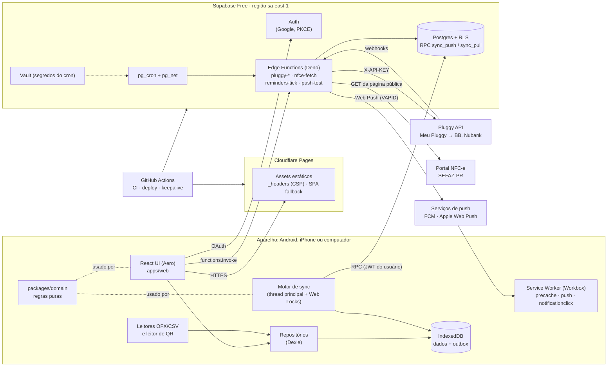
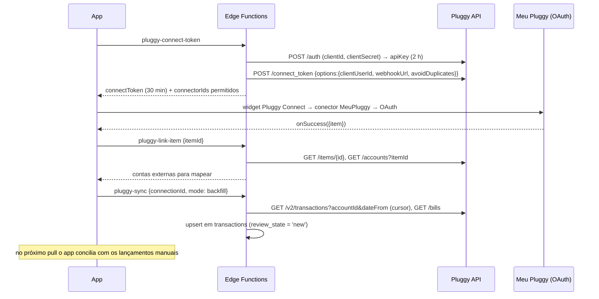

# 02 — Especificação Técnica · OakFinance (PWA de finanças pessoais)

*Versão 1.1 · 05/11/2026 · Autor: Arquitetura / Tech Lead · Base: `discovery-brief.md` v2 (seção 6, arquitetura escolhida)*
*App: **OakFinance**. Repositório: GitHub **público** **`silveiralh/oakfinance`** (branch padrão `main`). Identificadores técnicos usam `oakfinance`.*

**Histórico de versões**

| Versão | Data | Mudança |
|---|---|---|
| 1.0 | 05/11/2026 | Primeira versão |
| 1.1 | 05/11/2026 | Revisão de QA independente (`04-review.md`). **Repositório público**: minutos de CI deixam de ser restrição, bateria completa em todo PR (inclusive E2E `desktop`), regras de segredos e de dados reais, varredura de segredos e de dados pessoais no CI, proteção contra PR de fork (ADR-18). Compra no cartão no mês do vencimento confirmada (ADR-09). DDL: `cards.closing_day_rule`, `categories.feeds_reserve/is_system`, `category_rules.account_id` e `match_type 'token_prefix'`, `transactions.status 'cancelled'`, `count_before_received`, `invoice_pinned`, `source 'system'`, meio `food_voucher`, tabelas `month_closings` e `notices`, novos tipos de lembrete. Domínio alinhado às RN do PRD: selo de status do mês (`MonthStatus`, sem "céu"), VR/VA incluídos por padrão, resgates no disponível, conciliação determinística (RN-66 a RN-73), categorização por início de token (RN-57 a RN-63), sugestão da reserva (RN-52), parcelas (RN-21/RN-24), saldo credor (RN-15). Seeds iguais à RN-40/RN-64. Sync: backoff da RN-96, logout apaga dados locais (RN-100), histórico por 12 meses (RN-98). Lembretes: 20:00, silêncio 22:00–08:00 adiando para 08:00, central de avisos para todos os usuários |

---

## 0. Como usar este documento (leia antes de qualquer tarefa)

O desenvolvimento é feito por **sessões automáticas a cada 4 horas**. Cada sessão pega a próxima tarefa da cadeia e não tem memória das anteriores. **Não há revisão humana de PR**: o PR entra em `main` por *auto-merge* quando o CI passa. **O CI é o único portão de qualidade** (seção 8.6) e por isso é rígido. Cada sessão DEVE:

1. Ler `docs/TASKS.md` (a cadeia de tarefas e o status) e `docs/HANDOFF.md` (o que a sessão anterior deixou: estado, bloqueios, próximos passos). O acompanhamento de tarefas fica **só em documentos**, no repositório e no Projeto, e não em ferramentas como ClickUp ou Jira.
2. Ler este arquivo inteiro na primeira vez em que tocar uma área, e depois ao menos a seção da área e a seção 2 (convenções).
3. Tratar como **contrato** tudo que estiver marcado com **[CONTRATO]**: DDL, nomes de tabelas e colunas, assinaturas do domínio, payloads das Edge Functions e o protocolo de sync. Mudar um contrato exige um ADR novo na seção 1.3 e a atualização deste documento **no mesmo PR**.
4. Trabalhar em uma branch, rodar `pnpm verify` localmente, abrir PR com auto-merge habilitado e **não** fazer push direto em `main` (bloqueado pela proteção de branch).
5. Nunca enfraquecer o portão: é proibido apagar ou pular testes, baixar limiares de cobertura, adicionar `test.skip`/`.only`, editar *baselines* de snapshot ou de cobertura, ou mexer em `.github/workflows/**`, `biome.json`, `vitest.config.*` ou `playwright.config.ts` fora de uma tarefa que peça explicitamente isso (o CI verifica; seção 8.6, *job* `guard`).
6. Nunca criar contas, chaves ou recursos externos: isso fica na seção 9 e é feito pelo cliente. Se faltar uma variável, a sessão usa os mocks ou fixtures e registra a pendência em `docs/HANDOFF.md`.
7. Ao terminar, atualizar `docs/TASKS.md` (status da tarefa) e `docs/HANDOFF.md`. Registrar as decisões novas em `docs/DECISIONS.md` mencionando o ADR afetado. Se o CI falhar, a sessão corrige na mesma branch. Se não conseguir, deixa o PR aberto, marca a tarefa como `bloqueada` e descreve o motivo no HANDOFF. A próxima sessão começa pelas *issues* `regressão:` abertas, depois pelos PRs abertos e só então pela próxima tarefa da cadeia.
8. **Bootstrap**: as primeiras tarefas da cadeia criam o CI completo da seção 8.6 (inclusive o `guard` e a varredura de segredos e dados pessoais) antes de qualquer funcionalidade. O cliente ativa o ruleset de `main` (seção 9.1) logo depois disso. Até lá, nenhuma tarefa de funcionalidade é iniciada.
9. **O repositório é público.** Tudo o que a sessão escreve (código, testes, fixtures, `docs/*.md`, mensagens de commit, títulos e corpos de PR e issues, logs do CI) é visível para qualquer pessoa. Por isso a sessão **NÃO DEVE**: escrever segredos ou valores de variáveis privadas (tabela 9.8) em lugar nenhum do repositório; versionar arquivos reais dos usuários (OFX, CSV, páginas ou QR de NFC-e, respostas da Pluggy) nem trechos deles; escrever os e-mails da allowlist, nomes, CPF, números de conta ou de cartão; imprimir segredos ou dados de usuário em logs do CI (`echo`, `set -x`, artefatos). Fixtures são **anonimizadas** e ficam só em pastas `fixtures/` com um `README.md` que descreve a anonimização. E-mails de teste usam `@example.com` ou `@example.test`. Se uma tarefa precisar de um dado real (por exemplo, para descobrir o layout da NFC-e), a sessão registra a necessidade no HANDOFF e o cliente fornece o arquivo fora do repositório.

Legenda: **DEVE**, **NÃO DEVE** e **PODE** têm o sentido normativo usual. Valores monetários são sempre **centavos inteiros**. Datas de negócio são sempre `YYYY-MM-DD` no fuso `America/Sao_Paulo`.

---

## 1. Visão de arquitetura

### 1.1 Diagrama de componentes



### 1.2 Fluxos principais

**Lançamento offline e sincronização**

```mermaid
sequenceDiagram
  participant U as Usuário
  participant UI as UI
  participant D as Dexie (IndexedDB)
  participant S as Motor de sync
  participant P as Postgres (RPC)
  U->>UI: valor + categoria + meio
  UI->>D: transação Dexie: put(row) + outbox.add(mutação)
  UI-->>U: feedback imediato (check no botão + toast "Lançamento salvo.")
  Note over S: gatilhos: online, foco, timer, pós-escrita
  S->>S: navigator.locks.request('oakfinance-sync')
  S->>P: sync_push(device_id, lote ≤ 200)
  P-->>S: [{mutation_id, status: applied|stale|duplicate|rejected, row?}]
  S->>D: remove da outbox; aplica row do servidor nos "stale"
  S->>P: sync_pull(cursor, 500) (repete enquanto has_more)
  P-->>S: rows + next
  S->>D: bulkPut / remove tombstones; salva cursor
```

**Conexão Open Finance (Meu Pluggy)**



### 1.3 Decisões de arquitetura (ADRs curtos)

| ADR | Decisão | Alternativas descartadas e motivo |
|---|---|---|
| **ADR-01** SPA PWA | React 19 + Vite 8 + TypeScript, SPA estática, sem SSR | **Next.js/SSR**: exige servidor ou funções, sem ganho para um app privado e offline. **Expo/React Native**: duas lojas, conta Apple paga e prazo maior. **Flutter Web**: PWA pesado e acessibilidade pior. |
| **ADR-02** Offline-first próprio | Dexie é a fonte de dados da UI (`useLiveQuery`). Outbox e sync próprios via duas RPCs Postgres | **PowerSync / ElectricSQL / RxDB replication**: planos gratuitos limitados ou infraestrutura extra, e o volume (2 usuários) não justifica. **TanStack Query com cache persistido**: não resolve escrita offline com ordem e idempotência. **Supabase Realtime**: desnecessário, pois o pull por eventos de foco e rede basta. |
| **ADR-03** Backend | Supabase Free (Postgres + RLS + Auth + Edge Functions + pg_cron + Vault) | **Firebase**: modelo NoSQL ruim para relatórios e push no iOS depende do mesmo Web Push. **PocketBase auto-hospedado**: exige servidor 24/7. **Cloudflare D1 + Workers**: sem RLS nem Auth prontos. |
| **ADR-04** Hospedagem | Cloudflare Pages, com deploy por *Direct Upload* (`wrangler pages deploy`) a partir do GitHub Actions | **Vercel Hobby**: viável, mas Pages tem preview ilimitado e `_headers` nativo. **Workers Static Assets**: caminho que a Cloudflare tem incentivado (suporta `_headers`, SPA e previews); a migração é trivial se o Pages for descontinuado (ver riscos). **GitHub Pages**: sem headers customizados (CSP). |
| **ADR-05** Dinheiro | `bigint` de centavos no Postgres e `number` inteiro (`Number.isSafeInteger`) no TS, sempre positivo, com o sentido dado por `kind` | **`numeric`**: o cliente JS trataria como string ou float. **float**: erro de arredondamento. **Valor com sinal**: confunde receita e despesa nos agregados por faixa. |
| **ADR-06** IDs | UUID v7 gerado no cliente para entidades criadas pelo usuário. UUID v5 determinístico para entidades derivadas (fatura, parcela, ocorrência de recorrência, seeds) | **`serial`/identity**: impossível offline. **UUID v4**: sem ordenação temporal, o que piora índices e debug. v5 evita duplicar a mesma fatura ou parcela criada em dois aparelhos. |
| **ADR-07** Conflitos | Last-Writer-Wins por **linha**, ordenado por `client_updated_at` (relógio híbrido simples), com histórico completo em `app.row_history` | **CRDT / merge por campo**: complexidade desproporcional, já que cada pessoa usa principalmente um aparelho. **Servidor sempre vence**: perderia edições offline legítimas. |
| **ADR-08** Recorrência × parcela | Recorrências são **projetadas virtualmente** (só viram linha quando realizadas ou confirmadas). Parcelas são **materializadas** (uma linha por parcela, com id v5) | Materializar recorrências infinitas gera lixo e conflitos. Projetar parcelas impediria vê-las e editá-las em cada fatura. |
| **ADR-09** Fatura e mês orçamentário | A compra cai na fatura pela **data de fechamento**; a compra no dia do fechamento vai para a fatura seguinte por padrão (`cards.closing_day_rule = 'next'`, configurável por cartão para `'same'`, RN-09/RN-12). O mês orçamentário do cartão é configurável: `invoice_due_month` (padrão **confirmado pelo cliente em 05/11**: a compra conta no mês do vencimento da fatura) ou `purchase_month` | Um mês fixo pela data de compra contradiz a fórmula do discovery ("faturas que ainda vencem no mês"). |
| **ADR-10** Conciliação no cliente | O servidor só insere importados com `review_state='new'`. O domínio, no aparelho, concilia com os manuais (inclusive os ainda não sincronizados) | Conciliar no servidor duplicaria lançamentos manuais ainda na outbox. |
| **ADR-11** Open Finance | Pluggy via Meu Pluggy (gratuito para uso pessoal) atrás da interface `BankConnector`, trocável | **Belvo / outros**: pagos. **Open Finance direto**: exige ser instituição autorizada. **Scraping de banco**: frágil e contra termos. |
| **ADR-12** Push | Web Push padrão com VAPID próprio, enviado por Edge Function, payload no formato **Declarative Web Push** (com tratamento no SW para navegadores antigos) | **OneSignal / FCM SDK**: terceiros, telemetria e limites. Os dois navegadores-alvo já suportam Web Push padrão. |
| **ADR-13** Lint/format | **Biome 2** (lint + format), TypeScript **6.0.x** fixado para `tsc --noEmit` | **ESLint 10 + typescript-eslint**: hoje o typescript-eslint 8.72 exige `typescript <6.1`, o que impede o TS 7 nativo, e é mais lento. O TS 7.0 acabou de sair, então fica fixado no 6.0 até a cadeia de ferramentas estabilizar (reavaliar em 2027-Q1). |
| **ADR-14** Domínio compartilhado com Deno | `packages/domain` sem dependências além de `uuid`, com imports relativos **com extensão `.ts`**, copiado por script para `supabase/functions/_shared/domain` (o CI verifica que a cópia está em dia) | Importar de fora de `supabase/functions` é frágil no bundler das Edge Functions. Publicar um pacote é exagero para um único repositório. |
| **ADR-15** Ambientes | **Dois projetos Supabase Free**: `oakfinance-prod` e `oakfinance-staging` (o plano Free permite 2 ativos). Previews do Pages apontam para staging. Migrações em estilo *expand/contract* | Previews contra a produção arriscam corromper dados reais pelo sync. Branching do Supabase é recurso pago. |
| **ADR-16** Sem Storage nem Realtime do Supabase | Fotos da NFC-e não são guardadas (só os dados extraídos). Nada de Realtime | Economiza cota (1 GB), reduz superfície de privacidade e simplifica. |
| **ADR-17** Cadastro fechado | Auth Hook *Before User Created* recusa e-mails fora de `app.allowed_emails` | Sem isso, qualquer pessoa com a URL criaria conta e consumiria a cota. |
| **ADR-18** Repositório público | `silveiralh/oakfinance` é público (decisão do cliente, 05/11): minutos do GitHub Actions ilimitados, então a bateria completa roda em todo PR. Em troca: nenhum segredo nem dado real no repositório (seção 0, item 9), varredura de segredos (`gitleaks` + *secret scanning/push protection* do GitHub) e de dados pessoais no CI, workflows com segredos nunca rodam para PR de fork, auto-merge só para PRs de branches do próprio repositório | **Privado**: 2.000 min/mês não cobrem ~180 PRs/mês com a bateria completa. **Pagar minutos**: custo ≠ R$ 0. |

---

## 2. Repositório, convenções e qualidade

### 2.1 Estrutura (monorepo simples com pnpm workspaces)

```
oakfinance/
├─ apps/
│  └─ web/                          # PWA React
│     ├─ index.html
│     ├─ vite.config.ts             # vite-plugin-pwa (injectManifest), define __APP_VERSION__
│     ├─ playwright.config.ts
│     ├─ public/
│     │  ├─ _headers                # gerado no build a partir de _headers.template (CSP com a URL do Supabase)
│     │  ├─ _redirects              # "/* /index.html 200"
│     │  ├─ icons/                  # 192, 512, maskable-512, apple-touch-icon-180
│     │  └─ fonts/                  # fontes self-hosted (sem Google Fonts: offline + CSP)
│     ├─ src/
│     │  ├─ main.tsx
│     │  ├─ app/                    # router, providers, layout, guarda de auth, ErrorBoundary
│     │  ├─ features/               # uma pasta por feature (UI + hooks)
│     │  │  ├─ onboarding/          # login, instalação guiada, permissões, seeds
│     │  │  ├─ quick-entry/         # lançamento rápido (≤ 3 toques)
│     │  │  ├─ dashboard/           # "Quanto ainda posso gastar"
│     │  │  ├─ transactions/        # lista, edição, histórico do lançamento
│     │  │  ├─ accounts/  cards/  invoices/  installments/  recurrences/
│     │  │  ├─ categories/          # categorias + regras
│     │  │  ├─ budget/              # 50/30/20
│     │  │  ├─ reserve/             # reserva de emergência
│     │  │  ├─ inbox/               # revisão de importados e conciliação
│     │  │  ├─ imports/             # OFX/CSV
│     │  │  ├─ nfce/                # leitor de QR e foto
│     │  │  ├─ connections/         # Open Finance (Pluggy)
│     │  │  ├─ reminders/           # push e preferências de lembrete
│     │  │  └─ settings/            # privacidade (ocultar valores), tema, diagnóstico, exportar, excluir conta
│     │  ├─ components/ui/          # design system Aero (tokens, Glass, Button, Sheet…)
│     │  ├─ data/
│     │  │  ├─ db.ts                # schema Dexie (por usuário: oakfinance_<userId>)
│     │  │  ├─ repositories/        # save/delete com outbox, consultas
│     │  │  ├─ mappers.ts           # Row (snake_case) <-> domínio (camelCase)
│     │  │  ├─ schemas.ts           # zod das linhas sincronizadas
│     │  │  └─ sync/                # engine.ts, push.ts, pull.ts, outbox.ts, clock.ts, reconcile-runner.ts
│     │  ├─ lib/                    # supabase.ts, env.ts, format.ts, platform.ts, telemetry.ts
│     │  ├─ i18n/pt-BR.ts           # todas as strings de UI
│     │  ├─ sw/sw.ts                # Service Worker (Workbox injectManifest)
│     │  └─ styles/                 # tokens.css (claro/escuro), base.css
│     ├─ e2e/                       # Playwright (*.spec.ts) + fixtures/
│     └─ test/                      # Vitest de componentes e do data layer (fake-indexeddb)
├─ packages/
│  ├─ domain/                       # regras puras, sem I/O, sem relógio implícito
│  │  ├─ src/
│  │  │  ├─ index.ts  types.ts  money.ts  dates.ts  ids.ts
│  │  │  ├─ invoices.ts  installments.ts  recurrence.ts  ledger.ts
│  │  │  ├─ budget.ts  spendable.ts  reserve.ts
│  │  │  ├─ categorization.ts  defaults.ts
│  │  │  ├─ reconciliation.ts
│  │  │  ├─ imports/ofx.ts  imports/csv.ts
│  │  │  ├─ nfce/qr.ts
│  │  │  └─ notifications.ts       # cálculo dos lembretes devidos (usado pelo reminders-tick)
│  │  └─ test/                     # *.test.ts + fixtures/ (OFX do BB anonimizado, CSV Nubank)
│  └─ nfce-parser/                  # HTML da SEFAZ-PR → itens (depende só de linkedom)
│     ├─ src/index.ts  src/pr.ts
│     └─ test/fixtures/*.html       # páginas reais anonimizadas
├─ supabase/
│  ├─ config.toml                   # functions.*.verify_jwt, auth local, hooks
│  ├─ migrations/                   # 2026110500000N_*.sql (ordem da seção 3)
│  ├─ seed.sql                      # só ambiente local/CI: allowed_emails de teste (@example.test), vault de teste; NUNCA e-mails reais
│  ├─ tests/database/*.test.sql     # pgTAP (RLS, sync, triggers)
│  └─ functions/
│     ├─ deno.json                  # import map (npm:linkedom, jsr:@negrel/webpush, npm:@supabase/supabase-js…)
│     ├─ _shared/                   # http.ts (CORS/erros), pluggy.ts, push.ts, db.ts, auth.ts
│     │  ├─ domain/                 # CÓPIA GERADA de packages/domain/src (não editar)
│     │  └─ nfce/                   # CÓPIA GERADA de packages/nfce-parser/src (não editar)
│     ├─ pluggy-connect-token/  pluggy-link-item/  pluggy-sync/  pluggy-webhook/  pluggy-disconnect/
│     ├─ nfce-fetch/
│     ├─ reminders-tick/
│     ├─ push-test/
│     └─ account-delete/
├─ scripts/
│  ├─ vendor-shared.ts              # copia domain e nfce-parser para supabase/functions/_shared
│  ├─ gen-db-types.sh               # supabase gen types typescript --local > apps/web/src/data/db-types.ts
│  ├─ gen-headers.ts                # _headers.template → public/_headers
│  └─ vapid-from-base64url.ts       # utilitário de conversão (não gera chaves de produção)
├─ docs/
│  ├─ specs/                        # este documento e os demais specs
│  ├─ TASKS.md                      # cadeia de tarefas: id, título, dependências, aceite, status
│  ├─ HANDOFF.md                    # passagem entre sessões automáticas + checklist de aparelho real
│  └─ DECISIONS.md                  # log cronológico de decisões (aponta para os ADRs)
├─ coverage-baseline.json           # limiares mínimos por pacote (só sobem; job guard)
├─ .github/workflows/               # ci.yml, db.yml, e2e.yml, deploy.yml, keepalive.yml
├─ biome.json  lefthook.yml  commitlint.config.ts  tsconfig.base.json
├─ package.json  pnpm-workspace.yaml  .nvmrc (24)  .node-version
└─ README.md
```

### 2.2 Versões de referência (novembro de 2026)

Fixar versões exatas no `package.json`, com o lockfile versionado. As versões abaixo eram as `latest` do npm em 05/11/2026. Atualizações passam pelo Dependabot, com PRs agrupados por semana.

| Pacote | Versão | Uso / observação |
|---|---|---|
| Node.js | 24 LTS | `engines` e `.nvmrc` (Vitest 5 exige Node ≥ 22.12) |
| pnpm | 10.x ou superior (o que o `packageManager` fixar) | workspaces |
| react / react-dom | 19.3.x | |
| vite | 8.3.x | `@vitejs/plugin-react` 6.2.x |
| typescript | **6.0.3** (fixado, ADR-13) | `tsc --noEmit -p` em cada pacote |
| vite-plugin-pwa | 2.0.0 | peer: vite ^8, workbox-build/window ^7.4.1. Usar `strategies: 'injectManifest'` |
| workbox-window / workbox-* | 7.4.x | |
| dexie / dexie-react-hooks | 4.4.7 / 4.4.0 | |
| uuid | 14.x | `v7()` e `v5()` (única dependência de runtime do domínio) |
| @supabase/supabase-js | 2.119.x | cliente web e Edge Functions (`npm:`) |
| @supabase/server | 1.9.x | `withSupabase({ auth })` nas Edge Functions |
| supabase (CLI) | 3.0.x | `supabase start`, `db push`, `functions deploy`, `test db` |
| react-router | 8.x (modo SPA, `createBrowserRouter`) | conferir a API na documentação da versão instalada |
| zod | 4.x | validação das linhas sincronizadas e dos payloads |
| tailwindcss | 4.3.x | tokens Aero em CSS variables |
| papaparse | 5.7.x | tokenização de CSV (o mapeamento fica no domínio) |
| barcode-detector | 3.2.x | ponyfill de `BarcodeDetector` (zxing-wasm) para iOS. O `.wasm` vai self-hosted e no precache |
| react-pluggy-connect | 2.12.x | widget Pluggy Connect (lazy-loaded) |
| linkedom | 0.18.x | DOM para o parser da NFC-e (Node e Deno) |
| @negrel/webpush (JSR) | 0.5.0 | Web Push em Deno com WebCrypto. Plano B: `npm:web-push@3.6.7` |
| vitest / @vitest/coverage-v8 | 5.1.x | |
| fake-indexeddb | 6.2.x | testes do data layer |
| @playwright/test | 1.64.x | E2E |
| @axe-core/playwright | 4.14.x | acessibilidade |
| fast-check | atual | testes de propriedade do domínio |
| @biomejs/biome | 2.6.x | lint + format |
| lefthook / @commitlint/cli | 2.2.x / 21.x | hooks e mensagens de commit |
| wrangler | 4.x | `pages deploy` no CI |

### 2.3 Convenções de código

- **TypeScript**: `strict`, `noUncheckedIndexedAccess`, `exactOptionalPropertyTypes`, `noImplicitOverride`, `verbatimModuleSyntax`, `allowImportingTsExtensions` (só no domínio e no nfce-parser, que importam com `.ts` para rodar no Deno).
- **Nomes**: arquivos em `kebab-case.ts`, componentes em `PascalCase.tsx`, colunas e tabelas SQL em `snake_case`, tipos de domínio em `camelCase`. A conversão fica só em `data/mappers.ts`.
- **Dinheiro**: tipo `Cents` (alias de `number`, validado). `parseFloat`, `toFixed` e `Number(...)` sobre texto monetário são **proibidos** fora de `money.ts` (o CI verifica com grep, ver 8.6). Exibição só via `formatBRL()`.
- **Datas**: `ISODate = 'YYYY-MM-DD'` e `YearMonth = 'YYYY-MM'` como strings. **Proibido** `new Date('YYYY-MM-DD')` (é interpretado em UTC). "Hoje" é sempre obtido na borda com `todayIn('America/Sao_Paulo', now)` e passado ao domínio como parâmetro.
- **Domínio puro**: sem `Date.now()`, `Math.random()`, `fetch` ou acesso a armazenamento. Relógio e IDs entram por parâmetro (`ctx: { today, newId }`).
- **UI**: as strings ficam em `i18n/pt-BR.ts` e os componentes não têm texto literal. Acessibilidade WCAG AA: alvos de toque ≥ 44 px, `prefers-reduced-motion` respeitado, receita e despesa diferenciadas também por ícone e sinal (não só por cor).
- **Erros**: as funções de I/O retornam `Result<T, AppError>` (união discriminada). Exceções só para bug. `AppError.code` é estável (ex.: `SYNC_STALE`, `PLUGGY_ITEM_LOGIN_ERROR`, `NFCE_PARSE_FAILED`).
- **Imports**: não pode haver ciclos entre features. `features/*` pode importar `data/`, `components/`, `lib/` e `@oakfinance/domain`. `data/` nunca importa `features/`.
- **Comentários e documentação** em pt-BR. Identificadores em inglês.

### 2.4 Lint, formatação e scripts

`biome.json`: indentação de 2 espaços, `lineWidth` 100, aspas simples, ponto e vírgula sempre, `organizeImports` ligado, regras `recommended` mais `noExplicitAny: error`, `noNonNullAssertion: warn` e `useExhaustiveDependencies: error`.

Scripts na raiz (`package.json`):

| Script | Faz |
|---|---|
| `pnpm dev` | `supabase start` (se não estiver rodando) + `vite` |
| `pnpm lint` | `biome ci .` |
| `pnpm typecheck` | `tsc --noEmit` em todos os pacotes + `deno check supabase/functions/**/index.ts` |
| `pnpm test` | `vitest run` (domain, nfce-parser, web) com cobertura |
| `pnpm test:db` | `supabase db reset && supabase test db` |
| `pnpm test:fn` | `deno test -A supabase/functions` |
| `pnpm e2e` | `playwright test` (sobe `vite preview` + Supabase local) |
| `pnpm vendor` | `scripts/vendor-shared.ts` (o CI falha se `git diff` mostrar mudança) |
| `pnpm verify` | `lint && typecheck && vendor --check && test && build` |
| `pnpm db:types` | regenera `db-types.ts` |

### 2.5 Commits, branches e PRs

- **Conventional Commits**, com descrição em pt-BR no imperativo: `feat(domain): atribui compra à fatura pela data de fechamento`.
  Escopos: `web`, `domain`, `nfce`, `db`, `sync`, `fn`, `pluggy`, `push`, `ci`, `docs`, `deps`.
- Hooks (lefthook): `pre-commit` roda `biome check --write` nos arquivos staged. `commit-msg` roda o commitlint.
- Branch por tarefa: `feat/<id-tarefa>-<slug>`, `fix/…`, `chore/…`. PR pequeno (idealmente ≤ 400 linhas úteis), *squash merge*, título = mensagem de commit (o commitlint valida o título do PR).
- **Auto-merge**: a sessão abre o PR com `gh pr create` e roda `gh pr merge --auto --squash --delete-branch`. O GitHub só faz o merge quando **todos** os *required checks* da seção 8.6 passam. Não há revisão humana, então o portão é o CI.
- Proteção de `main` (configurada pelo cliente, seção 9): PR obrigatório, *required status checks* (`guard`, `secrets`, `lint-types`, `unit`, `db`, `fn`, `e2e`, `build`), branch atualizada antes do merge (*require up to date*), histórico linear, sem force-push e sem bypass.
- Corpo do PR (template `.github/pull_request_template.md`): tarefa (`T-xxx` de `docs/TASKS.md`), o que mudou, contrato alterado (sim/não → ADR), migração *expand/contract* respeitada, testes adicionados (lista) e verificação manual pendente em aparelho real (vai para `docs/HANDOFF.md`, seção "checklist de aparelho").
- **Uma tarefa por PR.** Cada tarefa de `docs/TASKS.md` traz critério de aceite e os testes que a provam. A tarefa só é marcada `concluída` depois do merge.
- Reversão: se uma regressão chegar a `main` (o `deploy` de produção falhou ou o E2E noturno ficou vermelho), a próxima sessão abre primeiro um PR `revert:` do commit culpado e só depois retoma a cadeia.
- Versão do app: `__APP_VERSION__ = <AAAA.MM.DD>+<sha curto>` injetado pelo Vite e exibido em Configurações → Diagnóstico.


---

## 3. Modelo de dados [CONTRATO]

### 3.0 Correspondência com o PRD (`01-prd-backlog.md` §3)

O PRD usa nomes de negócio em português; o banco e o código usam os nomes abaixo. Testes que citam `RN-xx` usam estes nomes técnicos.

| PRD | Técnica | Observação |
|---|---|---|
| `config_usuario` | `profiles.settings` (`ProfileSettings`, 5.11) + `budgets` (percentuais) + `reminders` (horários) + `profiles.onboarding` | `modo_calculo` caixa/competência = `spendable.cardAttribution` `invoice_due_month`/`purchase_month`; `considerar_beneficios` = `spendable.includeRestrictedAccounts`; silêncio = `quietHours` |
| `conta` (tipo `cartao`) | `accounts` + `cards` | Cartão não é linha de `accounts`; `beneficio` VR/VA = `accounts.type` `meal_voucher`/`food_voucher` com `is_restricted` |
| `cartao.regra_dia_fechamento` `proxima`/`atual` | `cards.closing_day_rule` `next`/`same` | |
| `fatura` (competência = mês do vencimento) | `invoices.reference_month` | Status calculado (`invoiceStatus`, 5.2) |
| `categoria.faixa`, `alimenta_reserva`, `sistema` | `categories.bucket`, `feeds_reserve`, `is_system` | "A classificar" = slug `a-classificar`; "Saldo credor da fatura anterior" = slug `saldo-credor` (ambas `bucket='none'`, `is_system`) |
| `categoria.limite_mensal_centavos` | `budgets` com `scope='category'` | |
| `lancamento` | `transactions` | `despesa`=`expense`, `receita`=`income`, `transferencia`=`transfer` com `counterpart_account_id`, `pagamento_fatura`=`transfer` com `counterpart_card_id` + `invoice_id`, `estorno`=`refund`, `resgate_reserva`=`income` com `goal_id` (não entra na Base) |
| `status` `efetivada`/`prevista`/`cancelada` | `status` `posted`/`pending`/`cancelled` + derivação | "Prevista/agendada" é **derivada**: `occurred_on > hoje`, parcela em fatura `open`/`future`, ou ocorrência projetada (ADR-08). `pending` = autorizada e não compensada (Pluggy), conta como efetivada. `cancelled` não entra em cálculo e continua visível |
| `contar_antes` (receita variável) | `income_expected` (ainda não caiu) + `count_before_received` | Recebida: `income_expected=false`. A receber: `true`/`false`. Prevista: `true`/`true` |
| `fatura_fixada` | `transactions.invoice_pinned` | |
| `revisado`, estados de `transacao_externa` | `review_state` | `new` = não revisado (conta); `suggested` = `pendente_decisao` (**não conta**); `merged` = `conciliada`/`duplicada` (o importado não conta, o manual conta); `ignored` = `ignorada`; `ok` = revisado |
| `transacao_externa` | linhas importadas de `transactions` (`source` ≠ `manual`) | O importado conciliado fica com `review_state='merged'` e `duplicate_of` |
| `serie_parcelas` | `installment_plans` | |
| `recorrencia.confirmacao_automatica`, `termo_conciliacao` | `recurrences.auto_post`, `recurrences.match_pattern` | |
| `regra_categorizacao` | `category_rules` | `seed`=`default`, `aprendida`=`learned`, `manual`=`manual`; `acertos`=`hits`, `ultimo_uso`=`last_hit_at` |
| `reserva` | `goals` (`kind='emergency_reserve'`) | `meta_manual` = `target_mode='manual'`; `saldo_inicial` = `initial_saved_cents`; `meta_atingida_em` = `achieved_at` |
| `nfce` | `nfce_receipts` + `receipt_items` | `estado_leitura` `completa`/`parcial` = `parse_status` `full`/`fallback` (`pending` = aguardando rede) |
| `push_subscription`, `notificacao_log` | `push_subscriptions`, `notification_outbox` (`dedupe_key`) | |
| `aviso` (central) | `notices` | Sincronizada; gerada pelo `reminders-tick` e pelo aparelho |
| `mes_fechado` | `month_closings` | |
| `lancamento_historico` | `app.row_history` (+ RPC `get_row_history`) | Retenção 12 meses |
| `evento_uso` | `app.app_events` com `code` `usage.*` | Retenção 180 dias para `usage.*` |

### 3.1 Princípios

- **Um usuário, um universo.** Toda linha de negócio tem `user_id`. As FKs entre tabelas de negócio são **compostas** `(user_id, x_id) → (user_id, id)`, o que impede no banco que um usuário referencie a linha de outro mesmo conhecendo o UUID (a checagem de FK ignora RLS, por isso a FK composta é necessária).
- **Colunas de auditoria e sync** em toda tabela sincronizada:
  `id uuid` (gerado no cliente), `user_id`, `created_at`, `updated_at` (do servidor), `client_updated_at` (relógio híbrido do aparelho, usado no LWW), `deleted_at` (soft delete), `server_version bigint` (sequência global, cursor de pull) e `device_id`.
- **Enumerações como `text` + `check`** (mais fáceis de evoluir que `enum` em migrações *expand/contract*).
- **Centavos `bigint` positivos**. O sentido vem de `kind`.
- **Exclusão** é sempre `deleted_at` vindo do cliente. A remoção física é só do job de expurgo (3.7), após 90 dias.
- Migrações em `supabase/migrations/`, na ordem `…01_base`, `…02_core`, `…03_integrations`, `…04_sync`, `…05_rls`, `…06_auth`, `…07_cron`. Uma migração nunca é editada depois de mergeada: corrige-se com uma migração nova.
- **Validação deste DDL (05/11/2026):** os blocos SQL deste documento foram aplicados em ordem num Postgres 16, com stubs de `auth`, `vault`, `net` e `cron` e com as funções auxiliares de 4.7. Também foram exercitados: `sync_push` (ordem pai→filho, `duplicate`, `stale`, LWW com `row_history`, `TABLE_NOT_WRITABLE`, `check` violado, linha alheia → `FOREIGN_ROW`, FK composta entre usuários → `23503`), `sync_pull` (paginação e `has_more`), RLS entre dois usuários e `app.purge()` (horizonte). A primeira tarefa de banco DEVE transformar esses cenários em pgTAP (8.3) e confirmar no Supabase local (Postgres 15/17).

### 3.2 Migração 01 — base

```sql
-- 20261105000001_base.sql
create schema if not exists app;                       -- interno (não exposto pelo PostgREST)
create extension if not exists pg_cron with schema pg_catalog;
create extension if not exists pg_net  with schema extensions;
-- supabase_vault já vem instalado no Supabase

create sequence if not exists app.sync_version_seq as bigint;

grant usage on schema app to authenticated, service_role;

-- Configuração do sync (linha única)
create table app.sync_config (
  id boolean primary key default true check (id),
  purge_horizon_version bigint not null default 0,   -- clientes com cursor menor precisam de reset
  tombstone_retention interval not null default interval '90 days'
);
insert into app.sync_config default values;

-- Registro das tabelas sincronizadas
create table app.sync_tables (
  table_name      text primary key,
  client_writable boolean not null,                  -- aceita escrita via sync_push
  push_order      int not null                       -- pais antes de filhos (FKs)
);
```

### 3.3 Migração 02 — núcleo

```sql
-- 20261105000002_core.sql
-- Macro mental: toda tabela abaixo termina com o bloco "AUDIT" que se repete literalmente:
--   created_at timestamptz not null default now(),
--   updated_at timestamptz not null default now(),
--   client_updated_at timestamptz not null default now(),
--   deleted_at timestamptz,
--   server_version bigint not null default 0,
--   device_id text,
--   unique (user_id, id)

create table public.profiles (
  id            uuid primary key references auth.users(id) on delete cascade,
  user_id       uuid not null references auth.users(id) on delete cascade check (user_id = id),
  display_name  text,
  timezone      text not null default 'America/Sao_Paulo',
  -- preferências versionadas junto com o perfil (ver tipo ProfileSettings em 5.10)
  settings      jsonb not null default '{}'::jsonb,
  onboarding    jsonb not null default '{}'::jsonb,   -- passos concluídos (instalação, push, seeds)
  created_at timestamptz not null default now(), updated_at timestamptz not null default now(),
  client_updated_at timestamptz not null default now(), deleted_at timestamptz,
  server_version bigint not null default 0, device_id text,
  unique (user_id, id)
);

create table public.accounts (
  id            uuid primary key,
  user_id       uuid not null default auth.uid() references auth.users(id) on delete cascade,
  name          text not null check (char_length(name) between 1 and 60),
  type          text not null check (type in ('checking','savings','cash','meal_voucher','food_voucher','investment','other')),
  institution   text,                                  -- 'bb' | 'nubank' | texto livre
  initial_balance_cents bigint not null default 0,     -- único campo monetário que pode ser negativo (cheque especial)
  initial_balance_on    date not null default current_date,
  is_restricted boolean not null default false,        -- VR/VA: saldo carimbado
  include_in_spendable boolean not null default true,
  color text, icon text,
  sort_order    int not null default 0,
  archived_at   timestamptz,
  created_at timestamptz not null default now(), updated_at timestamptz not null default now(),
  client_updated_at timestamptz not null default now(), deleted_at timestamptz,
  server_version bigint not null default 0, device_id text,
  unique (user_id, id)
);

create table public.cards (
  id            uuid primary key,
  user_id       uuid not null default auth.uid() references auth.users(id) on delete cascade,
  name          text not null check (char_length(name) between 1 and 60),
  institution   text,
  brand         text,
  last4         text check (last4 ~ '^\d{4}$'),        -- nunca o número completo
  limit_cents   bigint check (limit_cents >= 0),
  closing_day   smallint not null check (closing_day between 1 and 31),
  due_day       smallint not null check (due_day between 1 and 31),
  closing_day_rule text not null default 'next' check (closing_day_rule in ('next','same')), -- compra NO dia do fechamento: próxima fatura (padrão) ou a que fecha (RN-09)
  payment_account_id uuid,                             -- conta que paga a fatura (padrão)
  color text, icon text,
  sort_order    int not null default 0,
  archived_at   timestamptz,
  created_at timestamptz not null default now(), updated_at timestamptz not null default now(),
  client_updated_at timestamptz not null default now(), deleted_at timestamptz,
  server_version bigint not null default 0, device_id text,
  unique (user_id, id),
  foreign key (user_id, payment_account_id) references public.accounts (user_id, id)
);

-- id = uuidv5(NS_INVOICE, card_id || ':' || 'YYYY-MM' do vencimento)  (ver ids.ts)
create table public.invoices (
  id               uuid primary key,
  user_id          uuid not null default auth.uid() references auth.users(id) on delete cascade,
  card_id          uuid not null,
  reference_month  date not null check (extract(day from reference_month) = 1),  -- mês do VENCIMENTO
  closing_date     date not null,
  due_date         date not null,
  is_manual_dates  boolean not null default false,     -- usuário ajustou fechamento ou vencimento
  external_bill_id text,                               -- Pluggy bill.id
  external_total_cents       bigint,
  external_min_payment_cents bigint,
  notes            text,
  created_at timestamptz not null default now(), updated_at timestamptz not null default now(),
  client_updated_at timestamptz not null default now(), deleted_at timestamptz,
  server_version bigint not null default 0, device_id text,
  unique (user_id, id),
  check (closing_date < due_date),
  foreign key (user_id, card_id) references public.cards (user_id, id)
);
create unique index invoices_card_month_uq on public.invoices (user_id, card_id, reference_month) where deleted_at is null;

create table public.categories (
  id          uuid primary key,                        -- seeds: uuidv5(NS_CATEGORY, user_id || ':' || slug)
  user_id     uuid not null default auth.uid() references auth.users(id) on delete cascade,
  name        text not null check (char_length(name) between 1 and 40),
  slug        text,                                    -- só nas padrão (ex.: 'mercado')
  parent_id   uuid,
  kind        text not null check (kind in ('expense','income','transfer')),
  bucket      text not null check (bucket in ('needs','wants','savings','income','transfer','none')),
  icon text, color text,
  is_default  boolean not null default false,
  is_system   boolean not null default false,          -- "A classificar", "Saldo credor": não editável nem excluível (RN-40)
  feeds_reserve boolean not null default false check (not feeds_reserve or bucket = 'savings'), -- RN-54
  name_ci     text generated always as (lower(name)) stored,
  sort_order  int not null default 0,
  archived_at timestamptz,
  created_at timestamptz not null default now(), updated_at timestamptz not null default now(),
  client_updated_at timestamptz not null default now(), deleted_at timestamptz,
  server_version bigint not null default 0, device_id text,
  unique (user_id, id),
  foreign key (user_id, parent_id) references public.categories (user_id, id),
  check ((kind = 'income') = (bucket = 'income')),
  check ((kind = 'transfer') = (bucket = 'transfer'))
);
create unique index categories_slug_uq on public.categories (user_id, slug) where slug is not null and deleted_at is null;
-- parent_id existe para evolução, mas NÃO é usado no MVP (subcategorias são não-objetivo do PRD 1.3)

create table public.category_rules (
  id           uuid primary key,
  user_id      uuid not null default auth.uid() references auth.users(id) on delete cascade,
  match_field  text not null default 'description' check (match_field in ('description','merchant_cnpj')),
  match_type   text not null default 'token_prefix' check (match_type in ('token_prefix','contains','starts_with','equals','regex')), -- token_prefix = RN-59
  pattern      text not null check (char_length(pattern) between 2 and 80), -- já normalizado (normalizeDescription)
  category_id  uuid not null,
  account_id   uuid,                                   -- regra restrita a uma conta (RN-59/RN-60)
  card_id      uuid,                                   -- ou a um cartão
  payment_method text,                                 -- regra opcionalmente restrita a um meio
  source       text not null check (source in ('default','learned','manual')),
  priority     int not null default 0,
  hits         int not null default 0,
  last_hit_at  timestamptz,
  enabled      boolean not null default true,
  created_at timestamptz not null default now(), updated_at timestamptz not null default now(),
  client_updated_at timestamptz not null default now(), deleted_at timestamptz,
  server_version bigint not null default 0, device_id text,
  unique (user_id, id),
  check (num_nonnulls(account_id, card_id) <= 1),
  foreign key (user_id, category_id) references public.categories (user_id, id),
  foreign key (user_id, account_id) references public.accounts (user_id, id),
  foreign key (user_id, card_id) references public.cards (user_id, id)
);
create unique index category_rules_uq on public.category_rules (user_id, match_field, match_type, pattern,
  coalesce(account_id, card_id, '00000000-0000-0000-0000-000000000000'::uuid))
  where deleted_at is null;

-- Série de parcelas (a compra parcelada). As parcelas são linhas de transactions.
create table public.installment_plans (
  id                 uuid primary key,
  user_id            uuid not null default auth.uid() references auth.users(id) on delete cascade,
  description        text not null check (char_length(description) between 1 and 120),
  card_id            uuid,                             -- parcelado no cartão (caso normal)
  account_id         uuid,                             -- carnê/boleto parcelado (sem fatura)
  purchase_date      date not null,
  first_due_on       date,                             -- só para account_id
  total_cents        bigint not null check (total_cents > 0),
  installments_count smallint not null check (installments_count between 2 and 48),
  first_installment_cents bigint check (first_installment_cents > 0), -- quando o banco arredonda diferente
  start_installment  smallint not null default 1 check (start_installment >= 1), -- compra já em andamento
  category_id        uuid,
  payment_method     text not null default 'credit',
  source             text not null default 'manual' check (source in ('manual','pluggy','ofx','csv')),
  created_at timestamptz not null default now(), updated_at timestamptz not null default now(),
  client_updated_at timestamptz not null default now(), deleted_at timestamptz,
  server_version bigint not null default 0, device_id text,
  unique (user_id, id),
  check (num_nonnulls(card_id, account_id) = 1),
  check (account_id is null or first_due_on is not null),
  check (start_installment <= installments_count),
  foreign key (user_id, card_id) references public.cards (user_id, id),
  foreign key (user_id, account_id) references public.accounts (user_id, id),
  foreign key (user_id, category_id) references public.categories (user_id, id) on delete set null (category_id)
);

create table public.recurrences (
  id               uuid primary key,
  user_id          uuid not null default auth.uid() references auth.users(id) on delete cascade,
  kind             text not null check (kind in ('expense','income')),
  description      text not null check (char_length(description) between 1 and 120),
  amount_cents     bigint not null check (amount_cents > 0),
  is_variable_amount boolean not null default false,   -- valor estimado (ex.: conta de luz)
  category_id      uuid,
  account_id       uuid,
  card_id          uuid,
  payment_method   text not null check (payment_method in ('pix','debit','credit','cash','meal_voucher','food_voucher','transfer','boleto','auto_debit','other')),
  frequency        text not null check (frequency in ('monthly','weekly','yearly')),  -- a UI do MVP expõe só monthly/yearly (RN-26)
  match_pattern    text,                               -- termo de conciliação (RN-70), preenchido na 1ª conciliação manual
  interval_count   smallint not null default 1 check (interval_count between 1 and 12),
  day_of_month     smallint check (day_of_month between 1 and 31),
  weekday          smallint check (weekday between 0 and 6),     -- 0 = domingo
  month_of_year    smallint check (month_of_year between 1 and 12),
  start_on         date not null,
  end_on           date,
  max_occurrences  int check (max_occurrences > 0),
  is_fixed_income  boolean not null default false,     -- salário: entra no "Disponível para gastar" desde o 1º dia
  auto_post        boolean not null default false,     -- vira lançamento sozinho no dia; a UI liga por padrão quando card_id não é nulo (RN-26)
  remind           boolean not null default true,
  paused_at        timestamptz,
  created_at timestamptz not null default now(), updated_at timestamptz not null default now(),
  client_updated_at timestamptz not null default now(), deleted_at timestamptz,
  server_version bigint not null default 0, device_id text,
  unique (user_id, id),
  check (num_nonnulls(account_id, card_id) = 1),
  check (frequency <> 'monthly' or day_of_month is not null),
  check (frequency <> 'weekly'  or weekday is not null),
  check (frequency <> 'yearly'  or (day_of_month is not null and month_of_year is not null)),
  check (end_on is null or end_on >= start_on),
  check (not is_fixed_income or kind = 'income'),
  foreign key (user_id, account_id)  references public.accounts (user_id, id),
  foreign key (user_id, card_id)     references public.cards (user_id, id),
  foreign key (user_id, category_id) references public.categories (user_id, id) on delete set null (category_id)
);

create table public.budgets (
  id            uuid primary key,
  user_id       uuid not null default auth.uid() references auth.users(id) on delete cascade,
  month         date check (month is null or extract(day from month) = 1),   -- null = padrão de todos os meses
  scope         text not null check (scope in ('bucket','category')),
  bucket        text check (bucket in ('needs','wants','savings')),
  category_id   uuid,
  pct_bp        int check (pct_bp between 0 and 10000),   -- basis points: 5000 = 50%
  limit_cents   bigint check (limit_cents >= 0),
  alert_thresholds_bp int[] not null default '{8000,10000}',
  created_at timestamptz not null default now(), updated_at timestamptz not null default now(),
  client_updated_at timestamptz not null default now(), deleted_at timestamptz,
  server_version bigint not null default 0, device_id text,
  unique (user_id, id),
  check (
    (scope = 'bucket'   and bucket is not null and category_id is null and pct_bp is not null)
 or (scope = 'category' and category_id is not null and bucket is null and limit_cents is not null)),
  foreign key (user_id, category_id) references public.categories (user_id, id)
);
create unique index budgets_uq on public.budgets
  (user_id, coalesce(month, date '1900-01-01'), scope, coalesce(bucket, ''),
   coalesce(category_id, '00000000-0000-0000-0000-000000000000'::uuid))
  where deleted_at is null;

create table public.goals (
  id                   uuid primary key,              -- reserva: uuidv5(NS_GOAL, user_id || ':emergency')
  user_id              uuid not null default auth.uid() references auth.users(id) on delete cascade,
  kind                 text not null check (kind in ('emergency_reserve','custom')),
  name                 text not null,
  target_mode          text not null default 'auto' check (target_mode in ('auto','manual')),
  target_cents         bigint check (target_cents >= 0),        -- obrigatório quando manual
  auto_factor          smallint not null default 6 check (auto_factor between 1 and 24),
  auto_lookback_months smallint not null default 6 check (auto_lookback_months between 1 and 24),
  account_id           uuid,                          -- onde o dinheiro fica guardado (opcional)
  initial_saved_cents  bigint not null default 0 check (initial_saved_cents >= 0),
  achieved_at          timestamptz,
  created_at timestamptz not null default now(), updated_at timestamptz not null default now(),
  client_updated_at timestamptz not null default now(), deleted_at timestamptz,
  server_version bigint not null default 0, device_id text,
  unique (user_id, id),
  check (target_mode = 'auto' or target_cents is not null),
  foreign key (user_id, account_id) references public.accounts (user_id, id)
);
create unique index goals_one_reserve_uq on public.goals (user_id) where kind = 'emergency_reserve' and deleted_at is null;

create table public.imports (
  id            uuid primary key,
  user_id       uuid not null default auth.uid() references auth.users(id) on delete cascade,
  source        text not null check (source in ('ofx','csv','nfce','pluggy')),
  file_name     text,
  file_sha256   text check (file_sha256 ~ '^[0-9a-f]{64}$'),
  csv_profile   text,                                  -- id do CsvProfile usado
  account_id    uuid,
  card_id       uuid,
  status        text not null check (status in ('parsed','committed','failed','reverted')),
  period_start  date, period_end date,
  stats         jsonb not null default '{}'::jsonb,    -- {total,new,duplicates,autoMerged,suggested}
  error         text,
  created_at timestamptz not null default now(), updated_at timestamptz not null default now(),
  client_updated_at timestamptz not null default now(), deleted_at timestamptz,
  server_version bigint not null default 0, device_id text,
  unique (user_id, id),
  foreign key (user_id, account_id) references public.accounts (user_id, id),
  foreign key (user_id, card_id) references public.cards (user_id, id)
);
create unique index imports_file_uq on public.imports (user_id, file_sha256)
  where file_sha256 is not null and deleted_at is null and status <> 'reverted';

create table public.nfce_receipts (
  id             uuid primary key,
  user_id        uuid not null default auth.uid() references auth.users(id) on delete cascade,
  access_key     char(44) not null check (access_key ~ '^\d{44}$'),
  qr_url         text not null,
  uf             char(2) not null,                     -- '41' = PR
  qr_version     smallint not null check (qr_version in (2,3)),
  issuer_cnpj    char(14) not null,
  issuer_name    text,
  issued_on      date,                                 -- data completa (página) ou 1º dia do AAMM (fallback)
  total_cents    bigint check (total_cents >= 0),
  discount_cents bigint check (discount_cents >= 0),
  items_count    int,
  parse_status   text not null check (parse_status in ('pending','full','fallback','failed')),
  parser_version text,
  fetched_at     timestamptz,
  error_code     text,
  created_at timestamptz not null default now(), updated_at timestamptz not null default now(),
  client_updated_at timestamptz not null default now(), deleted_at timestamptz,
  server_version bigint not null default 0, device_id text,
  unique (user_id, id)
);
create unique index nfce_receipts_key_uq on public.nfce_receipts (user_id, access_key) where deleted_at is null;

create table public.transactions (
  id              uuid primary key,
  user_id         uuid not null default auth.uid() references auth.users(id) on delete cascade,
  kind            text not null check (kind in ('expense','income','transfer','refund','adjust_in','adjust_out')),
  status          text not null default 'posted' check (status in ('posted','pending','cancelled')),
                  -- pending = autorizado, não compensado (Pluggy; conta como efetivado)
                  -- cancelled = "cancelada" do PRD: ocorrência pulada, receita "não recebi", parcelas restantes canceladas; fora de todo cálculo, visível no histórico
                  -- "prevista/agendada" NÃO é status: é derivada (ver 3.0)
  amount_cents    bigint not null check (amount_cents > 0),
  occurred_on     date not null,                       -- data da compra/recebimento (fuso do usuário)
  occurred_at     timestamptz,                         -- hora, quando conhecida
  description     text check (char_length(description) <= 200),
  description_raw text,                                -- como veio da fonte (importados)
  notes           text check (char_length(notes) <= 1000),
  category_id     uuid,
  category_source text not null default 'manual' check (category_source in ('manual','rule','provider','default','none')),
  category_rule_id uuid,
  payment_method  text not null check (payment_method in ('pix','debit','credit','cash','meal_voucher','food_voucher','transfer','boleto','auto_debit','other')),
  account_id      uuid,
  card_id         uuid,
  invoice_id      uuid,                                -- obrigatório se card_id; em pagamento de fatura aponta a fatura paga
  invoice_pinned  boolean not null default false,      -- "fatura_fixada": movido pelo usuário ou fatura informada pelo banco (RN-18/RN-19)
  counterpart_account_id uuid,                         -- transfer: conta de destino
  counterpart_card_id    uuid,                         -- transfer: pagamento de fatura deste cartão
  series_id       uuid,                                -- installment_plans.id
  installment_number smallint,
  installment_count  smallint,
  recurrence_id   uuid,
  recurrence_date date,                                -- data da ocorrência projetada que este lançamento realiza
  goal_id         uuid,                                -- aporte para a reserva/meta
  income_expected boolean not null default false,      -- receita variável que ainda não caiu ("A receber" ou "Prevista", RN-33)
  count_before_received boolean not null default false, -- "Contar antes de receber": true = Prevista (entra na Base), false = A receber
  source          text not null default 'manual' check (source in ('manual','pluggy','ofx','csv','nfce','recurrence','installment','system')), -- system = saldo credor (RN-15)
  external_id     text,                                -- Pluggy tx.id | OFX FITID normalizado | hash CSV
  external_meta   jsonb,                               -- ver 6.1.6 (billId, installment, provider category…)
  import_id       uuid,
  review_state    text not null default 'ok' check (review_state in ('ok','new','suggested','merged','ignored')),
  duplicate_of    uuid,                                -- importado conciliado → id do manual que o representa
  matched_external boolean not null default false,     -- manual já confirmado por uma fonte externa
  merchant_name   text,
  merchant_cnpj   char(14),
  nfce_receipt_id uuid,
  tags            text[] not null default '{}',
  created_at timestamptz not null default now(), updated_at timestamptz not null default now(),
  client_updated_at timestamptz not null default now(), deleted_at timestamptz,
  server_version bigint not null default 0, device_id text,
  unique (user_id, id),
  check (num_nonnulls(account_id, card_id) = 1),
  check (card_id is null or invoice_id is not null),
  check (kind <> 'transfer' or num_nonnulls(counterpart_account_id, counterpart_card_id) = 1),
  check (kind = 'transfer' or num_nonnulls(counterpart_account_id, counterpart_card_id) = 0),
  check ((recurrence_id is null) = (recurrence_date is null)),
  check ((series_id is null) = (installment_number is null)),
  check (installment_number is null or installment_number between 1 and installment_count),
  check (not income_expected or kind = 'income'),
  check (not count_before_received or income_expected),
  check (duplicate_of is null or review_state = 'merged'),
  foreign key (user_id, account_id)  references public.accounts (user_id, id),
  foreign key (user_id, card_id)     references public.cards (user_id, id),
  foreign key (user_id, invoice_id)  references public.invoices (user_id, id),
  foreign key (user_id, counterpart_account_id) references public.accounts (user_id, id),
  foreign key (user_id, counterpart_card_id)    references public.cards (user_id, id),
  foreign key (user_id, category_id) references public.categories (user_id, id) on delete set null (category_id),
  foreign key (user_id, category_rule_id) references public.category_rules (user_id, id) on delete set null (category_rule_id),
  foreign key (user_id, series_id)   references public.installment_plans (user_id, id),
  foreign key (user_id, recurrence_id) references public.recurrences (user_id, id),
  foreign key (user_id, goal_id)     references public.goals (user_id, id),
  foreign key (user_id, import_id)   references public.imports (user_id, id),
  foreign key (user_id, duplicate_of) references public.transactions (user_id, id),
  foreign key (user_id, nfce_receipt_id) references public.nfce_receipts (user_id, id)
);
create index tx_user_date_idx     on public.transactions (user_id, occurred_on desc) where deleted_at is null;
create index tx_user_invoice_idx  on public.transactions (user_id, invoice_id) where invoice_id is not null and deleted_at is null;
create index tx_user_category_idx on public.transactions (user_id, category_id, occurred_on) where deleted_at is null;
create index tx_user_review_idx   on public.transactions (user_id, review_state) where review_state <> 'ok';
create unique index tx_external_uq    on public.transactions (user_id, source, external_id) where external_id is not null;
create unique index tx_recurrence_uq  on public.transactions (user_id, recurrence_id, recurrence_date) where recurrence_id is not null and deleted_at is null;
create unique index tx_installment_uq on public.transactions (user_id, series_id, installment_number) where series_id is not null and deleted_at is null;

create table public.receipt_items (
  id               uuid primary key,                   -- uuidv5(NS_RECEIPT_ITEM, receipt_id || ':' || line_no)
  user_id          uuid not null default auth.uid() references auth.users(id) on delete cascade,
  receipt_id       uuid not null,
  line_no          int not null check (line_no >= 1),
  code             text,
  description      text not null,
  quantity_milli   bigint not null check (quantity_milli > 0),    -- quantidade × 1000 (1,250 kg = 1250)
  unit             text,
  unit_price_cents bigint not null check (unit_price_cents >= 0),
  total_cents      bigint not null check (total_cents >= 0),
  category_id      uuid,
  created_at timestamptz not null default now(), updated_at timestamptz not null default now(),
  client_updated_at timestamptz not null default now(), deleted_at timestamptz,
  server_version bigint not null default 0, device_id text,
  unique (user_id, id),
  unique (user_id, receipt_id, line_no),
  foreign key (user_id, receipt_id) references public.nfce_receipts (user_id, id),
  foreign key (user_id, category_id) references public.categories (user_id, id) on delete set null (category_id)
);

create table public.reminders (
  id            uuid primary key,                      -- seeds: uuidv5(NS_REMINDER, user_id || ':' || kind)
  user_id       uuid not null default auth.uid() references auth.users(id) on delete cascade,
  kind          text not null check (kind in ('invoice_due','invoice_closed','bill_due','bill_overdue','income_unconfirmed',
                                              'budget_threshold','daily_log','weekly_summary','bank_connection')),
  enabled       boolean not null default true,
  local_time    time not null default '09:00',         -- horário local de disparo
  weekday       smallint check (weekday between 0 and 6),           -- weekly_summary
  days_before   smallint[] not null default '{3,0}',   -- invoice_due {3,0} / bill_due {1} / bill_overdue e income_unconfirmed {-1} (D+1)
  skip_if_logged_today boolean not null default true,  -- daily_log
  created_at timestamptz not null default now(), updated_at timestamptz not null default now(),
  client_updated_at timestamptz not null default now(), deleted_at timestamptz,
  server_version bigint not null default 0, device_id text,
  unique (user_id, id)
);
create unique index reminders_kind_uq on public.reminders (user_id, kind) where deleted_at is null;

-- Central de avisos (US-37). Gerada pelo reminders-tick (service role, para TODOS os usuários, com ou sem push)
-- e pelo aparelho (avisos locais, ex.: limite cruzado). O cliente só altera read_at e deleted_at.
create table public.notices (
  id            uuid primary key,                      -- uuidv5(NS_NOTICE, user_id || ':' || dedupe_key): idempotente
  user_id       uuid not null default auth.uid() references auth.users(id) on delete cascade,
  kind          text not null,                         -- mesmo vocabulário de reminders.kind
  dedupe_key    text not null,                         -- igual ao de notification_outbox
  title         text not null check (char_length(title) <= 60),
  body          text not null check (char_length(body) <= 160),  -- respeita hideValues no momento da criação
  navigate      text not null,                         -- rota do app (ex.: '/cartoes/<id>/fatura/2026-12')
  read_at       timestamptz,
  created_at timestamptz not null default now(), updated_at timestamptz not null default now(),
  client_updated_at timestamptz not null default now(), deleted_at timestamptz,
  server_version bigint not null default 0, device_id text,
  unique (user_id, id)
);
create unique index notices_dedupe_uq on public.notices (user_id, dedupe_key) where deleted_at is null;

-- Mês fechado (US-36, RN-77)
create table public.month_closings (
  id            uuid primary key,                      -- uuidv5(NS_MONTH, user_id || ':' || 'YYYY-MM')
  user_id       uuid not null default auth.uid() references auth.users(id) on delete cascade,
  month         date not null check (extract(day from month) = 1),
  closed_at     timestamptz,                           -- null = reaberto para revisão
  snapshot      jsonb not null default '{}'::jsonb,    -- totais (SpendableBreakdown + BucketStatus) no fechamento
  created_at timestamptz not null default now(), updated_at timestamptz not null default now(),
  client_updated_at timestamptz not null default now(), deleted_at timestamptz,
  server_version bigint not null default 0, device_id text,
  unique (user_id, id),
  unique (user_id, month)
);
```

Índices de cursor (um por tabela sincronizada, no mesmo arquivo):

```sql
do $$ declare t text; begin
  foreach t in array array['profiles','accounts','cards','invoices','categories','category_rules',
    'installment_plans','recurrences','budgets','goals','imports','nfce_receipts','transactions',
    'receipt_items','reminders','notices','month_closings'] loop
    execute format('create index %I on public.%I (user_id, server_version)', t || '_sync_idx', t);
  end loop; end $$;
```

### 3.4 Migração 03 — integrações e push

```sql
-- 20261105000003_integrations.sql
create table public.bank_connections (           -- escrita SÓ por Edge Function (service role)
  id                 uuid primary key,
  user_id            uuid not null references auth.users(id) on delete cascade,
  provider           text not null default 'pluggy' check (provider in ('pluggy')),
  external_item_id   text not null unique,        -- um item Pluggy pertence a um único usuário
  connector_id       int,
  connector_name     text,                        -- ex.: 'MeuPluggy' / nome do banco
  institution        text,                        -- 'bb' | 'nubank' | …
  status             text not null,               -- status Pluggy: UPDATED|UPDATING|OUTDATED|LOGIN_ERROR|WAITING_USER_INPUT
  execution_status   text,
  consent_expires_at timestamptz,
  last_synced_at     timestamptz,                 -- última execução nossa
  last_success_at    timestamptz,
  provider_updated_at timestamptz,                -- item.lastUpdatedAt (Pluggy)
  last_error         text,
  is_active          boolean not null default true,
  last_manual_refresh_at timestamptz,             -- limite de PATCH /items (1 por hora)
  created_at timestamptz not null default now(), updated_at timestamptz not null default now(),
  client_updated_at timestamptz not null default now(), deleted_at timestamptz,
  server_version bigint not null default 0, device_id text,
  unique (user_id, id)
);

create table public.external_accounts (          -- contas do provedor; o mapeamento é feito pelo usuário via RPC
  id                  uuid primary key,
  user_id             uuid not null references auth.users(id) on delete cascade,
  connection_id       uuid not null,
  external_account_id text not null unique,
  type                text not null,              -- BANK | CREDIT
  subtype             text not null,              -- CHECKING_ACCOUNT | SAVINGS_ACCOUNT | CREDIT_CARD
  name                text,
  number_masked       text,
  account_id          uuid,                       -- mapeamento local (um dos dois, ou nenhum)
  card_id             uuid,
  is_ignored          boolean not null default false,
  balance_cents       bigint,                     -- com sinal, como informado
  credit_limit_cents  bigint,
  available_limit_cents bigint,
  balance_close_date  date,
  balance_due_date    date,
  last_tx_date        date,                       -- maior data importada (para a janela incremental)
  backfill_done_at    timestamptz,
  created_at timestamptz not null default now(), updated_at timestamptz not null default now(),
  client_updated_at timestamptz not null default now(), deleted_at timestamptz,
  server_version bigint not null default 0, device_id text,
  unique (user_id, id),
  check (num_nonnulls(account_id, card_id) <= 1),
  foreign key (user_id, connection_id) references public.bank_connections (user_id, id),
  foreign key (user_id, account_id) references public.accounts (user_id, id),
  foreign key (user_id, card_id) references public.cards (user_id, id)
);

create table app.integration_events (           -- webhooks recebidos (idempotência + auditoria)
  event_id     text primary key,                -- Pluggy eventId
  provider     text not null default 'pluggy',
  event        text not null,
  item_id      text,
  user_id      uuid references auth.users(id) on delete cascade,
  payload      jsonb not null,
  received_at  timestamptz not null default now(),
  processed_at timestamptz,
  error        text
);

create table public.push_subscriptions (        -- gerida por RPC, não sincronizada
  id              uuid primary key default gen_random_uuid(),
  user_id         uuid not null default auth.uid() references auth.users(id) on delete cascade,
  endpoint        text not null unique,
  p256dh          text not null,
  auth            text not null,
  platform        text not null check (platform in ('android','ios','desktop','other')),
  user_agent      text,
  device_id       text,
  created_at      timestamptz not null default now(),
  last_success_at timestamptz,
  last_failure_at timestamptz,
  failure_count   int not null default 0,
  disabled_at     timestamptz
);
create index push_subs_user_idx on public.push_subscriptions (user_id) where disabled_at is null;

create table public.notification_outbox (       -- gerada e consumida pelo reminders-tick
  id            uuid primary key default gen_random_uuid(),
  user_id       uuid not null references auth.users(id) on delete cascade,
  kind          text not null,
  dedupe_key    text not null,                  -- ex.: 'invoice_due:<invoice_id>:d3'
  payload       jsonb not null,                 -- DeclarativePushPayload (6.4.3)
  scheduled_for timestamptz not null default now(),
  status        text not null default 'pending' check (status in ('pending','sent','failed','skipped')),
  attempts      int not null default 0,
  sent_at       timestamptz,
  error         text,
  created_at    timestamptz not null default now(),
  unique (user_id, dedupe_key)
);
create index notif_pending_idx on public.notification_outbox (scheduled_for) where status = 'pending';
```

### 3.5 Migração 04 — sync, histórico e observabilidade

```sql
-- 20261105000004_sync.sql
create table app.sync_applied_mutations (
  user_id     uuid not null references auth.users(id) on delete cascade,
  mutation_id uuid not null,
  table_name  text not null,
  row_id      uuid not null,
  status      text not null,                     -- applied | stale | rejected
  applied_at  timestamptz not null default now(),
  primary key (user_id, mutation_id)
);

create table app.row_history (
  id             bigint generated always as identity primary key,
  user_id        uuid not null references auth.users(id) on delete cascade,
  table_name     text not null,
  row_id         uuid not null,
  op             text not null check (op in ('update','delete','restore','stale_write')),
  old_row        jsonb,                          -- versão substituída (ou a atual, em stale_write)
  rejected_row   jsonb,                          -- a escrita perdedora, em stale_write
  old_version    bigint,
  device_id      text,
  changed_at     timestamptz not null default now()
);
create index row_history_row_idx on app.row_history (user_id, table_name, row_id, changed_at desc);

create table app.devices (
  user_id        uuid not null references auth.users(id) on delete cascade,
  device_id      text not null,
  platform       text,
  app_version    text,
  last_push_at   timestamptz,
  last_pull_at   timestamptz,
  last_cursor    bigint,
  primary key (user_id, device_id)
);

create table app.app_events (                    -- log mínimo do cliente e das funções (30 dias)
  id         bigint generated always as identity primary key,
  user_id    uuid references auth.users(id) on delete cascade,
  at         timestamptz not null default now(),
  level      text not null check (level in ('debug','info','warn','error')),
  code       text not null,                      -- AppError.code ou evento ('sync.done')
  message    text,                               -- SEM valores monetários, descrições ou PII
  context    jsonb not null default '{}'::jsonb,
  app_version text,
  device_id  text
);
create index app_events_at_idx on app.app_events (at);

create table app.job_runs (
  id          bigint generated always as identity primary key,
  job         text not null,                     -- 'pluggy-sync' | 'reminders-tick' | 'purge' | …
  user_id     uuid,
  ref         text,                              -- connection_id etc.
  started_at  timestamptz not null default now(),
  finished_at timestamptz,
  status      text not null default 'running' check (status in ('running','ok','partial','error')),
  stats       jsonb not null default '{}'::jsonb,
  error       text
);
create index job_runs_job_idx on app.job_runs (job, started_at desc);

create table app.rate_limits (
  user_id  uuid not null,
  bucket   text not null,                        -- 'nfce-fetch' | 'pluggy-sync-manual' | …
  window_start timestamptz not null,
  count    int not null default 0,
  primary key (user_id, bucket, window_start)
);

create table app.allowed_emails (email text primary key check (email = lower(email)));

insert into app.sync_tables (table_name, client_writable, push_order) values
  ('profiles',true,10),('accounts',true,20),('cards',true,30),('categories',true,40),
  ('category_rules',true,50),('invoices',true,60),('installment_plans',true,70),
  ('recurrences',true,80),('goals',true,90),('budgets',true,100),('imports',true,110),
  ('nfce_receipts',true,120),('transactions',true,130),('receipt_items',true,140),
  ('reminders',true,150),('notices',true,155),('month_closings',true,158),
  ('bank_connections',false,160),('external_accounts',false,170);

-- Colunas que o cliente pode escrever (todas menos as geridas pelo servidor)
create or replace function app.writable_columns(p_table text) returns text[]
language sql stable set search_path = '' as $$
  select array_agg(a.attname::text order by a.attnum)
  from pg_catalog.pg_attribute a
  where a.attrelid = ('public.' || quote_ident(p_table))::regclass
    and a.attnum > 0 and not a.attisdropped
    and a.attname not in ('user_id','created_at','updated_at','server_version')
$$;

-- Trigger único de todas as tabelas sincronizadas
create or replace function app.tg_sync_row() returns trigger
language plpgsql security definer set search_path = '' as $$
begin
  -- Serializa as escritas de um mesmo usuário: server_version fica monotônico na ordem de commit,
  -- o que torna o pull por cursor seguro (ver 4.6).
  perform pg_catalog.pg_advisory_xact_lock(pg_catalog.hashtextextended(new.user_id::text, 7341));

  -- Limita relógio adiantado do aparelho
  if new.client_updated_at > now() + interval '5 minutes' then
    new.client_updated_at := now();
  end if;

  if tg_op = 'UPDATE' then
    if new.user_id <> old.user_id then
      raise exception 'user_id é imutável' using errcode = '42501';
    end if;
    -- LWW: escrita mais antiga que a atual é descartada e registrada
    if new.client_updated_at < old.client_updated_at then
      insert into app.row_history (user_id, table_name, row_id, op, old_row, rejected_row, old_version, device_id)
      values (old.user_id, tg_table_name, old.id, 'stale_write', to_jsonb(old), to_jsonb(new), old.server_version, new.device_id);
      return null;                                 -- ignora a escrita (row_count = 0)
    end if;
    insert into app.row_history (user_id, table_name, row_id, op, old_row, old_version, device_id)
    values (old.user_id, tg_table_name, old.id,
      case when new.deleted_at is not null and old.deleted_at is null then 'delete'
           when new.deleted_at is null and old.deleted_at is not null then 'restore'
           else 'update' end,
      to_jsonb(old), old.server_version, new.device_id);
    new.created_at := old.created_at;
  end if;

  new.updated_at := now();
  new.server_version := nextval('app.sync_version_seq');
  return new;
end $$;

do $$ declare t text; begin
  for t in select table_name from app.sync_tables loop
    execute format('create trigger sync_row before insert or update on public.%I
                    for each row execute function app.tg_sync_row()', t);
  end loop; end $$;

-- Visão unificada para o pull (security_invoker: RLS das tabelas vale)
create or replace view app.v_sync_rows with (security_invoker = true) as
            select 'profiles'::text t, user_id, server_version, to_jsonb(x) r from public.profiles x
  union all select 'accounts',          user_id, server_version, to_jsonb(x) from public.accounts x
  union all select 'cards',             user_id, server_version, to_jsonb(x) from public.cards x
  union all select 'categories',        user_id, server_version, to_jsonb(x) from public.categories x
  union all select 'category_rules',    user_id, server_version, to_jsonb(x) from public.category_rules x
  union all select 'invoices',          user_id, server_version, to_jsonb(x) from public.invoices x
  union all select 'installment_plans', user_id, server_version, to_jsonb(x) from public.installment_plans x
  union all select 'recurrences',       user_id, server_version, to_jsonb(x) from public.recurrences x
  union all select 'goals',             user_id, server_version, to_jsonb(x) from public.goals x
  union all select 'budgets',           user_id, server_version, to_jsonb(x) from public.budgets x
  union all select 'imports',           user_id, server_version, to_jsonb(x) from public.imports x
  union all select 'nfce_receipts',     user_id, server_version, to_jsonb(x) from public.nfce_receipts x
  union all select 'transactions',      user_id, server_version, to_jsonb(x) from public.transactions x
  union all select 'receipt_items',     user_id, server_version, to_jsonb(x) from public.receipt_items x
  union all select 'reminders',         user_id, server_version, to_jsonb(x) from public.reminders x
  union all select 'notices',           user_id, server_version, to_jsonb(x) from public.notices x
  union all select 'month_closings',    user_id, server_version, to_jsonb(x) from public.month_closings x
  union all select 'bank_connections',  user_id, server_version, to_jsonb(x) from public.bank_connections x
  union all select 'external_accounts', user_id, server_version, to_jsonb(x) from public.external_accounts x;
grant select on app.v_sync_rows to authenticated;
```

As RPCs `sync_push`, `sync_pull`, `get_row_history`, `map_external_account`, `upsert_push_subscription`, `log_events` e `ping` estão na seção 4.7 (mesma migração).

### 3.6 Migração 05 — RLS

```sql
-- 20261105000005_rls.sql
revoke all on all tables in schema public from anon;
revoke all on all functions in schema public from anon;
alter default privileges in schema public revoke all on tables from anon;

-- Tabelas sincronizadas graváveis: select/insert/update do dono. Sem DELETE (soft delete).
do $$ declare t text; begin
  for t in select table_name from app.sync_tables where client_writable loop
    execute format('alter table public.%I enable row level security', t);
    execute format('alter table public.%I force row level security', t);
    execute format($p$create policy own_select on public.%I for select to authenticated
                    using ((select auth.uid()) = user_id)$p$, t);
    execute format($p$create policy own_insert on public.%I for insert to authenticated
                    with check ((select auth.uid()) = user_id)$p$, t);
    execute format($p$create policy own_update on public.%I for update to authenticated
                    using ((select auth.uid()) = user_id) with check ((select auth.uid()) = user_id)$p$, t);
    execute format('revoke delete, truncate on public.%I from authenticated', t);
  end loop; end $$;

-- profiles: a linha nasce pelo trigger de cadastro. A policy de insert continua porque o sync_push usa
-- INSERT … ON CONFLICT DO UPDATE (o Postgres exige permissão de insert mesmo quando a linha já existe).
-- O check (user_id = id) + FK para auth.users impedem criar o perfil de outra pessoa.

-- Somente leitura para o cliente
do $$ declare t text; begin
  foreach t in array array['bank_connections','external_accounts'] loop
    execute format('alter table public.%I enable row level security', t);
    execute format('alter table public.%I force row level security', t);
    execute format($p$create policy own_select on public.%I for select to authenticated
                    using ((select auth.uid()) = user_id)$p$, t);
    execute format('revoke insert, update, delete, truncate on public.%I from authenticated', t);
  end loop; end $$;
-- external_item_id é visível ao dono: sozinho não dá acesso a nada (a apiKey fica só no servidor).

alter table public.push_subscriptions enable row level security;
create policy own_all on public.push_subscriptions for all to authenticated
  using ((select auth.uid()) = user_id) with check ((select auth.uid()) = user_id);

alter table public.notification_outbox enable row level security;
create policy own_select on public.notification_outbox for select to authenticated
  using ((select auth.uid()) = user_id);
revoke insert, update, delete on public.notification_outbox from authenticated;

-- Schema app: nenhum acesso direto do cliente (só via RPC security definer)
revoke all on all tables in schema app from authenticated, anon;
grant select on app.v_sync_rows, app.sync_tables to authenticated;   -- sync_push lê o registro (não sensível)
```

### 3.7 Migração 06 — Auth (perfil e cadastro fechado) e 07 — cron

```sql
-- 20261105000006_auth.sql
create or replace function app.handle_new_user() returns trigger
language plpgsql security definer set search_path = '' as $$
begin
  insert into public.profiles (id, user_id, display_name)
  values (new.id, new.id, coalesce(new.raw_user_meta_data->>'full_name', split_part(new.email, '@', 1)));
  return new;
end $$;
create trigger on_auth_user_created after insert on auth.users
  for each row execute function app.handle_new_user();

-- Auth Hook "Before User Created" (ativar no Dashboard → Authentication → Hooks; ver seção 9).
-- Confirmar o formato de retorno na documentação de Auth Hooks no momento da implementação.
create or replace function public.hook_before_user_created(event jsonb) returns jsonb
language plpgsql security definer set search_path = '' as $$
declare v_email text := lower(event->'user'->>'email');
begin
  if exists (select 1 from app.allowed_emails where email = v_email) then
    return '{}'::jsonb;
  end if;
  return jsonb_build_object('error', jsonb_build_object('http_code', 403, 'message', 'Este app é de uso privado.'));
end $$;
revoke execute on function public.hook_before_user_created(jsonb) from public, anon, authenticated;
grant execute on function public.hook_before_user_created(jsonb) to supabase_auth_admin;
grant usage on schema app to supabase_auth_admin;
grant select on app.allowed_emails to supabase_auth_admin;
-- Os e-mails reais NÃO entram no repositório: o cliente insere via SQL Editor (seção 9).
```

```sql
-- 20261105000007_cron.sql   (horários em UTC; America/Sao_Paulo = UTC-3, sem horário de verão)
-- Segredos lidos do Vault: 'project_url' e 'cron_secret_key' (criados pelo cliente, seção 9).
create or replace function app.invoke_function(p_name text, p_body jsonb default '{}'::jsonb)
returns bigint language sql security definer set search_path = '' as $$
  select net.http_post(
    url     := (select decrypted_secret from vault.decrypted_secrets where name = 'project_url') || '/functions/v1/' || p_name,
    headers := jsonb_build_object('Content-Type','application/json',
               'apikey', (select decrypted_secret from vault.decrypted_secrets where name = 'cron_secret_key')),
    body    := p_body,
    timeout_milliseconds := 10000);
$$;

-- Uma chamada de pluggy-sync por conexão ativa (cada uma cabe no limite de 150 s / 2 s de CPU)
create or replace function app.enqueue_pluggy_sync() returns int
language plpgsql security definer set search_path = '' as $$
declare c record; n int := 0;
begin
  for c in select id from public.bank_connections where is_active and deleted_at is null loop
    perform app.invoke_function('pluggy-sync', jsonb_build_object('connectionId', c.id, 'mode', 'incremental'));
    n := n + 1;
  end loop;
  return n;
end $$;

create or replace function app.purge() returns void
language plpgsql security definer set search_path = '' as $$
declare v_cut timestamptz := now() - (select tombstone_retention from app.sync_config); v_max bigint := 0; v bigint; t text;
begin
  -- filhos antes dos pais (ordem inversa de push_order)
  for t in select table_name from app.sync_tables where table_name <> 'profiles' order by push_order desc loop
    execute format('with d as (delete from public.%I where deleted_at < $1 returning server_version)
                    select coalesce(max(server_version),0) from d', t) into v using v_cut;
    v_max := greatest(v_max, v);
  end loop;
  update app.sync_config set purge_horizon_version = greatest(purge_horizon_version, v_max);
  delete from app.sync_applied_mutations where applied_at < now() - interval '30 days';
  delete from app.row_history  where changed_at < now() - interval '365 days';                 -- RN-98: 12 meses
  delete from app.app_events   where at < now() - interval '30 days' and code not like 'usage.%';
  delete from app.app_events   where at < now() - interval '180 days' and code like 'usage.%';   -- RN-104: métricas
  delete from app.job_runs     where started_at < now() - interval '90 days';
  delete from app.rate_limits  where window_start < now() - interval '2 days';
  delete from app.integration_events where received_at < now() - interval '30 days';
  delete from public.notification_outbox where created_at < now() - interval '60 days';
  update public.notices set deleted_at = now(), client_updated_at = now(), device_id = 'server:purge'
   where read_at < now() - interval '60 days' and deleted_at is null;                         -- US-37
end $$;

select cron.schedule('reminders-tick', '*/15 * * * *', $$ select app.invoke_function('reminders-tick') $$);
select cron.schedule('pluggy-sync-am', '40 10 * * *',  $$ select app.enqueue_pluggy_sync() $$);  -- 07:40 BRT
select cron.schedule('pluggy-sync-pm', '40 22 * * *',  $$ select app.enqueue_pluggy_sync() $$);  -- 19:40 BRT
select cron.schedule('purge',          '17 6 * * *',   $$ select app.purge() $$);                 -- 03:17 BRT
select cron.schedule('cron-history-cleanup', '23 6 * * 0',
  $$ delete from cron.job_run_details where end_time < now() - interval '14 days' $$);
```

> A expurgação de tombstones apaga linhas com `deleted_at` antigo. Se um pai expurgável ainda tiver um filho vivo, a FK falha. Nesse caso `app.purge()` DEVE capturar a exceção por tabela (bloco `begin … exception when foreign_key_violation`), registrar em `app.job_runs` e seguir. O domínio garante que excluir um pai exclui os filhos (4.5).

### 3.8 Dados iniciais (seeds por usuário, criados no cliente no onboarding)

São criados pelo aparelho com **IDs v5 determinísticos** (`ids.ts`). Se dois aparelhos fizerem o onboarding, as linhas coincidem e não duplicam. Ficam em `packages/domain/src/defaults.ts` **[CONTRATO]**:

A lista é **idêntica à RN-40 do PRD** (nomes exibidos entre parênteses; ícones na tabela 4.7 do UX). Sem subcategorias (`parent_id` nulo em todas).

| Faixa | Categorias padrão (`slug` · nome) |
|---|---|
| Necessidades (`needs`) | moradia · Moradia; contas-da-casa · Contas da casa; mercado · Mercado; transporte · Transporte; combustivel · Combustível; saude · Saúde; farmacia · Farmácia; educacao · Educação; seguros · Seguros; impostos-taxas · Impostos e taxas; pets · Pets |
| Desejos (`wants`) | restaurantes-delivery · Restaurantes e delivery; lazer · Lazer; assinaturas · Assinaturas; compras · Compras e vestuário; beleza-cuidados · Beleza e cuidados; viagens · Viagens; presentes · Presentes; outros · Outros |
| Poupança (`savings`, `feeds_reserve = true`) | reserva-emergencia · Reserva de emergência; outros-aportes · Outros aportes |
| Receitas (`income`) | salario · Salário; renda-extra · Renda extra; beneficios · Benefícios (VR/VA); reembolsos · Reembolsos; outras-receitas · Outras receitas |
| Transferências (`transfer`, não aparecem no seletor) | pagamento-fatura · Pagamento de fatura; transferencia-entre-contas · Transferência entre contas; resgate-reserva · Resgate da reserva |
| Sistema (`none`, `is_system = true`) | a-classificar · A classificar; saldo-credor · Saldo credor da fatura anterior |

Regras padrão (`source='default'`, `match_type='token_prefix'`, padrões já normalizados) = **lista da RN-64 do PRD**: `POSTO`, `COMBUSTIVEL`, `SHELL`, `IPIRANGA`, `PETROBRAS` → combustivel; `SUPERMERC`, `MERCADO`, `ATACADO`, `ATACADAO`, `ASSAI`, `CONDOR` → mercado; `FARMACIA`, `DROGARIA`, `DROGA`, `PANVEL`, `RAIA`, `NISSEI`, `PAGUE MENOS` → farmacia; `UBER`, `CABIFY` → transporte; `IFOOD`, `RAPPI` → restaurantes-delivery; `NETFLIX`, `SPOTIFY`, `DISNEY`, `PRIME`, `YOUTUBE` → assinaturas; `COPEL`, `SANEPAR`, `VIVO`, `CLARO`, `TIM` (token inteiro) → contas-da-casa. A detecção de pagamento de fatura (`FATURA`, `NU PAGAMENTOS`, `OUROCARD`, `PAGAMENTO RECEBIDO`…) **não** é regra de categoria: fica em `detectInvoicePayments` (5.9, RN-71).

**Quando os seeds são criados:** no primeiro login, **antes** de qualquer passo do onboarding (US-01), numa única transação Dexie (`ensureSeeds(userId)`), e de novo a cada abertura do app se faltar algum seed (idempotente pelos ids v5). Uma migração SQL não cria seeds por usuário: o `user_id` só existe depois do login. Se o usuário apagou um seed (`deleted_at`), `ensureSeeds` **não** o recria (verifica a existência da linha, inclusive tombstone, antes de inserir).

Lembretes padrão (RN-86 a RN-94, D7 do PRD): `daily_log` 20:00; `invoice_due` 09:00 `{3,0}`; `invoice_closed` 09:00 `{0}`; `bill_due` 09:00 `{1}`; `bill_overdue` e `income_unconfirmed` 09:00 `{-1}`; `budget_threshold` (horário ignorado); `weekly_summary` domingo 19:00; `bank_connection` (horário ignorado). Silêncio padrão 22:00–07:59 (`ProfileSettings.quietHours`). Orçamento padrão: `budgets` com `month = null`, 5000/3000/2000 bp. Reserva: `goals` `emergency_reserve`, `auto`, fator 6, olhando os últimos 6 meses.


---

## 4. Protocolo offline e sincronização [CONTRATO]

### 4.1 Modelo

- **Fonte da verdade:** o Postgres. **Fonte da UI:** o Dexie local. A UI nunca espera a rede para mostrar ou gravar.
- **Banco local por usuário:** `oakfinance_<userId>`. No logout (RN-100): se a outbox tiver entradas, o app avisa "Há N alterações que ainda não foram para a nuvem" com **Enviar e sair** / **Sair e descartar**; ao concluir, apaga o banco local do usuário (`Dexie.delete`) e o cache de sessão. Não há opção de manter os dados no aparelho após sair.
- **Escrita local** = uma única transação Dexie que faz `put(row)` na tabela e adiciona a mutação na `outbox`.
- **Sync** = `push` (outbox → `sync_push`) e depois `pull` (`sync_pull` por cursor). **Sempre push antes de pull.**
- **Granularidade:** a mutação é a **linha inteira**, não um patch. A exclusão é uma mutação com `deleted_at` preenchido.

### 4.2 Schema Dexie (v1)

```ts
// apps/web/src/data/db.ts
export class OakDb extends Dexie {
  constructor(userId: string) {
    super(`oakfinance_${userId}`);
    this.version(1).stores({
      profiles: 'id',
      accounts: 'id, deleted_at',
      cards: 'id, deleted_at',
      invoices: 'id, card_id, reference_month, [card_id+reference_month]',
      categories: 'id, parent_id, slug',
      category_rules: 'id, category_id',
      installment_plans: 'id, card_id',
      recurrences: 'id',
      budgets: 'id, month',
      goals: 'id, kind',
      imports: 'id, file_sha256',
      nfce_receipts: 'id, access_key, parse_status',
      transactions: 'id, occurred_on, invoice_id, category_id, account_id, card_id, series_id, recurrence_id, review_state, [source+external_id]',
      receipt_items: 'id, receipt_id',
      reminders: 'id, kind',
      notices: 'id, read_at, created_at',
      month_closings: 'id, month',
      bank_connections: 'id',
      external_accounts: 'id, connection_id',
      outbox: '++seq, &mutation_id, [table+row_id], state',   // state: queued | inflight | rejected
      sync_state: 'key',      // 'cursor', 'device_id', 'last_push_at', 'last_pull_at', 'server_offset_ms', 'hlc_last'
      kv: 'key',              // conveniências locais (aba lembrada, rascunho do lançamento)
    });
  }
}
```

As linhas locais usam **os mesmos nomes e tipos das colunas do Postgres** (snake_case; `bigint` → `number`; `timestamptz`/`date` → string ISO), validados por `data/schemas.ts` (zod), gerado a partir de `db-types.ts`. Os campos locais extras começam com `_`: `_pending: 0|1`.

Leituras: as consultas da UI DEVEM filtrar `deleted_at == null` e, nos agregados, `review_state not in ('merged','ignored','suggested')` e `status <> 'cancelled'` (RN-05, RN-67: pendente de decisão não conta).

**Erros de armazenamento (US-64):** `QuotaExceededError` em qualquer escrita → banner G11 e o rascunho do lançamento fica em memória e em `kv` assim que houver espaço; IndexedDB indisponível na abertura (navegação privada, bloqueio) → modo somente online com banner permanente G12, sem Dexie (leituras via RPC). Ambos têm teste no data layer.

### 4.3 IDs e relógio

- `newId()` = **UUID v7** (`uuid` `v7()`) para tudo que o usuário cria.
- IDs **determinísticos** (UUID v5, `ids.ts`), com os namespaces abaixo como constantes **[CONTRATO]**. A implementação DEVE gerá-los uma única vez e fixá-los no código.
  - `invoiceId(cardId, 'YYYY-MM')`, `installmentTxId(seriesId, n)`, `recurrenceTxId(recurrenceId, 'YYYY-MM-DD')`, `seedCategoryId(userId, slug)`, `seedRuleId(userId, pattern)`, `seedReminderId(userId, kind)`, `reserveGoalId(userId)`, `receiptItemId(receiptId, lineNo)`, `pluggyTxId(userId, externalId)`.
- **Relógio híbrido simples (`sync/clock.ts`)**: `hlcNow() = max(Date.now() + serverOffsetMs, hlcLast + 1)`, gravado como ISO com milissegundos. `serverOffsetMs` é estimado a partir de `server_time` devolvido por `sync_pull` (média móvel; ignora amostras com RTT > 2 s).
- Toda escrita local define `client_updated_at = hlcNow()` e `device_id = sync_state.device_id` (UUID v7 gerado na primeira execução).

### 4.4 Outbox

```ts
interface OutboxEntry {
  seq?: number;                 // autoincremento local (ordem de aplicação)
  mutation_id: string;          // UUID v7, chave de idempotência
  table: SyncTable;
  row_id: string;
  row: Record<string, unknown>; // linha COMPLETA (todas as colunas graváveis)
  state: 'queued' | 'inflight' | 'rejected';
  attempts: number;
  last_error?: string;
  created_at: string;
}
```

- **Coalescência:** ao gravar uma linha que já tem entrada `queued` com o mesmo `[table+row_id]`, substitui o `row` e gera um `mutation_id` novo (a anterior nunca foi enviada). Entradas `inflight` não são tocadas: cria-se uma nova.
- **Exclusão em cascata (no repositório, não no banco):** excluir um cartão exclui as faturas e transações dele, excluir uma série exclui as parcelas e excluir um recibo exclui os itens. Tudo na mesma transação Dexie, como mutações separadas.
- **Rejeitadas** (`state='rejected'`): ficam visíveis em Configurações → Diagnóstico e com um aviso discreto na home ("1 alteração não sincronizou"), com as ações "tentar de novo" e "descartar e restaurar do servidor".

### 4.5 Push

1. Adquire `navigator.locks.request('oakfinance-sync', { ifAvailable: true })`. Se não conseguir, outro contexto (aba) já está sincronizando, e sai.
2. Garante uma sessão válida (`supabase.auth.getSession()`, que renova o token se preciso). Sem rede ou sem sessão, sai sem erro e agenda nova tentativa.
3. Pega até **200** entradas `queued` por `seq` e marca como `inflight`.
4. Chama `rpc('sync_push', { p_device_id, p_mutations })`, com `p_mutations = [{ mutation_id, table, row }]`.
5. Para cada resultado:
   - `applied` ou `duplicate`: remove da outbox e define `_pending=0` (se não houver outra entrada da mesma linha).
   - `stale` (o servidor tinha versão mais nova): grava localmente o `row` devolvido e remove da outbox. A edição local perdida fica em `app.row_history` (op `stale_write`) e pode ser vista no "Histórico do lançamento".
   - `rejected` (violou check, FK ou RLS): `state='rejected'`, `last_error=code`, mais um evento em `app_events`.
6. Erro de rede, 5xx ou timeout (15 s): devolve as entradas para `queued` com `attempts++` e aplica o backoff da RN-96 com jitter de ±20%: 5 s, 15 s, 1 min, 5 min e depois a cada 5 min. Após a 3ª falha seguida, a UI mostra o banner G04; um 401 mostra G05 (sessão expirada) e a fila espera o novo login.
7. Repete até a outbox esvaziar ou até 10 lotes por ciclo.

### 4.6 Pull

1. `cursor = sync_state.cursor ?? 0`.
2. `rpc('sync_pull', { p_since: cursor, p_limit: 500 })` → `{ rows: [{t, v, r}], next, has_more, server_time, reset_required? }`.
3. `reset_required` (cursor anterior ao horizonte de expurgo): apaga todas as tabelas locais **menos** `outbox`, `sync_state` e `kv`, volta `cursor=0` e refaz o pull.
4. Para cada linha recebida (numa única transação Dexie por página):
   - Se existe entrada `queued`/`inflight` para `[t+r.id]` **e** `local.client_updated_at > r.client_updated_at`, ignora a linha (a edição local ainda vai subir e vencerá).
   - Senão, `put(r)`. Se `r.deleted_at` não é nulo, a linha fica como tombstone local até o expurgo local (30 dias), para não "ressuscitar".
5. Grava `cursor = next` **na mesma transação** da página. Repete enquanto `has_more`.
6. Depois do pull: roda o **conciliador** (`reconcile-runner.ts`) para as linhas com `review_state='new'`, a materialização de recorrências `auto_post` vencidas e as faturas que faltam (criadas por id v5). As escritas geradas vão para a outbox normalmente.

**Por que o cursor único é seguro:** o trigger `app.tg_sync_row` pega um *advisory lock* transacional por usuário antes do `nextval`. Assim, duas transações do mesmo usuário nunca intercalam a atribuição de `server_version` com o commit, e um pull nunca vê a versão N+1 sem a N já commitada. Usuários diferentes não se bloqueiam.

### 4.7 RPCs (na migração 04)

```sql
create or replace function public.sync_push(p_device_id text, p_mutations jsonb)
returns jsonb language plpgsql security invoker set search_path = '' as $$
declare
  v_uid uuid := (select auth.uid());
  m jsonb; v_table text; v_cols text[]; v_sql text; v_count int; v_row jsonb; v_ver bigint;
  v_results jsonb := '[]'::jsonb; v_status text; v_current jsonb;
begin
  if v_uid is null then raise exception 'not authenticated' using errcode = '28000'; end if;
  if jsonb_typeof(p_mutations) <> 'array' or jsonb_array_length(p_mutations) > 200 then
    raise exception 'lote inválido' using errcode = '22023';
  end if;

  for m in
    select e.value from jsonb_array_elements(p_mutations) with ordinality e(value, ord)
    left join app.sync_tables st on st.table_name = e.value->>'table'
    order by coalesce(st.push_order, 9999), e.ord            -- pais antes de filhos, estável
  loop
    if app.mutation_seen((m->>'mutation_id')::uuid) then
      v_results := v_results || jsonb_build_object('mutation_id', m->'mutation_id', 'status', 'duplicate');
      continue;
    end if;

    select table_name into v_table from app.sync_tables
     where table_name = m->>'table' and client_writable;
    if v_table is null then
      v_results := v_results || jsonb_build_object('mutation_id', m->'mutation_id', 'status', 'rejected', 'code', 'TABLE_NOT_WRITABLE');
      continue;
    end if;

    v_cols := app.writable_columns(v_table);
    v_row  := (m->'row') || jsonb_build_object('device_id', p_device_id);
    v_sql := format(
      'insert into public.%1$I as t (%2$s, user_id)
         select %3$s, $2 from jsonb_populate_record(null::public.%1$I, $1) r
       on conflict (id) do update set (%4$s) = row(%5$s) where t.user_id = $2
       returning t.server_version',
      v_table,
      (select string_agg(quote_ident(c), ',') from unnest(v_cols) c),
      (select string_agg('r.' || quote_ident(c), ',') from unnest(v_cols) c),
      (select string_agg(quote_ident(c), ',') from unnest(v_cols) c where c <> 'id'),
      (select string_agg('excluded.' || quote_ident(c), ',') from unnest(v_cols) c where c <> 'id'));

    begin                                                    -- subtransação por mutação
      v_ver := null;
      execute v_sql into v_ver using v_row, v_uid;
      get diagnostics v_count = row_count;
      if v_count = 1 then
        v_status := 'applied';
        v_results := v_results || jsonb_build_object('mutation_id', m->'mutation_id', 'status', v_status, 'server_version', v_ver);
      else
        execute format('select to_jsonb(t) from public.%I t where id = $1 and user_id = $2', v_table)
          into v_current using (m->'row'->>'id')::uuid, v_uid;
        v_status := case when v_current is null then 'rejected' else 'stale' end;
        v_results := v_results || jsonb_build_object('mutation_id', m->'mutation_id', 'status', v_status,
                       'code', case when v_current is null then 'FOREIGN_ROW' end, 'row', v_current);
      end if;
    exception when others then
      v_status := 'rejected';
      v_results := v_results || jsonb_build_object('mutation_id', m->'mutation_id', 'status', v_status,
                     'code', sqlstate, 'message', left(sqlerrm, 200));
    end;

    perform app.record_mutation((m->>'mutation_id')::uuid, m->>'table', (m->'row'->>'id')::uuid, v_status);
  end loop;

  perform app.touch_device(p_device_id, 'push');

  return jsonb_build_object('results', v_results, 'server_time', now());
end $$;
```

> **Privilégios:** `sync_push` e `sync_pull` são `security invoker` (vale a RLS do usuário). O schema `app` continua fechado: o acesso a ele passa por quatro funções auxiliares `security definer` com `set search_path = ''`, todas usando `auth.uid()` internamente e com `grant execute` só para `authenticated`:
> `app.mutation_seen(p_mutation_id uuid) → boolean`, `app.record_mutation(p_mutation_id uuid, p_table text, p_row_id uuid, p_status text) → void` (`on conflict do nothing`), `app.touch_device(p_device_id text, p_kind text) → void` (atualiza `last_push_at` ou `last_pull_at`) e `app.get_horizon() → bigint`. A função `app.writable_columns` precisa de `grant execute` para `authenticated`.
>
> Se uma mutação `rejected` gravar `sync_applied_mutations`, o reenvio dela vira `duplicate` sem ser reaplicado. Por isso o cliente, ao "tentar de novo", DEVE gerar um `mutation_id` novo.

```sql
create or replace function public.sync_pull(p_since bigint, p_limit int default 500)
returns jsonb language plpgsql stable security invoker set search_path = '' as $$
declare v_uid uuid := (select auth.uid()); v_rows jsonb; v_next bigint; v_horizon bigint;
begin
  if v_uid is null then raise exception 'not authenticated' using errcode = '28000'; end if;
  v_horizon := app.get_horizon();
  if p_since > 0 and p_since < v_horizon then
    return jsonb_build_object('reset_required', true, 'server_time', now());
  end if;
  with page as (
    select t, server_version, r from app.v_sync_rows
     where user_id = v_uid and server_version > p_since
     order by server_version
     limit least(greatest(p_limit, 1), 1000))
  select coalesce(jsonb_agg(jsonb_build_object('t', t, 'v', server_version, 'r', r) order by server_version), '[]'::jsonb),
         max(server_version)
    into v_rows, v_next from page;
  return jsonb_build_object(
    'rows', v_rows,
    'next', coalesce(v_next, p_since),
    'has_more', exists (select 1 from app.v_sync_rows where user_id = v_uid and server_version > coalesce(v_next, p_since)),
    'server_time', now());
end $$;
```

Outras RPCs (todas `security invoker`, salvo indicação):

| RPC | Assinatura | Uso |
|---|---|---|
| `get_row_history` | `(p_table text, p_row_id uuid) → jsonb[]` (security definer, filtra por `auth.uid()`) | Tela "Histórico do lançamento" (online) |
| `map_external_account` | `(p_id uuid, p_account_id uuid, p_card_id uuid, p_is_ignored boolean) → void` (security definer: valida dono e FKs, atualiza só essas colunas) | Mapear contas Pluggy |
| `upsert_push_subscription` | `(p_endpoint text, p_p256dh text, p_auth text, p_platform text, p_user_agent text, p_device_id text) → uuid` | Registrar ou renovar a inscrição de push. Um endpoint repetido de outro usuário é reatribuído |
| `delete_push_subscription` | `(p_endpoint text) → void` | Ao desativar o push no aparelho |
| `log_events` | `(p_events jsonb) → void` (security definer, máx. 50 eventos e 4 KB cada; força `user_id = auth.uid()`) | Telemetria mínima |
| `ping` | `() → timestamptz` (pode ser chamada com a chave publicável; `grant execute to anon`) | Keepalive (6.5) |

### 4.8 Gatilhos de sincronização (o que roda onde)

| Gatilho | Onde | Ação |
|---|---|---|
| App abre / login | thread principal | push + pull completo |
| Escrita local | thread principal | push com *debounce* de 2 s |
| `online`, `visibilitychange → visible`, `focus` | thread principal | push + pull |
| Timer de 60 s com o app visível e outbox não vazia; 5 min com outbox vazia | thread principal | push (RN-96) / pull |
| `sync` (Background Sync, só Chromium/Android) | Service Worker | `postMessage({type:'RUN_SYNC'})` aos clientes abertos. Sem cliente aberto, não faz nada (o próximo uso sincroniza) |
| Notificação clicada | Service Worker | abre ou foca o app em `navigate`, e o app sincroniza ao ganhar foco |

**O Service Worker NÃO executa o motor de sync**, porque o iOS não tem Background Sync, o token de sessão vive no contexto da página e isso mantém um único código de sync testável. O SW faz só o seguinte (`src/sw/sw.ts`, `injectManifest`):

- `precacheAndRoute(self.__WB_MANIFEST)` do shell. `NavigationRoute` para `index.html` (SPA offline). `cleanupOutdatedCaches()`.
- Runtime: `CacheFirst` para `/fonts/`, `/icons/` e o `.wasm` do leitor de QR (que também vai no precache). `NetworkOnly` para `*.supabase.co` (dados offline vivem no Dexie, nunca no cache HTTP).
- Atualização com `registerType: 'prompt'`: o app mostra "Nova versão disponível. Atualizar". O SW só chama `skipWaiting()` ao receber `{type:'SKIP_WAITING'}`. O app **não recarrega** com o formulário de lançamento aberto e com rascunho.
- `push`: lê o payload declarativo (6.4.3) e chama `showNotification`. **Sempre** mostra a notificação, porque push silencioso faz o Safari revogar a permissão.
- `notificationclick`: `clients.matchAll` → foca a janela e navega para `notification.data.navigate`, ou `clients.openWindow`.
- `pushsubscriptionchange`: grava em `kv` um sinal `push_resubscribe_needed`. O app, ao abrir, refaz a inscrição e chama `upsert_push_subscription`.

### 4.9 Armazenamento e resiliência no aparelho

- No onboarding e a cada abertura: `navigator.storage.persist()` (o Chrome/Android concede para PWA instalada). O resultado fica no Diagnóstico.
- iOS: dados de *web app* da Tela de Início ficam separados do Safari e saem quando o ícone é removido. **A nuvem é a fonte da verdade**: o app avisa quando houver alteração pendente há mais de 24 h ("Abra com internet para guardar suas alterações na nuvem").
- `navigator.storage.estimate()` no Diagnóstico. Alerta acima de 80% da cota.
- Sessão Supabase: `persistSession: true`, `autoRefreshToken: true`, `flowType: 'pkce'`. Com o token expirado e sem rede, o app continua funcionando localmente e o sync espera.

### 4.10 Casos de borda obrigatórios (cada um com teste)

| Caso | Comportamento esperado |
|---|---|
| Mesma mutação enviada duas vezes (resposta perdida) | 2ª vez retorna `duplicate`, sem efeito |
| Edição offline no aparelho A (t1) e no B (t2 > t1) | B vence. Quando A sobe, recebe `stale` com a linha de B. O histórico tem as duas versões |
| A exclui (t1) e B edita (t2 > t1) | A edição de B vence (a linha "volta"). O histórico registra `delete` e `restore` |
| Pai criado offline + filhos no mesmo lote | `push_order` aplica o pai primeiro |
| Filho chega ao servidor sem o pai (pai rejeitado) | Filho `rejected` (FK), e ambos aparecem no Diagnóstico |
| Relógio do aparelho 1 h adiantado | O servidor limita a `now()+5min`. O HLC corrige com `server_offset` nas próximas escritas |
| Cursor anterior ao expurgo | `reset_required` → resync completo preservando a outbox |
| Duas abas abertas | Web Locks garante um único sync por vez |
| Item Pluggy atualiza linha que o usuário recategorizou | O servidor atualiza só colunas do provedor (6.1.6). A categoria do usuário fica |
| Outbox com mais de 1.000 entradas (muito tempo offline) | Envia em lotes de 200 até 10 por ciclo, com progresso visível no Diagnóstico |


---

## 5. Domínio puro — `packages/domain` [CONTRATO]

Regras: sem I/O, sem relógio, sem aleatoriedade. A única dependência é `uuid`. Imports relativos com `.ts`. Tudo exportado por `src/index.ts`. Cada função pública tem testes unitários com os exemplos desta seção **como casos obrigatórios**, além de testes de propriedade (fast-check) quando indicado.

### 5.1 Tipos base (`types.ts`, `money.ts`, `dates.ts`, `ids.ts`)

```ts
export type Cents = number;            // inteiro seguro; >= 0 salvo onde dito
export type BasisPoints = number;      // 10000 = 100%
export type ISODate = string;          // 'YYYY-MM-DD'
export type YearMonth = string;        // 'YYYY-MM'
export type Bucket = 'needs' | 'wants' | 'savings';
export type CategoryBucket = Bucket | 'income' | 'transfer' | 'none';
export type TxKind = 'expense' | 'income' | 'transfer' | 'refund' | 'adjust_in' | 'adjust_out';
export type PaymentMethod = 'pix' | 'debit' | 'credit' | 'cash' | 'meal_voucher' | 'food_voucher' | 'transfer' | 'boleto' | 'auto_debit' | 'other';
export type TxSource = 'manual' | 'pluggy' | 'ofx' | 'csv' | 'nfce' | 'recurrence' | 'installment' | 'system';
export type ReviewState = 'ok' | 'new' | 'suggested' | 'merged' | 'ignored';
export type MonthStatus = 'on_track' | 'attention' | 'over' | 'no_income';   // selo da RN-50 (PaceIndicator no UX)

export interface Tx {
  id: string; kind: TxKind; status: 'posted' | 'pending' | 'cancelled';
  countBeforeReceived: boolean; invoicePinned: boolean;
  amountCents: Cents; occurredOn: ISODate; description: string | null;
  categoryId: string | null; paymentMethod: PaymentMethod;
  accountId: string | null; cardId: string | null; invoiceId: string | null;
  counterpartAccountId: string | null; counterpartCardId: string | null;
  seriesId: string | null; installmentNumber: number | null; installmentCount: number | null;
  recurrenceId: string | null; recurrenceDate: ISODate | null;
  goalId: string | null; incomeExpected: boolean;
  source: TxSource; externalId: string | null; reviewState: ReviewState; duplicateOf: string | null;
  merchantCnpj: string | null; deletedAt: string | null;
}
export interface Card { id: string; closingDay: number; dueDay: number; closingDayRule: 'next' | 'same'; limitCents: Cents | null; paymentAccountId: string | null }
export interface Account { id: string; type: string; isRestricted: boolean; includeInSpendable: boolean; initialBalanceCents: number; initialBalanceOn: ISODate }
export interface Category { id: string; parentId: string | null; kind: 'expense' | 'income' | 'transfer'; bucket: CategoryBucket; slug: string | null; feedsReserve: boolean; isSystem: boolean }
export interface DomainCtx { today: ISODate; newId: () => string }   // injetado na borda

// money.ts
export function parseBRL(input: string): Cents;            // "1.234,56" | "1234,5" | "12" | "R$ 12,00" → 123456 | 123450 | 1200 | 1200; lança DomainError('INVALID_AMOUNT')
export function formatBRL(c: Cents, opts?: { hidden?: boolean; signed?: boolean }): string; // hidden → "R$ ••••"; negativo com U+2212: "−R$ 120,00"
export function splitEven(total: Cents, parts: number, remainderTo?: 'first' | 'last'): Cents[]; // soma exata
export function applyBp(base: Cents, bp: BasisPoints): Cents;   // arredonda meio para cima: floor((base*bp + 5000)/10000)
export function sumCents(values: readonly Cents[]): Cents;      // lança se não for inteiro seguro

// dates.ts
export function daysInMonth(ym: YearMonth): number;
export function clampDay(ym: YearMonth, day: number): ISODate;  // ('2027-02', 31) → '2027-02-28'
export function addMonths(ym: YearMonth, n: number): YearMonth;
export function addDays(d: ISODate, n: number): ISODate;
export function monthOf(d: ISODate): YearMonth;
export function diffDays(a: ISODate, b: ISODate): number;        // b - a
export function todayIn(timeZone: string, now: Date): ISODate;   // ÚNICA função com Date; só a borda usa
export function weekday(d: ISODate): 0 | 1 | 2 | 3 | 4 | 5 | 6;

// ids.ts (namespaces fixos, ver 4.3)
export function invoiceId(cardId: string, referenceMonth: YearMonth): string;
export function installmentTxId(seriesId: string, n: number): string;
export function recurrenceTxId(recurrenceId: string, date: ISODate): string;
export function seedCategoryId(userId: string, slug: string): string;
export function seedRuleId(userId: string, pattern: string): string;
export function seedReminderId(userId: string, kind: string): string;
export function reserveGoalId(userId: string): string;
export function receiptItemId(receiptId: string, lineNo: number): string;
export function pluggyTxId(userId: string, externalId: string): string;
export function carryOverTxId(prevInvoiceId: string): string;          // saldo credor (RN-15)
export function noticeId(userId: string, dedupeKey: string): string;   // central de avisos
export function monthClosingId(userId: string, month: YearMonth): string;
```

Testes de propriedade obrigatórios: `sum(splitEven(t, n)) === t` e `max - min <= 1`. `parseBRL(formatBRL(c)) === c`. `addMonths(addMonths(m, a), b) === addMonths(m, a + b)`.

### 5.2 Faturas (`invoices.ts`)

**Regra [CONTRATO]:**
- `dueDate(M) = clampDay(M, dueDay)`, onde M é o mês de referência (o mês do vencimento).
- `closingDate(M) = clampDay(M, closingDay)` se `closingDay < dueDay`. Senão, `clampDay(M − 1, closingDay)`.
- Com `closingDayRule = 'next'` (padrão), a compra na data `p` pertence à **menor** fatura M com `p < closingDate(M)`: **compra no dia do fechamento vai para a fatura seguinte**. Com `'same'`, à menor M com `p ≤ closingDate(M)` (RN-12). A mudança de F, V ou regra recalcula só itens de faturas `open`/`future` sem `invoicePinned` (RN-17).
- `periodStart(M) = closingDate(M − 1)` (inclusive) e `periodEnd(M) = closingDate(M) − 1 dia`.
- Uma fatura com `is_manual_dates` (ou datas vindas do Pluggy) **substitui** as datas calculadas do mês dela. Os períodos vizinhos se ajustam às datas reais.

```ts
export interface InvoiceDates { referenceMonth: YearMonth; closingDate: ISODate; dueDate: ISODate }
export interface InvoicePeriod extends InvoiceDates { id: string; cardId: string; periodStart: ISODate; periodEnd: ISODate }
export type InvoiceStatus = 'future' | 'open' | 'closed' | 'paid' | 'partial' | 'overdue';

export function invoicePeriod(card: Card, referenceMonth: YearMonth, overrides?: readonly InvoiceDates[]): InvoicePeriod;
export function invoiceForPurchase(card: Card, purchaseDate: ISODate, overrides?: readonly InvoiceDates[]): InvoicePeriod;
export function currentOpenInvoice(card: Card, today: ISODate, overrides?: readonly InvoiceDates[]): InvoicePeriod;
export function bestPurchaseDay(card: Card): number;   // = closingDay
export interface InvoiceTotals { chargesCents: Cents; creditsCents: Cents; paymentsCents: Cents; balanceCents: number /* pode ser < 0 */ }
export function invoiceTotals(invoiceId: string, txs: readonly Tx[]): InvoiceTotals;
// charges: expense no cartão; credits: refund no cartão; payments: transfer com counterpartCardId e invoiceId
export function invoiceStatus(p: InvoicePeriod, totals: InvoiceTotals, today: ISODate): InvoiceStatus;
// Precedência da RN-14: paid (saldo ≤ 0 após o fechamento, inclusive "sem valor a pagar") → partial (0 < pagamentos < cobranças e today ≤ dueDate)
// → overdue (today > dueDate e saldo > 0) → closed (fechou e não venceu) → open (período contém today) → future.
export function carryOverCredit(prev: InvoicePeriod, totals: InvoiceTotals, next: InvoicePeriod, ctx: DomainCtx): Omit<Tx, 'deletedAt'> | null;
// RN-15: se o saldo da fatura fechada for < 0, cria na seguinte um refund de |saldo| na categoria 'saldo-credor',
// source 'system', id v5 = carryOverTxId(prev.id). Idempotente; recalculado quando pagamentos mudam.
export function ensureInvoices(card: Card, from: YearMonth, to: YearMonth, existing: readonly InvoiceDates[]): InvoicePeriod[]; // as que faltam
export function cardAvailableLimit(card: Card, txs: readonly Tx[]): Cents | null;
```

Exemplos obrigatórios: **todos os casos da tabela da RN-12 do PRD** (inclusive regra `same`) e os abaixo:

| Cartão | Compra | Fatura (mês ref.) | Fechamento | Vencimento |
|---|---|---|---|---|
| fecha 3, vence 10 | 2026-11-02 | 2026-11 | 2026-11-03 | 2026-11-10 |
| fecha 3, vence 10 | 2026-11-03 | 2026-12 | 2026-12-03 | 2026-12-10 |
| fecha 28, vence 5 | 2026-11-27 | 2026-12 | 2026-11-28 | 2026-12-05 |
| fecha 28, vence 5 | 2026-11-28 | 2027-01 | 2026-12-28 | 2027-01-05 |
| fecha 31, vence 8 | 2027-02-27 | 2027-03 | 2027-02-28 | 2027-03-08 |
| fecha 31, vence 8 | 2027-02-28 | 2027-04 | 2027-03-31 | 2027-04-08 |

Propriedade: `invoiceForPurchase` é monotônica (`p1 ≤ p2 ⇒ ref(p1) ≤ ref(p2)`) e toda data cai em exatamente um período.

### 5.3 Parcelas (`installments.ts`)

```ts
export interface InstallmentPlanInput {
  seriesId: string; cardId: string | null; accountId: string | null;
  purchaseDate: ISODate; firstDueOn?: ISODate;              // obrigatório se accountId
  totalCents: Cents; count: number; firstInstallmentCents?: Cents;
  startInstallment?: number;                                // compra já em andamento (ex.: começa na 4/10)
  description: string; categoryId: string | null;
}
export interface InstallmentDraft {
  id: string;                     // installmentTxId(seriesId, n)
  installmentNumber: number; installmentCount: number; amountCents: Cents;
  occurredOn: ISODate;            // = purchaseDate (cartão) | vencimento (carnê)
  invoiceId: string | null; invoiceReferenceMonth: YearMonth | null;
}
export function buildInstallments(plan: InstallmentPlanInput, card: Card | null, overrides?: readonly InvoiceDates[]): InstallmentDraft[];
// Parcela 1 na fatura da compra; parcela k na fatura (ref1 + k − 1). Valores: splitEven(total, n, 'first'),
// ou firstInstallmentCents + splitEven(total − first, n − 1). Gera só de startInstallment em diante.
export interface ReschedulePlan { upsert: InstallmentDraft[]; softDelete: string[] }
export function rescheduleInstallments(prev: readonly Tx[], next: InstallmentPlanInput, card: Card | null, statusOf: (invoiceId: string) => InvoiceStatus, overrides?: readonly InvoiceDates[]): ReschedulePlan;
// RN-24(b): mudar total, nº de parcelas, data ou cartão só é permitido se NENHUMA parcela estiver em fatura paid/partial;
// caso contrário lança DomainError('INSTALLMENTS_LOCKED'). Regenera tudo pelas RN-21/RN-22 com o mesmo seriesId.
export function cancelRemainingInstallments(prev: readonly Tx[], statusOf: (invoiceId: string) => InvoiceStatus): string[];
// RN-25: ids das parcelas em faturas open/future, que passam a status 'cancelled'.
```

Exemplos obrigatórios: os 5 casos da RN-21 do PRD (R$ 100,00 em 3× → `[3334, 3333, 3333]`; R$ 0,10 em 3× → `[4, 3, 3]` …). Compra em 2026-11-02 no cartão "fecha 3 / vence 10" em 3× → faturas 2026-11, 2026-12 e 2027-01. Alterar de 3× para 2× sem parcela paga → `[5000, 5000]`, a 3ª recebe soft delete. Com a 1ª em fatura paga → `INSTALLMENTS_LOCKED`.

### 5.4 Recorrências (`recurrence.ts`)

```ts
export interface RecurrenceRule {
  frequency: 'monthly' | 'weekly' | 'yearly'; intervalCount: number;
  dayOfMonth?: number; weekday?: number; monthOfYear?: number;
  startOn: ISODate; endOn?: ISODate | null; maxOccurrences?: number | null;
}
export interface Recurrence extends RecurrenceRule {
  id: string; kind: 'expense' | 'income'; amountCents: Cents; isVariableAmount: boolean;
  categoryId: string | null; accountId: string | null; cardId: string | null; paymentMethod: PaymentMethod;
  isFixedIncome: boolean; autoPost: boolean; remind: boolean; pausedAt: string | null; deletedAt: string | null;
}
export function occurrences(rule: RecurrenceRule, range: { from: ISODate; to: ISODate }): ISODate[];
// dia 31 em mês de 30 → último dia; maxOccurrences conta desde startOn (não desde range.from)
export interface ProjectedOccurrence { recurrenceId: string; date: ISODate; amountCents: Cents; kind: 'expense' | 'income'; realizedTxId: string | null; invoiceReferenceMonth: YearMonth | null }
export function projectRecurrences(recs: readonly Recurrence[], range: { from: ISODate; to: ISODate }, txs: readonly Tx[], cards: readonly Card[]): ProjectedOccurrence[];
// realizada = existe Tx com recurrenceId+recurrenceDate (não excluída). Pausadas e excluídas não projetam.
export function materializeOccurrence(rec: Recurrence, date: ISODate, card: Card | null, overrides?: readonly InvoiceDates[], amountCents?: Cents): Omit<Tx, 'deletedAt'>;
// id = recurrenceTxId(rec.id, date); source 'recurrence'; se cartão → invoiceForPurchase(date)
export function dueAutoPosts(recs: readonly Recurrence[], txs: readonly Tx[], today: ISODate, lookbackDays?: number): Array<{ recurrenceId: string; date: ISODate }>;
```

Exemplos obrigatórios: mensal, dia 31, início 2027-01-31 → 01-31, 02-28, 03-31, 04-30. Semanal, quinta-feira, intervalo 2. Anual, 29/02 → 28/02 nos anos não bissextos. `maxOccurrences: 3` encerra após a 3ª.

### 5.5 Mês orçamentário, 50/30/20 e renda (`budget.ts`)

```ts
export type CardAttribution = 'invoice_due_month' | 'purchase_month';
export function budgetMonthOf(tx: Tx, invoiceMonthById: ReadonlyMap<string, YearMonth>, attribution: CardAttribution): YearMonth;
// sem cartão: monthOf(occurredOn).
// cartão + invoice_due_month: mês de referência da fatura.
// cartão + purchase_month: monthOf(occurredOn) + (installmentNumber − 1) para parcelas; monthOf(occurredOn) para à vista.

export interface MonthInput {
  month: YearMonth; today: ISODate;
  txs: readonly Tx[]; recurrences: readonly Recurrence[]; cards: readonly Card[];
  accounts: readonly Account[]; categories: readonly Category[];
  invoiceMonthById: ReadonlyMap<string, YearMonth>;
  attribution: CardAttribution; includeRestrictedAccounts: boolean;
}
export interface IncomeBreakdown { fixedCents: Cents; variableReceivedCents: Cents; variableExpectedCents: Cents }
export function monthlyIncome(input: MonthInput, opts: { includeExpected: boolean }): IncomeBreakdown & { totalCents: Cents };
// = Base(M) da RN-38. fixed: ocorrências de recorrências isFixedIncome no mês, projetadas ou realizadas, exceto 'cancelled'
//   (o valor realizado substitui o projetado). Inclui Benefícios (VR/VA) só se includeRestrictedAccounts (RN-35).
// variableReceived: income não cancelado, !incomeExpected, sem recurrence fixa, sem goalId (resgate não é renda), no mês.
// variableExpected: income com incomeExpected && countBeforeReceived ("Prevista", RN-33) no mês; soma ao total quando
//   includeExpected (padrão true; o switch de S06 desliga todas de uma vez). "A receber" (countBeforeReceived=false) nunca soma.

export interface BudgetConfig { pctBp: Record<Bucket, BasisPoints>; alertThresholdsBp: readonly BasisPoints[] }  // soma de pct = 10000
export interface BucketStatus {
  bucket: Bucket; targetCents: Cents; spentCents: Cents; committedCents: Cents;  // committed = a vencer no mês
  remainingCents: number; usageBp: BasisPoints; level: 'ok' | 'warning' | 'over';
}
export function bucketBudget(input: MonthInput, config: BudgetConfig, incomeTotalCents: Cents): Record<Bucket, BucketStatus>;
// RN-44/RN-45: target = applyBp(Base, pct); spent = efetivadas, committed = previstas/projetadas, ambas com mês orçamentário M,
// = expenses − refunds pela categoria → bucket, excluindo transfer, cancelled, review_state merged/ignored/suggested
// e contas restritas (se !includeRestrictedAccounts). Categoria 'none' ("A classificar") vai para o grupo "Sem faixa".
// Poupança = expenses em categorias 'savings' (aportes). Transferências NUNCA contam (RN-04).
// Base = 0 → targets = 0 e level 'ok' (sem alertas, RN-48).
export function categoryBudgets(input: MonthInput, limits: ReadonlyArray<{ categoryId: string; limitCents: Cents; alertThresholdsBp: readonly BasisPoints[] }>): Array<{ categoryId: string; spentCents: Cents; limitCents: Cents; usageBp: BasisPoints; level: 'ok' | 'warning' | 'over' }>;
export interface ThresholdCrossing { scope: 'bucket' | 'category'; ref: string; thresholdBp: BasisPoints; month: YearMonth }
export function thresholdCrossings(current: ReadonlyArray<{ scope: 'bucket' | 'category'; ref: string; usageBp: BasisPoints; thresholdsBp: readonly BasisPoints[] }>, month: YearMonth): ThresholdCrossing[];
// todas as faixas cruzadas (a deduplicação é feita por dedupe_key no outbox de notificações)
export function resolveBudgetConfig(budgets: ReadonlyArray<{ month: YearMonth | null; scope: string; bucket: Bucket | null; pctBp: number | null; alertThresholdsBp: number[] }>, month: YearMonth): BudgetConfig;
// o registro do mês sobrepõe o padrão (month = null)
```

### 5.6 "Quanto ainda posso gastar" (`spendable.ts`)

Fórmula padrão = **RN-47 do PRD** (que é a fonte normativa), sem dupla contagem **[CONTRATO]**:

```
disponível(M) = Base(M) + resgates(M)        // Base = RF + RV (monthlyIncome); resgates = income com goalId (RN-36)
              − gastosRealizados(M)          // GR: despesas − estornos efetivadas com mês orçamentário M: meio imediato com data ≤ hoje
                                             //     + itens de faturas com vencimento em M já pagas (inclui aportes feitos)
              − aVencer(M)                   // CP: todos os itens das faturas com vencimento em M não pagas (parcelas, ocorrências)
                                             //     + recorrências de despesa projetadas/atrasadas e não realizadas no mês M
                                             //     + despesas em meio imediato com data futura no mês M
              − reservaPoupança(M)           // AporteRestante = max(applyBp(Base, pct.savings) − aportesFeitos(M), 0)
```

Os aportes já feitos (categoria `savings`) entram em `gastosRealizados`. Por isso só se reserva o que falta da meta. As transferências (inclusive o pagamento de fatura) não entram. As contas restritas (VR/VA) **entram por padrão** (RN-35, decisão D5 do PRD) e saem junto com a receita de Benefícios quando `includeRestrictedAccounts = false`. Itens `cancelled` e importados `suggested`/`merged`/`ignored` não entram.

```ts
export interface SpendableConfig {
  includeExpectedIncome: boolean;            // padrão true: respeita o "Contar antes de receber" de cada receita (RN-33)
  savingsMode: 'target' | 'none';            // padrão 'target' (usa pctBp.savings do orçamento)
  includeUpcoming: boolean;                  // padrão true (fórmula conservadora do brief); false = não desconta aVencer (S06 do UX)
  cardAttribution: CardAttribution;          // padrão 'invoice_due_month' (confirmado pelo cliente)
  includeRestrictedAccounts: boolean;        // padrão true (RN-35)
}
export interface SpendableBreakdown {
  month: YearMonth; today: ISODate;
  income: IncomeBreakdown & { totalCents: Cents };
  withdrawalsCents: Cents;                   // resgates da reserva no mês
  spentCents: Cents;
  upcoming: { cardCents: Cents; recurringCents: Cents; scheduledCents: Cents; totalCents: Cents };
  savingsReserveCents: Cents; savingsDoneCents: Cents;
  availableCents: number;                    // pode ser negativo
  daysLeft: number;                          // inclui hoje
  perDayCents: number;                       // floor(available / daysLeft); 0 se available ≤ 0 (a UI não mostra)
  status: MonthStatus;                       // RN-50: on_track se available×100 ≥ Base×20; attention se 0 ≤ available; over se < 0; no_income se Base = 0
  futureCardCents: Cents;                    // RN-49: "No cartão para os próximos meses" (faturas com vencimento após M)
}
export function spendableThisMonth(input: MonthInput, budget: BudgetConfig, config: SpendableConfig): SpendableBreakdown;
export function restrictedBalances(accounts: readonly Account[], txs: readonly Tx[], asOf: ISODate): Array<{ accountId: string; balanceCents: number }>;
```

Exemplo obrigatório (`invoice_due_month`, hoje 2026-11-15): salário fixo 500000; freela recebido 80000; despesas em Pix/débito até hoje 120000 (inclui aporte de 30000 na reserva); fatura que vence em 2026-11 com 90000; aluguel recorrente (dia 20) de 150000 ainda não lançado; poupança 20% de 580000 = 116000, com 30000 já feitos → reserva 86000.
Disponível = 580000 − 120000 − (90000 + 150000) − 86000 = **134000**, com `daysLeft` = 16, `perDayCents` = 8375 e `status` = `on_track` (134000 ≥ 116000).

Também obrigatórios: o **caso de referência da RN-47 do PRD** (Disponível 121000, 7562/dia, `on_track`) e as variações dos cenários da US-30 e da US-34 (compra no cartão, débito, receita prevista, negativo, zero, sem renda, modo competência = 226000, sem poupança = 217000).

### 5.7 Reserva de emergência (`reserve.ts`)

```ts
export interface MonthlyNeeds { month: YearMonth; needsCents: Cents }
export function monthlyNeedsHistory(inputs: readonly MonthInput[]): Array<MonthlyNeeds & { expenseCount: number }>;  // meses civis completos
export function suggestedReserveTarget(history: readonly (MonthlyNeeds & { expenseCount: number })[], currentNeedsTargetCents: Cents,
  opts: { factor: number; lookbackMonths: number }): { targetCents: Cents; avgNeedsCents: Cents; basisMonths: YearMonth[]; provisional: boolean } | null;
// RN-52: média (meio para cima) dos até N meses civis completos anteriores a M com ≥ 5 despesas efetivadas;
// sem nenhum: factor × meta de Necessidades de M (provisional = true); Base(M) = 0 também → null.
export interface ReserveProgress { savedCents: Cents; targetCents: Cents; progressBp: BasisPoints; monthsCovered: number /* 1 casa decimal */; etaMonths: number | null; achieved: boolean }
export function reserveProgress(goal: { targetMode: 'auto' | 'manual'; targetCents: Cents | null; autoFactor: number; autoLookbackMonths: number; initialSavedCents: Cents; id: string },
  txs: readonly Tx[], history: readonly MonthlyNeeds[], today: ISODate): ReserveProgress;
// RN-56: saved = initialSaved + Σ aportes efetivados (expense em categoria com feedsReserve, meio imediato) − Σ resgates (income com goalId)
// progressBp = min(10000, floor(saved×10000/target)); saved < 0 → 0 com aviso; achieved na 1ª vez que saved ≥ target (grava achieved_at)
// eta = (target − saved) / média de aportes dos últimos 3 meses (null se média 0 ou < 2 meses de dados, UX P02)
```

### 5.8 Categorização por regras (`categorization.ts`)

```ts
export function normalizeDescription(raw: string): string;
// Exatamente a RN-57 (etapas 1–6) com as stopwords da RN-58: maiúsculas; sem acento (NFD); não alfanumérico → espaço;
// remove tokens com dígito; remove stopwords; colapsa espaços. "PAG*PostoIpiranga 1234 - Campo Mourão" → "POSTOIPIRANGA CAMPO MOURAO"
export function merchantKey(normalized: string): string;     // RN-62: 2 primeiros tokens (ou 1), máx. 30 caracteres; "" se < 4 caracteres
export interface CategoryRule { id: string; matchField: 'description' | 'merchant_cnpj'; matchType: 'token_prefix' | 'contains' | 'starts_with' | 'equals' | 'regex'; pattern: string; categoryId: string; accountId: string | null; cardId: string | null; paymentMethod: PaymentMethod | null; source: 'default' | 'learned' | 'manual'; priority: number; hits: number; lastHitAt: string | null; enabled: boolean }
export interface CategorizeInput { description: string | null; merchantCnpj?: string | null; paymentMethod?: PaymentMethod; kind: TxKind }
export interface CategorizeResult { categoryId: string; ruleId: string; confidence: 'high' | 'medium' }
export function categorize(input: CategorizeInput, rules: readonly CategoryRule[], categories: readonly Category[]): CategorizeResult | null;
// Casamento 'token_prefix' (padrão) = RN-59: o termo aparece em d começando no início de um token ("POSTO" casa "AUTO POSTO", não "IMPOSTO").
// Precedência = RN-60: cnpj > regra com conta/cartão da transação > termo mais longo > (empate) manual/learned > default > lastHitAt mais recente.
// Só considera categorias compatíveis com o kind e não arquivadas. Regex inválida é ignorada.
export interface RuleChange { upsert?: CategoryRule; bumpHitsOf?: string; previousRule?: CategoryRule | null /* para Desfazer */ }
export function learnFromCorrection(input: CategorizeInput, chosenCategoryId: string, previous: CategorizeResult | null, rules: readonly CategoryRule[], ctx: DomainCtx): RuleChange;
// RN-62/RN-63: se a escolha = sugestão → bumpHits. Senão cria/atualiza regra 'learned' (token_prefix merchantKey; se houver CNPJ, regra por CNPJ),
// substituindo uma 'learned' existente do mesmo termo (a última correção vence); nunca altera 'manual'; termo < 4 caracteres não gera regra.
export function similarUnreviewed(rule: CategoryRule, txs: readonly Tx[]): string[];   // "Aplicar a mais N parecidos": review_state new ou 'a-classificar'
export function suggestFromProvider(providerCategory: string | null, categories: readonly Category[]): string | null;  // mapa Pluggy → slug (6.1.6)
```

Exemplos obrigatórios: `"COMPRA CARTAO - POSTO IPIRANGA 1234 CAMPO MOURAO 05/11"` → normalizado `"POSTO IPIRANGA CAMPO MOURAO"`, chave `"POSTO IPIRANGA"` → combustível pela regra padrão `POSTO`. Corrigir para "transporte" cria `learned: contains "POSTO IPIRANGA"`, que passa a vencer a padrão.

### 5.9 Conciliação e deduplicação (`reconciliation.ts`)

```ts
export interface ReconItem { id: string; kind: TxKind; amountCents: Cents; occurredOn: ISODate; accountId: string | null; cardId: string | null; description: string | null; source: TxSource; externalId: string | null; installmentNumber: number | null; installmentCount: number | null; matchedExternal: boolean; reviewState: ReviewState }
// Regras DETERMINÍSTICAS da RN-66/RN-67 do PRD (sem pontuação):
export interface ReconOptions {
  windowDays: { card: 3; debit: 3; pix: 1; transfer: 1; boleto: 1; recurrence: 5; nfce: 1 };  // RN-66 (D6 do PRD)
  suggestTolerance: { minCents: 200; pctBp: 200 };   // max(R$ 2,00; 2% de valor_L), dentro de janela + 2 dias (RN-67.3)
  lookbackDays: 90;
}
export type ReconAction =
  | { importedId: string; action: 'new' }                                            // RN-67.4 (revisado = false)
  | { importedId: string; action: 'auto_merge'; matchId: string }                    // RN-67.1/2: valor exato, candidato único ou menor |Δdata|
  | { importedId: string; action: 'suggest'; matchIds: string[]; reason: 'tie' | 'approx' } // RN-67.2 empate / RN-67.3 aproximado → review_state 'suggested'
  | { importedId: string; action: 'duplicate'; ofImportedId: string };               // RN-72 entre fontes
export function reconcile(imported: readonly ReconItem[], existing: readonly ReconItem[], opts: ReconOptions): ReconAction[];
// candidatos: manuais (source manual/nfce/recurrence/installment), não cancelados, matchedExternal = false, mesma direção e mesma conta/cartão.
// Atribuição 1:1 processando os importados em ordem de data (dois cafés iguais: cenário da US-48).
// Ocorrências projetadas de recorrência também são candidatas (RN-70: valor exato, ou isVariableAmount + match_pattern).
export interface MergePlan { importedPatch: { reviewState: 'merged'; duplicateOf: string }; manualPatch: { matchedExternal: true; status: 'posted'; amountCents?: Cents; description?: string; invoiceId?: string; invoicePinned?: true }; }
export function planMerge(imported: ReconItem, manual: ReconItem, opts: { approx: boolean; bankInvoiceId?: string }): MergePlan;
// RN-68: o manual mantém categoria, descrição (recebe a do banco se vazia), notas e data; aceito por aproximação → valor do banco
// (versão anterior no row_history); fatura informada pelo banco prevalece (RN-19). Desfazer (RN-73) restaura pelo row_history.
export function importedDedupKey(source: 'ofx' | 'csv' | 'pluggy', parts: { fitId?: string; externalId?: string; date: ISODate; amountCents: Cents; description: string; ordinal: number }): string;
// pluggy: externalId; ofx: `${fitId}|${date}|${amount}` (o BB pode repetir FITID); csv sem id: sha-like determinístico de date|amount|desc normalizada|ordinal-no-dia
export function detectInternalTransfers(txs: readonly Tx[], opts: { windowDays: 1 }): Array<{ outId: string; inId: string }>;
// RN-71 (3º item): saída numa conta + entrada do mesmo valor em outra conta própria, |Δdata| ≤ 1 → SUGESTÃO de transferência (suggested)
export function detectInvoicePayments(imported: readonly Tx[], invoices: readonly (InvoicePeriod & { totals: InvoiceTotals; status: InvoiceStatus })[]): Array<{ txId: string; invoiceId: string; auto: boolean }>;
// RN-71 (1º e 2º itens): saída na corrente com valor = total/saldo de fatura closed/overdue/partial (fechamento ≤ data ≤ vencimento + 5)
// ou descrição com FATURA/NUBANK/NU PAGAMENTOS/CARTAO/OUROCARD → transfer com counterpartCardId (auto se valor exato, senão suggested).
// Entrada "PAGAMENTO RECEBIDO"/"PAGAMENTO EFETUADO" na conta do cartão → ignored.
export function linkImportedInstallment(imported: ReconItem, plans: ReadonlyArray<{ id: string; cardId: string | null; count: number; totalCents: Cents; purchaseDate: ISODate }>): { seriesId: string } | null;
```

### 5.10 Importação (`imports/ofx.ts`, `imports/csv.ts`) e QR da NFC-e (`nfce/qr.ts`)

```ts
// OFX — parser próprio, tolerante a SGML (OFX 1.02 "Money 2000+" do BB) e a XML (OFX 2.x)
export interface OfxTransaction { fitId: string; trnType: string; postedOn: ISODate; amountCents: number /* com sinal */; memo: string; name: string | null; checkNum: string | null }
export interface OfxStatement { kind: 'bank' | 'creditcard'; bankId: string | null; acctIdMasked: string | null; currency: string; startOn: ISODate | null; endOn: ISODate | null; ledgerBalanceCents: number | null; transactions: OfxTransaction[] }
export function decodeOfxBytes(bytes: Uint8Array): string;   // lê o cabeçalho (CHARSET:1252 / ENCODING:USASCII|UTF-8) e usa TextDecoder('windows-1252'|'utf-8')
export function parseOfx(text: string): OfxStatement[];      // lança DomainError('OFX_INVALID') com linha
// DTPOSTED "20261105120000[-3:BRT]" → '2026-11-05' (usa a data local declarada, nunca converte para UTC);
// TRNAMT aceita "-123.45" e "-123,45"; tags sem fechamento (SGML) e com fechamento (XML).
export function ofxToImportRows(st: OfxStatement, target: { accountId?: string; cardId?: string }): ImportedRow[];
export interface ImportedRow { externalKey: string; occurredOn: ISODate; amountCents: Cents; kind: 'expense' | 'income'; description: string; descriptionRaw: string; extra: Record<string, string> }

// CSV — a tokenização (papaparse) fica no app; o domínio recebe string[][]
export interface CsvProfile {
  id: string; name: string; delimiter: ',' | ';' | '\t'; encoding: 'utf-8' | 'windows-1252';
  headerRow: number;                                        // índice da linha de cabeçalho (−1 = sem cabeçalho)
  columns: { date: string; description: string; amount?: string; debit?: string; credit?: string; externalId?: string };
  dateFormat: 'DD/MM/YYYY' | 'YYYY-MM-DD' | 'DD/MM/YY';
  decimal: ',' | '.'; amountSign: 'expense_negative' | 'expense_positive';
  target: 'account' | 'card';
}
export const CSV_PRESETS: readonly CsvProfile[];
// 'nubank-fatura' (date,title,amount; YYYY-MM-DD; '.'; expense_positive; card) — PROVISÓRIO
// 'nubank-conta'  (Data,Valor,Identificador,Descrição; DD/MM/YYYY; '.'; expense_negative; account) — PROVISÓRIO
// 'generico-br'   (configurável na UI)
// Os presets Nubank DEVEM ser confirmados com um arquivo real do cliente (pendência 2 do discovery).
export function sniffCsvProfile(header: readonly string[]): CsvProfile | null;
export function mapCsvRows(rows: readonly string[][], profile: CsvProfile): { rows: ImportedRow[]; errors: Array<{ line: number; code: string }> };

// QR da NFC-e (chave de 44 dígitos + parâmetros por "|")
export interface NfceQr {
  url: string; accessKey: string; uf: string; issuedYearMonth: YearMonth; issuerCnpj: string;
  model: '65'; series: string; number: string; emissionType: string;
  qrVersion: 2 | 3; env: 1 | 2;
  contingency: { day: number; totalCents: Cents } | null;   // só emissões em contingência trazem valor
}
export function parseNfceQr(raw: string): NfceQr;            // lança DomainError('NFCE_QR_INVALID' | 'NFCE_KEY_DV')
export function accessKeyCheckDigit(first43: string): number; // módulo 11, pesos 2..9
// Layout da chave: cUF(2) AAMM(4) CNPJ(14) mod(2) série(3) nNF(9) tpEmis(1) cNF(8) cDV(1)
// v2 online:   chave|2|tpAmb|cIdToken|cHash
// v2 offline:  chave|2|tpAmb|dia|vNF|digVal|cIdToken|cHash
// v3 online:   chave|3|tpAmb
// v3 offline:  chave|3|tpAmb|dia|vNF|tpIdDest|idDest|assinatura
```

### 5.11 Lembretes devidos (`notifications.ts`, usado pelo `reminders-tick`)

```ts
export interface ReminderPref { kind: 'invoice_due' | 'bill_due' | 'budget_threshold' | 'daily_log' | 'weekly_summary'; enabled: boolean; localTime: string /* 'HH:MM' */; weekday: number | null; daysBefore: number[]; skipIfLoggedToday: boolean }
export interface DueNotification { kind: ReminderPref['kind']; dedupeKey: string; title: string; body: string; navigate: string; badge?: number }
export function dueNotifications(input: {
  nowLocal: { date: ISODate; time: string };          // já no fuso do usuário
  windowMinutes: number;                              // 15 (o tamanho do tick)
  prefs: readonly ReminderPref[]; month: MonthInput; budget: BudgetConfig; spendable: SpendableConfig;
  invoices: readonly (InvoicePeriod & { totals: InvoiceTotals })[];
  recurrences: readonly Recurrence[]; hideValues: boolean;
}): DueNotification[];
```

Chaves de deduplicação **[CONTRATO]**: `daily_log:<data>`, `invoice_due:<invoiceId>:d<n>`, `invoice_closed:<invoiceId>`, `bill_due:<recurrenceId>:<data>:d<n>`, `bill_overdue:<recurrenceId>:<data>`, `income_unconfirmed:<recurrenceId|txId>:<data>`, `budget:<bucket|categoryId>:<YYYY-MM>:<bp>`, `weekly:<ano-semanaISO>` e `bank:<connectionId>:<status>`. Os textos são **exatamente** os da tabela 6.7 do UX (tom sóbrio, sem "!", sem emoji, sem pergunta retórica; título ≤ 40 e corpo ≤ 120 caracteres, verificado por teste) e ficam em `notifications.ts` (não no i18n da UI, porque rodam no servidor). Com `hideValues`, os valores saem como "R$ ••••".

**`ProfileSettings`** (em `profiles.settings`):

```ts
export interface ProfileSettings {
  spendable: SpendableConfig;
  hideValues: boolean;              // "ocultar valores" (também na tela, com toque para revelar)
  theme: 'system' | 'light' | 'dark';
  glass: 'auto' | 'solid';          // S08 "Transparência"
  reduceMotion: 'system' | 'on' | 'off';
  quietHours: { start: 'HH:MM'; end: 'HH:MM' };   // padrão 22:00–08:00 (RN-86); push nesse intervalo é adiado para o fim
  csvProfiles: CsvProfile[];        // mapeamentos salvos por conta (RN-76)
  reconciliation: ReconOptions;
}
```


---

## 6. Integrações

### 6.0 Padrões das Edge Functions

- Runtime Deno (Supabase Edge). Limites do plano Free: **150 s** de *wall clock*, **2 s de CPU** por requisição, 256 MB de memória, 500 mil invocações/mês e portas 25/587 bloqueadas.
- Autenticação com `withSupabase` (`@supabase/server`):
  - `auth: 'user'` nas funções chamadas pelo app (`verify_jwt` padrão ligado).
  - `auth: 'secret'` nas chamadas pelo pg_cron (`verify_jwt = false` no `config.toml`, chave secreta enviada no header `apikey`).
  - `auth: 'none'` + token próprio no `pluggy-webhook`.
  - O `ctx.supabaseAdmin` (que ignora RLS) **sempre** filtra por `user_id` explícito.
- O app invoca com `supabase.functions.invoke(name, { body, region: 'sa-east-1' })` para executar em São Paulo (perto da SEFAZ-PR e dos bancos).
- CORS: `_shared/http.ts` permite `APP_ORIGIN`, `APP_PREVIEW_ORIGIN_SUFFIX` (ex.: `.oakfinance.pages.dev`) e `http://localhost:5173`. Responde `OPTIONS`.
- Erros no formato `{ error: { code: string, message: string } }` com o status HTTP adequado. Os códigos são estáveis e listados em `_shared/errors.ts`.
- Toda execução de job grava em `app.job_runs`, e todo erro em `app.app_events` (sem valores nem descrições de lançamento).
- `_shared/domain` e `_shared/nfce` são **cópias geradas** (ADR-14). Edite os originais em `packages/`.

Contratos das funções **[CONTRATO]**:

| Função | Auth | Entrada | Saída |
|---|---|---|---|
| `pluggy-connect-token` | user | `{ itemId?: string }` (atualizar ou renovar o consentimento) | `{ connectToken, connectorIds: number[], expiresAt }` |
| `pluggy-link-item` | user | `{ itemId }` | `{ connectionId, status, accounts: ExternalAccountDTO[] }` |
| `pluggy-sync` | user ou secret | `{ connectionId, mode: 'incremental' \| 'backfill', days?: number, refresh?: boolean }` | `{ jobRunId, stats: { accounts, inserted, updated, deleted, bills } }` |
| `pluggy-webhook` | none + `?t=` | evento Pluggy | `202` imediato |
| `pluggy-disconnect` | user | `{ connectionId, deleteAtProvider: boolean }` | `{ ok: true }` |
| `nfce-fetch` | user | `{ qr: string }` | `{ status: 'full' \| 'fallback', qr: NfceQr, receipt: NfceParsed \| null, errorCode?: string }` |
| `reminders-tick` | secret | `{}` | `{ enqueued, sent, failed }` |
| `push-test` | user | `{}` | `{ sent: number }` |
| `account-delete` | user | `{ confirm: 'EXCLUIR' }` | `{ ok: true }` (apaga o usuário de `auth.users`; cascata) |

### 6.1 Open Finance — Pluggy via Meu Pluggy

#### 6.1.1 Fatos atuais da API que afetam a implementação (verificados em 05/11/2026)

- Base `https://api.pluggy.ai`, header `X-API-KEY`, TLS ≥ 1.2. O ambiente é único: o sandbox usa conectores de teste.
- `POST /auth` com `{ clientId, clientSecret }` → `apiKey` válida por **2 h**. Só no servidor.
- `POST /connect_token` → `accessToken` válido por **30 min**. As opções vão **dentro de `options`**: `clientUserId`, `webhookUrl`, `oauthRedirectUri` e `avoidDuplicates`. `itemId` vai na raiz, para atualizar um item.
- Itens: `GET /items/{id}`; `PATCH /items/{id}` dispara atualização (limite de 20/min) e permite preencher `clientUserId`; `DELETE /items/{id}`.
  - Status: `UPDATED`, `UPDATING`, `OUTDATED`, `LOGIN_ERROR` e `WAITING_USER_INPUT`, mais o `executionStatus` detalhado (`USER_AUTHORIZATION_REVOKED` etc.).
  - Sincronização automática **1×/dia**. Depois de um `LOGIN_ERROR`, ela para até o usuário reconectar.
- Consentimento Open Finance: por padrão **sem expiração** (o usuário pode revogar no banco). O campo é `consentExpiresAt`. Expirado ou revogado, os endpoints de dados **voltam vazios**, e a renovação é feita pelo widget com o `itemId` (`updateItem`).
- Contas: `GET /accounts?itemId=`. `type` é `BANK` ou `CREDIT`, `subtype` é `CHECKING_ACCOUNT`, `SAVINGS_ACCOUNT` ou `CREDIT_CARD`. `creditData` traz `balanceCloseDate`, `balanceDueDate`, `creditLimit`, `availableCreditLimit` e `minimumPayment`.
- Transações: **`GET /v2/transactions`** (por cursor). `accountId` é obrigatório, com `dateFrom`/`dateTo` (yyyy-mm-dd) **ou** `createdAtFrom`, e `ids`. Para paginar, concatena-se o campo `next` da resposta. Página de 500.
  - **O endpoint por página `GET /transactions` é descontinuado em 31/12/2026: NÃO usar.**
- Parcelas: `installmentNumber`, `totalInstallments` e `billId` (vem preenchido quando a fatura vence). `totalAmount` **não** vem no Open Finance. Não há id de grupo da compra: o agrupamento é heurístico.
  - Há dois padrões por banco: todas as parcelas de uma vez, ou uma por mês.
  - Alguns bancos somem com uma transação por 1 a 3 dias e a devolvem **com id novo** (`deleted` seguido de `created`).
- Faturas: `GET /bills?accountId=` (paginação por página) com `dueDate`, `totalAmount`, `minimumPaymentAmount`, `financeCharges` e `payments`.
- Webhooks: `transactions/created|updated|deleted`, `item/created|updated|error|deleted|login_succeeded|waiting_user_input|waiting_user_action` e `connector/status_updated`.
  - O payload traz `event`, `eventId`, `clientId`, `itemId`, `transactionIds` e `triggeredBy`.
  - A resposta DEVE ser **2xx em até 10 s**. A Pluggy faz até 3 tentativas (na hora, ~15 min e ~2 h) e não repete 4xx.
  - Não há assinatura documentada: o segredo vai na URL (ou num header customizado do `POST /webhooks`).
- Limites: 360/min por IP em `/auth`, `/accounts` e `/transactions`, e 20/min em `PATCH /items`.
- Meu Pluggy: conector **MeuPluggy** (Direct, grupo Personal), habilitado em *Customization → Connectors* do dashboard. A conta de desenvolvedor começa com **trial de 15 dias**. Segundo a documentação do Actual Budget, só dá para **conectar** o Meu Pluggy durante o trial; depois disso a conexão continua puxando dados, mas não se edita mais a lista de conectores. **Consequência:** os dois usuários DEVEM conectar BB e Nubank dentro da janela do trial (seção 9.3).
- Widget web: `react-pluggy-connect` (props `connectToken`, `connectorIds`, `updateItem`, `includeSandbox`, `onSuccess({item})`, `onError` e `onClose`). O `onSuccess` **nem sempre é chamado** (autorização pendente): o webhook `item/created` cobre esse caso.

#### 6.1.2 Interface trocável (ADR-11)

```ts
// supabase/functions/_shared/connectors/types.ts
export interface BankConnector {
  readonly provider: 'pluggy';
  createConnectToken(input: { userId: string; itemId?: string }): Promise<{ token: string; connectorIds: number[]; expiresAt: string }>;
  getItem(itemId: string): Promise<ProviderItem>;
  listAccounts(itemId: string): Promise<ProviderAccount[]>;
  listTransactions(accountId: string, range: { dateFrom: ISODate; dateTo?: ISODate }): AsyncIterable<ProviderTransaction[]>;
  getTransactionsByIds(accountId: string, ids: string[]): Promise<ProviderTransaction[]>;
  listBills(accountId: string): Promise<ProviderBill[]>;
  requestRefresh(itemId: string): Promise<void>;
  deleteItem(itemId: string): Promise<void>;
}
```

Os tipos `Provider*` são **neutros** (centavos, `ISODate`, `direction: 'in' | 'out'`). O mapeamento Pluggy → neutro fica em `connectors/pluggy/map.ts` e o neutro → linhas do banco em `_shared/ingest.ts`. Trocar de agregador = escrever um novo `connectors/<x>/`.

#### 6.1.3 Fluxo de conexão (passo a passo)

1. **Configurações → Conexões → "Conectar banco"**. Se o app não estiver instalado no iPhone, mostra antes o guia de instalação (o OAuth volta melhor para o app instalado).
2. O app chama `pluggy-connect-token`. A função faz `POST /auth` e depois `POST /connect_token`:
   ```json
   { "options": { "clientUserId": "<auth.uid>", "webhookUrl": "<SUPABASE_URL>/functions/v1/pluggy-webhook?t=<PLUGGY_WEBHOOK_TOKEN>", "avoidDuplicates": true } }
   ```
   e devolve o token mais `connectorIds = PLUGGY_ALLOWED_CONNECTOR_IDS` (o id do MeuPluggy, descoberto com `GET /connectors` na tarefa de setup e guardado como segredo).
3. O app carrega o `PluggyConnect` sob demanda (chunk separado), com `connectorIds` filtrado. O usuário escolhe MeuPluggy, faz o OAuth no meu.pluggy.ai e escolhe **um banco por vez** (o Meu Pluggy autoriza por banco, não por conta).
4. `onSuccess({ item })` → `pluggy-link-item { itemId }`. A função:
   - `GET /items/{id}`, valida que `clientUserId` é o chamador, ou que é nulo (item criado pela Demo do dashboard), e nesse caso faz `PATCH { clientUserId }`. O conector precisa estar na lista permitida.
   - Recusa se `external_item_id` já pertence a outro usuário (constraint `unique`).
   - Faz upsert em `bank_connections` e, para cada `GET /accounts?itemId`, upsert em `external_accounts`.
   - Devolve as contas para a tela de **mapeamento**.
5. Mapeamento: para cada conta externa, o usuário escolhe "vincular a uma conta ou cartão existente", "criar novo" (pré-preenchido: nome, `closing_day = dia(balanceCloseDate)`, `due_day = dia(balanceDueDate)`, `limit_cents`) ou "ignorar". A escolha é gravada com a RPC `map_external_account`.
6. O app chama `pluggy-sync { mode: 'backfill', days: 90 }`. No próximo pull, a caixa **"Novos para revisar"** mostra o resultado da conciliação.
7. **Plano B** (se o widget falhar, por exemplo no OAuth em modo standalone no iOS): na mesma tela, "Tenho um Item ID". O cliente conecta pela Demo do dashboard Pluggy (*Applications → Demo → Connect Account → Copiar Item ID*) e cola o id. Daí segue o passo 4.
8. **Renovação ou erro**: o status `LOGIN_ERROR`/`OUTDATED`, `consentExpiresAt` a ≤ 7 dias ou dados vazios inesperados geram um aviso na home ("Sua conexão com o Nubank precisa ser renovada") e o botão "Renovar", que abre o widget com `updateItem = itemId` (connect token criado com `itemId`).

#### 6.1.4 Sincronização (`pluggy-sync`)

Gatilhos: pg_cron 2×/dia (07:40 e 19:40 BRT, uma chamada por conexão), webhook (`item/updated`, `transactions/*`) e o botão "Atualizar agora". O botão faz `refresh: true` → `PATCH /items` no máximo 1×/h por conexão (`last_manual_refresh_at`) e, depois, sync incremental. Pelo app, o rate limit é de 6 chamadas/h por usuário.

Algoritmo (por conexão, dentro de 150 s):

1. Cria uma linha em `job_runs`. `POST /auth`.
2. `GET /items/{id}` → atualiza `status`, `execution_status`, `consent_expires_at` e `provider_updated_at`. Se for `LOGIN_ERROR` ou `USER_AUTHORIZATION_REVOKED`, marca a conexão e para (sem apagar dados).
3. `GET /accounts?itemId` → atualiza saldos e limites em `external_accounts`.
4. Para cada conta mapeada (com `account_id` ou `card_id`, e não ignorada):
   - `dateFrom` = `backfill`: hoje − `days` (padrão 90, máximo 365); `incremental`: `min(last_tx_date − 10 dias, hoje − 10)`.
   - Itera `GET /v2/transactions?accountId&dateFrom` pelo cursor `next`.
   - Mapeia (6.1.6) e faz upsert por `(user_id, 'pluggy', external_id)`:
     - **novo** → `insert` com `id = pluggyTxId(userId, externalId)`, `review_state = 'new'`, categoria sugerida (regras do usuário via domínio; senão mapa de categorias Pluggy) e `invoice_id` calculado (`invoiceForPurchase`, ou fatura com `external_bill_id = billId`), criando a fatura que faltar com id v5;
     - **existente** → `update` **apenas** das colunas do provedor: `amount_cents`, `occurred_on`, `status`, `description_raw`, `external_meta` e `invoice_id` (só se `external_meta.userMovedInvoice` não for `true`, ou seja, se o usuário não moveu o lançamento de fatura). Nunca altera `category_id`, `notes`, `description` editada, `review_state` nem `duplicate_of`.
   - Atualiza `last_tx_date`.
5. Cartões: `GET /bills?accountId` → upsert em `invoices` (`external_bill_id`, `external_total_cents`, `external_min_payment_cents`, `due_date`/`closing_date` reais quando divergem → `is_manual_dates = false`, mas as datas do provedor prevalecem sobre as calculadas).
6. Fecha o `job_runs` com estatísticas. Todas as escritas usam `client_updated_at = now()` e `device_id = 'server:pluggy'`, passando pelo trigger de sync (lock, versão e histórico).

Webhook (`pluggy-webhook`):

- Valida `t` em tempo constante e `body.clientId === PLUGGY_CLIENT_ID`. Faz `insert … on conflict (event_id) do nothing` em `app.integration_events`. Se já existia, responde 200 e para.
- Responde **202** e processa em `EdgeRuntime.waitUntil(...)`:
  - `transactions/created|updated` → `getTransactionsByIds` e ingest;
  - `transactions/deleted` → soft delete dos importados correspondentes, **exceto** se `review_state = 'merged'`; nesse caso, desfaz o vínculo (`manual.matched_external = false`), para o reaparecimento com id novo voltar a conciliar;
  - `item/*` → atualiza o status e, em `item/updated`, roda o incremental;
  - `item/deleted` → `is_active = false`.
- Item desconhecido (sem `bank_connections`): para `item/created` com `clientUserId` válido, executa o passo 4 do 6.1.3 (cobre o `onSuccess` não chamado). Senão, registra e ignora.

#### 6.1.5 Segredos

`PLUGGY_CLIENT_ID`, `PLUGGY_CLIENT_SECRET`, `PLUGGY_WEBHOOK_TOKEN` e `PLUGGY_ALLOWED_CONNECTOR_IDS` existem **só** como *secrets* das Edge Functions (Dashboard → Edge Functions → Secrets, ou `supabase secrets set`).

- Nunca em `VITE_*`, no repositório, no Vault ou em logs.
- O `apiKey` não é persistido: é obtido a cada execução (o limite de 360/min sobra).
- O CI verifica que o bundle web não contém `PLUGGY`, `sb_secret_` nem `service_role` (8.6).

#### 6.1.6 Mapeamento Pluggy → modelo

| Pluggy | OakFinance |
|---|---|
| Account `BANK/CHECKING_ACCOUNT` | `accounts.type = 'checking'` (mapeado pelo usuário) |
| Account `BANK/SAVINGS_ACCOUNT` | `accounts.type = 'savings'` |
| Account `CREDIT/CREDIT_CARD` | `cards`. `closing_day`/`due_day` sugeridos de `creditData.balanceCloseDate`/`balanceDueDate` e `limit_cents` de `creditLimit` |
| `tx.id` | `external_id`. `id` local = `pluggyTxId(userId, tx.id)` |
| `tx.date` (ISO com hora) | `occurred_on` = data em `America/Sao_Paulo`; `occurred_at` = instante |
| `tx.type` `DEBIT`/`CREDIT` + `abs(amount)` | Banco: `DEBIT` → `expense`, `CREDIT` → `income`. Cartão: `DEBIT` → `expense`; `CREDIT` → `refund`, ou `transfer` se a descrição casar com pagamento de fatura (`detectInternalTransfers`). **O `type` é a fonte da verdade do sentido**: a primeira tarefa da integração DEVE gravar fixtures do sandbox e confirmar o sinal de `amount` nos dois tipos de conta |
| `tx.description` / `descriptionRaw` | `description` (nova) / `description_raw` |
| `tx.status` `PENDING`/`POSTED` | `status` `pending`/`posted` |
| `tx.category` | `external_meta.providerCategory`. Sugestão via `suggestFromProvider` quando nenhuma regra casa |
| `tx.paymentData.paymentMethod` (PIX, TED, BOLETO…) | `payment_method` (`pix`, `transfer`, `boleto`); cartão → `credit`; senão `debit` |
| `installmentNumber`/`totalInstallments` | `installment_number`/`installment_count` no importado mais `external_meta.installment`. O vínculo com a série é feito pelo conciliador no cliente (`linkImportedInstallment`) |
| `billId` | `external_meta.billId` → fatura com `external_bill_id` |
| `tx.merchant` (se houver) | `merchant_name`, `merchant_cnpj` |

`external_meta` **[CONTRATO]**: `{ provider: 'pluggy', providerCategory?: string, billId?: string, installment?: { n: number, total: number }, paymentMethodRaw?: string, userMovedInvoice?: boolean }`.

Mapa inicial de categorias Pluggy → slug (em `categorization.ts`, ajustável): `Groceries` → mercado; `Gas stations` → combustivel; `Pharmacy` → saude; `Eating out`/`Food delivery` → restaurantes-delivery; `Taxi and ride-hailing` → transporte; `Video streaming`/`Music streaming` → assinaturas; `Electricity`/`Water`/`Internet`/`Telecommunications` → contas-da-casa; `Rent` → moradia; `Salary` → salario; `Credit card payment` → pagamento-fatura; `Same person transfer` → transferencia-entre-contas. Os nomes exatos DEVEM ser conferidos com `GET /categories` na tarefa de integração.

### 6.2 NFC-e SEFAZ-PR (QR code ou foto)

#### 6.2.1 Leitura do QR no aparelho

- Câmera: `BarcodeDetector` nativo quando existe (Chrome/Android). Senão, o ponyfill `barcode-detector` (zxing-wasm) com o `.wasm` **self-hosted e no precache**. A CSP precisa de `'wasm-unsafe-eval'`.
- Foto: `<input type="file" accept="image/*" capture="environment">` → decodifica a imagem com o mesmo detector. **A foto não é guardada.**
- O texto lido vai para `parseNfceQr` (domínio). Se a chave for inválida, aparece "Não reconheci essa nota", com a opção de digitar a chave de 44 dígitos.

#### 6.2.2 Formato no Paraná

- URL do QR no PR: `http://www.fazenda.pr.gov.br/nfce/qrcode?p=<chave44>|2|<tpAmb>|<cIdToken>|<cHash>` (versão 2, emissão online). Em contingência: `…?p=<chave>|2|<tpAmb>|<dia>|<vNF>|<digVal>|<cIdToken>|<cHash>`.
- A **NT 2025.001** criou o QR versão 3 (`chave|3|tpAmb` online), mas segundo o fórum ACBr **o Paraná não aderiu ao v3 por enquanto**. O parser DEVE aceitar v2 e v3 e qualquer host `*.fazenda.pr.gov.br`.
- **Correção ao discovery:** o QR **online não traz o valor da compra nem a data completa**. Ele traz só a chave, da qual saem a UF, o ano/mês, o CNPJ do emitente e o número. O valor só vem no QR de contingência. Portanto o *fallback* registra **CNPJ, ano/mês e chave**, e pede o valor ao usuário. O nome da loja vem do cache local (recibos anteriores com o mesmo CNPJ) ou fica como "Loja CNPJ xx.xxx.xxx/…".

#### 6.2.3 Busca e parser (`nfce-fetch` + `packages/nfce-parser`)

1. Valida o QR (domínio). **Allowlist de host anti-SSRF**: só `www.fazenda.pr.gov.br` e `fazenda.pr.gov.br` (outras UFs ficam para depois). Força o caminho `/nfce/qrcode` e reconstrói a URL a partir dos campos validados, sem usar a string crua.
2. `fetch` com timeout de 20 s, `User-Agent` de navegador móvel, `Accept: text/html` e `Accept-Language: pt-BR`. Segue no máximo 3 redirects, só dentro da allowlist. Corpo máximo de 2 MB. Até 1 nova tentativa em 5xx ou timeout.
3. `parseNfcePage(html)` (linkedom). Seletores esperados no layout padrão do portal (**confirmar com fixture real**): emitente em `#u20` / `.txtTopo`; CNPJ e endereço em `.text`; itens em `#tabResult tr`, com `.txtTit` (descrição), `.RCod` (código), `.Rqtd` (quantidade), `.RUN` (unidade), `.RvlUnit` (valor unitário) e `.valor` (total do item); totais em `#totalNota` / `.totalNumb`; emissão no bloco de informações gerais (regex `\d{2}/\d{2}/\d{4} \d{2}:\d{2}:\d{2}`).
   - O parser é **defensivo**: busca por rótulo ("Qtde.:", "UN:", "Vl. Unit.:", "Valor total R$") quando a classe não existir.
   - Valida que `Σ itens − desconto ≈ total` (tolerância de 1 centavo por item). Se não fechar, `status = 'fallback'`.
4. Resposta: `full` (cabeçalho e itens), `fallback` (página indisponível, captcha, layout mudou ou validação falhou; `errorCode` em `NFCE_UNAVAILABLE | NFCE_LAYOUT | NFCE_CAPTCHA | NFCE_TIMEOUT`) ou erro 400 em QR inválido. Limite de 30 chamadas/h por usuário.
5. **Sem estado no servidor.** O app grava `nfce_receipts`, `receipt_items` e a transação (`source = 'nfce'`, `merchant_cnpj`, categoria por regra do CNPJ ou "mercado") pelo sync normal.
6. **Offline:** o app grava o recibo com `parse_status = 'pending'` e o lançamento com o valor digitado (ou o de contingência). Ao voltar a rede, chama `nfce-fetch`. Se o total buscado diferir do digitado, pergunta qual manter.
7. **Fixtures:** a primeira tarefa da NFC-e DEVE partir de 3 páginas reais fornecidas pelo cliente **fora do repositório** (mercado com itens por kg, desconto e várias formas de pagamento), anonimizar (CPF do consumidor, chave de acesso com DV inválido, CNPJ e nome do emitente fictícios, protocolo e QR trocados, valores alterados mantendo a soma) e salvar só a versão anonimizada em `packages/nfce-parser/test/fixtures/` com `README.md` (seção 0, item 9). Sem fixture real, a tarefa fica `bloqueada` e o app entrega só o fallback.

### 6.3 Importação OFX/CSV (no aparelho)

- **OFX do BB (conta corrente, "Money 2000+")**: OFX 1.02 SGML com `CHARSET:1252`. O parser é **próprio** (`imports/ofx.ts`), não a biblioteca `ofx-data-extractor`, para controlar encoding, `DTPOSTED` com fuso `[-3:BRT]`, decimal e FITIDs repetidos, com testes de fixture. Fixture obrigatória: um OFX real do cliente anonimizado (troca de nomes e documentos, mantendo a estrutura).
- **Fluxo**: escolher o arquivo → `sha256` (WebCrypto). Se já foi importado, mostra o aviso "Este arquivo já foi importado em dd/mm" (com a opção de importar mesmo assim) → parse → escolher a conta ou cartão de destino (sugerido pelo `ACCTID` mascarado) → **pré-visualização** com contagem de novos, duplicados (mesma `externalKey` já existente) e possíveis conciliações → confirmar → grava `imports` e as transações (`source = 'ofx'`, `review_state = 'new'`) → o conciliador roda.
- **Desfazer importação**: `imports.status = 'reverted'` e soft delete das transações com aquele `import_id` que não foram conciliadas nem editadas.
- **CSV**: papaparse (encoding pelo perfil, com `TextDecoder`) → `sniffCsvProfile` → se não reconhecer, abre o **assistente de colunas** (escolhe as colunas de data, descrição e valor, ou débito/crédito, o formato de data, o separador decimal e o sinal). Perfis criados pelo usuário ficam em `profiles.settings.csvProfiles`.
- Limite: arquivo ≤ 5 MB e ≤ 5.000 linhas por importação. O parse roda em um **Web Worker**, para não travar a UI em aparelhos modestos.

### 6.4 Web Push

#### 6.4.1 Requisitos de plataforma (estado atual)

- **iPhone:** iOS/iPadOS **16.4 ou superior**, e só com o app **adicionado à Tela de Início** e aberto por lá.
  - O manifest precisa de `display: standalone`. No iOS 26, sites adicionados abrem como web app por padrão, se o usuário mantiver a opção "Abrir como Web App".
  - A permissão só pode ser pedida num **toque do usuário**.
  - Se o usuário tocar "Não permitir", só remover e readicionar o ícone resolve.
  - Remover o ícone apaga os dados locais e a inscrição.
  - Notificação **sempre visível** (sem push silencioso).
  - Badging API disponível.
  - **Declarative Web Push** no iOS 18.4+ / Safari 18.5+ (macOS): o sistema mostra a notificação sem rodar o SW.
- **Android/Chrome:** Web Push padrão, inclusive fora do app instalado. Pedir permissão também só com gesto e contexto claro.
- O app detecta o suporte com `'PushManager' in window && 'serviceWorker' in navigator && Notification`, mais `matchMedia('(display-mode: standalone)')` no iOS. Fora do standalone no iOS, a tela de lembretes mostra o **guia de instalação** em vez do botão de ativar.

#### 6.4.2 Inscrição

`registration.pushManager.subscribe({ userVisibleOnly: true, applicationServerKey: VITE_VAPID_PUBLIC_KEY })` → RPC `upsert_push_subscription` com `endpoint`, `keys.p256dh`, `keys.auth`, `platform` e `device_id`. A cada abertura, o app compara a inscrição atual com a registrada (e com o sinal `push_resubscribe_needed`) e re-registra se mudou. Botão "Enviar notificação de teste" → `push-test`.

#### 6.4.3 Payload [CONTRATO]

Formato **Declarative Web Push**, que é o mesmo para todos os navegadores. O SW trata navegadores sem suporte nativo.

```json
{
  "web_push": 8030,
  "notification": {
    "title": "Fatura do Nubank vence em 3 dias",
    "body": "Toque para ver o resumo.",
    "navigate": "https://<APP_ORIGIN>/faturas/<invoiceId>",
    "lang": "pt-BR",
    "tag": "invoice_due:<invoiceId>",
    "silent": false,
    "app_badge": 1
  }
}
```

Envio com headers `TTL: 43200` (12 h), `Urgency: normal` (`high` para vencimento no dia) e `Topic: <kind>` (substitui uma notificação ainda não entregue do mesmo tipo), além de `Content-Type: application/json`.

#### 6.4.4 Envio (`_shared/push.ts`)

- Biblioteca: `jsr:@negrel/webpush@0.5.0`, que usa só Web APIs (WebCrypto) e roda em Deno. **Plano B**: `npm:web-push@3.6.7`, atrás da mesma interface `PushSender.send(sub, payload, opts)`.
- Chaves VAPID: guardadas em base64url padrão (pública de 65 bytes não comprimida, privada de 32 bytes). `scripts/vapid-from-base64url.ts` / `_shared/push.ts` convertem para JWK (`x`, `y`, `d`) e fazem `crypto.subtle.importKey`. `VAPID_SUBJECT = mailto:<email do cliente>`.
- Resposta 404 ou 410 → `disabled_at = now()`. 429 ou 5xx → `failure_count++` e nova tentativa no próximo tick (até 3; depois `status = 'failed'`). Sucesso → `last_success_at`.
- Endpoints esperados: `fcm.googleapis.com` (Chrome) e `*.push.apple.com` (Safari). Não é preciso conta Apple Developer.

#### 6.4.5 Agendamento dos lembretes

Um único pg_cron a cada 15 min chama `reminders-tick` (~2.900 invocações/mês, muito abaixo do limite de 500 mil). Para **cada usuário** (com ou sem inscrição push: a central de avisos vale para todos, RN-86):

1. Calcula `nowLocal` no fuso do perfil.
2. Carrega, com o service role filtrado por `user_id`, o mês corrente: transações, faturas, recorrências, orçamento, preferências e `settings`.
3. `dueNotifications(...)` (domínio) aplica as regras:
   - **Vencimento de faturas e contas** (`invoice_due`, `bill_due`): no horário configurado, para cada `d` em `days_before`, faturas com `due_date = hoje + d` e saldo > 0, e recorrências de despesa com ocorrência em `hoje + d` ainda não realizada.
   - **Categoria/faixa perto do limite** (`budget_threshold`): em todo tick, `thresholdCrossings` (80% e 100%). O `dedupe_key` garante 1 aviso por limite por mês. No próprio app, ao lançar, um aviso imediato aparece na tela (sem push).
   - **Lembrete diário** (`daily_log`): no horário configurado (padrão 20:00), se `skip_if_logged_today` e não houver lançamento manual criado hoje (`created_at` no fuso local).
   - **Fatura fechou** (`invoice_closed`, RN-88), **conta fixa atrasada** e **receita não confirmada** (`bill_overdue`, `income_unconfirmed`, RN-91, D+1 às 09:00), **conexão bancária** (`bank_connection`, RN-94, na mudança de estado e com consentimento a ≤ 7 dias).
   - **Resumo semanal** (`weekly_summary`): no dia e horário configurados (padrão domingo 19:00), com o conteúdo da RN-93.
   - Cada regra dispara quando `localTime ∈ (agora − 15 min, agora]`.
4. Insere em `notification_outbox` com `on conflict (user_id, dedupe_key) do nothing` **e** em `notices` (id v5 da `dedupe_key`, idempotente). Sem inscrição push ativa, só `notices`.
5. Envia os `pending` com `scheduled_for <= now()` (`for update skip locked`) e atualiza o status.

O texto respeita `hideValues`. **Silêncio** (`quietHours`, padrão 22:00–08:00, RN-86): um push que cairia nele recebe `scheduled_for` = próximo fim do silêncio (08:00); o aviso na central é criado na hora. Exceção da US-39: um `daily_log` adiado só é enviado às 08:00 se continuar sem lançamento manual no dia de referência; senão vira `skipped`. Limite de 3 push por dia por usuário (UX 6.7): os excedentes ficam só na central.

**Push sem app instalado / sem permissão:** o tick gera só `notices`; o app mostra o contador no sino (H02). Ver 6.4.1 para a regra do iPhone.

### 6.5 Keepalive do Supabase (evitar a pausa por inatividade)

- O plano Free pausa o projeto após **1 semana** de pouca atividade. Abrir o dashboard ou fazer requisições reais conta como atividade.
- Mitigação primária: o uso diário pelos dois usuários. A secundária é o workflow `keepalive.yml` (GitHub Actions, `cron: '37 11 * * *'`), que chama `POST <SUPABASE_URL>/rest/v1/rpc/ping` com a chave publicável, **para prod e staging**, e falha (avisando por e-mail do GitHub) se a resposta não for 200.
- O pg_cron do `reminders-tick` também gera tráfego interno, mas não é garantido que conte como atividade, por isso não é a única defesa.
- Os workflows agendados do GitHub são desativados após 60 dias sem atividade **em repositórios públicos**, que é o caso do `silveiralh/oakfinance`. Enquanto as sessões de 4 h fizerem commits, o repositório fica ativo. Quando o desenvolvimento parar (pós-MVP), o risco é real: o `nightly.yml` verifica se `keepalive.yml` rodou nas últimas 48 h e abre uma issue se não; `docs/HANDOFF.md` lembra de reativar o workflow (*Actions → keepalive → Enable*) e, como defesa adicional gratuita, o cliente pode criar um Cron Trigger num Cloudflare Worker chamando o mesmo `ping` (opcional, seção 9.5).
- O workflow usa só a chave **publicável** para `ping` e a chave secreta (GitHub Secret) para `ops_health()`; nada disso aparece no log (`::add-mask::` e sem `set -x`).

---

## 7. Segurança, privacidade e observabilidade

### 7.1 Controles

| Área | Controle |
|---|---|
| Isolamento | RLS forçada (`force row level security`) em todas as tabelas `public`, mais FKs compostas por `user_id`. `anon` sem acesso (exceto `ping`). Schema `app` fechado. Testes pgTAP para cada tabela (8.3) |
| Cadastro | Só Google. Provider de e-mail **desligado** em produção. Auth Hook *Before User Created* com `app.allowed_emails` (os 2 e-mails) |
| Sessão | PKCE, `autoRefreshToken`. JWT padrão de 1 h. Logout limpa a sessão e, se o usuário escolher, o banco local |
| Segredos | Pluggy, VAPID privada e chave secreta só em secrets das Edge Functions e no Vault (para o cron); credenciais de deploy só em GitHub Secrets. Front recebe só `VITE_SUPABASE_URL`, `VITE_SUPABASE_PUBLISHABLE_KEY` e `VITE_VAPID_PUBLIC_KEY` (públicos por natureza). O CI faz varredura do bundle e o job `secrets` (8.6) roda **gitleaks** no diff do PR e no histórico completo no `nightly`; o GitHub *secret scanning* com *push protection* fica ligado (gratuito em repositório público) |
| Repositório público (ADR-18) | Nenhum dado real de usuário versionado (seção 0, item 9); o job `secrets` também procura dados pessoais. Workflows com segredos (`deploy`, `preview`, `keepalive`, `backup`) **nunca** rodam em `pull_request` de fork nem usam `pull_request_target`; o `ci.yml` não usa segredos. PR de fork exige aprovação manual para rodar Actions e não recebe auto-merge. Dump de backup só como artefato **cifrado**, com retenção curta |
| Edge Functions | `withSupabase` com o modo de auth correto. Admin client sempre com `user_id` explícito. Validação de entrada com zod. Rate limit (`app.rate_limits`). Allowlist de host no `nfce-fetch` |
| Webhook | Token na URL (32 bytes aleatórios, comparação em tempo constante) + checagem de `clientId` + idempotência por `eventId` |
| CSP e headers | `public/_headers` (abaixo) |
| Dependências | Lockfile, Dependabot semanal agrupado, `pnpm audit --prod --audit-level=high` bloqueante no CI |
| Dados no aparelho | IndexedDB do próprio origin. "Ocultar valores" (toggle global com toque para revelar). Sem dados financeiros em `localStorage` (só a sessão do supabase-js e preferências de UI) |
| Logs | `app_events` nunca recebe valores, descrições, CNPJ, e-mail ou tokens (o lint do `telemetry.ts` aceita só `code` e `context` com chaves da allowlist) |

`apps/web/public/_headers` (gerado de `_headers.template` com `SUPABASE_HOST`):

```
/*
  Content-Security-Policy: default-src 'self'; script-src 'self' 'wasm-unsafe-eval' https://connect.pluggy.ai; style-src 'self' 'unsafe-inline'; img-src 'self' data: blob:; font-src 'self'; connect-src 'self' https://SUPABASE_HOST wss://SUPABASE_HOST https://*.pluggy.ai; frame-src https://connect.pluggy.ai; worker-src 'self' blob:; manifest-src 'self'; media-src 'self' blob:; base-uri 'self'; form-action 'self'; frame-ancestors 'none'; object-src 'none'; upgrade-insecure-requests
  X-Content-Type-Options: nosniff
  Referrer-Policy: strict-origin-when-cross-origin
  Permissions-Policy: camera=(self), microphone=(), geolocation=(), payment=()
  Strict-Transport-Security: max-age=31536000; includeSubDomains
  Cross-Origin-Opener-Policy: same-origin-allow-popups
/index.html
  Cache-Control: no-cache
/sw.js
  Cache-Control: no-cache
/manifest.webmanifest
  Cache-Control: no-cache
/assets/*
  Cache-Control: public, max-age=31536000, immutable
```

Os domínios exatos que o widget da Pluggy carrega (script, iframe, APIs) DEVEM ser conferidos na tarefa de integração, com o teste E2E que escuta `securitypolicyviolation` (8.4), e a CSP ajustada **no mínimo necessário**.

### 7.2 LGPD (uso pessoal)

- O tratamento de dados por pessoa natural para fins **exclusivamente particulares e não econômicos** fica fora do escopo da LGPD (art. 4º, I). Mesmo assim, o app adota as boas práticas:
  - **minimização**: não coleta CPF, número de cartão (só os 4 últimos dígitos, opcionais), endereço nem foto de nota;
  - **dados no Brasil**: Supabase em `sa-east-1`;
  - **exportação**: Configurações → "Exportar meus dados", com JSON completo e CSV de lançamentos gerados no aparelho a partir do Dexie, depois de um pull completo;
  - **exclusão**: `account-delete` apaga o usuário e tudo em cascata. Antes, o app oferece "desconectar bancos" (`DELETE /items` na Pluggy).
- Dados bancários de Open Finance ficam também na Pluggy e no Meu Pluggy de cada usuário. O usuário revoga o consentimento no app do banco ou no meu.pluggy.ai, e o onboarding da conexão diz isso em uma frase.
- Uma página "Privacidade" no app explica, em linguagem simples, o que é guardado e onde.

### 7.3 Observabilidade mínima (R$ 0)

- **Diagnóstico** (Configurações) mostra:
  - versão do app, `device_id` e se o armazenamento é persistente;
  - cota usada e mutações pendentes ou rejeitadas, com detalhe;
  - último push e último pull, e o cursor;
  - status de cada conexão (último sucesso, `consent_expires_at`, erro);
  - status do push (permissão, inscrição, último envio);
  - os últimos 20 `app_events` do usuário.
- **Telemetria do cliente**: `lib/telemetry.ts` enfileira os eventos `warn`/`error` e os marcos (`sync.done`, `sync.failed`, `import.committed`, `nfce.fallback`) numa fila local separada (tabela `kv`). O envio é feito por `log_events` a cada sync, em lotes de até 50. `window.onerror` e `unhandledrejection` também são capturados.
- **Servidor**: `app.job_runs` (cada execução de cron, sync e tick) e `app.app_events` (erros das funções). Os logs do Supabase têm só 1 dia de retenção, por isso o que importa vai para essas tabelas, com retenção de 30 a 90 dias (`app.purge`).
- **Alerta**: o `keepalive.yml` também chama a RPC `ops_health()` (security definer, `grant execute` só para `service_role`, chamada com a chave secreta guardada como secret do GitHub), que devolve a contagem de `job_runs` com `status = 'error'` nas últimas 24 h e a idade do último `reminders-tick`. Se houver, o workflow falha e o GitHub avisa o dono por e-mail.


---

## 8. Estratégia de testes, CI como portão de qualidade e deploy

Não há revisão humana: **o que o CI não pega entra em produção**. Por isso a pirâmide é completa e o próprio portão é protegido contra enfraquecimento (job `guard`).

### 8.1 Unitários — Vitest

| Pacote | O que cobre | Meta de cobertura (linhas / branches) |
|---|---|---|
| `packages/domain` | Todas as funções da seção 5, incluindo os exemplos obrigatórios e os testes de propriedade (fast-check, 200 execuções no CI) | **≥ 95% / ≥ 90%** |
| `packages/nfce-parser` | Fixtures reais (full, com desconto, com itens por kg), HTML quebrado, página de erro e captcha → fallback | ≥ 90% / ≥ 85% |
| `apps/web/src/data/**` (sync, outbox, repositórios, mappers) | `fake-indexeddb` + RPC simulada: coalescência, ordem, backoff, `stale`, `rejected`, `reset_required`, Web Locks (polyfill), HLC | ≥ 85% / ≥ 80% |
| `apps/web/src/**` (resto) | Componentes críticos com Testing Library + happy-dom: lançamento rápido, painel, faturas, importação, inbox | ≥ 60% / ≥ 50% |
| `supabase/functions/**` | `deno test --coverage`: mapeamento Pluggy (fixtures do sandbox), ingest, webhook (token, idempotência, `clientId`), push (404/410), `reminders-tick` (relógio injetado) | ≥ 80% (`_shared`) |

Regras: `vitest run --allowOnly=false`, aleatorização de ordem (`sequence.shuffle: true`), sem rede (o MSW bloqueia requests não mockados), relógio sempre injetado (proibido `vi.useFakeTimers` sem `setSystemTime` explícito).

### 8.2 Integração com Supabase local (CLI)

- `supabase start` com os serviços mínimos (excluir studio, imgproxy, storage, realtime, logflare/analytics e vector) → `supabase db reset` (migrações + `seed.sql`).
- `apps/web/test/integration/*.int.test.ts` (Vitest, `environment: node`) com dois usuários reais criados via Admin API local:
  - `sync_push`/`sync_pull` ponta a ponta (applied, duplicate, stale, rejected por FK e por linha alheia, ordem pai→filho, paginação e `has_more`, `reset_required` após `app.purge()` com retenção forçada para 0);
  - LWW e `row_history`;
  - concorrência: 2 clientes do mesmo usuário enviando em paralelo e cursor sem buracos (property test com 50 iterações);
  - Edge Functions servidas localmente (`supabase functions serve --env-file supabase/.env.test`), com `PLUGGY_API_URL` apontando para o **mock da Pluggy** (`scripts/mock-pluggy.ts`, que serve as fixtures do sandbox, inclusive a paginação `next`, `deleted` seguido de `created` com id novo, e `LOGIN_ERROR`) e `NFCE_TEST_BASE_URL` para o servidor de fixtures. Esses overrides só valem com `APP_ENV=local`. Em produção, o código ignora as variáveis e usa a allowlist fixa.
- `supabase db lint --level error` falha o job.
- **Drift de tipos**: `supabase gen types typescript --local` precisa ser idêntico a `apps/web/src/data/db-types.ts`.

### 8.3 Testes de RLS e banco (pgTAP)

`supabase/tests/database/*.test.sql`, com os helpers `supabase_test_helpers` (basejump) vendorizados em `000-setup.test.sql` (`tests.create_supabase_user`, `tests.authenticate_as`, `tests.clear_authentication`). Casos obrigatórios:

1. **Todas** as tabelas de `public` têm RLS habilitada e forçada (consulta a `pg_class.relrowsecurity` / `relforcerowsecurity`; uma tabela nova sem RLS quebra o teste).
2. Para cada tabela sincronizada: B não lê, não altera e não insere linhas de A. `anon` não lê nada.
3. FK composta: A não consegue referenciar a categoria, o cartão ou a fatura de B (`foreign_key_violation`).
4. `bank_connections`, `external_accounts` e `notification_outbox`: o cliente não escreve. `map_external_account` só funciona para o dono.
5. `sync_push` com linha de outro usuário → `rejected`/`FOREIGN_ROW`, sem efeito. Com tabela não gravável → `TABLE_NOT_WRITABLE`.
6. Trigger: `server_version` cresce, `updated_at` é do servidor, `created_at` é imutável, `user_id` é imutável, `client_updated_at` futuro é limitado, a escrita velha vira `stale_write` no histórico.
7. Schema `app`: `authenticated` não lê nem escreve diretamente.
8. Hook de cadastro: e-mail fora da allowlist → erro. Dentro → `{}`.
9. Checks de domínio no banco: valor ≤ 0, cartão sem fatura, transfer sem contraparte e parcela fora de faixa são recusados.
10. `app.purge()` respeita a retenção e atualiza o horizonte.

### 8.4 E2E — Playwright

`apps/web/playwright.config.ts`:

```ts
export default defineConfig({
  forbidOnly: true,
  failOnFlakyTests: true,          // um teste que só passa na repetição reprova o job
  retries: process.env.CI ? 1 : 0,
  fullyParallel: true,
  reporter: [['list'], ['html', { open: 'never' }], ['json', { outputFile: 'e2e-results.json' }]],
  use: { baseURL: 'http://localhost:4173', trace: 'retain-on-failure', locale: 'pt-BR', timezoneId: 'America/Sao_Paulo' },
  projects: [
    { name: 'android', use: { ...devices['Pixel 7'] } },     // Chromium: único onde o Playwright suporta Service Worker
    { name: 'iphone',  use: { ...devices['iPhone 15'] } },   // WebKit
    { name: 'desktop', use: { ...devices['Desktop Chrome'] } },
  ],
  webServer: [
    { command: 'pnpm --filter web preview --port 4173', port: 4173, reuseExistingServer: !process.env.CI },
    { command: 'deno run -A scripts/mock-pluggy.ts', port: 54400 },
  ],
});
```

- **Login nos testes:** o Google OAuth não é automatizável. O Supabase local habilita e-mail e senha (só no `config.toml` local) e o build de E2E (`VITE_E2E=1`) mostra um formulário de login de teste. O job `build` de produção **verifica que a string `data-e2e-login` não existe** no bundle.
- **Widget Pluggy:** com `VITE_E2E=1`, o `PluggyConnect` é trocado por `FakePluggyConnect`, que chama `onSuccess` com um item do mock.
- **Push:** `pushManager.subscribe` não funciona em headless. O E2E cobre os estados de UI (sem suporte, precisa instalar, permitido, negado) com `grantPermissions` e stub de `PushManager`. O handler `push`/`notificationclick` do SW tem teste unitário com eventos simulados.

Cenários obrigatórios. Em **todo PR** rodam nos três projetos (`android`, `iphone` e `desktop`); o `nightly` repete com `--repeat-each=3` para caçar testes instáveis (salvo indicação):

| # | Cenário |
|---|---|
| E01 | Login → onboarding → seeds criados (categorias, regras, lembretes, orçamento, reserva) sem duplicar ao relogar |
| E02 | Lançamento rápido em ≤ 3 interações (valor → categoria → meio). O painel atualiza e o "quanto posso gastar" diminui o valor exato |
| E03 | **Offline** (`context.setOffline(true)`): lança 3 despesas, edita 1 e exclui 1 → recarrega a página (**android/desktop**: shell servido pelo SW) → os dados persistem → online → outbox zera → linhas conferidas no banco via Admin API |
| E04 | Compra 3× no cartão "fecha 3 / vence 10" → aparece nas 3 faturas certas. Pagar a fatura (transfer) muda o status para `paid` |
| E05 | Recorrência mensal de aluguel aparece como "a vencer" e some do "a vencer" ao ser confirmada |
| E06 | Conflito: dois contextos do mesmo usuário editam o mesmo lançamento offline. O mais recente vence e o "Histórico" mostra as duas versões |
| E07 | Importação OFX (fixture do BB): pré-visualização, confirmação, conciliação automática com um manual igual, sugestão para um parecido. Reimportar o mesmo arquivo → aviso e zero duplicados |
| E08 | CSV pelo assistente de colunas (perfil genérico) |
| E09 | NFC-e: QR injetado (stub do detector) → `full` com itens. Página quebrada → `fallback` pede o valor. Offline → `pending`, que resolve ao voltar a rede |
| E10 | Open Finance com o mock: conectar → mapear contas → backfill → inbox com novos e conciliados → recategorizar cria uma regra aprendida |
| E11 | Isolamento: o usuário B não vê nada do A pela UI nem por URL direta de lançamento |
| E12 | Acessibilidade: `@axe-core/playwright` sem violações *serious*/*critical* em home, lançamento, faturas, orçamento, reserva, importação e configurações, nos temas claro e escuro. `reducedMotion: 'reduce'` desliga as animações (verificado por classe) |
| E13 | Ocultar valores: nenhum `R$ <dígito>` visível nas telas principais |
| E14 | CSP: nenhum `securitypolicyviolation` durante todos os cenários (listener global na fixture base) |
| E15 | Atualização do SW (**android**): nova versão → aviso "Atualizar" → recarrega sem perder o rascunho do lançamento |
| E16 | Instalação guiada: com o UA do iPhone fora do standalone → guia "Compartilhar → Adicionar à Tela de Início" **antes** do login. Em `display-mode: standalone` → guia oculto |
| E17 | Painel: caso de referência da RN-47 (R$ 1.210,00, R$ 75,62/dia, selo "No ritmo do mês"), sem renda, negativo e zero; virada do mês com relógio simulado em `America/Sao_Paulo` (31/10 23:59 → 01/11 00:00) |
| E18 | Central de avisos (H02): aviso gerado pelo tick aparece com contador no sino, abre a tela certa e fica lido; funciona offline com o que já sincronizou |
| E19 | Fechar o mês (P04): checklist com pendências bloqueia; sem pendências grava `month_closings`; editar mês fechado pede confirmação |
| E20 | Sair com alterações pendentes: aviso "Há N alterações…", "Enviar e sair" envia e apaga o banco local |

Snapshots visuais: só dos tokens Aero (página `/__styleguide` no build E2E), com `maxDiffPixelRatio: 0.01`. Atualizar o snapshot é uma mudança de *baseline* e cai na regra do `guard`.

### 8.5 Testes em aparelho real (manual, a cada entrega semanal)

O Playwright WebKit **não é** o Safari do iOS, e a emulação Android não é o Chrome de um aparelho. A cada entrega das semanas 2, 3 e 4, a sessão que fecha a entrega escreve em `docs/HANDOFF.md` o **checklist de aparelho** abaixo, e o cliente executa:

- **iPhone (iOS ≥ 16.4; ideal ≥ 18.4)**: instalar pela Tela de Início, abrir pelo ícone, login Google (o retorno do OAuth fica no app instalado?), lançar em modo avião e reabrir, ativar notificações e receber a de teste, câmera do QR, reabrir no dia seguinte.
- **Android (Chrome)**: prompt de instalação, os mesmos itens e a notificação com o app fechado.
- O resultado vira uma tarefa de correção (`fix:` com teste de regressão) quando falhar.

### 8.6 CI no GitHub Actions — portão obrigatório

**Workflows:**

| Arquivo | Disparo | Jobs |
|---|---|---|
| `ci.yml` | `pull_request` (e `push` em `main`) | `guard`, `secrets`, `lint-types`, `unit`, `db`, `fn`, `e2e`, `build` — **todos *required checks*, sempre a bateria completa, em todo PR** (inclusive PRs só de `docs/**`). Sem segredos: roda igual em PR de branch e de fork |
| `preview.yml` | `pull_request` | deploy de preview no Pages apontando para staging (informativo, **não** é required) |
| `deploy.yml` | `push` em `main` | backup → staging → produção → smoke |
| `nightly.yml` | `cron: '13 7 * * *'` (04:13 BRT) | E2E completo com `--repeat-each=3`, mutation testing do domínio (Stryker), `gitleaks` no histórico completo, `pnpm audit`, verificação de dependências desatualizadas e de que o `keepalive` rodou nas últimas 48 h |
| `keepalive.yml` | `cron: '37 11 * * *'` | `ping` prod/staging e `ops_health()` (6.5, 7.3) |
| `backup.yml` | `cron: '7 8 * * 0'` + chamado pelo deploy | dump cifrado do banco de produção |

Configuração comum: `concurrency: { group: ci-${{ github.ref }}, cancel-in-progress: true }`, Node 24 com cache do pnpm, Deno 2 (`denoland/setup-deno`), Supabase CLI fixada (`supabase/setup-cli` com `version: 3.0.x`) e `timeout-minutes` por job (`e2e`: 30, os demais: 15). `permissions:` mínimas por workflow (`contents: read` no `ci.yml`). Os jobs rodam **em paralelo** (sem `needs:` para economizar minutos, que não são mais restrição; ADR-18): o tempo de parede de um PR fica em ~15 min. Caches (pnpm, browsers do Playwright, imagens Docker do Supabase) existem só para velocidade.

**Jobs do `ci.yml`:**

1. **`guard`** (proteção do portão; script `scripts/ci-guard.ts`, comparando com `origin/main`):
   - **Caminhos protegidos**: um PR que alterar `.github/**`, `biome.json`, `**/vitest.config.*`, `**/playwright.config.ts`, `coverage-baseline.json` (para baixo), `scripts/ci-guard.ts`, `scripts/ci-secrets.ts`, `.gitleaks.toml`, `supabase/tests/database/000-setup.test.sql` ou `lefthook.yml` **sempre falha** (não há exceção por autor, porque o autor do commit é falsificável). Quando uma tarefa precisar mexer nesses caminhos, a sessão deixa o PR aberto com o rótulo `needs-owner` e anota no HANDOFF. O dono revisa e faz o merge pela **bypass list** do ruleset. As sessões **NÃO DEVEM** usar `gh pr merge --admin`, bypass nem desabilitar regras.
   - **Testes não podem sumir**: o número de casos de teste (`it(`/`test(` em `*.test.ts`/`*.spec.ts`/`*.test.sql`, contados pelo script) não pode cair em relação a `main`. Arquivo de teste removido → falha.
   - Proibido adicionar `.only`, `.skip`, `test.todo`, `it.skip`, `describe.skip`, `xit`, `@ts-nocheck`, `biome-ignore` sem justificativa no mesmo comentário, e `skip(` no pgTAP.
   - **Migrações imutáveis**: arquivos de `supabase/migrations/` que já existem em `main` não podem mudar. Migrações novas não podem conter `drop table`, `drop column`, `alter column … type`, `rename` ou `truncate` (o padrão *expand/contract* exige uma tarefa com rótulo `needs-owner`).
   - **Drift de contrato**: se a API pública de `packages/domain` (o `.d.ts` gerado de `src/index.ts`) ou os arquivos de migração mudarem, `docs/specs/02-tech-spec.md` também precisa mudar no PR.
   - **Correção exige teste**: um PR com título `fix:` precisa alterar ou adicionar ao menos um arquivo de teste.
   - **Título do PR** no padrão Conventional Commits e corpo com `T-\d+`.
   - **Origem do PR**: PR vindo de fork falha o `guard` (as sessões só abrem PR de branch do próprio repositório; PR de terceiros só entra pela revisão do dono).
2. **`secrets`** (repositório público, ADR-18; script `scripts/ci-secrets.ts` + `gitleaks`):
   - `gitleaks detect --log-opts=origin/main..HEAD` com `.gitleaks.toml` próprio (regras padrão + `sb_secret_`, `sb_publishable_` fora de `.env.example`, JWT, chaves VAPID privadas de 32 bytes base64url, `PLUGGY_CLIENT_SECRET=`, tokens do Cloudflare). Qualquer achado reprova; não há allowlist por commit, só por caminho de fixture explicitamente sintética e revisada (`.gitleaks.toml` é caminho protegido do `guard`).
   - **Dados pessoais e arquivos reais**: reprova se o diff adicionar e-mail fora de `@example.com`/`@example.test`/`noreply@`; CPF (`\d{3}\.?\d{3}\.?\d{3}-?\d{2}` com dígito verificador válido); número de cartão que passe no Luhn com 13–19 dígitos; chave de acesso NFC-e de 44 dígitos com DV válido fora de `**/fixtures/**`; qualquer `*.ofx`, `*.csv`, `*.html` de NFC-e ou JSON de resposta Pluggy fora de `**/fixtures/**`; uma pasta `fixtures/` sem `README.md` de anonimização; arquivos `.env*` além de `.env.example` e `supabase/.env.test`.
   - Fixtures **dentro** de `fixtures/` também passam pelo CPF/Luhn e pela checagem de e-mail (chaves de acesso de fixture DEVEM ter DV inválido ou CNPJ fictício, documentado no README).
3. **`lint-types`**: `biome ci .`, `tsc --noEmit` (todos os pacotes), `deno check` e `deno lint` das funções, `pnpm vendor --check`, greps proibidos (`parseFloat`/`toFixed` em `packages/domain` e `apps/web/src/features`, `new Date('` com data literal, `console.log` em `src/`, `localStorage` fora de `lib/`, `set -x` e `echo $` de variáveis `secrets.*` em `.github/workflows/`) e `pnpm audit --prod --audit-level=high`.
4. **`unit`**: `vitest run --coverage` (domain, nfce-parser, web) com os limiares de 8.1 **e** a catraca `coverage-baseline.json`. Nenhuma métrica pode cair mais de 0,5 ponto percentual abaixo da baseline. A baseline só sobe: o script `pnpm coverage:ratchet` atualiza para cima e o `guard` recusa descida.
5. **`db`**: Supabase local, `db reset`, `supabase test db` (pgTAP, inclusive RLS de todas as tabelas, 8.3), `db lint`, testes `*.int.test.ts` e drift de tipos.
6. **`fn`**: `deno test -A --coverage supabase/functions` com o limiar de 8.1.
7. **`e2e`**: Supabase local + `supabase functions serve` + build `VITE_E2E=1` + `playwright test` nos **três** projetos (`android`, `iphone`, `desktop`), com *sharding* em 3 máquinas paralelas. Os artefatos (trace, vídeo, HTML) são enviados quando há falha e nunca contêm dados reais (só fixtures).
8. **`build`**: build de **produção** (`VITE_E2E` ausente) com variáveis de staging. Verificações:
   - **orçamento de tamanho**: JS inicial ≤ 250 KB gzip, precache total ≤ 3 MB, `.wasm` do QR fora do bundle inicial;
   - **varredura de segredos** em `dist/` (`sb_secret_`, `service_role`, `PLUGGY_`, `VAPID_PRIVATE`, `data-e2e-login`);
   - `manifest.webmanifest` válido (nome, ícones 192/512/maskable, `display: standalone`, `id`, `start_url`, `scope`);
   - `sw.js` presente e `_headers` gerado com a CSP.

**Proteção de `main`** (ruleset configurado pelo cliente; seção 9.1): PR obrigatório, os 8 checks acima como required, *require branches to be up to date*, histórico linear, bloqueio de force-push e de exclusão, **sem bypass para os tokens das sessões**. Auto-merge habilitado no repositório.

**Quando `main` quebra mesmo assim** (falha no `deploy.yml` ou no `nightly.yml`): o workflow abre uma *issue* `regressão: <job>` com o link do run. A próxima sessão automática DEVE começar por ela (ver seção 0, item 7): reverter o commit (`revert:`) ou corrigir com teste de regressão.

### 8.7 Deploy

**Preview (PR):** `preview.yml` → `pnpm build` com variáveis de **staging** → `wrangler pages deploy apps/web/dist --project-name=$CF_PAGES_PROJECT --branch=pr-<n>` → comenta a URL no PR.
- Se o PR tiver migração nova, o preview fica marcado como "schema pendente": o staging só recebe migrações após o merge.
- As Redirect URLs do Supabase staging aceitam `https://*.<projeto>.pages.dev/**`.

**Produção (`deploy.yml`, push em `main`):**
1. `backup`: `supabase db dump --linked` (schema + dados) do **prod** → cifrado com `openssl enc -aes-256-cbc -pbkdf2 -pass env:BACKUP_PASSPHRASE` → artefato com retenção de 30 dias. (O plano Free não tem backup automático.)
2. `staging`: `supabase link --project-ref $SUPABASE_STAGING_REF` → `supabase db push` → `supabase functions deploy --no-verify-jwt` só para as funções marcadas no `config.toml` (as outras com JWT) → smoke (`ping`, `reminders-tick` em dry-run).
3. `production`: o mesmo contra `$SUPABASE_PROD_REF` → `wrangler pages deploy apps/web/dist --project-name=$CF_PAGES_PROJECT --branch=main` (build com variáveis de prod).
4. `smoke`: Playwright `smoke.spec.ts` contra a URL de produção (sem login): carrega o app, registra o SW, o manifest responde, a CSP é aplicada, `ping` = 200 e nenhum erro de console.
5. Falha em qualquer etapa → issue `regressão: deploy`. Uma migração que falhar no prod para o deploy antes do front (o front antigo continua compatível pelo *expand/contract*).

Ordem obrigatória para mudanças de schema: **migração aditiva → deploy das funções → deploy do front → (em tarefa posterior) remoção do legado**.

**Minutos do GitHub Actions:** o repositório é público (ADR-18), e os runners padrão do GitHub são gratuitos e sem cota de minutos para repositórios públicos. Por isso **minutos não são restrição de projeto**: nenhum check é pulado por filtro de caminho, o E2E roda nos três projetos em todo PR e o `nightly` pode repetir a bateria. Os limites que continuam valendo são os de **concorrência** (20 jobs simultâneos no plano Free) e de duração (6 h por job): com uma sessão a cada 4 h, não há fila. Se o GitHub mudar essa política, a resposta é registrar no HANDOFF e reavaliar (ADR novo), não enfraquecer o portão.

**Sessões automáticas e auto-merge (resumo do fluxo):** a cada 4 h uma sessão lê `TASKS.md`/`HANDOFF.md` → trata issues `regressão:` → PRs abertos → próxima tarefa; abre o PR de uma branch do próprio repositório com `gh pr merge --auto --squash --delete-branch`; o GitHub faz o merge em `main` quando os 8 checks passam e a branch está atualizada; o `deploy.yml` publica staging e produção. Duas sessões nunca trabalham ao mesmo tempo (a próxima só começa 4 h depois); se uma sessão encontrar o PR anterior ainda em CI, espera ou segue para tarefa independente, sem empilhar PRs que dependam dele.

---

## 9. Setup manual (só o cliente pode fazer)

As sessões automáticas **não criam contas nem chaves**. Faça os passos na ordem. Os itens marcados **(semana 3)** podem esperar a integração Open Finance, e os marcados **(semana 4)** podem esperar a entrega de push.

### 9.1 GitHub — `silveiralh/oakfinance`

1. *Settings → General*: marcar **Allow auto-merge** e **Automatically delete head branches**. Em *Pull Requests*, deixar só **Allow squash merging**.
2. *Settings → Actions → General*: *Workflow permissions* = **Read repository contents** (cada workflow pede só o que precisa em `permissions:`); marcar **Allow GitHub Actions to create and approve pull requests** (para os PRs de revert e da baseline). Em *Fork pull request workflows from outside collaborators*: **Require approval for all outside collaborators** (repositório público).
3. *Settings → Secrets and variables → Actions*: criar os itens da tabela 9.8 com destino "GitHub".
4. **Depois que a tarefa de bootstrap do CI estiver em `main`** (ela é anotada no HANDOFF): *Settings → Rules → Rulesets → New branch ruleset* para `main`:
   - *Restrict deletions*, *Require linear history*, *Block force pushes*;
   - *Require a pull request before merging* (0 aprovações);
   - *Require status checks to pass* com `guard`, `secrets`, `lint-types`, `unit`, `db`, `fn`, `e2e` e `build`, e *Require branches to be up to date*;
   - *Bypass list*: só você (`silveiralh`, papel *Repository admin*), para os PRs `needs-owner`, no modo **"For pull requests only"**.
   - **Credencial das sessões automáticas**: use uma credencial com permissão de escrita (*Contents* e *Pull requests: Read and write*) **sem** papel de admin, por exemplo a GitHub App/integração com acesso só a este repositório. Se as sessões usarem um token com admin, a bypass list vale para elas também, e o portão passa a depender só da regra da seção 0.
5. *Settings → Code security*: ativar **Dependabot alerts**, **security updates**, **Secret scanning**, **Push protection** e **Private vulnerability reporting** (todos gratuitos em repositório público).
6. *Settings → Environments*: criar `staging` e `production` e mover para eles os segredos de deploy (`SUPABASE_*_SECRET_KEY`, senhas de banco, `CLOUDFLARE_API_TOKEN`, `BACKUP_PASSPHRASE`), com *Deployment branches* = só `main`. Assim nenhum workflow de PR consegue lê-los.
7. Antes de tornar o repositório público (ou agora, se já for): confirmar que o histórico não tem segredo nem dado real (`gitleaks detect` local no clone completo). Se tiver, girar a credencial: apagar o commit não basta num repositório público.

### 9.2 Supabase — dois projetos Free

1. Criar a conta e a organização em supabase.com. Criar os projetos **`oakfinance-prod`** e **`oakfinance-staging`** na região **South America (São Paulo)**, com senhas de banco fortes e diferentes (guardar no gerenciador de senhas).
2. Em cada projeto, anotar: **Project ref**, **Project URL** (`https://<ref>.supabase.co`), **Publishable key** (`sb_publishable_…`) e **Secret key** (`sb_secret_…`), em *Project Settings → API Keys*.
3. Gerar um **Personal Access Token** (*Account → Access Tokens*), que o CI usa para `link`, `db push` e `functions deploy`.
4. *Authentication → URL Configuration*:
   - **prod**: Site URL `https://<projeto>.pages.dev` (ou o domínio próprio); Redirect URLs `https://<projeto>.pages.dev/auth/callback` e `http://localhost:5173/auth/callback`.
   - **staging**: Site URL `https://<projeto>.pages.dev`; Redirect URLs `https://*.<projeto>.pages.dev/auth/callback` e `http://localhost:5173/auth/callback`.
5. *Authentication → Sign In / Providers*: **Google** habilitado com o Client ID e o Secret do 9.3 (nos dois projetos). **Email** desabilitado no prod (no staging também pode ficar desabilitado).
6. **Depois do primeiro deploy das migrações** (aviso no HANDOFF):
   - (a) *SQL Editor* (em cada projeto), com os seus e-mails reais:
     ```sql
     insert into app.allowed_emails (email) values ('<email-1@gmail.com>'), ('<email-2@gmail.com>');
     select vault.create_secret('https://<ref>.supabase.co', 'project_url');
     select vault.create_secret('<sb_secret_… do mesmo projeto>', 'cron_secret_key');
     ```
   - (b) *Authentication → Hooks → Before User Created* → tipo **Postgres function** → `public.hook_before_user_created`.
   - (c) *Edge Functions → Secrets* (ou `supabase secrets set`): `APP_ORIGIN`, `APP_PREVIEW_ORIGIN_SUFFIX`, `VAPID_PUBLIC_KEY`, `VAPID_PRIVATE_KEY`, `VAPID_SUBJECT` e, **(semana 3)**, os `PLUGGY_*` (tabela 9.8).

### 9.3 Google Cloud — cliente OAuth

1. console.cloud.google.com → criar o projeto **OakFinance**.
2. *Google Auth Platform → Branding*: nome do app "OakFinance", e-mail de suporte e logotipo opcional. *Audience*: **External**. Escopos: `openid`, `.../auth/userinfo.email`, `.../auth/userinfo.profile` (básicos, sem verificação). Publicar em **In production** **ou** manter em *Testing* com os 2 e-mails como *test users*.
3. *Clients → Create client → Web application*:
   - *Authorized JavaScript origins*: `https://<projeto>.pages.dev` (e o domínio próprio, se houver) e `http://localhost:5173`.
   - *Authorized redirect URIs*: `https://<prod-ref>.supabase.co/auth/v1/callback` e `https://<staging-ref>.supabase.co/auth/v1/callback`.
4. Copiar o **Client ID** e o **Client Secret** para o provider Google dos dois projetos Supabase (9.2, passo 5).

### 9.4 Pluggy e Meu Pluggy (semana 3) — atenção ao trial de 15 dias

> Só comece quando a tarefa de Open Finance estiver pronta para teste (aviso no HANDOFF). **A conexão do Meu Pluggy só pode ser feita durante o trial.**

1. Criar a conta em **dashboard.pluggy.ai**, criar um *Team* e uma **Application** (desenvolvimento).
2. *Customization → Connectors → Direct Connectors*: habilitar **MeuPluggy** (grupo Personal). Se aparecer a opção, escolher **Unlock real data → Meu Pluggy** (gratuito, uso pessoal).
3. Copiar o **Client ID** e o **Client Secret** da Application → secrets `PLUGGY_CLIENT_ID` e `PLUGGY_CLIENT_SECRET` no Supabase **prod** e **staging**.
4. Gerar o `PLUGGY_WEBHOOK_TOKEN` com `openssl rand -hex 32` → secret nos dois projetos.
5. `PLUGGY_ALLOWED_CONNECTOR_IDS`: a sessão de integração descobre o id do MeuPluggy (`GET /connectors`) e informa no HANDOFF. Você grava o secret (ex.: `"<id>"`). No staging, inclua também o id do sandbox para testes.
6. **Cada pessoa** cria a própria conta em **meu.pluggy.ai** e conecta **Banco do Brasil** e **Nubank** (Open Finance, autorizando no app do banco).
7. Em seguida, cada pessoa entra no OakFinance → *Configurações → Conexões → Conectar banco*, escolhe MeuPluggy, autoriza e repete para o segundo banco. Se o widget falhar, use o plano B (6.1.3, passo 7): *Applications → Demo → Connect Account → MeuPluggy* e "Copiar Item ID", e cole o id no app.
8. Anote a data de início do trial no HANDOFF. Os dois usuários precisam concluir o passo 7 antes do fim.

### 9.5 Cloudflare Pages

1. Criar a conta em dash.cloudflare.com. Em *Workers & Pages → Create → Pages → **Direct Upload***, criar o projeto **`oakfinance`** (se o nome não estiver disponível, escolha outro e informe em `CF_PAGES_PROJECT`). A URL será `https://<projeto>.pages.dev`.
2. *My Profile → API Tokens → Create Token* com a permissão **Account → Cloudflare Pages → Edit** → secret `CLOUDFLARE_API_TOKEN`.
3. Copiar o **Account ID** (barra lateral do dashboard) → `CLOUDFLARE_ACCOUNT_ID`.
4. (Opcional) Domínio próprio em *Custom domains*. Se usar, atualize as origens do 9.2 e do 9.3 e o `APP_ORIGIN`.

### 9.6 Chaves VAPID (semana 4, ou antes, para testar o push)

Gere **no seu computador** (não em sessão automática, para a chave privada não passar por logs), um par para prod e outro para staging:

```bash
npx web-push@3.6.7 generate-vapid-keys      # imprime Public Key e Private Key em base64url
```

- Pública → variável do GitHub `VAPID_PUBLIC_KEY_PROD`/`_STAGING` **e** secret `VAPID_PUBLIC_KEY` da Edge Function do projeto correspondente.
- Privada → secret `VAPID_PRIVATE_KEY` da Edge Function (nunca no GitHub).
- `VAPID_SUBJECT` = `mailto:<seu e-mail>`.

> Trocar o par VAPID invalida todas as inscrições: os aparelhos precisam reativar as notificações.

### 9.7 Senha dos backups

Gere uma frase longa (`openssl rand -base64 48`) → secret do GitHub `BACKUP_PASSPHRASE`. **Guarde também fora do GitHub**: sem ela, os backups não abrem.

### 9.8 Lista exata de variáveis e segredos

| Nome | Onde | Ambiente | Formato / origem | Público? |
|---|---|---|---|---|
| `VITE_SUPABASE_URL` | build (o CI monta a partir de `SUPABASE_*_URL`) | prod/staging | `https://<ref>.supabase.co` | sim |
| `VITE_SUPABASE_PUBLISHABLE_KEY` | build (GitHub variable `SUPABASE_*_PUBLISHABLE_KEY`) | prod/staging | `sb_publishable_…` | sim |
| `VITE_VAPID_PUBLIC_KEY` | build (GitHub variable `VAPID_PUBLIC_KEY_*`) | prod/staging | base64url 65 bytes | sim |
| `VITE_APP_ENV` | build | `production` / `staging` / `preview` / `local` | fixo no workflow | sim |
| `VITE_E2E` | build | só CI/E2E | `1` | — |
| `SUPABASE_PROD_URL`, `SUPABASE_STAGING_URL` | GitHub **variables** | — | URL do projeto | sim |
| `SUPABASE_PROD_PUBLISHABLE_KEY`, `SUPABASE_STAGING_PUBLISHABLE_KEY` | GitHub **variables** | — | `sb_publishable_…` | sim |
| `SUPABASE_PROD_REF`, `SUPABASE_STAGING_REF` | GitHub **variables** | — | ref de 20 caracteres | sim |
| `SUPABASE_ACCESS_TOKEN` | GitHub **secret** | — | Personal Access Token | não |
| `SUPABASE_PROD_DB_PASSWORD`, `SUPABASE_STAGING_DB_PASSWORD` | GitHub **secret** | — | senha do banco | não |
| `SUPABASE_PROD_SECRET_KEY`, `SUPABASE_STAGING_SECRET_KEY` | GitHub **secret** (keepalive/`ops_health`) | — | `sb_secret_…` | não |
| `CLOUDFLARE_API_TOKEN` | GitHub **secret** | — | token Pages:Edit | não |
| `CLOUDFLARE_ACCOUNT_ID` | GitHub **variable** | — | id da conta | sim |
| `CF_PAGES_PROJECT` | GitHub **variable** | — | `oakfinance` | sim |
| `VAPID_PUBLIC_KEY_PROD`, `VAPID_PUBLIC_KEY_STAGING` | GitHub **variables** | — | base64url | sim |
| `BACKUP_PASSPHRASE` | GitHub **secret** | — | frase aleatória | não |
| `APP_ORIGIN` | Edge secret | prod: `https://<projeto>.pages.dev`; staging: idem | URL | — |
| `APP_PREVIEW_ORIGIN_SUFFIX` | Edge secret | staging: `.<projeto>.pages.dev` | sufixo | — |
| `VAPID_PUBLIC_KEY`, `VAPID_PRIVATE_KEY`, `VAPID_SUBJECT` | Edge secrets | por projeto | base64url / `mailto:` | privada não |
| `PLUGGY_CLIENT_ID`, `PLUGGY_CLIENT_SECRET` | Edge secrets | prod + staging | dashboard Pluggy | não |
| `PLUGGY_WEBHOOK_TOKEN` | Edge secret | por projeto | hex 64 | não |
| `PLUGGY_ALLOWED_CONNECTOR_IDS` | Edge secret | por projeto | ids separados por vírgula | — |
| `PLUGGY_API_URL`, `NFCE_TEST_BASE_URL`, `APP_ENV` | `supabase/.env.test` (versionado, valores locais) | só local/CI | URLs do mock | — |
| `project_url`, `cron_secret_key` | **Vault** (SQL, 9.2 passo 6) | por projeto | URL / `sb_secret_…` | não |
| `SUPABASE_URL`, `SUPABASE_*_KEY(S)`, `SUPABASE_JWKS`, `SUPABASE_DB_URL` | injetadas automaticamente nas Edge Functions | — | **não configurar** | — |

---

## 10. Riscos técnicos e mitigação

| # | Risco | Prob. | Impacto | Mitigação |
|---|---|---|---|---|
| R1 | **Trial de 15 dias da Pluggy**: depois dele não dá para conectar novos bancos no Meu Pluggy; uma conexão revogada pode não ser refeita de graça | Alta | Alto | Iniciar o trial só com a integração pronta (9.4). Os dois usuários conectam na mesma semana. Aviso de expiração no app. OFX/CSV como plano B. `BankConnector` trocável (ADR-11) |
| R2 | O widget Pluggy ou o OAuth do Meu Pluggy falha no PWA standalone do iOS | Média | Médio | Plano B do Item ID (6.1.3, passo 7). Validar no aparelho real na semana 3 (8.5) |
| R3 | Produtos e formatos variam por banco: sinal de `amount`, data das parcelas, transações que somem e voltam com id novo | Alta | Médio | Fixtures do sandbox e dos dois bancos reais na 1ª tarefa da integração. `type` como fonte do sentido. Conciliação tolerante. Tratamento de `deleted` seguido de `created` (6.1.4). Faturas reais via `/bills` |
| R4 | Fim do `GET /transactions` (31/12/2026) e outras mudanças da API | Certa | Baixo | Usar só `/v2/transactions` desde o início. A API Pluggy adiciona campos sem versionar, então os mappers ignoram campos desconhecidos (zod `.passthrough()`) |
| R5 | Login Google com retorno fora do app instalado no iOS (sessão fica no Safari) | Média | Alto | PKCE + `/auth/callback`. Testar no aparelho na semana 1. Plano B: Google Identity Services + `signInWithIdToken` (com nonce), que mantém o fluxo na página |
| R6 | Pausa do Supabase Free por inatividade | Baixa | Alto | Uso diário + `keepalive.yml` diário nos dois projetos + alerta por falha |
| R7 | **Sem backup automático no Free** e com migrações aplicadas sem revisão humana | Média | Alto | Dump cifrado antes de cada deploy e semanal (8.7). `guard` bloqueia DDL destrutivo. *Expand/contract*. pgTAP no CI. Exportação pelo app |
| R8 | Portal da SEFAZ-PR muda de layout, coloca captcha ou bloqueia IPs de datacenter | Média | Médio | Parser isolado com fixtures. Fallback para chave/CNPJ/ano-mês + valor digitado. Função em `sa-east-1`. Monitorar `nfce.fallback` no Diagnóstico. Alternativa paga (Infosimples) só se for necessário |
| R9 | O QR online não traz valor nem loja (correção ao discovery) | Certa | Baixo | O fluxo pede o valor e cacheia o nome da loja por CNPJ |
| R10 | iOS apaga os dados locais (ícone removido) ou o usuário nega a permissão de push | Média | Médio | A nuvem é a verdade. Aviso de pendência há mais de 24 h. Onboarding explica a permissão antes de pedir. Instruções de readicionar o ícone |
| R11 | Regressão que passa pelo CI e chega à produção (sem revisão humana) | Média | Alto | Portão rígido (8.6) com catraca de cobertura, `failOnFlakyTests`, contagem de testes, mutation testing noturno, issue automática e revert prioritário. Checklist de aparelho semanal |
| R12 | Sessões automáticas divergem do contrato (por exemplo, renomeiam colunas ou mudam fórmulas) | Média | Alto | Marcação [CONTRATO]. `guard` de drift (domínio/migração ⇒ spec no mesmo PR). Exemplos obrigatórios da seção 5 como testes. Tipos gerados com checagem de drift |
| R13 | Conflitos de sync ou perda de edição offline | Baixa | Médio | LWW + `row_history`. Edição local mais nova protegida no pull. Testes de concorrência (8.2). Tela de histórico |
| R14 | **Repositório público** expõe por engano um segredo, um e-mail da allowlist ou um arquivo real (OFX, CSV, NFC-e) | Média | Alto | Seção 0 item 9, ADR-18, job `secrets` required + gitleaks no `nightly` + push protection do GitHub, segredos de deploy só em Environments restritos a `main`, fixtures anonimizadas com README. Vazamento → girar a credencial imediatamente (o histórico público é permanente) e registrar no HANDOFF. (Os minutos de CI deixaram de ser risco com o repositório público) |
| R15 | Cloudflare desincentivar o Pages em favor do Workers Static Assets | Baixa | Baixo | O deploy é só `wrangler … deploy` de arquivos estáticos com `_headers`/`_redirects`, ambos suportados no Workers. Migração em uma tarefa |
| R16 | Vidro, desfoque e animações pesam em aparelhos modestos | Média | Médio | Tokens com alternativa sólida (`@supports not (backdrop-filter)` e preferência "visual leve"). Orçamento de bundle. `prefers-reduced-motion`. Parse de import em Web Worker |
| R17 | Ferramentas novas (TS 7, Vite 8, React Router 8, Vitest 5) com APIs diferentes do que as sessões "lembram" | Média | Médio | Versões fixadas (2.2). Regra: consultar a documentação da versão instalada antes de usar uma API. TS fixado em 6.0 (ADR-13) |
| R18 | Formato de exportação do Nubank não confirmado | Média | Baixo | Open Finance como caminho principal. Presets CSV marcados como provisórios e assistente de colunas |
| R19 | Auth Hook mal configurado bloqueia até os donos | Baixa | Médio | Teste pgTAP do hook. O passo 6 do 9.2 só depois de inserir os e-mails. Desativar o hook resolve em segundos |

---

## 11. Pendências e decisões a confirmar

1. ~~Mês orçamentário do cartão~~ — **resolvido (05/11)**: `invoice_due_month`, a compra conta no mês do vencimento da fatura.
2. ~~Repositório público × minutos de CI~~ — **resolvido (05/11)**: repositório público (ADR-18).
3. **Presets CSV do Nubank**: confirmar com um arquivo real (entregue fora do repositório).
4. **Fixtures reais** (OFX do BB, 3 páginas de NFC-e do PR, respostas Pluggy dos dois bancos), que bloqueiam as respectivas tarefas. O cliente entrega os arquivos fora do repositório; só versões anonimizadas são versionadas.
5. **Domínio próprio** (opcional): afeta OAuth, CORS e CSP.

---

## Fontes

- Pluggy — Autenticação (apiKey 2 h, connect token 30 min, `options`): https://docs.pluggy.ai/en/docs/authentication.md
- Pluggy — Conceitos básicos (base URL, `X-API-KEY`, paginação por cursor, descontinuação do `GET /transactions` em 31/12/2026): https://docs.pluggy.ai/en/docs/reference/basic-concepts.md
- Pluggy — List transactions by cursor (`/v2/transactions`): https://docs.pluggy.ai/reference/transactions-list-by-cursor
- Pluggy — Webhooks (eventos, retentativas, 10 s): https://docs.pluggy.ai/en/docs/reference/webhooks.md
- Pluggy — Consentimentos e expiração: https://docs.pluggy.ai/en/docs/connections/consents
- Pluggy — Ciclo de vida do Item (status, auto-sync diário): https://docs.pluggy.ai/en/docs/item-lifecycle
- Pluggy — Parcelas de cartão: https://docs.pluggy.ai/en/docs/products/credit-card-installments.md
- Pluggy — Faturas de cartão: https://docs.pluggy.ai/en/docs/products/credit-card-bills.md
- Pluggy — Contas (`creditData`): https://docs.pluggy.ai/en/docs/products/accounts
- Pluggy — Limites de taxa: https://docs.pluggy.ai/pt/docs/developer-tools/rate-limits
- Pluggy — Sandbox: https://docs.pluggy.ai/en/docs/guides/sandbox.md
- Pluggy — Dashboard, conectores e itemId (MeuPluggy): https://docs.pluggy.ai/en/docs/guides/dashboard-connectors.md
- Pluggy — Connect Widget, ambientes e filtros: https://docs.pluggy.ai/en/docs/connect-widget/environments
- react-pluggy-connect (npm): https://npmjs.com/package/react-pluggy-connect
- Meu Pluggy (GitHub): https://github.com/pluggyai/meu-pluggy
- Actual Budget — integração Pluggy.ai (trial e Item ID): https://actualbudget.org/docs/advanced/bank-sync/pluggyai
- WebKit — Web Push for Web Apps on iOS and iPadOS (16.4): https://webkit.org/blog/13878/web-push-for-web-apps-on-ios-and-ipados/
- OneSignal — Web push no iOS (manifest, iOS 26, armadilhas): https://documentation.onesignal.com/docs/web-push-for-ios
- Pushpad — Requisitos do iOS para web push: https://pushpad.xyz/blog/ios-special-requirements-for-web-push-notifications
- Aimtell — Declarative Web Push em 2026: https://aimtell.com/blog/state-of-declarative-web-push-2026
- Supabase — Preços e limites do plano Free: https://supabase.com/pricing
- Supabase — Pausa de projetos Free: https://supabase.com/kb/faqs/platform/free-project-pausing
- Supabase — Limites das Edge Functions: https://supabase.com/docs/guides/functions/limits.md
- Supabase — Agendar Edge Functions (pg_cron + pg_net + Vault): https://supabase.com/docs/guides/functions/schedule-functions.md
- Supabase — Segurança das Edge Functions (`withSupabase`, chaves publishable/secret): https://supabase.com/docs/guides/functions/auth.md
- Supabase — Login com Google: https://supabase.com/docs/guides/auth/social-sign-in/auth-google.md
- Supabase — Testes e lint com a CLI: https://supabase.com/docs/guides/local-development/cli/testing-and-linting.md
- supabase-test-helpers (basejump): https://github.com/usebasejump/supabase-test-helpers
- Projeto ACBr — QR Code versão 3 (Paraná não adere; URL `fazenda.pr.gov.br/nfce/qrcode`): https://www.projetoacbr.com.br/forum/topic/83651-qr-code-vers%C3%A3o-3/
- Projeto ACBr — QR Code Paraná (URLs de consulta): https://www.projetoacbr.com.br/forum/topic/19199-qr-code-paran%C3%A1/
- Tecnospeed — NT 2025.001 (QR Code v3 da NFC-e): https://blog.tecnospeed.com.br/nota-tecnica-2025-001-nfc-e-qr-code/
- TabNews — Parsing de NFC-e em JavaScript (armadilhas de portais SEFAZ): https://www.tabnews.com.br/shoc/como-parsear-nf-e-e-nfc-e-em-javascript-e-por-que-e-mais-complexo-do-que-parece
- Infosimples — API SEFAZ/PR NFC-e (alternativa paga): https://infosimples.com/consultas/sefaz-pr-nfce/
- @negrel/webpush (JSR): https://jsr.io/@negrel/webpush
- ofx-data-extractor (npm, alternativa avaliada): https://www.npmjs.com/package/ofx-data-extractor
- Playwright — Service Workers (só Chromium): https://playwright.dev/docs/service-workers
- Cloudflare — Limites do Pages: https://developers.cloudflare.com/pages/platform/limits/
- Cloudflare — Migrar de Pages para Workers (static assets, `_headers`, SPA): https://developers.cloudflare.com/workers/static-assets/migration-guides/migrate-from-pages/
- Versões de pacotes: consulta ao registro npm (`npm view <pacote> version`) em 05/11/2026 — vite-plugin-pwa 2.0.0, dexie 4.4.7, vite 8.3.6, react 19.3.1, typescript 7.0.2 (latest) / 6.0.3, typescript-eslint 8.72.1 (peer `typescript <6.1`), vitest 5.1.0, @playwright/test 1.64.1, @supabase/supabase-js 2.119.0, supabase CLI 3.0.0, react-pluggy-connect 2.12.0, barcode-detector 3.2.3, linkedom 0.18.15, web-push 3.6.7.

---

## Apêndice A — Registro de implementação

Uma linha por PR que mude a API pública de `packages/domain` ou as migrações (decisão D-001 em `docs/DECISIONS.md`). Mudanças que alteram o comportamento de um **[CONTRATO]** continuam exigindo ADR novo na seção 1.3.

| Data | Tarefa | PR | Área | Mudança |
|---|---|---|---|---|
| 05/11/2026 | T-008 | PR #11 | migrações | `20261105000001_base.sql` e `20261105000002_core.sql` com o DDL literal da §3.2–3.3 e os índices de cursor; tipos em `apps/web/src/data/db-types.ts` gerados por `scripts/gen-db-types.sh` |
| 05/11/2026 | T-009 | PR #13 | migrações | `20261105000003_integrations.sql` (§3.4 literal) e `20261105000004_sync.sql` (§3.5 e `sync_push`/`sync_pull` literais; helpers `app.mutation_seen`/`record_mutation`/`touch_device`/`get_horizon`, `get_row_history`, `map_external_account`, `upsert_push_subscription`/`delete_push_subscription`, `log_events` e `ping` pelas assinaturas da §4.7; privilégios em D-008) |
| 05/11/2026 | T-010 | PR #14 | migrações | `20261105000005_rls.sql` (§3.6 com os ajustes de D-009) e `20261105000006_auth.sql` (§3.7 literal: perfil no cadastro e hook `before_user_created`); hook ligado no `config.toml` local e allowlist `@example.test` no `seed.sql` |
| 05/11/2026 | T-011 | PR #16 | migrações | `20261105000007_cron.sql` (§3.7: `invoke_function`, `enqueue_pluggy_sync`, `purge` com captura de `foreign_key_violation` por tabela e linha a linha, registro em `job_runs`, 5 jobs do cron) e `public.ops_health()` (§7.3, só `service_role`) |
| 05/11/2026 | T-012 | PR #17 | domínio | `types.ts`, `money.ts` (`parseBRL`, `formatBRL`, `splitEven` com D-010, `applyBp`, `sumCents`, `isValidTxAmount`, `MIN/MAX_TX_CENTS`, `MINUS_SIGN`, `HIDDEN_AMOUNT`), `dates.ts` (+ `parseISODate`, `parseYearMonth`, `isISODate`, `toISODate`, `toYearMonth`), `ids.ts` (12 namespaces v5 fixos, `NS_*` exportados), `errors.ts` (`DomainError`, `DomainErrorCode`); dependência `uuid` 14 (import map do Deno) |
| 05/11/2026 | T-013 | PR #18 | domínio | `invoices.ts` (§5.2): `invoicePeriod`, `invoiceForPurchase`, `currentOpenInvoice`, `bestPurchaseDay`, `invoiceTotals`, `invoiceStatus`, `carryOverCredit` (5º parâmetro opcional `saldoCredorCategoryId`), `ensureInvoices`, `cardAvailableLimit`; extras `countsForTotals`, `reassignCardItems` (RN-17/RN-18), `CARRY_OVER_DESCRIPTION`. Período da regra `same` = (fech(M−1), fech(M)] (RN-13) |
| 05/11/2026 | T-014 | PR #19 | domínio | `installments.ts` (§5.3): `buildInstallments`, `rescheduleInstallments`, `cancelRemainingInstallments`; extras `installmentAmounts`, `totalFromInstallment`, `MIN_INSTALLMENTS`/`MAX_INSTALLMENTS` |
| 05/11/2026 | T-015 | PR #21 | domínio | `recurrence.ts` (§5.4): `occurrences`, `projectRecurrences`, `materializeOccurrence`, `dueAutoPosts`; extra `projectionEnd` (fim de M+12, RN-27); `Recurrence` ganhou `description` (coluna existente em `recurrences`) |
| 05/11/2026 | T-019 | PR #20 | domínio | `categorization.ts` (§5.8): `normalizeDescription`, `merchantKey`, `categorize`, `learnFromCorrection`, `similarUnreviewed` (3º parâmetro opcional com o id de "A classificar"), `suggestFromProvider`; extras `STOPWORDS`, `tokenPrefixMatch`, `ruleMatches`, `compareRules`, `PROVIDER_CATEGORY_MAP`; `CategorizeInput` ganhou `accountId`/`cardId` opcionais (RN-60). `defaults.ts` (§3.8): `DEFAULT_CATEGORIES`, `DEFAULT_RULES`, `DEFAULT_REMINDERS`, `DEFAULT_QUIET_HOURS`, `DEFAULT_BUDGET_PCT_BP`, `DEFAULT_RESERVE`, `UNCLASSIFIED_SLUG`, `CARRY_OVER_SLUG`. A regra aprendida usa `token_prefix` (RN-59), não `contains` como no exemplo da §5.8 |
| 05/11/2026 | T-016 | PR #23 | domínio | `budget.ts` (§5.5) e, além da spec, `isPredicted` e `BENEFITS_SLUG` |
| 05/11/2026 | T-023 | PR #22 | domínio | `nfce/qr.ts`: `parseNfceQr`, `accessKeyCheckDigit` (§5.10) e, além da spec, `isNfceHostAllowed`, `NFCE_UF_PR` e `NFCE_PR_HOST_SUFFIX` para a allowlist da RN-82 |
| 05/11/2026 | T-017 | PR #24 | domínio | `spendable.ts` (§5.6): `spendableThisMonth`, `monthStatus`, `daysLeftInMonth`, `restrictedBalances` e `DEFAULT_SPENDABLE_CONFIG` |
| 05/11/2026 | T-018 | PR #25 | domínio | `reserve.ts` (§5.7): `monthlyNeedsHistory`, `suggestedReserveTarget` e `reserveProgress` |
| 06/11/2026 | T-020 | PR #28 | domínio | `reconciliation.ts` (§5.9): `reconcile`, `planMerge`, `importedDedupKey`; além da spec, `ReconItem.paymentMethod?`/`cancelled?`, `DEFAULT_RECON_OPTIONS`, `directionOf`, `matchWindowDays` e o namespace fixo `NS_IMPORT_ROW` |
| 06/11/2026 | T-021 | PR #29 | domínio | `reconciliation.ts` (§5.9): `detectInvoicePayments`, `detectInternalTransfers` (`windowDays` como `number`, padrão 1), `linkImportedInstallment` (o item da lista é `ImportedSeriesCandidate`, com `firstInvoiceMonth?`/`firstInstallmentCents?` opcionais); além da spec, `ReconItem.isVariableAmount?`/`matchPattern?`/`invoiceMonth?`, RN-70 no `reconcile` (recorrência variável casa pelo termo em J) e no `planMerge` (assume o valor do banco), `invoiceForImported` (RN-19), `installmentMarkerOf`, `INSTALLMENT_MARKER_RE` ("1/1" não é série), `importedInstallmentPlan` (RN-69, `partiallyImported`), `invoicePaymentPatch`, `detectIgnoredCardCredits`, `INVOICE_PAYMENT_TERMS`, `CARD_PAYMENT_RECEIVED_TERMS`, `PayableInvoice` e `matchPatternFor` |
| 06/11/2026 | T-022 | PR #30 | domínio | `imports/ofx.ts` (§5.10): `decodeOfxBytes`, `parseOfx`, `ofxToImportRows` (chave com o valor **com sinal**; valor zero descartado; destino conta **ou** cartão), `OfxTransaction`, `OfxStatement`; `imports/csv.ts`: `CsvProfile`, `CSV_PRESETS` (`nubank-fatura`, `nubank-conta` provisórios, `generico-br`), `sniffCsvProfile` (só presets Nubank, colunas exatas), `mapCsvRows` (códigos `CsvErrorCode`: `CSV_COLUMN_MISSING`, `CSV_AMOUNT_COLUMN_MISSING`, `CSV_DATE_INVALID`, `CSV_AMOUNT_INVALID`, `CSV_AMOUNT_ZERO`); `imports/common.ts`: `ImportedRow`, `MAX_IMPORT_BYTES`, `MAX_IMPORT_ROWS`, `assertImportSize`, `parseSignedCents`, `tidyText`, `ordinalKey`. `DomainError` ganhou o código `IMPORT_TOO_LARGE` e o campo `line` (3º parâmetro opcional `{ line }`) |
