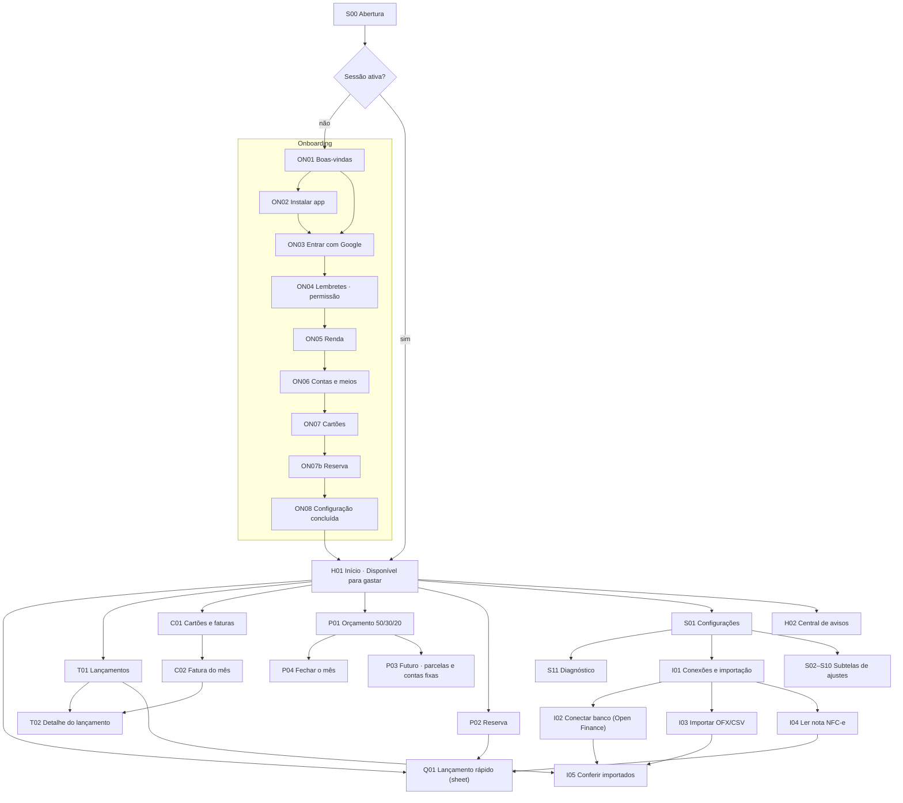
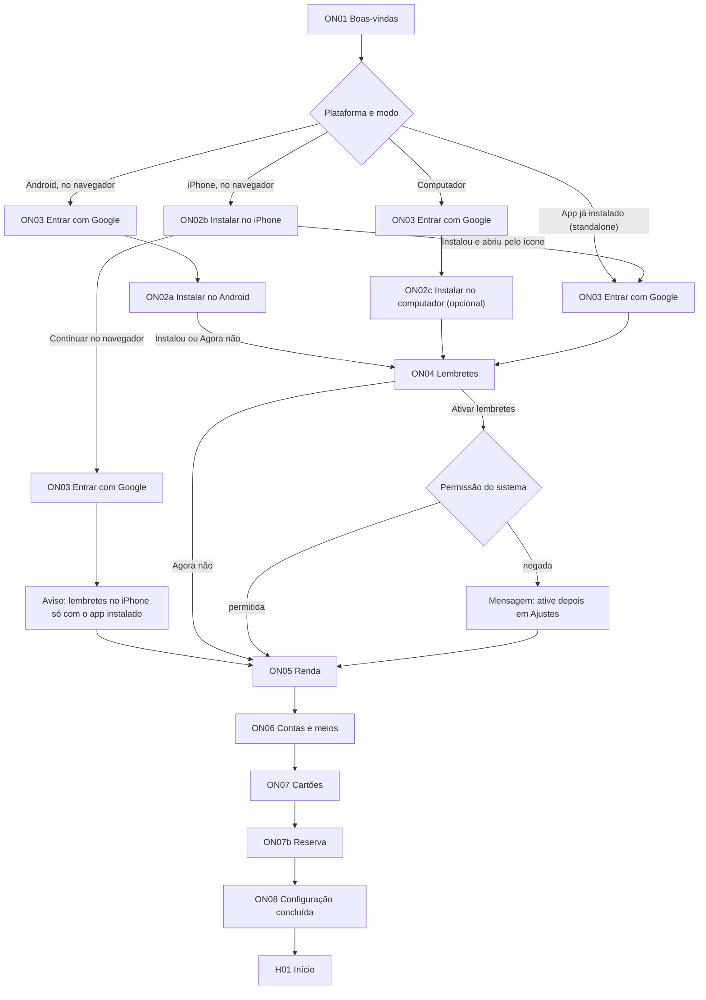
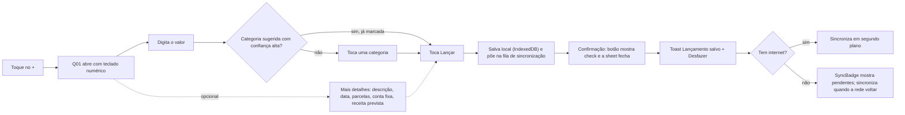
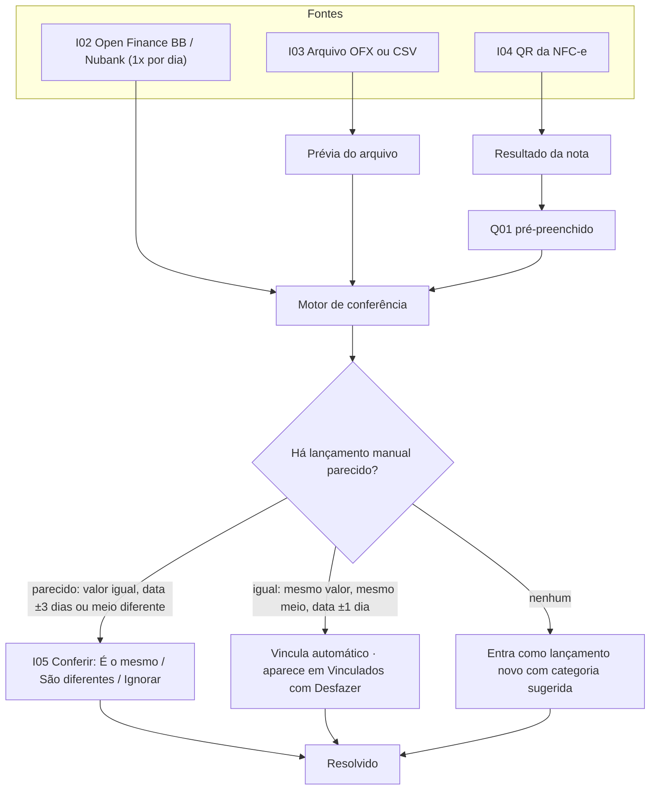
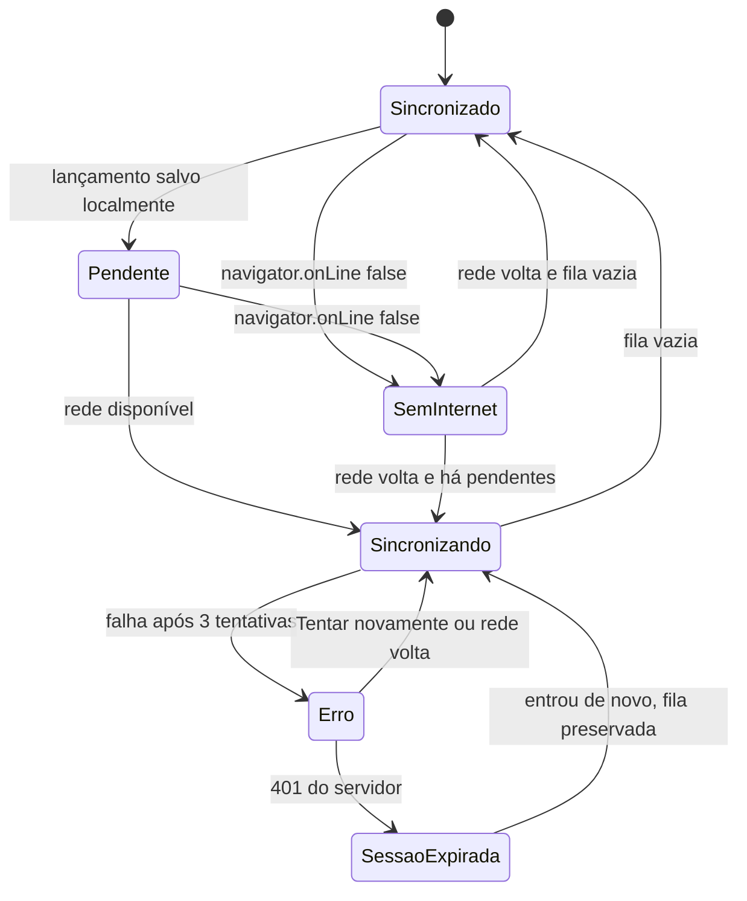

# 03 — OakFinance · UX, telas e Design System "Aero sóbrio"

*Spec de Product Design / UX · base: `discovery-brief.md` v2 (05/11/2026) · **versão 1.3** · idioma da interface: pt-BR · nome do app: **OakFinance** · marca só tipográfica · tom sóbrio e premium para jovens adultos*

> **Para quem implementa:** este documento é normativo. Cada tela tem um ID (`ON01`, `H01`, `Q01`…), uma rota e a semana em que entra (S1–2, S3, S4). Cada componente tem nome, props e estados. Todo valor visual vem de um token CSS da seção 4. **Não use cor, raio, sombra, duração ou tamanho de fonte fora dos tokens.** Onde houver dúvida entre "bonito" e "legível/rápido", vence legível/rápido.

**Histórico de versões**

| Versão | Data | Mudança |
|---|---|---|
| 1.0 | 05/11/2026 | Primeira versão (estética Aero com tom lúdico, nome a definir) |
| 1.1 | 05/11/2026 | Nome OakFinance e símbolo ilustrado (reprovado pelo cliente) |
| 1.2 | 05/11/2026 | Marca só tipográfica. **Tom lúdico removido** a pedido do cliente: sem animações decorativas, celebrações, gamificação nem fundo que muda com o mês. Estética Aero mantida em versão sóbria e premium; microcopy reescrita para jovens adultos; o indicador de progresso da reserva passa a ser `GoalProgress` (anel e barra) |
| 1.3 | 05/11/2026 | Revisão de QA independente (`04-review.md`): `PaceIndicator` segue a RN-50 do PRD (selo de status do mês, mesmos estados e textos na técnica); novas telas `H02` Central de avisos, `ON07b` Reserva, `P04` Fechar o mês, `S11` Diagnóstico, `I06` Regras e estados `G11`–`G16`; Q01 com transferência, estorno, receita "Já caiu na conta?" e até 48 parcelas; exclusão de parcela e de conta fixa conforme RN-25/RN-30; S06 com o mês do cartão (padrão: vencimento da fatura, confirmado pelo cliente) e VR/VA; S10 com exportação por período, backup e restauração; push alinhado às RN-86 a RN-94; limites de valor iguais à RN-01 |

---

## Sumário

0. Convenções e glossário
1. Princípios de experiência
2. Arquitetura de navegação e fluxos (Mermaid)
3. Especificação por tela
4. Design system Aero sóbrio: tokens CSS, contrastes, marca e logo (4.11)
5. Inventário de componentes
6. Guia de microcopy
7. Registro de decisões de marca e tom
8. Checklist de aceite (UX + acessibilidade)

---

## 0. Convenções e glossário

### 0.1 Convenções

| Item | Regra |
|---|---|
| IDs de tela | `ON` onboarding · `H` início · `Q` lançamento rápido · `T` lançamentos · `C` cartões · `P` planejar · `I` integrações · `S` configurações · `G` estados globais |
| Semana | **S1–2** núcleo · **S3** Open Finance + conciliação · **S4** OFX/CSV, NFC-e, push completo |
| Moeda | Sempre `Intl.NumberFormat('pt-BR', { style: 'currency', currency: 'BRL' })` → `R$ 1.234,56`. Valor negativo: `−R$ 45,00` (sinal de menos U+2212, não hífen) |
| Datas | Relativas até 6 dias: "hoje", "ontem", "qua". Depois: "7 nov". Outro ano: "7 nov 2025". Fuso: `America/Sao_Paulo` |
| Números em telas | Sempre com algarismos tabulares (`font-variant-numeric: tabular-nums`) |
| Tamanho de toque | Mínimo **48×48 px** (CSS) em todo controle; 8 px entre alvos adjacentes |
| Breakpoints | `sm` < 600 px (celular, layout base) · `md` 600–1023 px (tablet / celular deitado) · `lg` ≥ 1024 px (computador) |
| Ícones | Lucide (`lucide-react`, licença ISC), §4.0 e §4.7 |
| Tema/movimento | Atributos no `<html>`: `data-theme="light|dark"`, `data-glass="glass|solid"` (herança do Aero, hoje sem efeito visual, §4.0), `data-motion="full|reduced"`, `data-perf="normal|low"`, `data-values="shown|hidden"` (ver 4.10) |

### 0.2 Glossário da interface (usar exatamente estes termos)

| Termo na tela | Significado | Não usar |
|---|---|---|
| **Lançamento** | Qualquer registro (despesa, receita, transferência) | "transação", "movimentação" |
| **Despesa** / **Receita** | Tipo do lançamento | "gasto" em rótulos de campo (em frases livres, "gasto" é aceito) |
| **Disponível para gastar** | Valor do painel inicial (rótulo curto: "Disponível") | "saldo livre", "posso gastar" |
| **Meio de pagamento** | Pix, débito, crédito, dinheiro, VR, VA | "forma de pagamento" |
| **Conta** | Conta corrente, carteira, VR/VA | "carteira digital" |
| **Cartão** | Cartão de crédito | — |
| **Fatura** | Fatura do cartão (aberta, fechada, paga) | "boleto do cartão" |
| **Parcela** | Parte de compra parcelada, ex.: "3/10" | "prestação" |
| **Conta fixa** | Recorrência (aluguel, assinatura) | "débito automático" |
| **Faixa** | Necessidades, Desejos ou Poupança (50/30/20) | "bucket", "grupo" |
| **Reserva** | Reserva de emergência | "fundo", "cofrinho" |
| **Guardar** / **Aporte** | Botão: "Guardar". Registro: "aporte" | "investir", "aplicar" |
| **Conexão** | Banco ligado via Open Finance | "integração" |
| **Conferir** | Ação de conciliação | "conciliar" (só em título técnico) |
| **Status do mês** | Selo do herói (`PaceIndicator`): No ritmo do mês · Atenção · Acima do planejado · Sem renda (RN-50) | "saúde", "humor", "clima", "céu" |
| **Aviso** | Item da central de avisos (H02); o push é a cópia no aparelho | "notificação" na central |

---

## 1. Princípios de experiência

Cada princípio tem um **critério verificável**. As sessões de desenvolvimento devem tratá-los como requisitos de aceite.

| # | Princípio | O que significa | Critério verificável |
|---|---|---|---|
| P1 | **Lançar em 3 toques e menos de 5 s** | Da tela inicial ao lançamento salvo: tocar **+**, digitar o valor, tocar a categoria, tocar **Lançar**. O meio de pagamento já vem com o último usado | Medir localmente `t(save) − t(tap FAB)`; mediana ≤ 5 s em teste com os dois usuários. No máximo 3 toques além dos dígitos quando a categoria não vem pré-selecionada; 2 quando vem |
| P2 | **Uma mão, polegar primeiro** | Ações primárias no terço inferior da tela. Nada essencial no topo que exija esticar o dedo | FAB, botão "Lançar", teclado numérico e abas na zona inferior (≤ 40% da altura a partir da base). O topo tem só leitura e ações secundárias |
| P3 | **Offline sem fricção** | Lançar sem internet é normal, não um erro. O app salva na hora e informa o estado com calma | Lançamento salvo em IndexedDB em < 100 ms, sem esperar rede. Nenhum spinner bloqueante por falta de rede. Aviso offline em tom informativo, nunca em vermelho |
| P4 | **A resposta antes dos detalhes** | A tela inicial responde "quanto ainda posso gastar" em uma olhada; detalhes a 1 toque | Valor "Disponível para gastar" visível sem rolagem em 360×640; primeiro paint com dado local em < 1 s após abrir |
| P5 | **Sóbrio e premium: movimento só com função** | O visual menta e lima da §4.0 (cards sólidos, pílulas, sombras discretas) dá a sensação de ferramenta financeira moderna. Nada decora por decorar | Nenhuma animação em loop, exceto indicadores de carregamento. Transições entre 150 e 250 ms; feedback de toque ≤ 100 ms. Sem celebrações, confetes, metas gamificadas, contagens de dias seguidos nem ilustrações. Com `prefers-reduced-motion`, nenhum deslocamento: só troca de opacidade ≤ 100 ms |
| P6 | **Direto e respeitoso, nunca culpar** | Texto claro e confiante, para adultos. Informa o fato e o próximo passo, sem sermão e sem infantilizar. Despesa não é vermelha | Lista de construções proibidas (6.3) verificada em revisão; nenhum "!" e nenhum emoji em `pt-BR.json` e nos textos de push (teste automatizado); cor de despesa = cor de texto neutra |
| P7 | **Legível em qualquer superfície** | Card branco, menta e escuro são fundos de texto; a lima nunca é texto nem borda sobre branco | Pares texto/fundo da 4.3 ≥ 4,5:1 (texto) e ≥ 3:1 (componentes e gráficos), medidos no pior fundo possível |
| P8 | **Automático, mas sob controle** | Open Finance, OFX e NFC-e trazem dados; o usuário confere antes de duplicar ou sumir algo | Nenhum lançamento importado altera ou apaga lançamento manual sem ação explícita ou vínculo automático com "Desfazer" |
| P9 | **Privacidade à vista** | Um toque esconde todos os valores (fila do caixa, transporte público) | Botão olho no topo do Início; com valores ocultos, nenhum valor monetário aparece em tela, notificação de tela bloqueada nem prévia de app |
| P10 | **Mesmo peso para Android e iPhone** | Fluxos específicos de cada plataforma (instalação, notificação) são de primeira classe | Toda tela testada em Chrome Android e Safari iOS instalados; guia de instalação separado por plataforma |

---

## 2. Arquitetura de navegação e fluxos

### 2.1 Estrutura de navegação

**Celular (`sm`/`md`):** barra de abas flutuante (pílula preta, §4.0) com 4 abas + botão central **+** (FAB).

| Posição | Aba | Rota | Ícone (nomes do registro original; a Lucide equivalente vem de `features/quick-entry/icons.ts` e `app/`, traço 2 / 2,5 na ativa) |
|---|---|---|---|
| 1 | Início | `/` | `House` |
| 2 | Lançamentos | `/lancamentos` | `ListBullets` (badge com nº a conferir) |
| 3 | **+** (FAB) | abre `Q01` como sheet (`?novo=despesa`) | `Plus` (bold) |
| 4 | Cartões | `/cartoes` | `CreditCard` |
| 5 | Planejar | `/planejar` (abas internas: Orçamento · Reserva · Futuro · Fechar o mês, D-076) | `ChartDonut` |

**Menu da conta (D-076, T-118):** avatar com as iniciais (ou `CircleUser` sem nome) no topo das 4 abas principais (Início, Lançamentos, Cartões e as abas do Planejar) abre uma folha "Sua conta" com **Configurações** (`/ajustes`), **Importar extrato** (`/importar`), **Ler nota fiscal** (`/nota`) e **Sair** (o do S02, com o aviso de pendências da RN-100); **Conexões e importação** só aparece com o Open Finance (D-080). Toque longo no FAB: **Receita**, **Guardar**, **Importar extrato** e **Ler nota** (o toque simples abre a despesa); a alternativa sem gesto (WCAG 2.5.1) é o seletor de tipo do Q01 e o menu da conta. "Importar extrato" também no vazio de Lançamentos; a S01 lista a I01 e a I06. Subtelas têm **Voltar** no TopBar (volta no histórico; aberta direto, vai para a tela-mãe).

**Computador (`lg`):** barra lateral branca de 248 px à esquerda (mesmos itens + Configurações + Conexões; sem o Open Finance, o último item é "Importar extrato", que abre a I01), conteúdo em uma coluna que usa a largura toda (D-025, D-026); o lançamento rápido abre como diálogo central de 440 px. Atalhos de teclado: `N` novo lançamento, `/` buscar em Lançamentos, `Esc` fecha sheet/diálogo.

### 2.2 Mapa geral de telas



### 2.3 Fluxo de onboarding (com ramos por plataforma)

> **Por que a ordem muda no iPhone:** no iOS, o app instalado na Tela de Início tem armazenamento separado do Safari. Se a pessoa entrar com Google no Safari e só depois instalar, precisará entrar de novo dentro do app. Por isso, no iPhone, o guia de instalação vem **antes** do login. No Android o app instalado compartilha a sessão do Chrome, então o login pode vir primeiro.



Regras do onboarding:
- Todos os passos após o login têm **Pular**; o que for pulado vira um card "Complete a configuração" no Início, que some ao concluir.
- Progresso mostrado como **stepper textual** no topo: "Passo 2 de 5 · Renda", com barra fina de progresso (`ProgressBar size="xs"`). Os 5 passos são ON04 Lembretes, ON05 Renda, ON06 Contas, ON07 Cartões e ON07b Reserva.
- **Antes do ON04**, no primeiro login, o app cria as categorias, regras, lembretes, orçamento e reserva padrão (seeds da RN-40/RN-64; técnica 3.8). Se o e-mail não estiver na allowlist, aparece `G14` e nada é criado.
- O progresso fica salvo na conta (`profiles.onboarding`): fechar o app e voltar retoma o mesmo passo, inclusive em outro aparelho. Configurações › "Refazer configuração inicial" reabre o fluxo sem apagar dados.
- Tempo-alvo do onboarding inteiro: ≤ 3 min.
- Após a instalação ser detectada, chamar `navigator.storage.persist()` uma vez.

### 2.4 Fluxo do lançamento rápido



### 2.5 Fluxo de entradas automáticas e conferência



### 2.6 Estados de sincronização (SyncBadge e banners)



---

## 3. Especificação por tela

### 3.0 Moldura comum (AppShell)

- **Fundo:** `AppBackdrop` fixo atrás de tudo: gradiente estático do tema (`--bg-backdrop`), azul-céu suave no claro e azul-noite profundo no Aero noturno, com um realce radial discreto no topo para dar profundidade. Não muda com dados, horário nem estado do mês, e não tem elementos animados.
- **Abertura (S00):** fundo `--bg-backdrop` com o wordmark `BrandLogo variant="wordmark"` centralizado (altura 32 px) e uma `ProgressBar` indeterminada fina abaixo, só se o carregamento passar de 400 ms. Sem animação de logo. Some quando os dados locais carregam (meta < 1 s).
- **Topo (`TopBar`):** 56 px + `env(safe-area-inset-top)`. Três colunas: Voltar (subtelas) à esquerda, título centrado numa linha (com reticências; a S06 usa o título curto "Cálculo e orçamento", D-089) e, à direita, `SyncBadge` (só o ícone quando sincronizado) e o avatar do menu da conta nas raízes das abas (D-076). Sem fundo próprio (fica sobre a menta, §4.0).
- **Abas (`TabBar`):** pílula preta flutuante de 64 px a 12 px do fundo (mais `env(safe-area-inset-bottom)`), FAB lima de 52 px no meio (§4.0).
- **Banner global:** abaixo do topo, para offline/erro de sync/atualização (`G01`–`G08`).
- **Região `aria-live="polite"`** única no AppShell para toasts e mudanças de sync; no celular o toast fica acima da barra de abas flutuante (64 px + 12 px + 12 px), no `lg` a 24 px do fundo.
- **Landmarks:** `<header>`, `<nav aria-label="Navegação principal">`, `<main id="conteudo">`; no `lg`, link "Pular para o conteúdo" como primeiro foco.
- Rolagem: só o `<main>` rola; topo e abas fixos. Nada de `backdrop-filter` dentro de listas que rolam (ver 4.5).

Template de cada tela abaixo: **Objetivo · Conteúdo e hierarquia · Componentes · Estados · Interações e feedback · Acessibilidade.**

---

### ON01 — Boas-vindas · `/boas-vindas` · S1–2

- **Objetivo:** apresentar o app em poucos segundos e levar ao próximo passo certo para a plataforma.
- **Conteúdo e hierarquia:**
  1. `BrandLogo variant="wordmark"` (altura 40 px) no terço superior, sobre o fundo.
  2. Subtítulo: "Registre gastos em segundos e saiba quanto ainda pode gastar no mês."
  3. `GlassCard level=2` com 3 linhas, ícone `regular` 24 px + texto: `Lightning` "Lançamento rápido, também sem internet" · `CreditCard` "Faturas e parcelas no mês certo" · `ShieldCheck` "Reserva de emergência com meta e acompanhamento".
  4. Botão primário (varia por plataforma, ver Interações). Link secundário "Já uso em outro aparelho" (vai direto ao login).
- **Componentes:** `AppBackdrop`, `BrandLogo`, `GlassCard(level=2)`, `Button(variant="primary", size="lg", fullWidth)`, `Button(variant="ghost")`.
- **Estados:** padrão; offline ("Sem conexão. O primeiro acesso precisa de internet." + botão desativado com motivo visível).
- **Interações:** detecção: `isIOS = /iPhone|iPad|iPod/.test(ua) || (ua.includes('Mac') && navigator.maxTouchPoints > 1)`; `isStandalone = matchMedia('(display-mode: standalone)').matches || navigator.standalone === true`.
  - iPhone no navegador → "Começar" leva a `ON02b`.
  - Demais → "Começar" leva a `ON03`.
- **Acessibilidade:** `<h1>` "OakFinance" (o SVG do logo tem `role="img"` e `<title>`); ícones `aria-hidden`; botão com texto, não só ícone.

### ON02a — Instalar no Android · `/instalar?p=android` · S1–2

- **Objetivo:** instalar o PWA com o prompt nativo; sem prompt, guiar pelo menu do navegador.
- **Conteúdo:**
  1. Título "Instale o OakFinance no Android". Texto: "Abre mais rápido, funciona sem internet e permite lembretes."
  2. Se `beforeinstallprompt` foi capturado: botão primário **Instalar app** → `prompt()`; aguarda `appinstalled`.
  3. Sem o evento (Samsung Internet, Firefox, ou já recusado): `InstallGuide(platform="android")` com passos:
     - Chrome: 1) Toque no menu **⋮** no canto superior. 2) Toque em **Instalar app** (ou **Adicionar à tela inicial**). 3) Confirme em **Instalar**.
     - Samsung Internet: 1) Toque no menu **≡** na parte de baixo. 2) **Adicionar página a** → **Tela inicial**.
  4. Link "Agora não" (registra recusa; o card "Instalar o app" volta no Início após 3 dias, no máximo 2 vezes).
- **Estados:** aguardando prompt · instalando · instalado (ícone `CheckCircle` + "App instalado. Abra pelo ícone na tela inicial." + botão "Continuar") · recusado.
- **Acessibilidade:** passos em `<ol>`; cada imagem do passo com `alt` descritivo ("Menu de três pontos no canto superior direito do Chrome").

### ON02b — Instalar no iPhone · `/instalar?p=ios` · S1–2

- **Objetivo:** levar a pessoa a adicionar o app à Tela de Início pelo Safari, condição para lembretes push no iPhone.
- **Conteúdo e hierarquia:**
  1. Título "Instale o OakFinance no iPhone". Texto: "No iPhone, os lembretes só funcionam com o app na Tela de Início. Leva cerca de 20 segundos."
  2. Se o navegador **não** é Safari (`CriOS`, `FxiOS`, `EdgiOS` no UA, ou navegador embutido de outro app): aviso "Para instalar, abra este link no Safari." + botão **Copiar link** + instrução "Cole na barra de endereço do Safari." (Navegadores de terceiros no iOS 16.4+ também podem adicionar à Tela de Início pelo menu Compartilhar; o guia mostra essa variante quando detectar Chrome iOS.)
  3. `InstallGuide(platform="ios")` com 3 passos ilustrados por capturas estilizadas da interface do Safari (variante escolhida pela versão do iOS no UA; **validar em aparelho real na S1**, porque o Safari muda a posição do botão entre versões):
     - **iOS 17–18:** 1) Toque em **Compartilhar** (quadrado com seta para cima) na barra inferior. 2) Role e toque em **Adicionar à Tela de Início**. 3) Toque em **Adicionar**.
     - **iOS 26+:** 1) Toque em **•••** na barra de endereço. 2) Toque em **Compartilhar** e depois em **Adicionar à Tela de Início**. 3) Mantenha **Abrir como app** ligado e toque em **Adicionar**.
  4. Indicador estático (seta `ArrowDown` 24 px em `--text-link`) apontando para a região do botão no Safari (base da tela no iPhone; topo no iPad).
  5. Rodapé: "Depois, abra o app pelo novo ícone na Tela de Início." · link "Continuar no navegador por enquanto".
- **Estados:** guia · não é Safari · já instalado (detectado em `standalone`: pula para `ON03`).
- **Interações:** "Continuar no navegador" → `ON03` e marca `installSkipped`; o Início mostra o card "Instale o app para receber lembretes".
- **Acessibilidade:** passos em `<ol>`; nomes dos botões do Safari em negrito e escritos exatamente como o VoiceOver os anuncia ("Compartilhar", "Adicionar à Tela de Início").

### ON02c — Instalar no computador · `/instalar?p=desktop` · S1–2

- Opcional, uma tela: "Instale no computador para analisar o mês em uma tela maior." Botão **Instalar** (`beforeinstallprompt` no Chrome/Edge) ou instrução "Clique no ícone de instalação na barra de endereço." Link "Agora não".

### ON03 — Entrar com Google · `/entrar` · S1–2

- **Objetivo:** autenticar via Supabase Auth (Google).
- **Conteúdo:** wordmark (altura 28 px); título "Entre com sua conta Google"; texto "Seus dados ficam vinculados só à sua conta e não são compartilhados."; botão **Entrar com Google** (no padrão visual do Google: fundo branco, logo G colorido, texto "Entrar com Google", conforme as diretrizes de marca do Google; é a única exceção visual ao design system); link "Como seus dados são protegidos" abre sheet curta sobre privacidade.
- **Estados:** padrão · carregando (botão com spinner, texto "Entrando…") · erro ("Não foi possível entrar com o Google. Verifique a conexão e tente novamente." + **Tentar novamente**) · popup bloqueado (usar redirect em vez de popup; no iOS standalone sempre redirect) · offline (botão desativado + motivo).
- **Acessibilidade:** foco inicial no botão; erro anunciado via `role="alert"`.

### ON04 — Lembretes (permissão de notificação) · `/boas-vindas/lembretes` · S1–2 (push completo S4)

- **Objetivo:** explicar o valor antes do prompt do sistema e só pedir após um toque.
- **Conteúdo:**
  1. Ícone `Bell` 32 px em disco sólido de 64 px, antes do título (UXA-029, D-103).
  2. Título "Lembretes de vencimentos e orçamento".
  3. Lista de lembretes com `Switch`, ligados por padrão: Vencimento de faturas e contas (3 dias antes e no dia) · Lembrete diário para registrar gastos (20:00) · Resumo semanal (domingo, 19:00) · Categoria perto do limite (80%).
  4. Primário **Ativar lembretes** → `Notification.requestPermission()` → assinatura Web Push. Secundário **Agora não**.
- **Regras de plataforma:**
  - iPhone fora do modo instalado: a tela é substituída pelo aviso "No iPhone, os lembretes exigem o app instalado. Você pode instalar depois em Ajustes › Instalar app." Sem botão de permissão.
  - Nunca chamar `requestPermission()` fora de um toque.
- **Estados:** padrão · aguardando sistema · permitido (segue) · negado ("Lembretes desativados. Para ativar depois, vá em Ajustes do aparelho › Notificações." e segue) · sem suporte.
- **Acessibilidade:** cada `Switch` com rótulo e descrição (`aria-describedby`) do horário.

### ON05 — Renda · `/boas-vindas/renda` · S1–2

- **Objetivo:** cadastrar a renda fixa, base do "Disponível para gastar" e do 50/30/20.
- **Conteúdo:** título "Qual é a sua renda mensal?"; `AmountInput` compacto "Salário ou renda fixa"; `DayPicker` "Dia do crédito" (1–31, padrão 5; dia 29–31 em mês mais curto cai no último dia, RN-03); `Select` "Conta de crédito" (contas criadas ou "Cadastrar no próximo passo"); `Switch` "Também tenho renda variável" com ajuda: "A renda variável só entra no cálculo quando for creditada. Você pode marcá-la como prevista."
- **Estados:** vazio · preenchido · erro de validação ("Informe um valor maior que zero." inline) · pulado.
- **Interação:** **Continuar** cria a recorrência mensal de receita. **Pular** deixa o Início no estado "sem renda" (ver H01).

### ON06 — Contas e meios · `/boas-vindas/contas` · S1–2

- **Objetivo:** criar as contas onde o dinheiro está.
- **Conteúdo:** título "Onde está o seu dinheiro?"; chips de atalho: **Banco do Brasil** · **Nubank** · **Carteira (dinheiro)** · **VR** · **VA** · **Outra conta**. Cada chip tocado vira uma linha editável com nome e "saldo atual" opcional (`AmountInput` compacto). Pix e débito não são contas: são meios ligados a uma conta corrente (pergunta inline: "Pix e débito saem de qual conta?").
- **Estados:** nenhuma selecionada (Continuar desativado, texto "Selecione pelo menos uma conta") · com itens · editando.
- **Acessibilidade:** chips são `role="checkbox"` com `aria-checked`.

### ON07 — Cartões · `/boas-vindas/cartoes` · S1–2

- **Objetivo:** cadastrar cartões de crédito com fechamento e vencimento (base das faturas).
- **Conteúdo:** título "Cartões de crédito"; por cartão: Nome (sugestões "Nubank", "Ourocard"), "Dia de fechamento" (1–31), "Dia de vencimento" (1–31), Limite (opcional), cor do cartão (6 opções de gradiente da paleta). Botão **Adicionar outro cartão**. Link "Não uso cartão de crédito".
- **Ajuda contextual:** abaixo dos dias, prévia calculada com a RN-12: "Compras de hoje vão para a fatura de dezembro, que vence em 10/12." `Switch` "Compra no dia do fechamento vai para a próxima fatura" (ligado por padrão, com explicação de uma linha; RN-09). Dia 31: nota "Em meses mais curtos, o fechamento será no último dia do mês."
- **Validação:** vencimento igual ao fechamento → aviso (não bloqueia): "Fechamento e vencimento no mesmo dia. Confira na sua fatura." Dia fora de 1–31 → "Escolha um dia entre 1 e 31."

### ON07b — Reserva · `/boas-vindas/reserva` · S1–2

- **Objetivo:** registrar quanto a pessoa já tem guardado (RN-55) e mostrar a meta sugerida.
- **Conteúdo:** título "Reserva de emergência"; `AmountInput` compacto "Quanto você já tem guardado" (padrão R$ 0,00); texto da meta sugerida conforme RN-52 ("Meta sugerida: R$ 17.400,00 · estimativa provisória, recalculada com seus gastos"); sem renda informada no ON05: "A meta é sugerida depois que você cadastrar a renda."; link **Definir outra meta** (abre campo de valor, `target_mode = manual`).
- **Interação:** **Continuar** grava `goals.initial_saved_cents` (e a meta manual, se definida). **Pular** mantém 0 e meta automática.
- **Estados:** vazio · preenchido · sem renda · offline (funciona: grava local).

### ON08 — Configuração concluída · `/boas-vindas/pronto` · S1–2

- **Conteúdo:** ícone `CheckCircle` 32 px em `--status-success-fg`; título "Configuração concluída"; texto "Registre o primeiro gasto para começar a acompanhar o mês." Primário **Fazer o primeiro lançamento** (abre Q01 sobre o Início) · secundário **Ir para o início**.
- **Transição:** entrada da tela com fade de 200 ms (sem deslocamento em movimento reduzido).

---

### H01 — Início · "Gasto em {mês}" · `/` · S1–2

- **Objetivo (D-081):** responder em uma olhada quanto já foi gasto no mês, como está a conta e o que vence em breve.
- **Conteúdo e hierarquia (de cima para baixo, celular):**
  1. `TopBar`: saudação curta ("Boa tarde, {nome}", primeiro nome do Google; período do dia pelo fuso `America/Sao_Paulo`), botão olho (`Eye`/`EyeSlash`, ocultar valores), sino (`Bell` com `Badge` de não lidos → `H02`), `SyncBadge`, avatar (→ `/ajustes`).
  2. **Herói "Gasto em {mês}"** (D-081, T-120) no cartão escuro:
     - Rótulo: "Gasto em novembro"; valor: `MoneyText` grande = GR da RN-47 (efetivadas pelo mês de impacto, menos estornos).
     - Linha de apoio: "Ainda vai sair este mês: R$ 280,00" (previstas, só informativa).
     - Linha "Saldo nas contas R$ 2.450,00" com chevron → lista de contas (`S03`).
     - Botão **Novo lançamento**. Saíram (D-081): o "Disponível para gastar", o valor por dia, o `PaceIndicator`, a linha "No cartão para os próximos meses" e o "Ver cálculo" (`H01-S`).
  3. **Card "Próximos 7 dias"** (GlassCard nível 2): até 4 itens (faturas, contas fixas, parcelas) com data relativa, valor e ícone; link "Ver tudo" → `P03`.
  4. **Card "Saúde do mês"** (D-081): uma barra por faixa (Necessidades, Desejos, Poupança) com "R$ 1.200,00 de R$ 2.250,00" e o estado em texto e ícone — "No caminho" (`CircleCheck`), "Atenção" (`TriangleAlert`, ≥ 80%) ou "Passou do planejado" (`CircleAlert`, ≥ 100%; Poupança é mínimo e nunca passa) — e o atalho **Ajustar percentuais** → `P01`. Sem renda: "Cadastre sua renda para acompanhar as faixas do mês." + **Cadastrar renda**.
  5. **Card Reserva:** `GoalProgress variant="bar"` + "R$ 3.400 de R$ 13.500 · 25%" + botão **Guardar** → Q01 em modo Guardar.
  6. **Card "Conferir"** (só se houver pendências em I05): "3 lançamentos do Nubank para conferir" → `I05`.
  7. **Últimos lançamentos:** 3 `TransactionRow` + "Ver todos".
  8. Cards de configuração pendente (instalar, renda, cartões) acima dos demais cards, dispensáveis.
- **Layout `lg`:** grade de 12 colunas: herói (5 col) e cards (7 col); gráfico de barras de gastos por dia do mês (12 col) abaixo.
- **`H01-S` removida (D-081):** a sheet "Como o valor é calculado" saiu com o "Disponível para gastar"; o texto abaixo fica como registro da fórmula da RN-47, que continua no domínio.
- **Cálculo exibido (`H01-S`, sheet "Como o valor é calculado"):**
  ```
  Receita fixa do mês           + R$ 4.500,00
  Receitas variáveis recebidas  + R$   300,00
  (Receitas previstas)          + R$     0,00   ← só as marcadas "Contar antes de receber"
  (Resgates da reserva)         + R$     0,00   ← só se houver
  Gastos realizados             − R$ 1.320,00
  Faturas, parcelas e contas
  fixas que ainda vencem        − R$ 1.150,00
  Poupança do mês (20%)         − R$   960,00
  ───────────────────────────────────────────
  Disponível para gastar          R$ 1.370,00
  ```
  Cada linha abre a lista filtrada correspondente (T01). "Ainda vencem" mostra as 3 próximas saídas por data. Rodapé: "Você pode ajustar o cálculo em Ajustes › Disponível para gastar." A fórmula e os nomes das linhas são os da RN-47/RN-49 do PRD.
- **Regra do `PaceIndicator` = RN-50 do PRD** (selo de status do mês; informação funcional, sem efeito no fundo). `D` = Disponível, `Base` = renda do mês (RN-38). Mesmos estados no domínio (`MonthStatus`, técnica 5.6):

  | Estado | Condição | Texto | Ícone | Tom |
  |---|---|---|---|---|
  | `on_track` | `D × 100 ≥ Base × 20` | No ritmo do mês | `CheckCircle` | `--status-success-fg` |
  | `attention` | `0 ≤ D` e abaixo de 20% da Base | Atenção: restam {valor} (com D = 0: "No limite do planejado") | `TrendUp` | `--status-warning-fg` |
  | `over` | `D < 0` | Acima do planejado em {valor} | `WarningCircle` | `--status-danger-fg` |
  | `no_income` | Base = 0 | Cadastre a renda para calcular | `Info` | `--text-secondary` |

  - Sem histerese: o estado é função direta do valor exibido (o número e o selo nunca se contradizem).
  - Com valores ocultos, `{valor}` vira "R$ ••••" e o estado continua visível.
  - O fundo (`AppBackdrop`) **não** muda com o estado.
- **Componentes:** `TopBar`, `MoneyText`, `AppBackdrop`, `PaceIndicator`, `GlassCard`, `BudgetRing`, `GoalProgress`, `TransactionRow`, `InvoiceMini`, `Banner`, `Skeleton`, `BottomSheet`.
- **Estados:**
  - Carregando (primeira vez, sem cache): `Skeleton` no herói e nos cards.
  - Sem renda (RN-48): herói mostra "Cadastre sua renda para ver quanto pode gastar" + botões **Cadastrar renda** (receita fixa) e **Lançar receita** (avulsa) no lugar do valor, e abaixo "Você já gastou {valor} este mês".
  - Acima do planejado (D < 0): valor com sinal "−R$ 120,00", selo `over` e link **Ver onde ajustar** (→ `P01`).
  - Sem lançamentos no mês: herói normal + card "Nenhum lançamento em novembro. Registre um gasto para começar." com **Novo lançamento**.
  - Valores ocultos: todos os `MoneyText` viram "R$ ••••"; gráficos mantêm formas, sem rótulos de valor.
  - Offline / sincronizando / erro: via `SyncBadge` e banner global; o valor sempre é calculado com os dados locais.
- **Interações e feedback:**
  - Puxar para atualizar (só no topo): indicador circular padrão (`ArrowsClockwise` girando enquanto sincroniza) → força sincronização.
  - Toque no herói → `H01-S`.
  - Toque longo no FAB → menu com 4 opções: **Despesa**, **Receita**, **Guardar**, **Ler nota** (`QrCode`).
  - Quando o valor do herói muda após um lançamento: troca por fade de 200 ms (sem contagem animada).
- **Acessibilidade:**
  - Herói é `<section aria-labelledby>` com `<h1>` "Disponível para gastar: R$ 1.370,00".
  - O estado do ritmo está em texto no `PaceIndicator` (cor e ícone nunca são a única pista).
  - Texto diretamente sobre o `AppBackdrop`: só `--text-primary` (6,83:1 no ponto mais escuro, ver 4.3).
  - Botão olho: `aria-pressed`, rótulo "Ocultar valores" / "Mostrar valores".

### H02 — Central de avisos · `/avisos` · S1–2

- **Objetivo:** reunir todos os avisos (os mesmos do push), para quem não ativou notificações ou usa iPhone sem o app instalado (US-37).
- **Conteúdo:** lista de avisos do mais recente ao mais antigo em um GlassCard: ícone do tipo, título, texto, data relativa e ponto "não lido" (com texto para leitor de tela). Toque abre a tela de destino e marca como lido. Ação **Marcar todos como lidos**. Avisos lidos há mais de 60 dias somem.
- **Estados:** vazio (`EmptyState` "Nenhum aviso" / "Vencimentos, limites e conexões aparecem aqui.", ícone `Bell`) · com não lidos · offline (mostra os já sincronizados e os gerados no aparelho).
- **Acessibilidade:** sino com `aria-label="Avisos, {n} não lidos"`; lista `<ul>`.

---

### Q01 — Lançamento rápido · sheet `?novo=despesa|receita|guardar` · S1–2

- **Celular (T-119, D-090):** a folha abre com o foco no valor; com ponteiro grosso, o teclado numérico e **Lançar** ficam num rodapé fixo da folha (o resto rola acima); o cabeçalho da folha (título e Fechar) fica fixo; o valor é centrado; **Mais** tem forma de chip (com `ChevronDown`) e o grupo de categorias se chama "Categoria". A opção escolhida no segmentado e nos chips tem contorno de 2 px no token `--selection-outline` (preto no claro, claro no escuro), não só a cor.
- **Objetivo:** registrar valor + categoria + meio de pagamento em ≤ 5 s, com uma mão, com ou sem internet.
- **Conteúdo e hierarquia (sheet de 88% da altura no celular):**
  1. Alça de arrasto + `SegmentedControl` **Despesa | Receita** (padrão: Despesa). **Guardar** é uma folha própria (`?novo=guardar`, D-043), aberta pelo menu do FAB ou pelo card do Início. Na despesa, **Ler nota** (ícone `QrCode`) leva à I04 (D-096, T-126).
  2. `AmountInput` grande, centralizado: "R$ 0,00" → digitação estilo caixa eletrônico (dígitos entram pela direita: `3` `2` `9` `0` → R$ 32,90).
  3. Linha de **categorias sugeridas**: 5 `CategoryChip` + chip **Mais** (abre `CategoryPicker` em grade com busca). Ordem: (a) regra aprendida para o meio de pagamento + faixa horária ±2 h; (b) frequência nos últimos 30 dias; (c) padrão por meio (VR → Restaurantes, VA → Mercado). Se a primeira sugestão tem **confiança alta** (mesma regra confirmada ≥ 3 vezes no mesmo contexto), já vem marcada; senão, nenhuma vem marcada.
  4. `PaymentMethodPicker` compacto: chip com o meio atual (padrão = último usado); toque abre a lista. Se for cartão de crédito, aparece abaixo: "Entra na fatura de dezembro, vence 10/12" e o `InstallmentStepper` **À vista | 2x | 3x … 48x** (RN-20), com a alternância **Total | Parcela** para informar o valor total ou o da parcela.
  5. Link **Mais detalhes** (expande na própria sheet): Descrição (com autocompletar; se digitada antes da categoria, sugere a categoria pela regra, RN-61) · Data (`DateChip`: Hoje / Ontem / escolher; data a mais de 60 dias de hoje pede confirmação "Essa data está longe de hoje. Confirmar?") · Observação · Conta (se o meio permitir mais de uma) · "Repetir todo mês" (conta fixa: dia, fim, valor variável, confirmação automática) · **Outro tipo**: Transferência entre contas (origem e destino, cartão não aparece como destino) · Estorno no cartão.
  - Em **Receita**: pergunta "Já caiu na conta?" (**Sim** / **Não**, RN-33). Com **Não**, aparece o `Switch` "Contar antes de receber" (desligado = "A receber", não entra no cálculo; ligado = "Prevista", entra com borda tracejada).
  6. `NumericKeypad` (4×3: 1–9, `00`, 0, apagar) num rodapé fixo da folha, junto com **Lançar**, com ponteiro grosso (§5.8, T-119); com ponteiro fino, o campo usa o teclado do sistema.
  7. Botão primário **Lançar** (largura total, 56 px), no mesmo rodapé fixo. Na folha do Guardar, **Guardar**.
- **Componentes:** `BottomSheet`, `SegmentedControl`, `AmountInput`, `NumericKeypad`, `CategoryChip`, `CategoryPicker`, `PaymentMethodPicker`, `InstallmentStepper`, `DateChip`, `TextField`, `Switch`, `Button`, `Toast`.
- **Estados:**
  - Vazio: "Lançar" desativado; texto auxiliar abaixo do botão: "Informe o valor" / "Escolha a categoria" (o que faltar primeiro).
  - Válido: "Lançar" ativo.
  - Salvando: < 100 ms, sem spinner.
  - Offline: igual ao online; o toast informa "Lançamento salvo no aparelho. Sincroniza quando a conexão voltar."
  - Edição (aberto a partir de T02): título "Editar lançamento", botão **Salvar alterações**, link destrutivo **Excluir lançamento**.
  - Pré-preenchido por NFC-e (I04): campos preenchidos, com selo "Dados da nota fiscal" no topo.
  - Parcelado: abaixo do stepper, "10x de R$ 120,00 · primeira parcela em dezembro".
- **Interações e feedback:**
  - Abre com foco no valor; o teclado próprio aparece de imediato (`inputmode="none"` no campo para não abrir o teclado do sistema). Em `lg`, aceita teclado físico: dígitos, `Backspace`, `Enter` = Lançar, `Esc` = fechar.
  - Toque longo em apagar = zera o valor.
  - Arrastar a sheet para baixo ou tocar fora = fecha; se há valor digitado, pergunta "Descartar este lançamento?" (**Descartar** / **Continuar editando**).
  - Botão voltar do Android/gesto fecha a sheet (estado na URL via `?novo=`).
  - Ao corrigir a categoria sugerida, o app registra a correção na regra aprendida (silencioso; visível em Ajustes › Categorias e regras).
  - Valor máximo: R$ 999.999,99 (RN-01); dígitos excedentes são ignorados com vibração curta (Android).
  - Parcelado: valida 2–48 parcelas e total ≥ número de parcelas em centavos; mostra a divisão da RN-21 ("1ª de R$ 33,34 e 2 de R$ 33,33").
  - **Feedback de toque:** tecla escurece o fundo (`--surface-pressed`) por 100 ms + `navigator.vibrate(8)` no Android.
  - **Confirmação de salvamento:** o rótulo do botão é trocado por ícone `Check` (150 ms), a sheet fecha (250 ms, `--motion-ease-in`) e o toast confirma com "Desfazer". O herói do Início atualiza com fade de 200 ms.
- **Acessibilidade:**
  - Sheet: `role="dialog"`, `aria-modal="true"`, `aria-labelledby` = "Novo lançamento"; foco preso dentro; `Esc` fecha; foco volta ao FAB.
  - `AmountInput`: `role="textbox"`, `aria-label="Valor"`, e o valor formatado é anunciado em `aria-live="polite"` 400 ms após a última tecla.
  - Teclas com `aria-label` ("Apagar", "Zero zero").
  - Chips de categoria: grupo `role="radiogroup"` com `aria-label="Categoria"`; setas navegam.
  - Gesto de arrastar sempre tem alternativa: botão **Fechar** (`X`) visível no topo da sheet (WCAG 2.5.1).
  - Mensagens "Informe o valor" vinculadas ao botão por `aria-describedby`.

---

### T01 — Lançamentos · `/lancamentos` · S1–2

- **Objetivo:** ver, buscar e corrigir lançamentos do mês.
- **Conteúdo:**
  1. Seletor de mês `‹ novembro 2026 ›` (deslizar lateral também troca).
  2. Resumo do mês em 3 números: Entradas · Saídas · Guardado.
  3. Filtros em chips roláveis e combináveis: Todos · Despesas · Receitas · Cartões · Pix · Dinheiro · VR/VA · Para conferir · Previstas · Atrasadas; botão **Filtros** abre conta, faixa e categoria (US-15), com o total filtrado. Botão busca (`MagnifyingGlass`): sem acento e por valor ("45,90").
  4. Card "Conferir" se houver pendências (→ I05).
  5. Lista agrupada por dia (cabeçalho fixo "Hoje · R$ 87,40", "Ontem", "ter, 3 nov") em **um** card por grupo; linhas `TransactionRow` sem card próprio.
- **Estados:** carregando (skeleton de 6 linhas) · vazio do mês · vazio por filtro · busca sem resultado · linhas pendentes de sync (ícone `CloudArrowUp` pequeno + texto para leitor de tela "não sincronizado") · linhas importadas (selo da fonte: "Nubank", "OFX", "Nota").
- **Interações:** toque na linha → T02. Deslizar a linha para a esquerda revela **Editar** e **Excluir** (alternativa: botão `DotsThree` na linha, sempre visível em `lg` e acessível por teclado). Exclusão mostra toast "Lançamento excluído" + **Desfazer** (8 s).
- **Acessibilidade:** lista com `<ul>`/`<li>`; cada linha é um botão com rótulo completo (ver TransactionRow). Cabeçalhos de dia são `<h2>`.

### T02 — Detalhe do lançamento · `/lancamentos/:id` · S1–2

- **Conteúdo:** valor grande, tipo, status em texto (Agendada · Prevista · A receber · Atrasada · Cancelada), categoria (chip editável), meio de pagamento, conta/cartão + fatura onde entrou, data, descrição, observação, parcelas (lista "1/10 dez · 2/10 jan…", com a atual destacada; selo "importada parcialmente" quando for o caso), recorrência, origem (Manual / Nubank via Open Finance / OFX / CSV / Nota fiscal com itens, lista recolhível de itens da NFC-e — US-56), vínculo de conferência ("Vinculado a: PIX ENVIADO PADARIA SOL · **Não é o mesmo**"), **Histórico** ("Categoria alterada de Lazer para Mercado · ontem 18:02 · neste aparelho" / "em outro aparelho"; versões perdidas em conflito com **Restaurar esta versão**, RN-97; o histórico precisa de internet e mostra "Disponível com conexão" offline).
- **Ações:** **Editar** (abre Q01 em modo edição; em item de série ou conta fixa, pergunta o escopo: parcelas "Toda a compra" / "Só esta parcela" (RN-24); conta fixa "Só esta" / "Esta e as próximas" (RN-30)) · **Mover para outra fatura** (itens de cartão em fatura não paga, RN-18) · **Excluir**:
  - avulso: toast "Lançamento excluído." com **Desfazer** (8 s);
  - parcelado (RN-25): "Compra em 10x. O que deseja fazer?" com **Cancelar parcelas restantes** (padrão) / **Apagar a compra inteira** / **Voltar**. Se alguma parcela estiver em fatura paga, "Apagar a compra inteira" mostra "A fatura de {mês}, já paga, vai deixar de mostrar {valor}" e pede segunda confirmação. Não existe excluir uma parcela isolada;
  - ocorrência de conta fixa (RN-30): **Pular este mês** / **Encerrar a partir desta** / **Voltar**;
  - receita fixa não recebida: **Não recebi este mês** (RN-32);
  - mês já fechado: antes de salvar, "{Mês} já foi fechado. Salvar mesmo assim?" (US-36).
- **Acessibilidade:** `<dl>` para os pares rótulo/valor.

### C01 — Cartões e faturas · `/cartoes` · S1–2

- **Objetivo:** saber quanto está em cada fatura e quando vence.
- **Conteúdo:** carrossel horizontal (scroll-snap) de `InvoiceCard` por cartão com a **fatura atual**; abaixo, para o cartão selecionado: próximas 3 faturas projetadas (com parcelas já lançadas), limite usado (se cadastrado) e botão **Adicionar cartão**.
- **Estados:** sem cartões ("Nenhum cartão cadastrado. Cadastre para acompanhar faturas e parcelas." + **Adicionar cartão**) · fatura vencendo em ≤ 3 dias (badge "Vence em 2 dias", tom alerta) · vencida e não paga (badge "Venceu ontem" + ação **Registrar pagamento**, tom alerta) · parcialmente paga (badge "Parcialmente paga · {valor} em aberto") · paga (badge "Paga", `CheckCircle`; total ≤ 0: "Sem valor a pagar").
- **Editar cartão:** em S03; mudar fechamento, vencimento ou a regra do dia do fechamento mostra antes "{n} itens podem mudar de fatura" (RN-17).
- **Acessibilidade:** carrossel com botões anterior/próximo além do deslize; cada card `aria-roledescription="cartão"`, rótulo "Nubank, fatura de novembro, R$ 1.240,30, vence em 10/11".

### C02 — Fatura do mês · `/cartoes/:cartaoId/fatura/:aaaa-mm` · S1–2

- **Conteúdo:** cabeçalho com nome do cartão, navegação de mês `‹ dez ›`, status, total, "Fecha em 03/12 · Vence em 10/12"; barra das faixas 50/30/20 dentro da fatura; lista de lançamentos por dia, parcelas com selo "3/10"; rodapé fixo com **Registrar pagamento** (cria transferência da conta corrente para o cartão, valor pré-preenchido com o total, editável para pagamento parcial).
- **Pagamento** (RN-16): valor padrão = saldo restante; conta de origem = conta padrão do cartão (alterável); a fatura de destino padrão é a fechada/vencida mais antiga não paga. Pagamento parcial deixa "{valor} em aberto" (sem juros); pagamento acima do total gera na próxima fatura o item "Saldo credor da fatura anterior" (valor negativo).
- **Estados:** aberta ("Fecha em 03/12 (18 dias)") · fechada · parcialmente paga · vencida · paga · futura ("Fatura futura: mostra parcelas e contas fixas já previstas.") · vazia ("Nenhuma compra nesta fatura."). O status sempre aparece em texto no `Badge`.
- **Feedback:** ao registrar pagamento, o badge muda para "Paga" (fade de 200 ms) e o toast confirma "Pagamento da fatura de novembro registrado."

### P01 — Orçamento 50/30/20 · `/planejar/orcamento` · S1–2

- **Objetivo:** ver como a renda do mês se divide entre Necessidades, Desejos e Poupança.
- **Conteúdo:**
  1. `BudgetRing size="lg"`: 3 anéis concêntricos (externo Necessidades, meio Desejos, interno Poupança), centro com "Renda do mês R$ 4.800".
  2. Legenda em linhas (sempre visível; é a fonte primária da informação): ícone + nome + "R$ 1.200 de R$ 2.400 · 50%" + `ProgressBar` + status ("Dentro do planejado" / "Restam R$ 200 até o limite" / "R$ 45 acima do planejado").
  3. Toque numa faixa expande a lista de categorias dela com barras individuais ("já foi" sólido e "vai sair" listrado, RN-45) e limite opcional por categoria ("R$ 120,00 de R$ 400,00").
  4. Grupo **Sem faixa** quando houver lançamentos em "A classificar": "{n} lançamentos para classificar" + atalho (RN-41).
  5. Link "Ajustar percentuais" → `S06`. Link **Fechar {mês anterior}** → `P04` (a partir do dia 1).
- **Análise do mês (`lg`, US-35):** em tela ≥ 1024 px, abaixo do anel: gastos por categoria (barras horizontais ordenadas), faixas × meta, gasto acumulado por dia × ritmo ideal, comparação por categoria com o mês anterior e os 10 maiores gastos; seletor de mês; cada gráfico com "Ver como tabela".
- **Estados:** sem renda (anéis vazios + "Cadastre sua renda para dividir o orçamento do mês" + botão) · início do mês sem gastos · faixa ≥ 80% (status de alerta + ícone `Warning`) · faixa > 100% (o anel completa a volta e o excedente aparece com hachura diagonal + texto "R$ 45 acima do planejado").
- **Feedback:** quando um valor muda, o arco transiciona em 250 ms; ao abrir a tela, os anéis já aparecem no valor atual (sem animação de preenchimento).
- **Acessibilidade:** gráfico `role="img"` com `aria-label` resumindo as três faixas; legenda em `<table>` estilizada; excedente identificado por hachura **e** texto, não só cor.

### P02 — Reserva de emergência · `/planejar/reserva` · S1–2

- **Objetivo:** acompanhar a reserva em relação à meta, com números claros.
- **Conteúdo:**
  1. `GoalProgress variant="ring" size="lg"`: anel de 200 px com o percentual no centro ("25%") e marcações discretas em 25/50/75%.
  2. "R$ 3.400 guardados de R$ 13.500" + "Faltam R$ 10.100".
  3. Projeção: "No ritmo atual (média de R$ 600/mês), a meta é atingida em cerca de 17 meses." (oculta sem 2 meses de dados).
  4. Explicação da meta (RN-52): "Meta sugerida: 6× a média mensal de Necessidades (R$ 2.250)." + **Ajustar meta**. Sem mês completo com 5 ou mais despesas: usa 6× a meta de Necessidades do mês, com o rótulo "estimativa provisória". Meta manual nunca é sobrescrita; se a sugestão mudar mais de 10%: "Sugestão atualizada: {valor}. Usar?" com **Usar sugestão** / **Manter minha meta** (RN-53). **Editar valor já guardado** (saldo inicial, RN-55).
  5. Botões: **Guardar** (Q01 em modo Guardar) · **Registrar uso da reserva** (resgate: valor e conta de destino; entra no Disponível do mês e reduz a reserva, RN-36).
  - Progresso negativo (resgates acima do guardado): anel em 0% e o texto "Os resgates passaram do que foi guardado."
  6. Gráfico de linha simples do saldo da reserva nos últimos 12 meses (com tabela alternativa).
  7. Histórico de aportes e retiradas.
- **Estados:** sem meta (anel vazio tracejado + "Defina uma meta para acompanhar o progresso") · vazio ("Nenhum aporte registrado.") · em progresso · meta atingida (anel completo em `--band-savings` + "Meta atingida: R$ 13.500 guardados, cerca de 6 meses de Necessidades.") · retirada registrada (texto: "Retirada de R$ 800 registrada. A reserva está em 19% da meta.").
- **Feedback:** após um aporte ou retirada, o arco e a barra transicionam em 250 ms para o novo valor.
- **Acessibilidade:** `GoalProgress` é `role="progressbar"` com `aria-valuenow` (percentual) e `aria-valuetext="R$ 3.400 de R$ 13.500, 25%"`.

### P03 — Futuro: parcelas e contas fixas · `/planejar/futuro` · S1–2

- **Objetivo:** ver o dinheiro já comprometido nos próximos meses.
- **Conteúdo:** gráfico de barras dos próximos 12 meses (empilhado: parcelas de cartão · contas fixas), resumo "Comprometido nos próximos 3 meses: R$ 2.880"; lista agrupada por mês ("Geladeira · 4/10 · R$ 250,00 · Nubank", "Aluguel · todo dia 10 · R$ 1.100,00" com ícone `Repeat`). Toque → T02. Filtro por cartão.
- **Estados:** vazio ("Nenhum valor comprometido nos próximos meses. Compras parceladas e contas fixas aparecem aqui."), carregando.
- **Acessibilidade:** gráfico com tabela alternativa ("Ver como tabela"); segmentos com padrão (sólido / listrado) além da cor.

### P04 — Fechar o mês · `/planejar/fechar/:aaaa-mm` · S3

- **Objetivo:** conferir que o mês está completo antes de fechá-lo (US-36, RN-77).
- **Conteúdo:** título "Fechar {mês}"; checklist com contagem e atalho para cada pendência: "{n} lançamentos para conferir" (→ I05) · "{n} importados não revisados" (→ I05, grupo Novos) · "{n} lançamentos em A classificar" (→ T01 filtrado) · "Fatura {cartão} com {valor} em aberto" (→ C02, ou **Confirmar saldo em aberto**). Resumo do mês (renda, gasto por faixa, guardado). Botão primário **Fechar mês**, desativado com o motivo enquanto houver pendência.
- **Estados:** com pendências · pronto para fechar · fechado ("{Mês} fechado em {data}." + **Reabrir para revisão**) · offline (funciona com os dados locais; o fechamento sincroniza depois).
- **Feedback:** toast "{Mês} fechado." Sem celebração.

---

### I01 — Conexões e importação · `/ajustes/conexoes` · S3–S4

- **MVP sem Open Finance (D-080, D-087):** com `OPEN_FINANCE_ENABLED` desligado (produção até a v2), a I01 mostra só as seções 2 (**Importar extrato**) e 3 (**Nota fiscal (NFC-e)**); a seção 1, o botão **Conectar banco** e o estado vazio "Nenhum banco conectado" não aparecem. A descrição abaixo é a da v2.
- **Conteúdo:** três seções em GlassCard:
  1. **Bancos conectados (Open Finance)**: `BankConnectionCard` para BB e Nubank: estado, "Atualizado hoje às 07:40", "Expira em 12 dias" (só quando o consentimento tem data), botões **Atualizar agora** (no máximo 1 vez por hora: "Atualizado há {n} min. Tente de novo em {m} min.") / **Renovar** / **Desconectar**. Botão **Conectar banco**. Após cada sincronização: "{n} novas · {m} vinculadas · {k} para conferir".
  2. **Importar extrato**: **Escolher arquivo OFX ou CSV** + dica "Banco do Brasil: exporte o extrato em OFX (Money 2000+)."
  3. **Nota fiscal (NFC-e)**: **Ler QR code da nota** + "Disponível para notas emitidas no Paraná."
- **Offline:** **Conectar banco**, **Atualizar agora** e **Ler QR code** ficam desativados com o motivo "Precisa de internet"; **Importar extrato** funciona (lido no aparelho).
- **Estados de conexão:** não conectado · conectando · ativo · atualizando · expira em breve (≤ 7 dias, tom alerta, RN-94) · expirada ("A conexão com o Nubank expirou. Renove para continuar recebendo lançamentos." + **Renovar**) · erro do banco ("O Nubank não respondeu. Uma nova tentativa será feita amanhã cedo, ou tente agora.") · indisponível no plano gratuito ("Sincronização automática pausada. Enquanto isso, importe o extrato em OFX ou CSV." + atalho para importar).

### I02 — Conectar banco · `/ajustes/conexoes/novo` · S3

- **MVP sem Open Finance (D-080, D-087):** a rota redireciona para a I01; nenhum caminho visível leva a esta tela.
- **Fluxo:** tela de explicação ("A autorização é feita no Meu Pluggy. Suas credenciais bancárias não passam pelo OakFinance; o app recebe apenas os lançamentos.") → **Continuar** abre o fluxo do Meu Pluggy/Pluggy Connect → retorno → "Conectado. Buscando os últimos 90 dias…" (`ProgressBar` indeterminada) → resultado "48 lançamentos importados. 6 precisam de conferência." → **Conferir agora** (I05) / **Depois**.
- **Mapeamento de contas** (após o retorno): para cada conta do banco, **Vincular a uma conta ou cartão existente** / **Criar nova** (pré-preenchida com nome, fechamento, vencimento e limite) / **Ignorar**.
- **Plano B:** link **Tenho um Item ID** (campo de texto + **Validar**), para quando o widget falhar no iPhone instalado. Código inválido: "Não encontramos essa conexão no Meu Pluggy. Confira o código."
- **Erros:** cancelado ("Conexão cancelada. Você pode tentar novamente quando quiser.") · banco indisponível · produto não disponível ("O Nubank liberou apenas a conta, sem o cartão. As compras no cartão podem ser importadas pela fatura em CSV.").

### I03 — Importar OFX/CSV · `/importar` · S4

- **Passos:** 1) Escolher arquivo (`ImportDropzone`; no celular abre o seletor de arquivos; no `lg` aceita arrastar, com "Ou arraste o arquivo para cá." e contorno tracejado durante o arraste; as dicas ficam abaixo do botão, iguais na I01, e o arquivo escolhido na I01 chega aqui já carregado, D-102). 2) Para CSV: **mapear colunas** (Data · Descrição · Valor · Tipo), com prévia de 5 linhas e formato detectado ("Data em dd/mm/aaaa · decimal com vírgula") e memória por banco. 3) Escolher conta/cartão de destino. 4) **Prévia**: "52 lançamentos · 3 já existem (serão ignorados) · 7 parecidos com lançamentos seus (vão para conferência)". 5) **Importar** → toast + I05 se houver pendências.
- **Erros:** formato inválido ou maior que 5 MB / 5.000 linhas ("Arquivo não reconhecido. Envie um OFX ou CSV exportado pelo banco.") · arquivo vazio · coluna de valor não definida ("Selecione a coluna que contém o valor.") · datas fora do padrão · arquivo já importado ("Este arquivo já foi importado em {dd/mm}." + **Importar mesmo assim**; os lançamentos repetidos são ignorados pela deduplicação).
- **Depois de importar:** toast "{n} lançamentos importados." com **Desfazer importação** disponível por 24 h também em I01 (RN-78).
- Funciona offline: grava no aparelho e sincroniza depois.
- Tudo é processado no aparelho; rodapé: "O arquivo é lido no seu aparelho e não é enviado ao servidor."

### I04 — Ler nota NFC-e · `/nota` · S4

- **Conteúdo:** câmera em tela cheia com moldura arredondada (borda 2 px branca a 80%); texto "Aponte para o QR code da nota"; botões **Lanterna**, **Escolher foto**, **Digitar chave** (44 dígitos, teclado numérico, agrupados de 4 em 4).
- **Resultado:** sheet com loja, data, valor total, itens (lista recolhível), categoria sugerida (Mercado), meio de pagamento (escolher) → **Usar estes dados** abre Q01 pré-preenchido.
- **Estados:** explicação antes da permissão da câmera · câmera negada ("Sem acesso à câmera. Escolha uma foto da nota ou digite a chave de acesso.") · lendo · lido · offline ("Nota salva. Os itens serão buscados quando a conexão voltar." — o lançamento é criado com os dados conhecidos e marcado "Aguardando nota") · SEFAZ indisponível ou formato alterado ("Não foi possível carregar os detalhes da nota. Complete o valor para continuar."; Q01 abre com loja/data inferidas da chave quando possível).
- **Mais estados:** QR que não é de NFC-e ou chave com dígito verificador errado ("Este QR code não é de uma nota fiscal (NFC-e). Digite a chave de acesso ou tente outra nota.") · nota já lida ("Essa nota já foi lida em {dd/mm}." + **Ver lançamento**) · nota de um gasto já lançado (os itens são anexados ao lançamento existente: "Itens da nota adicionados ao lançamento de {valor}.") · nota parcial com **Tentar ler a nota de novo** por 7 dias (em T02).
- **Acessibilidade:** botões alternativos sempre visíveis; leitura do QR anunciada ("Nota encontrada: Supermercado Exemplo, R$ 187,45").

### I05 — Conferir importados · `/conferir` · S3

- **Objetivo:** evitar duplicidade entre lançamentos manuais e automáticos com decisões rápidas.
- **Conteúdo:** contador "6 para conferir"; um `ReconcileCard` por vez: à esquerda "Lançado por você" (manual) e à direita "Recebido do banco" (importado), com valor, data, descrição e meio; diferenças destacadas com ícone + texto ("Data diferente: 03/11 × 04/11").
- **Ações (botões grandes, na zona do polegar):** **É o mesmo** (vincula; mantém categoria e descrição do manual e guarda os dados do banco) · **São diferentes** (mantém os dois) · **Ignorar** (descarta o importado). Atalho opcional por gesto: deslizar para a direita = É o mesmo; para a esquerda = São diferentes.
- Grupo **Novos do banco** (importados sem candidato, `revisado = false`): lista com a categoria sugerida numa linha própria (ícone + nome; "A classificar" em destaque de alerta), **Mudar categoria** e **Revisado** por item (D-084 item 6, D-102); **Marcar todos como revisados** (exige que nenhum esteja em "A classificar"). Corrigir a categoria cria a regra e mostra o toast "Regra criada: '{termo}' → {categoria}" com **Desfazer** e **Editar**, e, se houver, **Aplicar a mais {n} parecidos** (RN-62).
- Seção recolhível **Vinculados automaticamente** (últimos 7 dias) com **Não é o mesmo** por item (RN-73).
- **Card sem candidato** (D-084 item 9, D-102): uma coluna só, com o importado e as ações **Manter como novo** e **Ignorar**; a frase "O lançamento parecido não está mais disponível." aparece quando o candidato existia e foi apagado. Pagamento de fatura sugerido (RN-71) usa a pergunta "É o pagamento da fatura de {mês}?" com **É o pagamento** e **Ignorar**.
- **Estados:** vazio ("Nenhum lançamento pendente de conferência.") · carregando · erro de sync.
- **Feedback:** ao decidir, o card sai com fade + deslocamento de 8 px (200 ms) e o próximo entra; o contador atualiza.

---

### S01 — Configurações · `/ajustes` · S1–2

Lista em GlassCards agrupados; cada item leva a uma subtela:

| ID | Subtela | Conteúdo principal |
|---|---|---|
| S02 | Perfil | Foto e nome do Google, e-mail, **Refazer configuração inicial**, **Sair** (com alterações pendentes: diálogo G16) |
| S03 | Contas e cartões | CRUD de contas (BB, Nubank, carteira, VR, VA; nome único entre as ativas) e cartões (fechamento, vencimento, regra do dia do fechamento, limite, conta que paga, cor); **Arquivar** (conta com lançamentos) ou **Excluir** (sem lançamentos); arquivadas em seção recolhível com **Desarquivar** |
| S04 | Categorias | Lista por faixa; criar/editar (nome, ícone, faixa obrigatória, limite mensal opcional); trocar faixa avisa "Isso muda os totais de todos os meses"; **Arquivar**; **Excluir** pede categoria de destino quando há uso; categorias de sistema sem edição. Link **Regras** → `I06` |
| S05 | Renda e contas fixas | Receitas recorrentes, contas fixas (editar, pular, encerrar), receitas a receber e previstas |
| S06 | Disponível para gastar e orçamento | Percentuais 50/30/20 (inteiros, soma obrigatória de 100%, sliders com valor em texto); **Compras no cartão contam no mês**: **do vencimento da fatura** (padrão) / **da compra**; `Switch` "Considerar VR/VA nos cálculos" (ligado); `Switch` "Incluir receitas previstas" (ligado: respeita o "Contar antes de receber" de cada receita); `Switch` "Descontar a poupança do mês (20%)" (ligado); `Switch` "Descontar faturas e contas que ainda vencem no mês" (ligado), todos com prévia do valor resultante; card **Avisos do orçamento** (D-082, T-121): "Avisar com atenção a partir de (%)" (padrão 80) e "Avisar que passou do planejado a partir de (%)" (padrão 100), inteiros com 1 ≤ atenção < passou ≤ 200; fora disso, "Use números inteiros, com a atenção menor que o passou do planejado e no máximo 200." e **Salvar** desativado |
| S07 | Lembretes | Status da permissão; toggles e horários por tipo: vencimento de faturas (3 dias antes e no dia, 09:00) · fatura fechou · contas fixas (véspera) · conta fixa atrasada e receita não confirmada (dia seguinte) · limite de faixa ou categoria (80% e 100%) · diário (20:00) · resumo semanal (domingo 19:00) · conexão bancária; horário silencioso 22:00–08:00; **Enviar notificação de teste** |
| S08 | Aparência | Tema: **Automático / Claro / Aero noturno** · Transparência: **Automática / Sempre sólida** · Movimento: **Automático / Reduzido** · `Switch` "Abrir com valores ocultos" |
| S09 | Instalar app | Reabre ON02a/b/c conforme a plataforma; mostra "App instalado" quando standalone |
| S10 | Dados e privacidade | **Exportar lançamentos (CSV)** com período (US-59) · **Baixar backup (JSON)** · **Restaurar backup** (confirmação digitando "RESTAURAR", US-60) · página "Privacidade" · **Excluir minha conta e dados** (oferece o backup antes; confirmação digitando "EXCLUIR"; lembra de revogar a conexão no Meu Pluggy) |
| S11 | Diagnóstico | Versão do app, armazenamento persistente e cota, alterações pendentes e **rejeitadas** (com **Tentar de novo** e **Descartar e restaurar do servidor**), último envio e recebimento, status do push e das conexões, últimos eventos (técnica 7.3) |
| I01 | Conexões e importação | ver acima |
| I06 | Regras | Lista com termo, categoria, conta (se houver), origem, acertos e último uso, por último uso; editar o termo mostra "Casaria com {n} lançamentos dos últimos 90 dias"; criar regra manual; apagar (lançamentos já categorizados não mudam). Vazio: "Nenhuma regra criada" |

- **Acessibilidade:** cada item é link com rótulo + valor atual ("Tema, Automático"); `Switch` com `role="switch"`.

---

### G — Estados globais

| ID | Estado | Onde aparece | Visual | Texto |
|---|---|---|---|---|
| G01 | **Sem internet** | Banner abaixo do topo (some após 4 s; fica o SyncBadge) | Vidro com ícone `CloudSlash`, tom informativo, nunca vermelho | "Sem conexão. Você pode continuar lançando; tudo fica salvo no aparelho." |
| G02 | **Sincronizando** | SyncBadge | Ícone `ArrowsClockwise` girando (indicador de carregamento; estático + texto em movimento reduzido) | Leitor de tela: "Sincronizando 3 lançamentos" |
| G03 | **Sincronizado** | SyncBadge | `CloudCheck` discreto, some após 2 s | Leitor de tela: "Tudo sincronizado" |
| G04 | **Erro de sincronização** | Banner persistente + SyncBadge em tom alerta | Âmbar, ícone `Warning` | "3 lançamentos não foram sincronizados. Eles continuam salvos no aparelho." **Tentar novamente** |
| G05 | **Sessão expirada** | Diálogo | — | "Sua sessão expirou. Entre novamente para sincronizar. Nenhum lançamento foi perdido." **Entrar com Google** |
| G06 | **Editado em outro aparelho** | Toast ao sincronizar + item no histórico (T02) | Info | "1 lançamento foi atualizado a partir de outro aparelho." |
| G07 | **Nova versão** | Toast persistente | Info | "Nova versão disponível." **Atualizar** |
| G08 | **Armazenamento local limpo pelo sistema** | Diálogo | Alerta | "O sistema liberou espaço e apagou a cópia local. Seus dados estão na nuvem e serão baixados novamente." **Baixar agora** |
| G09 | **Erro de tela** | Substitui o conteúdo | `EmptyState variant="error"` | "Não foi possível carregar esta tela. Seus dados estão seguros." **Tentar novamente** |
| G10 | **Carregando** | Conteúdo | `Skeleton` sobre o card | — (`aria-busy="true"`) |
| G11 | **Armazenamento cheio** | Banner persistente | Alerta | "O armazenamento do aparelho está cheio. Libere espaço para continuar lançando." (o lançamento em digitação não é descartado) |
| G12 | **Armazenamento local bloqueado** | Banner persistente | Alerta | "Este navegador bloqueou o armazenamento local. Abra pelo app instalado." (modo só online) |
| G13 | **Serviço lento** | Inline na ação | Info | "O serviço demorou para responder. Tente novamente." **Tentar novamente** |
| G14 | **E-mail não autorizado** | Substitui ON03 | — | "Este app é de uso privado. Esta conta Google não tem acesso." **Entrar com outra conta** |
| G15 | **Alteração rejeitada pelo servidor** | Banner discreto no Início | Alerta | "1 alteração não sincronizou." **Ver detalhes** (→ S11) |
| G16 | **Sair com alterações pendentes** | Diálogo | Alerta | "Há {n} alterações que ainda não foram para a nuvem." **Enviar e sair** / **Sair e descartar** / **Cancelar** (ao sair, os dados locais deste aparelho são apagados) |
| G17 | **Rascunho recuperado** | Toast ao abrir Q01 | Info | "Rascunho recuperado." **Descartar** (rascunho guardado por até 24 h) |
| G18 | **Pendência antiga** | Banner | Info | "Abra com internet para guardar suas alterações na nuvem." (alteração local pendente há mais de 24 h) |

---

## 4. Design system — tokens

### 4.0 Visual menta e lima (D-023, substitui o Aero sóbrio)

> **Vale sobre tudo o que segue nesta seção.** Em 06/11/2026 o cliente trocou o Aero (vidro, céu azul, brilho) por um visual claro e amigável, a partir de uma referência própria de app financeiro. A referência muda **só a aparência**: telas, fluxos, regras, textos (§6) e acessibilidade continuam. Onde as subseções 4.1–4.11 falam de vidro, desfoque, gradiente de céu ou aqua, leia com as regras abaixo. A fonte da verdade dos valores é `apps/web/src/styles/tokens.css`; os nomes semânticos (`--text-*`, `--status-*`, `--band-*`, `--glass-*`, `--grad-*`) foram mantidos.

**Paleta**

| Papel | Claro | Escuro | Uso |
|---|---|---|---|
| Fundo (`--bg-base`) | menta `#EEFDE0`, liso | grafite `#0B0D0A` | toda a tela; sem gradiente |
| Card (`--glass-1/2/3-bg`) | branco `#FFFFFF` | `#1C1F1A` / `#2A2D27` | cards, chips, sheets internos; sólidos, sem desfoque |
| Destaque (`--accent` / `--on-accent`) | lima `#C0E45C` com texto `#0B0D0A` | igual | seleção, FAB, aba ativa, ação secundária forte |
| Escuro (`--surface-dark` / `--on-dark`) | `#0B0D0A` com texto branco | `#2A2D27` (superfície elevada, T-117) | cartão do mês no Início, barra de abas, ícone da categoria, botão primário |
| Texto | `#0B0D0A` · `#3A3F36` · `#4F5649` | `#F2F7EC` · `#C4CCBB` · `#A9B2A0` | primário · secundário · terciário |
| Receita / guardado | `#3A5C0B` / `#0B5E58` | `#D4F07E` / `#5FD4C3` | sempre com sinal e ícone, nunca só cor |
| Faixas 50/30/20 | Necessidades `#0F766E` · Desejos `#7A55D3` · Poupança `#4D7C0F` | `#5FD4C3` · `#9D82F5` · `#C0E45C` | ≥ 3:1 sobre o card |
| Alerta / perigo | âmbar e coral do Aero | idem | sem mudança |

Botão primário: pílula preta com texto branco (no escuro, pílula lima com texto preto). Secundário: pílula branca com contorno sutil. Fantasma: texto preto em negrito, sem sublinhado. Seleção (chips, segmentado, aba): fundo lima com texto preto **e** contorno preto de 2 px ou ícone de check, para não depender só da cor.

**Tema e largura (D-025).** O claro é o padrão, mesmo com o sistema no escuro; o escuro só com a escolha "Escuro" ou "Automático" no S08. No `lg` o conteúdo usa a largura toda (sem limite de 1200 px), numa coluna só que cresce para ocupar a tela (D-026): no Início, cartão do mês com mais respiro e valor de 48–72 px, atalhos de 120 px e títulos maiores.

**Forma e tipografia.** Fonte única arredondada: **Nunito** variável (auto-hospedada, latin e latin-ext), pesos 500–800. Botões, chips, campos de busca e barra de abas em pílula (`--radius-md: 999px`); cards com raio 20 px; campos com raio 16 px e borda 1 px `--border-strong`. Sombras discretas (`--shadow-1/2`); sem brilho especular, sem vidro.

**Moldura.** Barra de abas flutuante: pílula preta centrada a 12 px do fundo (mais a área segura), itens em círculo com rótulo de 13 px (D-084 item 3), aba ativa em lima, FAB lima de 52 px no meio. A zona segura do conteúdo passa a `64px + env(safe-area-inset-bottom) + var(--space-12)`. TopBar sem fundo próprio (fundo menta) e título centralizado em 17 px negrito. No `lg`, barra lateral branca com o item ativo em pílula lima. Sheets e diálogos com fundo menta e cards brancos por cima.

**Telas de referência.** ON01: tela lima inteira, logo monocromática, frase de abertura em 30–40 px negrito, benefícios com ícone em círculo preto e, embaixo, "Já uso em outro aparelho" à esquerda e "Começar" em pílula preta com seta à direita. H01 (até a T-058 trazer o Disponível para gastar): cartão preto com o mês, botão lima "Novo lançamento", Saídas em destaque e Entradas e Guardado abaixo; quatro atalhos em pílula (Despesa, Receita, Lançamentos, Contas e cartões, o último em lima); "Últimos lançamentos" com "Ver todos". Linha de lançamento: ícone branco em círculo preto com anel na cor da faixa, divisória de 1 px entre linhas, cards brancos. T01: chips em uma linha com rolagem horizontal.

**Ícones.** Biblioteca **Lucide** (`lucide-react`), traço 2 (2,5 no estado ativo ou selecionado, no lugar do `fill` da Phosphor). As categorias continuam salvando o nome antigo (ex.: `ForkKnife`); `features/quick-entry/icons.ts` traduz o nome salvo para o ícone Lucide (`Utensils`), sem migração de dados. "Entrar com Google" usa o ícone `LogIn` (a Lucide não tem logos de marca).

**Marca.** Continua só tipográfica: "Oak" em `#0B0D0A` e "Finance" em `#4D7C0F` (escuro: `#F2F7EC` e `#C0E45C`), em Nunito 800. Ícone do app: quadrado preto com o monograma "OF" em lima. `theme-color`: `#EEFDE0` (claro) e `#0B0D0A` (escuro).

**Contraste.** Verificado em `test/tokens.test.ts` a partir do `tokens.css`: todo texto ≥ 4,5:1 sobre o card branco **e** direto sobre a menta (ex.: primário 19,51:1 no branco e 18,36:1 na menta; terciário 7,61:1; preto sobre lima 13,47:1); elementos não textuais ≥ 3:1. A lima não serve de texto nem de borda sobre branco (1,4:1): seleção sempre leva o contorno preto.


**Base visual (T-117, D-084 itens 3 e 4, D-088).** Escuro: o cartão do mês (`--surface-dark`) é uma superfície elevada `#2A2D27` (`--ink-800`), não `#000`, e a seleção (chip selecionado) ganha contorno na cor do texto (`--text-primary`) quando não há cor de faixa. Preenchimento e faixa "info" (barra de progresso, faixa do banner e do toast, controle deslizante) usam `--status-info-fill`: preto no claro, lima no escuro. Títulos `h1`–`h3` em Nunito 800 com entrelinha 1,3 (o `h2` solto em 17 px); o corpo do card empilha os filhos com 12 px de espaço; listas de seleção com seta (`ChevronDown`); passos de instalação numerados; "Conferir" como selo em pílula (fundo lima, texto preto); pílulas de categoria em linhas que fluem, com o nome inteiro e o ícone sem encolher.

### 4.1 Arquitetura de tokens

Três camadas, todas como CSS custom properties em `src/styles/tokens.css`:

1. **Primitivos** (`--aqua-500`, `--grass-600`…): nunca usados direto em componentes.
2. **Semânticos** (`--text-primary`, `--glass-2-bg`, `--band-needs`…): o que os componentes usam. Mudam entre claro e escuro.
3. **De componente** (`--button-primary-bg`…): só quando um componente precisa de ajuste próprio.

**Direção visual:** Aero sóbrio e premium. Vidro translúcido em camadas com desfoque e borda fina clara, profundidade por sombras suaves, gradientes discretos de azul-céu e aqua, brilho especular sutil (no máximo 35% de opacidade no claro e 8% no escuro), tipografia geométrica limpa e muito espaço em branco. Referência de tom: bancos digitais e fintechs premium. Sem ilustrações, mascotes ou efeitos decorativos.

Resolução do tema: script inline bloqueante no `<head>` do `index.html` lê a preferência salva (`localStorage` com try/catch; padrão "auto") e `matchMedia('(prefers-color-scheme: dark)')`, e grava `data-theme="light"` ou `data-theme="dark"` **resolvido** no `<html>` antes do primeiro paint (escuta mudanças do sistema quando "auto"). Assim o CSS só precisa de `[data-theme="dark"]`. O `<meta name="theme-color">` é atualizado junto (`#EEFDE0` claro, `#0B0D0A` escuro, D-023).

### 4.2 Tokens CSS (copiar como está)

> **Substituída (D-023, T-128).** O visual Aero descrito abaixo (vidro, desfoque, céu azul, aqua, Manrope, Phosphor) não vale mais; fica como registro. A regra vigente é a §4.0 e a fonte da verdade dos valores é `apps/web/src/styles/tokens.css`.

```css
/* ==========================================================
   tokens.css — OakFinance · Aero sóbrio
   ========================================================== */
:root {
  color-scheme: light;

  /* ---------- 1. PRIMITIVOS ---------- */
  /* Aqua (marca) */
  --aqua-50:  #EEFAFF;
  --aqua-100: #D6F1FF;
  --aqua-200: #A9E2FA;
  --aqua-300: #5CCFFF;
  --aqua-400: #2FB6EE;
  --aqua-500: #22A8E6;
  --aqua-600: #1580BF;
  --aqua-650: #0B76AE;
  --aqua-700: #0A5F8C;
  --aqua-800: #075884;
  --aqua-900: #053F5F;
  /* Grama (receita, poupança) */
  --grass-100: #DDF7DF;
  --grass-300: #6BE38F;
  --grass-400: #45C86A;
  --grass-450: #5CCB55;
  --grass-500: #4CB848;
  --grass-600: #2E8B3E;
  --grass-700: #1A6430;
  --grass-900: #0F3320;
  /* Céu (fundo) */
  --sky-100: #E8F7FF;
  --sky-200: #D8F1FC;
  --sky-300: #8FD3F5;
  --sky-500: #4FB6EC;
  /* Tinta (texto claro) */
  --ink-900: #0A2540;
  --ink-700: #2B4A66;
  --ink-600: #3D5C78;
  --ink-500: #5E7A93;
  --ink-300: #A7BCCD;
  --ink-200: #C5D9E8;
  /* Névoa (texto escuro) */
  --mist-50:  #EAF6FF;
  --mist-300: #A9C8DE;
  --mist-400: #8FB2CB;
  --mist-500: #6F93AE;
  --mist-700: #2F5470;
  /* Noite */
  --night-950: #04121F;
  --night-900: #071827;
  --night-850: #0B2236;
  --night-800: #0F2A40;
  --night-700: #0E3A57;
  --night-650: #0B2D4A;
  --night-600: #061A2E;
  /* Violeta (faixa Desejos) */
  --violet-100: #EEE8FF;
  --violet-300: #B9A2FF;
  --violet-400: #9D82F5;
  --violet-500: #7A55D3;
  --violet-700: #5E3FB0;
  /* Âmbar (alerta) */
  --amber-100: #FFF1D6;
  --amber-300: #FFC75A;
  --amber-400: #F2A93B;
  --amber-600: #A86400;
  --amber-700: #804400;
  --amber-900: #3A2A0E;
  /* Coral (acima do limite, destrutivo) */
  --coral-100: #FFE3DE;
  --coral-300: #FF9583;
  --coral-400: #F47360;
  --coral-600: #C2402C;
  --coral-700: #A3301F;
  --coral-900: #3D1A16;
  --white: #FFFFFF;

  /* ---------- 2. SEMÂNTICOS (tema claro) ---------- */
  /* Fundo */
  --bg-base: var(--sky-100);
  --bg-backdrop:
    radial-gradient(90% 50% at 80% 0%, rgba(255, 255, 255, 0.35) 0%, rgba(255, 255, 255, 0) 60%),
    linear-gradient(180deg, #4FB6EC 0%, #8FD3F5 38%, #D8F1FC 72%, #E8F7FF 100%);

  /* Texto */
  --text-primary:   var(--ink-900);   /* títulos, valores, corpo */
  --text-secondary: var(--ink-700);   /* rótulos, apoio */
  --text-tertiary:  var(--ink-600);   /* metadados */
  --text-on-primary: var(--white);    /* sobre botão primário aqua */
  --text-on-success: var(--ink-900);
  --text-on-danger:  var(--white);
  --text-link:      var(--aqua-700);
  --text-disabled:  var(--ink-500);   /* isento de contraste (WCAG 1.4.3), sempre com outro sinal */

  /* Dinheiro — nunca depender só da cor */
  --money-income:   var(--grass-700);    /* + sinal "+", ícone ArrowDownLeft, prefixo SR "Receita" */
  --money-expense:  var(--text-primary); /* neutro, sinal "−", ícone ArrowUpRight */
  --money-saving:   var(--aqua-700);     /* ícone Vault, rótulo "Guardado" */
  --money-transfer: var(--ink-700);      /* ícone ArrowsLeftRight */

  /* Status */
  --status-info-fg:      var(--aqua-700);
  --status-info-bg:      var(--aqua-100);
  --status-success-fg:   var(--grass-700);
  --status-success-bg:   var(--grass-100);
  --status-warning-fg:   var(--amber-700);
  --status-warning-bg:   var(--amber-100);
  --status-warning-fill: var(--amber-600);
  --status-danger-fg:    var(--coral-700);
  --status-danger-bg:    var(--coral-100);
  --status-danger-fill:  var(--coral-600);

  /* Faixas 50/30/20 (preenchimentos ≥ 3:1 sobre vidro) */
  --band-needs:   var(--aqua-600);    /* Necessidades · ícone House */
  --band-wants:   var(--violet-500);  /* Desejos · ícone Tag */
  --band-savings: var(--grass-600);   /* Poupança · ícone Vault */
  --band-track:   rgba(10, 37, 64, 0.10); /* trilho decorativo */

  /* Bordas e foco */
  --border-subtle: rgba(255, 255, 255, 0.70); /* borda de vidro (decorativa) */
  --border-strong: var(--ink-500);            /* campos, controles: ≥ 3:1 */
  --focus-ring-color: var(--aqua-700);
  --focus-ring: 0 0 0 2px var(--white), 0 0 0 5px var(--focus-ring-color);

  /* Superfícies sólidas (fallback do vidro e áreas internas) */
  --surface-solid-1: #EEF8FE;
  --surface-solid-2: #F5FBFF;
  --surface-solid-3: #FFFFFF;
  --surface-inset:   rgba(10, 37, 64, 0.05); /* área rebaixada dentro de vidro (nunca vidro sobre vidro) */
  --surface-pressed: rgba(10, 37, 64, 0.08); /* feedback de toque */
  --scrim: rgba(4, 18, 31, 0.40);            /* fundo atrás de sheet/diálogo */

  /* ---------- 3. GRADIENTES ---------- */
  --grad-primary:         linear-gradient(180deg, #0B76AE 0%, #075884 100%); /* texto branco ≥ 4,98:1 */
  --grad-primary-pressed: linear-gradient(180deg, #075884 0%, #053F5F 100%);
  --grad-success:         linear-gradient(180deg, #7AD96B 0%, #5CCB55 100%); /* texto ink-900 ≥ 7,49:1 */
  --grad-danger:          linear-gradient(180deg, #B0362A 0%, #A3301F 100%); /* texto branco ≥ 6,16:1 */
  /* Brilho especular discreto (camada ::before na metade de cima do vidro) */
  --grad-gloss:        linear-gradient(180deg, rgba(255, 255, 255, 0.35) 0%, rgba(255, 255, 255, 0.06) 48%, rgba(255, 255, 255, 0) 52%);
  --grad-gloss-button: linear-gradient(180deg, rgba(255, 255, 255, 0.18) 0%, rgba(255, 255, 255, 0.03) 50%, rgba(255, 255, 255, 0) 51%);
  /* Cores de cartão (escolha do usuário; texto branco: nome e total ≥ 18px peso 700) */
  --grad-card-aqua:     linear-gradient(135deg, #0B76AE, #053F5F);
  --grad-card-grass:    linear-gradient(135deg, #2E8B3E, #0F3320);
  --grad-card-violet:   linear-gradient(135deg, #7A55D3, #3E2580);
  --grad-card-night:    linear-gradient(135deg, #1E5A72, #04121F);
  --grad-card-coral:    linear-gradient(135deg, #C2402C, #5E1B12);
  --grad-card-graphite: linear-gradient(135deg, #3D5C78, #0A2540);

  /* Marca OakFinance (ver 4.11) */
  --brand-oak:        var(--ink-900);    /* "Oak" · 15,54:1 sobre branco */
  --brand-finance:    var(--aqua-700);   /* "Finance" · 6,93:1 sobre branco */
  --brand-oak-sheen:     linear-gradient(180deg, #2B4A66 0%, #0A2540 100%);
  --brand-finance-sheen: linear-gradient(180deg, #0B76AE 0%, #075884 100%);
  --brand-icon-bg:    linear-gradient(180deg, #0B76AE 0%, #053F5F 100%);
  --brand-mono:       var(--ink-900);

  /* ---------- 4. VIDRO ---------- */
  /* Nível 1: chips e controles sobre o fundo */
  --glass-1-bg: rgba(255, 255, 255, 0.50);
  --glass-1-blur: 12px;
  /* Nível 2: cards de conteúdo (padrão) */
  --glass-2-bg: rgba(255, 255, 255, 0.72);
  --glass-2-blur: 20px;
  /* Nível 3: barra de abas, topo rolado, sheets, diálogos, toasts */
  --glass-3-bg: rgba(255, 255, 255, 0.86);
  --glass-3-blur: 28px;
  --glass-saturate: 160%;
  --glass-border: 1px solid var(--border-subtle);
  --glass-highlight: inset 0 1px 0 rgba(255, 255, 255, 0.80), inset 0 -1px 0 rgba(10, 37, 64, 0.04);
  /* Fallbacks sólidos equivalentes */
  --glass-1-solid: var(--surface-solid-1);
  --glass-2-solid: var(--surface-solid-2);
  --glass-3-solid: var(--surface-solid-3);

  /* ---------- 5. TIPOGRAFIA ---------- */
  --font-display: "Manrope Variable", "Manrope", "Inter Variable", system-ui, sans-serif;
  --font-text:    "Inter Variable", "Inter", system-ui, -apple-system, "Segoe UI", Roboto, sans-serif;
  --font-numeric-features: "tnum" 1, "lnum" 1;

  /* Escala (rem; 1rem = 16px; respeita o zoom do usuário) */
  --font-size-hero:    clamp(2.5rem, 10vw, 3.25rem); /* 40–52px · valor Disponível para gastar */
  --font-size-display: 2rem;      /* 32px · AmountInput, total da fatura, % da reserva */
  --font-size-title:   1.375rem;  /* 22px · título de tela */
  --font-size-heading: 1.125rem;  /* 18px · título de card */
  --font-size-body:    1rem;      /* 16px · corpo, campos (≥ 16px evita zoom no iOS) */
  --font-size-label:   0.875rem;  /* 14px · rótulos, chips */
  --font-size-caption: 0.8125rem; /* 13px · metadados (mínimo absoluto) */

  --line-height-tight: 1.15;
  --line-height-snug:  1.3;
  --line-height-body:  1.5;

  --font-weight-regular:  400;
  --font-weight-medium:   500;
  --font-weight-semibold: 600;
  --font-weight-bold:     700;

  --letter-spacing-hero:  -0.025em;
  --letter-spacing-title: -0.01em;
  --letter-spacing-caps:  0.06em; /* só em rótulos curtos em caixa alta */

  /* ---------- 6. ESPAÇAMENTO (base 4px) ---------- */
  --space-0: 0;
  --space-1: 0.25rem; /* 4 */
  --space-2: 0.5rem;  /* 8 */
  --space-3: 0.75rem; /* 12 */
  --space-4: 1rem;    /* 16 · margem lateral do celular */
  --space-5: 1.25rem; /* 20 · padding interno de card */
  --space-6: 1.5rem;  /* 24 · entre cards */
  --space-8: 2rem;    /* 32 */
  --space-10: 2.5rem; /* 40 */
  --space-12: 3rem;   /* 48 */
  --space-16: 4rem;   /* 64 */
  --gutter: var(--space-4);
  --touch-min: 48px;

  /* ---------- 7. RAIOS ---------- */
  --radius-xs: 6px;    /* skeleton, tags pequenas */
  --radius-sm: 10px;   /* campos, teclas */
  --radius-md: 14px;   /* botões */
  --radius-lg: 20px;   /* cards */
  --radius-xl: 28px;   /* sheets (cantos de cima), diálogos */
  --radius-pill: 999px;/* chips, badges, FAB */

  /* ---------- 8. SOMBRAS (profundidade) ---------- */
  --shadow-1: 0 1px 2px rgba(10, 37, 64, 0.06), 0 2px 8px rgba(10, 37, 64, 0.05);
  --shadow-2: 0 4px 16px rgba(10, 37, 64, 0.08), 0 1px 3px rgba(10, 37, 64, 0.05);
  --shadow-3: 0 12px 40px rgba(10, 37, 64, 0.14), 0 2px 6px rgba(10, 37, 64, 0.06);
  --shadow-fab: 0 6px 20px rgba(7, 88, 132, 0.30), 0 1px 3px rgba(7, 88, 132, 0.20);

  /* ---------- 9. MOVIMENTO (só funcional) ---------- */
  --motion-duration-press: 100ms;  /* feedback de toque */
  --motion-duration-fast:  150ms;  /* hover, troca de estado, ícone de confirmação */
  --motion-duration-base:  200ms;  /* fade de valores, toast, menus, cards de conferência */
  --motion-duration-slow:  250ms;  /* sheet, diálogo, navegação, arcos de progresso */
  --motion-duration-fade:  100ms;  /* substituto de tudo em movimento reduzido */
  --motion-ease-standard: cubic-bezier(0.2, 0, 0, 1);
  --motion-ease-out:      cubic-bezier(0, 0, 0.2, 1);
  --motion-ease-in:       cubic-bezier(0.4, 0, 1, 1);
  /* Sem easing com overshoot: nada "quica" */

  /* ---------- 10. CAMADAS ---------- */
  --z-backdrop: 0;
  --z-content: 1;
  --z-topbar: 10;
  --z-tabbar: 10;
  --z-fab: 11;
  --z-banner: 12;
  --z-scrim: 40;
  --z-sheet: 41;
  --z-dialog: 50;
  --z-toast: 60;

  /* ---------- 11. ÍCONES ---------- */
  --icon-sm: 20px;
  --icon-md: 24px;
  --icon-lg: 32px;
}

/* ==========================================================
   AERO NOTURNO (tema escuro)
   ========================================================== */
:root[data-theme="dark"] {
  color-scheme: dark;

  --bg-base: var(--night-900);
  --bg-backdrop:
    radial-gradient(90% 50% at 80% 0%, rgba(47, 182, 238, 0.10) 0%, rgba(47, 182, 238, 0) 60%),
    linear-gradient(180deg, #061A2E 0%, #0B2D4A 55%, #0E3A57 100%);

  --text-primary:   var(--mist-50);
  --text-secondary: var(--mist-300);
  --text-tertiary:  var(--mist-400);
  --text-on-primary: var(--night-950);
  --text-on-success: var(--night-950);
  --text-on-danger:  var(--night-950);
  --text-link:      var(--aqua-300);
  --text-disabled:  var(--mist-500);

  --money-income:   var(--grass-300);
  --money-expense:  var(--text-primary);
  --money-saving:   var(--aqua-300);
  --money-transfer: var(--mist-300);

  --status-info-fg:      var(--aqua-300);
  --status-info-bg:      #0B3550;
  --status-success-fg:   var(--grass-300);
  --status-success-bg:   var(--grass-900);
  --status-warning-fg:   var(--amber-300);
  --status-warning-bg:   var(--amber-900);
  --status-warning-fill: var(--amber-400);
  --status-danger-fg:    var(--coral-300);
  --status-danger-bg:    var(--coral-900);
  --status-danger-fill:  var(--coral-400);

  --band-needs:   var(--aqua-400);
  --band-wants:   var(--violet-400);
  --band-savings: var(--grass-400);
  --band-track:   rgba(234, 246, 255, 0.10);

  --border-subtle: rgba(140, 220, 255, 0.18);
  --border-strong: var(--mist-500);
  --focus-ring-color: #7FDBFF;
  --focus-ring: 0 0 0 2px var(--night-900), 0 0 0 5px var(--focus-ring-color);

  --surface-solid-1: #0D2539;
  --surface-solid-2: var(--night-800);
  --surface-solid-3: #12324B;
  --surface-inset:   rgba(234, 246, 255, 0.05);
  --surface-pressed: rgba(234, 246, 255, 0.08);
  --scrim: rgba(2, 8, 14, 0.60);

  --grad-primary:         linear-gradient(180deg, #5CCFFF 0%, #22A8E6 100%); /* texto night-950 ≥ 7,03:1 */
  --grad-primary-pressed: linear-gradient(180deg, #22A8E6 0%, #1580BF 100%);
  --grad-success:         linear-gradient(180deg, #6BE38F 0%, #45C86A 100%); /* texto night-950 ≥ 8,75:1 */
  --grad-danger:          linear-gradient(180deg, #FFA796 0%, #FF9583 100%); /* texto night-950 ≥ 8,89:1 */
  --grad-gloss:        linear-gradient(180deg, rgba(255, 255, 255, 0.08) 0%, rgba(255, 255, 255, 0.02) 48%, rgba(255, 255, 255, 0) 52%);
  --grad-gloss-button: linear-gradient(180deg, rgba(255, 255, 255, 0.16) 0%, rgba(255, 255, 255, 0.03) 50%, rgba(255, 255, 255, 0) 51%);

  --brand-oak:        var(--mist-50);    /* 16,36:1 sobre night-900 */
  --brand-finance:    var(--aqua-300);   /* 10,11:1 sobre night-900 */
  --brand-oak-sheen:     linear-gradient(180deg, #FFFFFF 0%, #A9C8DE 100%);
  --brand-finance-sheen: linear-gradient(180deg, #7FDBFF 0%, #2FB6EE 100%);
  --brand-mono:       var(--mist-50);

  --glass-1-bg: rgba(11, 34, 54, 0.45);
  --glass-2-bg: rgba(11, 34, 54, 0.66);
  --glass-3-bg: rgba(11, 34, 54, 0.84);
  --glass-saturate: 130%;
  --glass-highlight: inset 0 1px 0 rgba(255, 255, 255, 0.08), inset 0 -1px 0 rgba(0, 0, 0, 0.25);

  --shadow-1: 0 1px 2px rgba(0, 0, 0, 0.30), 0 2px 8px rgba(0, 0, 0, 0.25);
  --shadow-2: 0 4px 16px rgba(0, 0, 0, 0.40), 0 1px 3px rgba(0, 0, 0, 0.30);
  --shadow-3: 0 12px 40px rgba(0, 0, 0, 0.55), 0 2px 6px rgba(0, 0, 0, 0.35);
  --shadow-fab: 0 6px 20px rgba(0, 0, 0, 0.45), 0 0 0 1px rgba(92, 207, 255, 0.25);
}

/* ==========================================================
   VIDRO SÓLIDO: preferência do sistema, ajuste do app ou falta de suporte
   O script de ambiente (4.10) grava data-glass="solid" quando
   prefers-reduced-transparency: reduce e o ajuste está em "Automática".
   ========================================================== */
:root[data-glass="solid"] {
  --glass-1-bg: var(--glass-1-solid);
  --glass-2-bg: var(--glass-2-solid);
  --glass-3-bg: var(--glass-3-solid);
  --glass-1-blur: 0px;
  --glass-2-blur: 0px;
  --glass-3-blur: 0px;
  --grad-gloss: none;
  --border-subtle: var(--ink-200);
}
:root[data-theme="dark"][data-glass="solid"] { --border-subtle: var(--mist-700); }

/* Desempenho baixo: menos desfoque */
:root[data-perf="low"] {
  --glass-2-blur: 10px;
  --glass-3-blur: 14px;
}

/* ==========================================================
   MOVIMENTO REDUZIDO: nada se desloca; só opacidade em 100ms
   ========================================================== */
@media (prefers-reduced-motion: reduce) {
  :root:not([data-motion="full"]) {
    --motion-duration-press: 0ms;
    --motion-duration-fast: var(--motion-duration-fade);
    --motion-duration-base: var(--motion-duration-fade);
    --motion-duration-slow: var(--motion-duration-fade);
  }
}
:root[data-motion="reduced"] {
  --motion-duration-press: 0ms;
  --motion-duration-fast: var(--motion-duration-fade);
  --motion-duration-base: var(--motion-duration-fade);
  --motion-duration-slow: var(--motion-duration-fade);
}

/* ==========================================================
   BASE
   ========================================================== */
html { background: var(--bg-base); color: var(--text-primary); }
body {
  margin: 0;
  background: var(--bg-base);
  color: var(--text-primary);
  font-family: var(--font-text);
  font-size: var(--font-size-body);
  line-height: var(--line-height-body);
  -webkit-font-smoothing: antialiased;
  -webkit-tap-highlight-color: transparent;
}
:focus-visible { outline: none; box-shadow: var(--focus-ring); border-radius: inherit; }
.money, [data-money] { font-feature-settings: var(--font-numeric-features); font-variant-numeric: tabular-nums lining-nums; }
```

**Receita do vidro (classe utilitária `.glass` com modificador de nível):**

```css
.glass {
  --_bg: var(--glass-2-bg);
  --_blur: var(--glass-2-blur);
  position: relative;
  background: var(--_bg);
  -webkit-backdrop-filter: blur(var(--_blur)) saturate(var(--glass-saturate));
  backdrop-filter: blur(var(--_blur)) saturate(var(--glass-saturate));
  border: var(--glass-border);
  border-radius: var(--radius-lg);
  box-shadow: var(--glass-highlight), var(--shadow-2);
  isolation: isolate;
}
.glass::before { /* brilho especular discreto */
  content: ""; position: absolute; inset: 0; border-radius: inherit;
  background: var(--grad-gloss); pointer-events: none; z-index: -1;
  mask: linear-gradient(#000 0 0) top / 100% 46% no-repeat; /* só a metade de cima */
}
.glass[data-level="1"] { --_bg: var(--glass-1-bg); --_blur: var(--glass-1-blur); box-shadow: var(--glass-highlight), var(--shadow-1); }
.glass[data-level="3"] { --_bg: var(--glass-3-bg); --_blur: var(--glass-3-blur); box-shadow: var(--glass-highlight), var(--shadow-3); }

@supports not ((backdrop-filter: blur(1px)) or (-webkit-backdrop-filter: blur(1px))) {
  .glass                 { background: var(--glass-2-solid); }
  .glass[data-level="1"] { background: var(--glass-1-solid); }
  .glass[data-level="3"] { background: var(--glass-3-solid); }
}
```

### 4.3 Verificação de contraste WCAG 2.1 AA

> **Substituída (D-023, T-128).** O visual Aero descrito abaixo (vidro, desfoque, céu azul, aqua, Manrope, Phosphor) não vale mais; fica como registro. A regra vigente é a §4.0 e a fonte da verdade dos valores é `apps/web/src/styles/tokens.css`.

**Método:** razão de contraste WCAG (luminância relativa sRGB). Para o vidro, o fundo efetivo foi calculado compondo a camada de vidro (cor × opacidade) sobre o **pior pixel possível** do `--bg-backdrop` estático: no claro, o topo `#4FB6EC` (o tom mais escuro do gradiente); no escuro, o tom mais claro (`#0E3A57` com o realce aqua) somado a 6% de brilho especular. O desfoque não aumenta o contraste, então o cálculo sem desfoque é conservador. Os valores abaixo são o **mínimo** encontrado.

**Ajustes feitos durante a verificação** (primeira proposta → final):
- Vidro nível 2 claro: opacidade 0,62 → **0,72**.
- `aqua-700` `#0A6C9E` → **`#0A5F8C`**; `grass-700` `#1E6E34` → **`#1A6430`**; `amber-700` `#8A4B00` → **`#804400`**; `coral-700` `#B0362A` → **`#A3301F`**.
- Preenchimento de alerta `#D98A00` (1,96:1) → **`#A86400`**; preenchimento acima do limite `#E0533F` (2,72:1) → **`#C2402C`**; borda de campo `#6F8BA3` (2,52:1) → **`#5E7A93`**.
- Botão primário claro: tom mais claro do gradiente `#0C7DB8` (4,52:1, no limite) → **`#0B76AE`** (4,98:1).

#### Tema claro — texto (exige 4,5:1)

| Token | Cor | Vidro 1 (0,50) | Vidro 2 (0,72) | Vidro 3 (0,86) | Sólido `#F5FBFF` | Branco | Direto no fundo | Uso permitido |
|---|---|---|---|---|---|---|---|---|
| `--text-primary` ink-900 | `#0A2540` | 10,36 ✅ | 12,50 ✅ | 13,93 ✅ | 14,89 ✅ | 15,54 ✅ | 6,83 ✅ | Em tudo |
| `--text-secondary` ink-700 | `#2B4A66` | 6,16 ✅ | 7,43 ✅ | 8,28 ✅ | 8,85 ✅ | 9,23 ✅ | 4,06 ❌ | Vidro e sólidos; **não** direto no fundo |
| `--text-tertiary` ink-600 | `#3D5C78` | 4,67 ✅ | 5,63 ✅ | 6,28 ✅ | 6,71 ✅ | 7,00 ✅ | 3,08 ❌ | Vidro e sólidos |
| `--text-link` aqua-700 | `#0A5F8C` | 4,62 ✅ | 5,58 ✅ | 6,22 ✅ | 6,65 ✅ | 6,93 ✅ | 3,05 ❌ | Vidro e sólidos |
| `--money-income` grass-700 | `#1A6430` | 4,81 ✅ | 5,80 ✅ | 6,47 ✅ | 6,92 ✅ | 7,22 ✅ | 3,17 ❌ | Vidro e sólidos |
| `--status-warning-fg` amber-700 | `#804400` | 5,10 ✅ | 6,15 ✅ | 6,86 ✅ | 7,33 ✅ | 7,65 ✅ | 3,36 ❌ | Vidro e sólidos |
| `--status-danger-fg` coral-700 | `#A3301F` | 4,67 ✅ | 5,63 ✅ | 6,28 ✅ | 6,71 ✅ | 7,00 ✅ | 3,08 ❌ | Vidro e sólidos |
| violet-700 | `#5E3FB0` | 4,98 ✅ | 6,00 ✅ | 6,69 ✅ | 7,15 ✅ | 7,46 ✅ | 3,28 ❌ | Rótulo de Desejos |

**Regra derivada:** todo token de texto passa em qualquer nível de vidro. Direto sobre o `--bg-backdrop`, só `--text-primary`.

#### Tema claro — pares de componente

| Par | Razão | Exige | Resultado |
|---|---|---|---|
| Branco sobre `--grad-primary` (pior tom `#0B76AE`) | 4,98 | 4,5 | ✅ |
| Branco sobre `#075884` (base do gradiente primário) | 7,67 | 4,5 | ✅ |
| ink-900 sobre `--grad-success` (pior tom `#5CCB55`) | 7,49 | 4,5 | ✅ |
| Branco sobre `--grad-danger` (pior `#B0362A`) | 6,16 | 4,5 | ✅ |
| ink-900 sobre `--status-info-bg` `#D6F1FF` | 13,23 | 4,5 | ✅ |
| aqua-700 sobre `#D6F1FF` | 5,91 | 4,5 | ✅ |
| amber-700 sobre `--status-warning-bg` `#FFF1D6` | 6,85 | 4,5 | ✅ |
| coral-700 sobre `--status-danger-bg` `#FFE3DE` | 5,77 | 4,5 | ✅ |
| grass-700 sobre `--status-success-bg` `#DDF7DF` | 6,34 | 4,5 | ✅ |

#### Tema claro — não texto (exige 3:1, WCAG 1.4.11), sobre vidro 2 no pior caso

| Elemento | Cor | Razão | Resultado |
|---|---|---|---|
| Anel/barra Necessidades `--band-needs` | `#1580BF` | 3,47 | ✅ |
| Anel/barra Desejos `--band-wants` | `#7A55D3` | 4,15 | ✅ |
| Anel/barra Poupança `--band-savings` | `#2E8B3E` | 3,46 | ✅ |
| Preenchimento alerta | `#A86400` | 3,76 | ✅ |
| Preenchimento acima do limite | `#C2402C` | 4,16 | ✅ |
| Borda de campo `--border-strong` | `#5E7A93` | 3,61 | ✅ |
| Botão primário contra o vidro | `#0B76AE` | 4,00 | ✅ |
| Anel de foco | `#0A5F8C` | 5,58 | ✅ |
| Trilho `--band-track` | — | decorativo | n/a: o valor está sempre em texto ao lado |

#### Aero noturno — texto (pior fundo: `#0E3A57` + realce aqua + 6% de brilho)

| Token | Cor | Vidro 1 | Vidro 2 | Vidro 3 | Sólido `#0F2A40` | Fundo `#071827` | Direto no fundo | Resultado |
|---|---|---|---|---|---|---|---|---|
| `--text-primary` mist-50 | `#EAF6FF` | 9,68 | 10,66 | 11,56 | 13,42 | 16,36 | 9,14 | ✅ |
| `--text-secondary` mist-300 | `#A9C8DE` | 6,07 | 6,69 | 7,25 | 8,42 | 10,27 | 5,74 | ✅ |
| `--text-tertiary` mist-400 | `#8FB2CB` | 4,76 | 5,24 | 5,68 | 6,59 | 8,04 | 4,49 ❌ | ✅ no vidro; não direto no fundo |
| `--text-link` aqua-300 | `#5CCFFF` | 5,98 | 6,59 | 7,15 | 8,29 | 10,11 | 5,65 | ✅ |
| `--money-income` grass-300 | `#6BE38F` | 6,58 | 7,25 | 7,86 | 9,13 | 11,13 | 6,22 | ✅ |
| `--status-warning-fg` amber-300 | `#FFC75A` | 6,87 | 7,56 | 8,20 | 9,52 | 11,61 | 6,49 | ✅ |
| `--status-danger-fg` coral-300 | `#FF9583` | 5,00 | 5,51 | 5,97 | 6,93 | 8,45 | 4,72 | ✅ |
| violet-300 | `#B9A2FF` | 4,90 | 5,39 | 5,85 | 6,79 | 8,28 | 4,63 | ✅ |

| Par / elemento noturno | Razão | Exige | Resultado |
|---|---|---|---|
| night-950 sobre `--grad-primary` (pior `#22A8E6`) | 7,03 | 4,5 | ✅ |
| night-950 sobre `--grad-success` (pior `#45C86A`) | 8,75 | 4,5 | ✅ |
| night-950 sobre `--grad-danger` (`#FF9583`) | 8,89 | 4,5 | ✅ |
| amber-300 sobre `#3A2A0E` · coral-300 sobre `#3D1A16` · grass-300 sobre `#0F3320` · aqua-300 sobre `#0B3550` | 8,94 · 7,28 · 8,59 · 7,21 | 4,5 | ✅ |
| Anéis sobre vidro 2: aqua-400 · violet-400 · grass-400 | 5,04 · 3,87 · 5,42 | 3 | ✅ |
| Alerta `#F2A93B` · acima do limite `#F47360` | 5,86 · 4,16 | 3 | ✅ |
| Borda de campo mist-500 `#6F93AE` | 3,60 | 3 | ✅ |
| Botão primário `#22A8E6` contra o vidro 2 | 4,35 | 3 | ✅ |
| Foco `#7FDBFF` | 7,51 | 3 | ✅ |

**Testes obrigatórios na implementação:** `axe-core` via Playwright nas telas H01, Q01, T01, P01, P02 nos dois temas e com `data-glass="solid"`, mais verificação visual manual sobre o ponto mais escuro do fundo (topo da tela) no tema claro.

### 4.4 Tipografia

Fonte única **Nunito** variável (`--font-display` e `--font-text`), auto-hospedada (`@fontsource-variable/nunito`, latin e latin-ext), empacotada pelo Vite e pré-cacheada pelo Workbox; nada de CDN em tempo de execução. Números com `font-feature-settings: "tnum" 1, "lnum" 1` (`--font-numeric-features`).

| Papel | Token | Tamanho / peso / altura | Uso |
|---|---|---|---|
| Hero | `--font-size-hero` | 36–46 px / 800 / 1,15 | Valor principal do Início |
| Display | `--font-size-display` | 32 px / 800 / 1,15 | AmountInput do Q01, total da fatura, % da reserva |
| Title | `--font-size-title` | 22 px / 800 / 1,3 | Título de tela (`h1`) |
| Heading | `--font-size-heading` | 17 px / 800 / 1,3 | Título de card, cabeçalho de grupo |
| Body | `--font-size-body` | 16 px / 500 / 1,5 | Texto corrido, campos (≥ 16 px evita zoom no iOS) |
| Label | `--font-size-label` | 14 px / 600 / 1,4 | Rótulos, chips |
| Caption | `--font-size-caption` | 13 px / 500 / 1,4 | Data, meio de pagamento, selo de origem, rótulo das abas (D-084 item 3) |

- Pesos: 500 (`regular`), 600 (`medium`), 700 (`semibold`), 800 (`bold`).
- Nunca abaixo de 13 px. O texto acompanha o zoom do navegador (tudo em `rem`); o layout aguenta 200% sem rolagem horizontal.

### 4.5 Regras de uso do vidro

> **Substituída (D-023, T-128).** O visual Aero descrito abaixo (vidro, desfoque, céu azul, aqua, Manrope, Phosphor) não vale mais; fica como registro. A regra vigente é a §4.0 e a fonte da verdade dos valores é `apps/web/src/styles/tokens.css`.

| Regra | Detalhe |
|---|---|
| Nível por função | Nível 1: chips e controles sobre o fundo. Nível 2: cards. Nível 3: TabBar, TopBar rolada, BottomSheet, Dialog, Toast |
| Sem vidro sobre vidro | Dentro de um vidro, áreas internas usam `--surface-inset` (sólido translúcido sem `backdrop-filter`) |
| Máximo de camadas com desfoque visíveis | 4 ao mesmo tempo (ex.: TopBar, TabBar, FAB e um sheet). Cards de lista são **um** vidro por grupo; linhas sem vidro |
| Sem desfoque durante deslocamento | Na entrada do sheet, use o fundo sólido equivalente e ligue o `backdrop-filter` no `transitionend` |
| Quando vira sólido (`data-glass="solid"`) | (a) Ajuste "Transparência: Sempre sólida"; (b) `prefers-reduced-transparency: reduce` com o ajuste em Automática; (c) navegador sem `backdrop-filter`; (d) com `data-perf="low"`, se a taxa de quadros medida continuar < 40 |
| Heurística de desempenho (`data-perf="low"`) | `navigator.deviceMemory ≤ 4` **ou** `navigator.hardwareConcurrency ≤ 4` **ou** média < 45 fps na primeira rolagem do Início. Efeito: desfoque reduzido |

### 4.6 Movimento (somente funcional)

| Uso | Duração | Easing | Com movimento reduzido |
|---|---|---|---|
| Feedback de toque (botão escala 0,98; tecla e linha com `--surface-pressed`) | `press` 100 ms | standard | sem escala; só cor, imediata |
| Hover e troca de estado de controles | `fast` 150 ms | standard | fade 100 ms |
| Ícone de confirmação no botão "Lançar" | `fast` 150 ms | out | fade 100 ms |
| Troca de valor (herói, totais, badges de status) | `base` 200 ms (crossfade) | standard | fade 100 ms |
| Toast entra/sai | `base` 200 ms (fade + 8 px) | out / in | fade 100 ms, sem deslocamento |
| Card de conferência sai/entra (I05) | `base` 200 ms (fade + 8 px) | standard | fade 100 ms |
| Abrir/fechar sheet e diálogo | `slow` 250 ms | out / in | fade 100 ms, sem deslizar |
| Navegação entre telas | `slow` 250 ms (fade + 12 px) | standard | troca direta |
| Arcos e barras de progresso quando o valor muda | `slow` 250 ms | standard | valor final direto |
| Indicadores de carregamento (spinner, skeleton, barra indeterminada) | loop enquanto carrega | linear | estáticos, com texto "Carregando" |

Regras: nenhuma animação em loop além de indicadores de carregamento; nenhuma animação de entrada em gráficos; só animar `transform` e `opacity`; nada pisca mais de 3 vezes por segundo; nenhuma animação bloqueia toque; nenhum easing com overshoot.

### 4.7 Ícones

- **Biblioteca:** Lucide (`lucide-react`, ISC), traço 2 na UI e 2,5 no estado ativo ou selecionado (§4.0). A tabela abaixo guarda os **nomes do registro original** (que as categorias continuam salvando); `features/quick-entry/icons.ts` traduz cada nome para o ícone Lucide equivalente, sem migração de dados.
- Ícone sozinho sempre com `aria-label`; ícone ao lado de texto com `aria-hidden="true"`.

| Uso | Ícone |
|---|---|
| Pix · Débito · Crédito · Dinheiro · VR · VA · Conta corrente | `PixLogo` · `CreditCard` (com selo "D") · `CreditCard` · `Money` · `ForkKnife` · `ShoppingCart` · `Bank` |
| Receita · Despesa · Guardar · Transferência | `ArrowDownLeft` · `ArrowUpRight` · `Vault` · `ArrowsLeftRight` |
| Sync: ok · pendente · sincronizando · offline · erro | `CloudCheck` · `CloudArrowUp` · `ArrowsClockwise` · `CloudSlash` · `Warning` |
| Faixas | Necessidades `House` · Desejos `Tag` · Poupança `Vault` |
| Ritmo do mês | `CheckCircle` · `TrendUp` · `WarningCircle` · `Info` |
| Categorias padrão (faixa) | Moradia `HouseLine` (N) · Contas da casa `Lightning` (N) · Mercado `ShoppingCart` (N) · Transporte `Bus` (N) · Combustível `GasPump` (N) · Saúde `FirstAidKit` (N) · Farmácia `Pill` (N) · Educação `GraduationCap` (N) · Pets `PawPrint` (N) · Impostos e taxas `Receipt` (N) · Restaurantes e delivery `ForkKnife` (D) · Lazer `Ticket` (D) · Compras `ShoppingBag` (D) · Assinaturas `Repeat` (D) · Beleza e cuidados `Scissors` (D) · Viagens `AirplaneTilt` (D) · Presentes `Gift` (D) · Outros `DotsThreeCircle` (D) · Reserva de emergência `ShieldCheck` (P) · Investimentos `TrendUp` (P) · Objetivos `Target` (P) |
| Receitas | Salário `Briefcase` · Renda extra `Coins` · Reembolso `ArrowCounterClockwise` · Rendimentos `ChartLineUp` · Outras `PlusCircle` |

### 4.8 Layout e grade

- Celular: 1 coluna, `--gutter` 20 px (`--space-5`), cards com `--space-4` entre si.
- `md` e `lg`: **uma coluna** que estica (D-026), sem limite de largura (D-025); no `lg`, barra lateral de 248 px e elementos maiores (bloco `@media (min-width: 1024px)` de `shell.css`).
- Zona segura: `padding-bottom: calc(64px + env(safe-area-inset-bottom) + var(--space-12))` no `<main>` para não esconder conteúdo atrás da barra de abas flutuante (§4.0).
- `<meta name="viewport" content="width=device-width, initial-scale=1, viewport-fit=cover">` (sem `maximum-scale`, sem `user-scalable=no`).
- Manifest: `name: "OakFinance"`, `short_name: "OakFinance"`, `lang: "pt-BR"`, `display: "standalone"`, `orientation: "any"`, `theme_color: "#EEFDE0"` (claro; `#0B0D0A` no escuro, §4.0), `background_color: "#EEFDE0"`, ícones como quadrado preto com o "OF" lima (§4.0).

### 4.9 Imagens e ícones de estado

- **Sem ilustrações, mascotes ou figuras decorativas.** A identidade vem da paleta menta e lima, da tipografia e dos dados (§4.0).
- Estados vazios, erros e confirmações usam um ícone Lucide de 32 px dentro de um disco sólido de 64 px (`--surface-solid-2`), em `--text-secondary` (ou na cor de status correspondente), com `aria-hidden="true"`.
- Guias de instalação usam capturas estilizadas da interface do navegador (retângulos e rótulos), não ilustrações.

### 4.10 Atributos de ambiente (resumo para implementação)

| Atributo | Valores | Definido por |
|---|---|---|
| `data-theme` | `light` / `dark` | Script inline: ajuste do usuário (Automático/Claro/Aero noturno) + `prefers-color-scheme` |
| `data-glass` | `glass` / `solid` | Ajuste do usuário + `prefers-reduced-transparency` + suporte a `backdrop-filter` + taxa de quadros |
| `data-motion` | `full` / `reduced` | Ajuste do usuário (Automático usa `prefers-reduced-motion`) |
| `data-perf` | `normal` / `low` | Heurística da 4.5 |
| `data-values` | `shown` / `hidden` | Botão olho (P9) |

Expor também um hook `useEnvironment()` que devolve os 5 valores para componentes JS (BudgetRing, GoalProgress, MoneyText).

### 4.11 Marca e logo: OakFinance (só tipográfica)

> **Substituída (D-023, T-128).** O visual Aero descrito abaixo (vidro, desfoque, céu azul, aqua, Manrope, Phosphor) não vale mais; fica como registro. A regra vigente é a §4.0 e a fonte da verdade dos valores é `apps/web/src/styles/tokens.css`.

#### 4.11.1 Nome e decisão

- Grafia: **OakFinance**, uma palavra, com O e F maiúsculos. Nunca "Oak Finance", "OAKFINANCE", "Oakfinance" nem só "Oak".
- Em frases em pt-BR o nome é masculino ("o OakFinance", "abra o OakFinance"). A interface continua toda em português; só o nome fica em inglês.
- **Marca só tipográfica:** "Oak" é apenas parte do nome. A marca não usa nenhuma figura ou ilustração, nem no logo nem no produto. A personalidade vem da tipografia, do vidro e da paleta.
- `<title>` das rotas: "{Tela} · OakFinance". Manifest `name` e `short_name`: "OakFinance" (10 caracteres, cabe sob o ícone no Android e no iPhone).

#### 4.11.2 Conceito

Um logotipo de ferramenta financeira séria: a palavra escrita em Manrope 700, geométrica e compacta, em duas cores, com "Oak" em tinta escura (solidez) e "Finance" em aqua (a cor de marca e do Aero). No ícone, o monograma **OF** branco sobre um gradiente aqua profundo, dentro de um disco de vidro com borda fina e brilho discreto, que é o vidro Aero em versão contida.

#### 4.11.3 Wordmark: tipografia, peso e kerning

| Item | Especificação |
|---|---|
| Fonte | **Manrope**, peso 700 (Google Fonts, OFL). Fallback: Inter 700 |
| Caixa | "Oak" + "Finance" juntos, O e F maiúsculos; nunca tudo em caixa alta |
| Espaçamento entre letras | `-0.025em` (−1,05 em corpo 42) |
| Kerning manual | +0,5 unidade (em corpo 42) entre "k" e "F", para a troca de cor não parecer espaço faltando; revisar "Fi" no arquivo em contornos |
| Cores (claro) | "Oak" `--brand-oak` (`#0A2540`, 15,54:1 sobre branco) · "Finance" `--brand-finance` (`#0A5F8C`, 6,93:1) |
| Cores (Aero noturno) | "Oak" `#EAF6FF` (16,36:1 sobre `#071827`) · "Finance" `#5CCFFF` (10,11:1) |
| Monocromático | Tudo em `currentColor` (`--brand-mono`: `#0A2540` no claro, `#EAF6FF` no escuro) |
| Arquivo final | **Converter o texto em contornos** (`<path>`) antes de publicar, para não depender da fonte instalada: script gratuito com `opentype.js` (ou Inkscape, "Objeto em caminho"). O SVG com `<text>` abaixo é a referência de construção |

**Brilho opcional (versão `wordmark-sheen`):** para uso grande (altura ≥ 32 px) sobre vidro ou superfície sólida: letras com gradiente vertical sutil ("Oak" `#2B4A66 → #0A2540`; "Finance" `#0B76AE → #075884`), sem contorno nem reflexo. Não usar direto sobre o `--bg-backdrop` (o aqua cai para 3,05:1 no topo do fundo). Com `data-glass="solid"` e em tamanhos menores, usar a versão chapada.

#### 4.11.4 Monograma OF (ícone, favicon, maskable)

- **Construção geométrica própria (sem fonte):** "O" = anel (círculo de raio 74 com traço 40, numa grade de 512). "F" = haste e duas barras com o mesmo traço 40 e pontas arredondadas, alinhadas à altura do "O". Por usar apenas primitivas, renderiza igual em qualquer gerador de ícone.
- **Fundo:** gradiente `#0B76AE → #053F5F` com realce radial aqua de 30% no alto à esquerda, sangrando até a borda.
- **Disco de vidro:** círculo de raio 182 com preenchimento branco de 12% → 4%, borda branca de 3 px a 35% e brilho especular de 10% na parte superior.
- **Contraste:** monograma branco sobre o fundo efetivo, medido pixel a pixel no ícone renderizado em 512 px: **mínimo 3,35:1** (no topo do "O", sob o brilho), acima de 4,5:1 no restante. No favicon, branco sobre `#0B76AE`: 4,98:1. Logos são isentos do WCAG 1.4.3, mas mantemos ≥ 3:1 para reconhecimento.

#### 4.11.5 Versões e arquivos

Fonte da verdade em `src/brand/*.svg`. PNGs gerados por script (`scripts/build-icons.mjs` com `sharp`, gratuito) no build, nunca editados à mão.

| Versão | Arquivo(s) | Medidas | Uso | Regras |
|---|---|---|---|---|
| Wordmark claro | `oakfinance-wordmark.svg` | proporção 272×64 | Login (ON03), barra lateral no `lg`, Boas-vindas, abertura, Sobre | Duas cores chapadas |
| Wordmark escuro | `oakfinance-wordmark-dark.svg` | 272×64 | Mesmos usos no Aero noturno | `#EAF6FF` / `#5CCFFF` |
| Wordmark com brilho | `oakfinance-wordmark-sheen.svg` (+ `-dark`) | 272×64 | Cabeçalhos grandes sobre vidro | Altura ≥ 32 px; nunca direto no fundo nem em vidro sólido |
| Wordmark mono | `oakfinance-wordmark-mono.svg` (`currentColor`) | 272×64 | Impressão em 1 cor, marca d'água, exportações (PDF/CSV) | Sem gradiente |
| Ícone do app ("any") | `icon-192.png`, `icon-512.png` | 192, 512 | Manifest `purpose: "any"` | Arte do maskable recortada com cantos de 22% (transparente fora) |
| **Maskable** | `icon-maskable-192.png`, `icon-maskable-512.png` (de `of-icon-maskable.svg`) | 192, 512 | Manifest `purpose: "maskable"` (o Android recorta em círculo, quadrado arredondado ou outro formato do aparelho) | Fundo até a borda. Tudo o que importa fica na **zona segura: círculo central com 80% do lado** (raio 204,8 px em 512). **Conferido:** o ponto mais distante do monograma está a 182,1 px do centro e a borda do disco a 183,5 px, ambos dentro da zona |
| Apple touch icon | `apple-touch-icon.png` | 180×180 | Tela de Início do iPhone | Mesma arte do maskable, sem transparência, sem cantos (o iOS arredonda) |
| Monocromático | `of-mono.svg` (`currentColor`), `icon-mono-512.png` | vetor / 512 | Manifest `purpose: "monochrome"` (ícones temáticos do Android) | Só o monograma, sem disco e sem fundo |
| Badge de notificação | `badge-96.png` | 96×96 | Campo `badge` do Web Push (barra de status do Android) | Monograma branco sobre transparente |
| Ícone da notificação | `icon-192.png` | 192 | Campo `icon` do Web Push | — |
| Favicon | `favicon.svg`, `favicon.ico` (16, 32, 48) | 16–48 | Aba do navegador | Monograma branco sobre quadrado aqua arredondado, sem disco (legível em 16 px) |

Trecho do `manifest.webmanifest`:

```json
{
  "name": "OakFinance",
  "short_name": "OakFinance",
  "lang": "pt-BR",
  "start_url": "/?origem=pwa",
  "display": "standalone",
  "orientation": "any",
  "theme_color": "#EEFDE0",
  "background_color": "#EEFDE0",
  "icons": [
    { "src": "/icons/icon-192.png", "sizes": "192x192", "type": "image/png", "purpose": "any" },
    { "src": "/icons/icon-512.png", "sizes": "512x512", "type": "image/png", "purpose": "any" },
    { "src": "/icons/icon-maskable-192.png", "sizes": "192x192", "type": "image/png", "purpose": "maskable" },
    { "src": "/icons/icon-maskable-512.png", "sizes": "512x512", "type": "image/png", "purpose": "maskable" },
    { "src": "/icons/icon-mono-512.png", "sizes": "512x512", "type": "image/png", "purpose": "monochrome" }
  ]
}
```

Trecho do `<head>`:

```html
<link rel="icon" href="/favicon.ico" sizes="48x48">
<link rel="icon" href="/favicon.svg" type="image/svg+xml">
<link rel="apple-touch-icon" href="/apple-touch-icon.png">
<meta name="apple-mobile-web-app-title" content="OakFinance">
<meta name="theme-color" content="#4FB6EC" media="(prefers-color-scheme: light)">
<meta name="theme-color" content="#061A2E" media="(prefers-color-scheme: dark)">
```

#### 4.11.6 Área de proteção e tamanhos mínimos

- **Wordmark:** espaço livre igual à altura do "O" (altura de maiúscula) em todos os lados.
- **Monograma no disco:** espaço livre de 25% do diâmetro do disco.

| Versão | Mínimo digital | Mínimo impresso | Abaixo do mínimo |
|---|---|---|---|
| Wordmark chapado | 96 px de largura (≈ 22 px de altura) | 25 mm | Usar o monograma |
| Wordmark com brilho | 32 px de altura | 40 mm | Usar o wordmark chapado |
| Monograma no disco | 32 px | 10 mm | Usar o favicon |
| Favicon / monograma mono | 16 px | 5 mm | — |

#### 4.11.7 SVGs iniciais (originais)

Validados como XML e renderizados para conferência (ícone em 512 e 48 px, favicon em 16 px). Ao usar mais de um SVG inline na mesma página, prefixe os `id` por instância (`useId()` do React).

**Wordmark claro** — `src/brand/oakfinance-wordmark.svg` (versão `-dark`: trocar `#0A2540` por `#EAF6FF` e `#0A5F8C` por `#5CCFFF`; versão `-mono`: `fill="currentColor"` nos dois `tspan`)

```svg
<svg xmlns="http://www.w3.org/2000/svg" viewBox="0 0 272 64" role="img" aria-labelledby="wm-t">
  <title id="wm-t">OakFinance</title>
  <text x="8" y="45" font-family="Manrope, Inter, system-ui, sans-serif" font-weight="700" font-size="42" letter-spacing="-1.05"><tspan fill="#0A2540">Oak</tspan><tspan fill="#0A5F8C" dx="0.5">Finance</tspan></text>
</svg>
```

**Wordmark com brilho** — `src/brand/oakfinance-wordmark-sheen.svg`

```svg
<svg xmlns="http://www.w3.org/2000/svg" viewBox="0 0 272 64" role="img" aria-labelledby="ws-t">
  <title id="ws-t">OakFinance</title>
  <defs>
    <linearGradient id="ws-ink" gradientUnits="userSpaceOnUse" x1="0" y1="14" x2="0" y2="46">
      <stop offset="0" stop-color="#2B4A66"/>
      <stop offset="1" stop-color="#0A2540"/>
    </linearGradient>
    <linearGradient id="ws-aqua" gradientUnits="userSpaceOnUse" x1="0" y1="14" x2="0" y2="46">
      <stop offset="0" stop-color="#0B76AE"/>
      <stop offset="1" stop-color="#075884"/>
    </linearGradient>
  </defs>
  <text x="8" y="45" font-family="Manrope, Inter, system-ui, sans-serif" font-weight="700" font-size="42" letter-spacing="-1.05"><tspan fill="url(#ws-ink)">Oak</tspan><tspan fill="url(#ws-aqua)" dx="0.5">Finance</tspan></text>
</svg>
```

**Ícone maskable** — `src/brand/of-icon-maskable.svg` (gera 192, 512, apple-touch 180 e, recortado com cantos de 22%, os ícones "any")

```svg
<svg xmlns="http://www.w3.org/2000/svg" viewBox="0 0 512 512">
  <defs>
    <linearGradient id="ofm-bg" x1="0" y1="0" x2="0" y2="1">
      <stop offset="0" stop-color="#0B76AE"/>
      <stop offset="1" stop-color="#053F5F"/>
    </linearGradient>
    <radialGradient id="ofm-light" cx="0.3" cy="0.15" r="0.75">
      <stop offset="0" stop-color="#5CCFFF" stop-opacity="0.30"/>
      <stop offset="1" stop-color="#5CCFFF" stop-opacity="0"/>
    </radialGradient>
    <linearGradient id="ofm-disc" x1="0" y1="0" x2="0" y2="1">
      <stop offset="0" stop-color="#FFFFFF" stop-opacity="0.12"/>
      <stop offset="1" stop-color="#FFFFFF" stop-opacity="0.04"/>
    </linearGradient>
    <linearGradient id="ofm-gloss" x1="0" y1="0" x2="0" y2="1">
      <stop offset="0" stop-color="#FFFFFF" stop-opacity="0.10"/>
      <stop offset="1" stop-color="#FFFFFF" stop-opacity="0"/>
    </linearGradient>
  </defs>
  <rect width="512" height="512" fill="url(#ofm-bg)"/>
  <rect width="512" height="512" fill="url(#ofm-light)"/>
  <circle cx="256" cy="256" r="182" fill="url(#ofm-disc)" stroke="#FFFFFF" stroke-opacity="0.35" stroke-width="3"/>
  <path d="M90 230 A182 182 0 0 1 422 230 Q256 196 90 230 Z" fill="url(#ofm-gloss)"/>
  <g fill="none" stroke="#FFFFFF" stroke-width="40" stroke-linecap="round">
    <circle cx="194" cy="256" r="74"/>
    <path d="M330 182 V330 M330 182 H392 M330 256 H376"/>
  </g>
</svg>
```

**Monograma monocromático** — `src/brand/of-mono.svg`

```svg
<svg xmlns="http://www.w3.org/2000/svg" viewBox="0 0 512 512">
  <g fill="none" stroke="currentColor" stroke-width="40" stroke-linecap="round">
    <circle cx="194" cy="256" r="74"/>
    <path d="M330 182 V330 M330 182 H392 M330 256 H376"/>
  </g>
</svg>
```

**Favicon** — `public/favicon.svg`

```svg
<svg xmlns="http://www.w3.org/2000/svg" viewBox="0 0 32 32">
  <defs>
    <linearGradient id="fv-bg" x1="0" y1="0" x2="0" y2="1">
      <stop offset="0" stop-color="#0B76AE"/>
      <stop offset="1" stop-color="#053F5F"/>
    </linearGradient>
  </defs>
  <rect width="32" height="32" rx="8" fill="url(#fv-bg)"/>
  <g fill="none" stroke="#FFFFFF" stroke-width="3.4" stroke-linecap="round">
    <circle cx="11.6" cy="16" r="5.6"/>
    <path d="M21.6 10.4 V21.6 M21.6 10.4 H26.2 M21.6 16 H25.2"/>
  </g>
</svg>
```

#### 4.11.8 Aplicação da marca no produto

| Local | Versão | Regras |
|---|---|---|
| Abertura (S00) | Wordmark chapado, 32 px de altura, centralizado | Estático |
| Boas-vindas (ON01) e login (ON03) | Wordmark chapado, 40 px / 28 px | Sobre o fundo: usar a versão chapada (o "Oak" tem 6,83:1 sobre o topo do fundo) |
| Barra lateral (`lg`) | Wordmark chapado, 24 px | No topo, dentro do vidro |
| Sobre / exportações | Wordmark mono | — |
| Ícone instalado, favicon, notificações | Monograma | Ver 4.11.5 |

#### 4.11.9 Não fazer

| Não | Por quê |
|---|---|
| Adicionar qualquer figura, ilustração ou mascote ao logo | Decisão do cliente: marca só tipográfica |
| Separar "Oak" e "Finance" com espaço ou mudar a caixa | Grafia oficial |
| Trocar a fonte, condensar, inclinar, esticar ou animar o wordmark | Perde a identidade e o tom sóbrio |
| Usar cores fora de `--brand-*` | Consistência e contraste |
| Usar o wordmark com brilho direto no fundo ou abaixo de 32 px | Contraste e ruído visual |
| Aplicar contorno, sombra pesada ou reflexo nas letras | Fora do tom premium |
| Colocar logos de bancos colados à marca | Uso de marca de terceiros |

---

## 5. Inventário de componentes

Convenções: componentes React + TypeScript em `src/ui/`. Props em notação TS. Todos aceitam `className` e repassam `data-testid`. Estados visuais `hover` só se aplicam a `@media (hover: hover)`.

### 5.1 Button

| Prop | Tipo | Padrão | Descrição |
|---|---|---|---|
| `variant` | `'primary' \| 'success' \| 'secondary' \| 'ghost' \| 'danger'` | `'primary'` | Primary = ação principal da tela (1 por tela). Success = confirmação positiva em conferência ("É o mesmo"). Secondary = pílula branca com contorno sutil (§4.0). Ghost = só texto. Danger = excluir |
| `size` | `'sm' \| 'md' \| 'lg'` | `'md'` | Alturas 40 (só em `lg` com mouse; no toque vira 48) / 48 / 56 |
| `fullWidth` | `boolean` | `false` | |
| `iconStart` / `iconEnd` | `AppIcon` (Lucide) | — | |
| `loading` | `boolean` | `false` | Spinner circular + `aria-busy`; mantém a largura |
| `confirmed` | `boolean` | `false` | Troca o rótulo por ícone `Check` (150 ms) para confirmar salvamento |
| `disabled` | `boolean` | `false` | |
| `disabledReason` | `string` | — | Texto mostrado abaixo e ligado por `aria-describedby` |

- **Visual:** raio `--radius-md`; primary = `--grad-primary` + `--grad-gloss-button` em `::before` + `--shadow-1`; success = `--grad-success`.
- **Estados:** default · hover (brilho +4%) · pressed (`--grad-primary-pressed`, escala 0,98, 100 ms) · focus-visible (`--focus-ring`) · disabled (opacidade 0,45, sem brilho, `aria-disabled="true"` para continuar focável e ler o motivo) · loading · confirmed.
- **A11y:** `<button>`; rótulo sempre com verbo; nunca só ícone (use `IconButton`).
- **Do / Don't:** um primário por tela ✔ · "Lançar" e não "OK" ✔ · dois primários lado a lado ✘ · danger para ação reversível ✘.

### 5.2 IconButton

`icon: AppIcon` (Lucide) · `label: string` (obrigatório, vira `aria-label`) · `variant: 'glass' | 'plain'` (o `glass` é um disco sólido, §4.0) · `size: 48 | 56` · `pressed?: boolean` (vira `aria-pressed`). Área de toque sempre ≥ 48 px mesmo com ícone de 24 px.

### 5.3 FAB

`onPress` · `onLongPress` (abre `FabMenu` com Despesa/Receita/Guardar/Ler nota) · `label = "Novo lançamento"`. 56 px, `--radius-pill`, `--grad-primary` + `--shadow-fab`, ícone `Plus` bold 24 px. Toque: escala 0,97 (100 ms). O menu de toque longo tem alternativa: o `SegmentedControl` dentro do Q01.

### 5.4 GlassCard

| Prop | Tipo | Padrão | Descrição |
|---|---|---|---|
| `level` | `1 \| 2 \| 3` | `2` | Ver 4.5 |
| `as` | `'section' \| 'article' \| 'div' \| 'li'` | `'section'` | |
| `title` | `string` | — | Renderiza `<h2>` (ou o nível em `headingLevel`) |
| `action` | `{ label: string; onPress \| href }` | — | Link no canto ("Ver tudo") |
| `interactive` | `boolean` | `false` | Card inteiro clicável: vira `<a>`/`<button>` com foco no card |
| `padding` | `'none' \| 'md' \| 'lg'` | `'md'` | 20 / 24 px |
| `tone` | `'default' \| 'info' \| 'warning' \| 'success'` | `'default'` | Faixa de 3 px à esquerda + ícone; cor nunca sozinha |

Estados: default · pressed (se interativo: `--surface-pressed`, 100 ms) · focus · loading (contém `Skeleton`). Implementação: classe `.glass` da 4.2.

### 5.5 AppBackdrop

Sem props de estado. Camada `position: fixed; inset: 0; z-index: var(--z-backdrop); background: var(--bg-backdrop); aria-hidden`. Estática: não reage a dados, horário nem rolagem. No `lg`, o gradiente ocupa os primeiros 60% da altura e o restante é `--bg-base`.

### 5.6 PaceIndicator

`state: MonthStatus` (`'on_track' | 'attention' | 'over' | 'no_income'`, mesmo enum do domínio) · `amountCents?: number` (restante em `attention`, excedente em `over`) · `onPress?` (abre `H01-S`). Linha com ícone 20 px + texto 14 px peso 500 na cor de status (regra em H01 = RN-50). Sem animação; a troca de estado usa fade de 200 ms. `role="status"`; o texto completo é lido ("Status do mês: atenção, restam R$ 300,00").

### 5.7 MoneyText

| Prop | Tipo | Padrão | Descrição |
|---|---|---|---|
| `value` | `number` (centavos, inteiro) | — | Sempre centavos, para evitar erro de ponto flutuante |
| `kind` | `'neutral' \| 'income' \| 'expense' \| 'saving' \| 'transfer'` | `'neutral'` | Define sinal, cor e ícone opcional |
| `size` | `'hero' \| 'display' \| 'body' \| 'label'` | `'body'` | |
| `showSign` | `boolean` | `true` para income/expense | "+" receita, "−" despesa |
| `showIcon` | `boolean` | `false` | Ícone de direção ao lado |
| `hideable` | `boolean` | `true` | Obedece `data-values="hidden"` → "R$ ••••" |

Troca de valor: crossfade de 200 ms (sem contagem numérica). A11y: texto já formatado; quando oculto, `aria-label="Valor oculto"`; `kind` anunciado por prefixo visualmente oculto ("Receita de", "Despesa de").

### 5.8 AmountInput + NumericKeypad

**AmountInput**

| Prop | Tipo | Padrão | Descrição |
|---|---|---|---|
| `value` | `number` (centavos) | `0` | |
| `onChange` | `(cents: number) => void` | — | |
| `size` | `'display' \| 'compact'` | `'display'` | Compact para formulários (onboarding, S03), com a moldura dos campos: borda 1 px `--border-strong`, raio 16 px (UXA-016) |
| `max` | `number` | `99999999` | R$ 999.999,99 (RN-01) |
| `label` | `string` | `"Valor"` | |
| `error` | `string` | — | Mensagem inline + `aria-invalid` |
| `autoFocus` | `boolean` | `true` em Q01 | |
| `keypad` | `'custom' \| 'native'` | `'custom'` no toque, `'native'` em `lg` | Native usa `inputmode="decimal"` |

Estados: vazio ("R$ 0,00" em `--text-tertiary`) · digitando (cursor à direita) · válido · erro · desativado. Entrada estilo caixa eletrônico. Colar texto ("32,90", "R$ 1.234,56", "32.9") é interpretado.

**NumericKeypad:** `onDigit(d: string)`, `onBackspace()`, `onClear()` (toque longo em apagar), `extraKey: '00' | ','` (padrão `00`). Teclas de no mínimo 64×56 px, raio `--radius-sm`, fundo sólido do card; pressed = `--surface-pressed` (100 ms). `role="group"`, `aria-label="Teclado numérico"`.

### 5.9 SegmentedControl

`options: { value, label, icon? }[]` · `value` · `onChange` · `size`. Opção marcada com fundo lima, texto preto **e** contorno de 2 px em `--selection-outline` (não depende só da cor, §4.0); o trilho tem fundo próprio nos dois temas; rótulo visível acima do controle (UXC-008). `role="radiogroup"`; setas trocam. Usado em Despesa/Receita, tema da S08, mês e abas de Planejar.

### 5.10 CategoryChip / CategoryPicker

**CategoryChip:** `category: { id, name, icon, band }` · `selected: boolean` · `suggested?: boolean` (rótulo para leitor de tela "sugerida") · `size: 'md' | 'lg'` · `onPress`. Visual: pílula branca com texto `--text-primary` → selecionado: fundo `--status-info-bg`, borda 2 px na cor da faixa (`--band-*`), ícone `fill`, check à direita (seleção não depende só de cor). Altura 48 px. `role="radio"` dentro de `radiogroup`.

**CategoryPicker:** sheet com busca (`TextField` com ícone), grade de 4 colunas agrupada por faixa (cabeçalhos "Necessidades", "Desejos", "Poupança"), recentes no topo, **Criar categoria** no fim (pede nome, ícone e faixa).

### 5.11 PaymentMethodPicker

| Prop | Tipo | Descrição |
|---|---|---|
| `methods` | `{ id, kind: 'pix'\|'debit'\|'credit'\|'cash'\|'vr'\|'va', label, accountId, cardId? }[]` | |
| `value` | `string` | |
| `onChange` | `(id) => void` | |
| `variant` | `'compact' \| 'list'` | Compact = chip com o meio atual; toque abre a lista em sheet |
| `invoiceHint` | `string` | Ex.: "Entra na fatura de dezembro (fecha 03/12)" quando crédito |

Lista: ícone, nome ("Nubank · crédito"), detalhe ("fatura fecha dia 3"). `role="radiogroup"`.

### 5.12 InstallmentStepper

`value: number` (1 = à vista) · `max = 48` (RN-20) · `amountCents` (para "10x de R$ 120,00") · `mode: 'total' | 'installment'` (alternância Total / Parcela) · `firstInvoiceLabel` ("primeira parcela em dezembro"). Chips roláveis "À vista, 2x, 3x… 12x" + botão "Mais" para 13–48. `role="radiogroup"`.

### 5.13 DateChip

`value: Date` · `onChange` · atalhos **Hoje** / **Ontem** / **Escolher** (abre `<input type="date">` nativo, acessível nos dois sistemas).

### 5.14 TextField / Select / Switch

- **TextField:** `label` (sempre visível, acima), `hint`, `error`, `prefixIcon`, `clearable`. Altura 52 px, fundo `--surface-solid-3`, borda 1,5 px `--border-strong`, foco = `--focus-ring`. Fonte 16 px. Erro: borda `--status-danger-fill` + ícone `WarningCircle` + texto.
- **Select:** `<select>` nativo estilizado com o mesmo visual do TextField.
- **Switch:** `role="switch"`, 52×32 px dentro de linha de 48 px; ligado = trilho `--grad-primary` + botão branco com ícone check (não depende só de cor); transição de 150 ms.

### 5.15 BudgetRing

| Prop | Tipo | Padrão | Descrição |
|---|---|---|---|
| `bands` | `{ key: 'needs'\|'wants'\|'savings'; spentCents; plannedCents }[]` | — | |
| `incomeCents` | `number` | — | Centro do anel |
| `size` | `'sm' \| 'lg'` | `'lg'` | 96 / 240 px |
| `showLegend` | `boolean` | `true` em lg | Legenda em tabela |

Anéis concêntricos (necessidades fora, poupança dentro), espessura 12 px (lg) / 7 px (sm), pontas arredondadas, trilho `--band-track`. Acima de 100%: o excedente continua em segunda volta com hachura diagonal de 45° em `--status-danger-fill` + rótulo "R$ 45 acima do planejado". Mudança de valor: transição do arco em 250 ms; sem animação ao abrir. Estados: vazio · normal · ≥ 80% (ícone `Warning` na legenda) · > 100% · sem renda. A11y: `role="img"` com `aria-label` gerado ("Necessidades 53% de R$ 2.400; Desejos 41% de R$ 1.440; Poupança 25% de R$ 960") + tabela.

### 5.16 ProgressBar

`valueCents`, `maxCents`, `tone: 'band-needs'|'band-wants'|'band-savings'|'info'`, `size: 'xs' | 'sm' | 'md'` (4 / 6 / 8 px), `indeterminate?: boolean`, `label`, `ticks?: number[]`. Raio pill, sem brilho. Excedente com hachura. Indeterminada: faixa deslizando em loop linear de 1,4 s (só enquanto carrega; estática com texto em movimento reduzido). `role="progressbar"`.

### 5.17 GoalProgress (reserva)

| Prop | Tipo | Padrão | Descrição |
|---|---|---|---|
| `savedCents` / `goalCents` | `number` | — | |
| `variant` | `'ring' \| 'bar'` | `'ring'` | Ring em P02; bar no card do Início |
| `size` | `'sm' \| 'lg'` | `'lg'` | Ring: 96 / 200 px |
| `ticks` | `number[]` | `[0.25, 0.5, 0.75]` | Marcações discretas de 2 px em `--border-strong` |
| `showLabel` | `boolean` | `true` | Percentual no centro (ring) ou à direita (bar) |

Anel de 12 px em `--band-savings` sobre `--band-track`, percentual em Nunito 800 (`--font-size-display`). Nível = `min(saved/goal, 1)`. Estados: sem meta (trilho tracejado + "Defina uma meta") · vazio · em progresso · meta atingida (anel completo + ícone `CheckCircle` + texto) · retirada (o arco diminui). Mudança de valor: 250 ms; sem animação ao abrir. A11y: `role="progressbar"` com `aria-valuetext`.

### 5.18 InvoiceCard / InvoiceMini

| Prop | Tipo | Descrição |
|---|---|---|
| `card` | `{ name, brandColor: 'aqua'\|'grass'\|'violet'\|'night'\|'coral'\|'graphite', last4? }` | |
| `invoice` | `{ month: 'aaaa-mm', totalCents, remainingCents, closesOn, dueOn, status: 'open'\|'closed'\|'partial'\|'paid'\|'overdue'\|'future' }` | Mesmo enum de `InvoiceStatus` da técnica (5.2) |
| `limitCents` / `usedCents` | `number?` | Barra de limite |
| `onPress` | | → C02 |

Visual: cartão em `--grad-card-*` com brilho especular diagonal discreto (12%), texto branco (nome e total ≥ 18 px peso 700; datas 14 px peso 600 sobre faixa inferior `rgba(0,0,0,.25)`). Status como `Badge` com ícone + texto: Aberta (`LockOpen`) · Fechada (`Lock`) · Parcialmente paga (`CircleHalf`) · Futura (`CalendarBlank`) · Paga (`CheckCircle`) · Vence em X dias (`Clock`, alerta) · Vencida (`WarningCircle`, alerta). InvoiceMini: linha para H01 "Nubank · vence sex, 10/11 · R$ 1.240,30".

### 5.19 TransactionRow

| Prop | Tipo | Descrição |
|---|---|---|
| `tx` | `{ id, kind, amountCents, description?, category, method, date, installment?: { n, total }, source: 'manual'\|'openfinance'\|'ofx'\|'csv'\|'nfce'\|'recurrence', syncState: 'synced'\|'pending'\|'error', state?: 'scheduled'\|'forecast'\|'to_receive'\|'late'\|'cancelled', needsReview?: boolean, linked?: boolean }` | `state` é derivado (técnica 3.0) |
| `onPress` / `onEdit` / `onDelete` | | |
| `density` | `'comfortable' \| 'compact'` | 64 / 56 px de altura |

Layout: ícone da categoria em disco de 40 px (`--surface-inset`, ícone na cor da faixa) · coluna com descrição (ou nome da categoria) em 16/600 e linha de metadados 13 px ("Nubank crédito · 3/10 · 14:32") · `MoneyText` à direita com sinal e cor do tipo. Selos (sempre com texto): "Agendada", "Prevista" (contorno tracejado), "A receber", "Atrasada" (tom alerta), "Cancelada" (valor riscado, fora dos totais), "Conferir" (ponto), "Vinculado", `CloudArrowUp` + "Não sincronizado" (pendente). Ações por deslize com alternativa `DotsThree`. A11y: botão com rótulo completo: "Despesa de R$ 32,90, Padaria, Mercado, Nubank crédito, parcela 3 de 10, hoje 14:32, não sincronizado".

### 5.20 BottomSheet

| Prop | Tipo | Padrão | Descrição |
|---|---|---|---|
| `open` | `boolean` | — | |
| `onClose` | `() => void` | — | |
| `title` | `string` | — | Vira `aria-labelledby` (pode ser visualmente oculto) |
| `snapPoints` | `number[]` (fração da altura) | `[0.88]` | |
| `dismissible` | `boolean` | `true` | |
| `confirmClose` | `() => boolean \| Promise<boolean>` | — | Para "Descartar este lançamento?" |
| `variant` | `'sheet' \| 'dialog'` | auto: `dialog` em `lg` | |

Visual: fundo menta (§4.0) com cards brancos por cima, raio `--radius-xl` nos cantos superiores, alça 36×4 px, `--scrim` atrás, `padding-bottom: env(safe-area-inset-bottom)`. Abre/fecha em 250 ms. A11y: `role="dialog"`, `aria-modal`, foco preso, `Esc` fecha, foco volta ao gatilho, botão **Fechar** visível, rolagem do fundo travada. Implementar com `<dialog>` nativo + `showModal()` quando possível.

### 5.21 Dialog (confirmação)

`title` (pergunta específica: "Excluir este lançamento?"), `description` (consequência), `confirmLabel` (verbo: "Excluir"), `cancelLabel` ("Cancelar"), `tone: 'default' | 'danger'`, `options?` (escolhas, como no caso das parcelas). `role="alertdialog"` para destrutivos; foco inicial no botão **não** destrutivo.

### 5.22 Toast

| Prop | Tipo | Padrão | Descrição |
|---|---|---|---|
| `message` | `string` | — | ≤ 60 caracteres |
| `tone` | `'info' \| 'success' \| 'warning'` | `'success'` | Ícone + faixa; erros vão em Banner ou inline, não em toast |
| `action` | `{ label: 'Desfazer' \| string; onPress }` | — | |
| `duration` | `number` ms | 4.000; 8.000 com `action` | Pausa com foco/hover; `Infinity` para G07 |

Posição: acima da barra de abas flutuante (no `lg`, a 24 px do fundo), centralizado, card sólido com faixa de tom à esquerda (`--status-info-fill`: preto no claro, lima no escuro). Entra/sai em 200 ms. Fila: 1 por vez. A11y: anunciado na região `aria-live="polite"`; ação alcançável por teclado; "Desfazer" tem caminho alternativo permanente (editar/excluir em T02), atendendo WCAG 2.2.1.

### 5.23 Banner

`tone: 'info' | 'warning'` · `icon` · `message` · `action?` · `dismissible`. Largura total sob a TopBar (card sólido com faixa de tom à esquerda; info em `--status-info-fill`, preto no claro e lima no escuro). Usado em G01, G04, conexão expirando e configuração pendente. `role="status"` (info) ou `role="alert"` (warning com ação necessária).

### 5.24 SyncBadge

| Prop | Tipo | Descrição |
|---|---|---|
| `state` | `'synced' \| 'pending' \| 'syncing' \| 'offline' \| 'error'` | |
| `pendingCount` | `number` | Mostrado em pendente/offline |
| `lastSyncedAt` | `Date` | Em detalhe ao tocar |
| `onPress` | | Abre popover/sheet com detalhes e **Sincronizar agora** |

Visual: pílula 32 px (área de toque 48 px) no topo, sem fundo próprio. `synced`: `CloudCheck`, some após 2 s. `pending`: `CloudArrowUp` + número. `syncing`: `ArrowsClockwise` girando. `offline`: `CloudSlash` + "Offline". `error`: `Warning` + "Não sincronizado", tom alerta. A11y: botão com `aria-label` dinâmico ("Offline, 3 lançamentos salvos neste aparelho"); a região live só anuncia `offline`, `error` e a volta a `synced` após erro.

### 5.25 EmptyState

`variant: 'empty' | 'filtered' | 'error' | 'offline' | 'done'` · `icon: AppIcon` (Lucide) · `title` · `description` · `primaryAction` · `secondaryAction`. Ícone 32 px em disco sólido de 64 px (`aria-hidden`); título `<h2>` 18 px; texto 16 px secundário; centralizado com largura máx. 320 px. Textos na 6.5.

### 5.26 Skeleton

`shape: 'line' | 'circle' | 'card' | 'hero'`, `lines?`. Fundo `--surface-inset` com pulso de opacidade (0,6 ↔ 1, 1,2 s, só enquanto carrega; estático em movimento reduzido). Contêiner com `aria-busy="true"` e texto para leitor de tela "Carregando".

### 5.27 InstallGuide

| Prop | Tipo | Descrição |
|---|---|---|
| `platform` | `'ios' \| 'android' \| 'desktop'` | Detectada; pode ser forçada |
| `variant` | `'ios-17' \| 'ios-26' \| 'ios-thirdparty' \| 'android-chrome' \| 'android-samsung' \| 'android-prompt' \| 'desktop-prompt' \| 'desktop-manual'` | Escolhida por UA e eventos |
| `onInstalled` | | Disparado por `appinstalled` ou detecção de `standalone` no próximo foco |
| `onSkip` | | |

Estrutura: lista ordenada de 3 passos, cada um com captura estilizada da interface do navegador e texto com o nome exato do botão em negrito; indicador estático apontando a região do botão; botão **Copiar link** na variante de terceiros. Estados: guia · aguardando prompt · instalado · não suportado.

### 5.28 BankConnectionCard

`bank: 'bb' | 'nubank' | string` · `status: 'disconnected' | 'connecting' | 'active' | 'refreshing' | 'expiring' | 'expired' | 'error' | 'unavailable'` · `lastUpdatedAt` · `expiresAt` · ações por status. Nome do banco em texto (logos de banco **não** são usados, para evitar uso de marca de terceiros; ícone `Bank` em cor neutra). Status com ícone + texto.

### 5.29 ImportDropzone

`accept: '.ofx,.csv,text/csv,application/x-ofx'` · `onFile`. Card branco com botão **Escolher arquivo** (ícone `FileUp`) e as dicas abaixo; no `lg` aceita arrastar, com "Ou arraste o arquivo para cá." e contorno tracejado durante o arraste (D-102); sempre há botão **Escolher arquivo** (input file nativo, acessível).

### 5.30 ColumnMapper (CSV)

Tabela de prévia (5 linhas) com `Select` acima de cada coluna (Data · Descrição · Valor · Tipo · Ignorar), formato detectado exibido como texto editável, `rememberAs: string` ("Nubank CSV").

### 5.31 QRScanner

`onResult(payload: string)` · `onManualKey(key: string)` · `onPhoto(file)`. Usa `BarcodeDetector` quando existir; senão, biblioteca JS de leitura de QR. Moldura arredondada com borda branca de 2 px a 80%, botão lanterna (se `torch` for suportado). Sempre mostra **Escolher foto** e **Digitar chave**.

### 5.32 ReconcileCard

`manual: TxSummary` · `imported: TxSummary` · `differences: ('date'|'amount'|'method'|'description')[]` · `onSame` · `onDifferent` · `onIgnore`. Duas colunas lado a lado (em telas < 360 px, empilhadas); diferenças marcadas com ícone `NotEquals` + texto. Botões fixos embaixo: **É o mesmo** (success), **São diferentes** (secondary), **Ignorar** (ghost). Deslizar é atalho opcional.

### 5.33 TopBar / TabBar

- **TopBar:** `title`, `leading` (voltar `ChevronLeft` com rótulo "Voltar"), `trailing` (ações), `transparentUntilScroll` (padrão `true` no Início).
- **TabBar:** `items: { key, label, icon, href, badge? }[]` + slot central do FAB. Rótulo sempre visível (13 px) sob o ícone. Aba ativa: círculo lima atrás do ícone (traço 2,5) e texto 800 (forma, não só cor), sobre a pílula preta (§4.0, D-084 item 3). `<nav>` com `aria-current="page"`.

### 5.34 Badge

`tone: 'neutral' | 'info' | 'success' | 'warning' | 'danger'` · `icon` · `label`. Pílula de 24 px de altura, 13 px, sempre ícone + texto.

### 5.35 BrandLogo

| Prop | Tipo | Padrão | Descrição |
|---|---|---|---|
| `variant` | `'wordmark' \| 'wordmark-sheen' \| 'monogram' \| 'mono'` | `'wordmark'` | Ver 4.11.5. `monogram` = OF no disco; `mono` = wordmark ou monograma em `currentColor` (prop `glyph`) |
| `glyph` | `'wordmark' \| 'monogram'` | `'wordmark'` | Só para `variant="mono"` |
| `height` | `number` (px) | 32 | Respeita os mínimos da 4.11.6; abaixo deles troca sozinho (brilho → chapado → monograma) |
| `theme` | `'auto' \| 'light' \| 'dark'` | `'auto'` | Usa `data-theme` |
| `decorative` | `boolean` | `false` | `true` → `aria-hidden`; senão `role="img"` com `<title>` "OakFinance" |

SVG inline (para herdar tokens), com ids prefixados por `useId()`. Em `data-glass="solid"`, `wordmark-sheen` cai para `wordmark`. Sem animação.

---

## 6. Guia de microcopy

### 6.1 Voz e tom

- **Para quem:** jovens adultos que querem controle do próprio dinheiro sem rodeios.
- **Somos:** diretos, claros, confiantes e respeitosos. Falamos como um bom app de banco digital: frases curtas, informação primeiro, tratando por **você**.
- **Não somos:** infantis, efusivos, motivacionais nem professorais. Não comemoramos, não damos sermão, não culpamos.

| Contexto | Tom | Exemplo |
|---|---|---|
| Sucesso | Confirmar o fato, sem comemorar | "Aporte de R$ 200 registrado." |
| Erro | Calmo, objetivo, com o próximo passo | "Não foi possível sincronizar. Seus lançamentos continuam salvos no aparelho." |
| Alerta de orçamento | Informar número e contexto | "Desejos atingiu 80% do planejado. Restam R$ 290 nesta faixa." |
| Neutro | Informativo e enxuto | "Fecha em 03/12 · Vence em 10/12" |

### 6.2 Regras de escrita

1. Botões começam com verbo no infinitivo e dizem o resultado: **Lançar**, **Guardar**, **Conectar banco**, **Registrar pagamento**. Nunca "OK", "Enviar" ou "Confirmar" sozinhos.
2. Erros: **o que aconteceu + por quê (se ajudar) + o que fazer**. Sem códigos técnicos na tela (o código vai para o histórico de sincronização).
3. Estados vazios: **o que é a área + por que está vazia + como começar**.
4. Diálogos de confirmação: pergunta específica + consequência + botões com a ação ("Excluir" / "Cancelar").
5. Caixa normal (só a primeira letra maiúscula). Sem ponto final em botões, chips e títulos; com ponto final em frases.
6. **Sem ponto de exclamação** e **sem emoji** em qualquer texto da interface e das notificações (verificado por teste em `pt-BR.json` e nos modelos de push).
7. Números sempre formatados em pt-BR: "R$ 1.234,56"; "3/10" para parcelas; "80%".
8. Datas: "hoje", "ontem", "sex, 8 nov".
9. Limites: botão ≤ 22 caracteres; título de notificação ≤ 40; corpo de notificação ≤ 120; toast ≤ 60.
10. Mesmo termo para a mesma coisa (glossário 0.2).
11. Sem diminutivos, gírias, interjeições ou perguntas retóricas ("Que tal…?", "Bora?", "Ops").

### 6.3 Construções proibidas → alternativas

| Evitar | Usar |
|---|---|
| "Você estourou o orçamento" | "R$ 45 acima do planejado" |
| "Cuidado!", "Atenção, você gastou demais" | "Desejos atingiu 90% do planejado" |
| "Saldo negativo", "no vermelho" | "Acima do planejado em R$ 45" |
| "Erro", "Falha" como título | Descrever o fato: "Não foi possível conectar ao Nubank" |
| "Inválido" | "Informe um valor maior que zero" |
| "Você esqueceu de lançar" | "Nenhum lançamento registrado hoje" |
| "Parabéns!", "Arrasou", "Mandou bem" | Confirmar o fato: "Meta da reserva atingida" |
| "Ops!", "Eita", "Uhul" | (cortar) |
| "Infelizmente" | (cortar; ir direto ao próximo passo) |
| "Transação" | "Lançamento" |
| "Que tal…?", "Bora…?" | Imperativo direto: "Registre o primeiro gasto" |

### 6.4 Textos por tela (prontos para i18n `pt-BR.json`)

**Onboarding**

| Chave | Texto |
|---|---|
| `onb.welcome.title` | OakFinance |
| `onb.welcome.subtitle` | Registre gastos em segundos e saiba quanto ainda pode gastar no mês. |
| `onb.welcome.f1` | Lançamento rápido, também sem internet |
| `onb.welcome.f2` | Faturas e parcelas no mês certo |
| `onb.welcome.f3` | Reserva de emergência com meta e acompanhamento |
| `onb.welcome.cta` | Começar |
| `onb.welcome.returning` | Já uso em outro aparelho |
| `onb.welcome.offline` | Sem conexão. O primeiro acesso precisa de internet. |
| `onb.install.ios.title` | Instale o OakFinance no iPhone |
| `onb.install.ios.body` | No iPhone, os lembretes só funcionam com o app na Tela de Início. Leva cerca de 20 segundos. |
| `onb.install.ios.notSafari` | Para instalar, abra este link no Safari. |
| `onb.install.ios.copyLink` | Copiar link |
| `onb.install.ios.after` | Depois, abra o app pelo novo ícone na Tela de Início. |
| `onb.install.skip` | Continuar no navegador por enquanto |
| `onb.install.android.title` | Instale o OakFinance no Android |
| `onb.install.android.body` | Abre mais rápido, funciona sem internet e permite lembretes. |
| `onb.install.android.cta` | Instalar app |
| `onb.install.done` | App instalado. Abra pelo ícone na tela inicial. |
| `onb.install.later` | Agora não |
| `onb.login.title` | Entre com sua conta Google |
| `onb.login.body` | Seus dados ficam vinculados só à sua conta e não são compartilhados. |
| `onb.login.cta` | Entrar com Google |
| `onb.login.why` | Como seus dados são protegidos |
| `onb.notif.title` | Lembretes de vencimentos e orçamento |
| `onb.notif.cta` | Ativar lembretes |
| `onb.notif.denied` | Lembretes desativados. Para ativar depois, vá em Ajustes do aparelho › Notificações. |
| `onb.notif.iosNotInstalled` | No iPhone, os lembretes exigem o app instalado. Você pode instalar depois em Ajustes › Instalar app. |
| `onb.step` | Passo {n} de 5 · {nome} |
| `onb.income.title` | Qual é a sua renda mensal? |
| `onb.income.fixed` | Salário ou renda fixa |
| `onb.income.day` | Dia do crédito |
| `onb.income.variable` | Também tenho renda variável |
| `onb.income.variableHint` | A renda variável só entra no cálculo quando for creditada. Você pode marcá-la como prevista. |
| `onb.accounts.title` | Onde está o seu dinheiro? |
| `onb.accounts.pixFrom` | Pix e débito saem de qual conta? |
| `onb.accounts.none` | Selecione pelo menos uma conta |
| `onb.cards.title` | Cartões de crédito |
| `onb.cards.preview` | Compras a partir de {data} entram na fatura com vencimento em {data}. |
| `onb.cards.none` | Não uso cartão de crédito |
| `onb.done.title` | Configuração concluída |
| `onb.done.body` | Registre o primeiro gasto para começar a acompanhar o mês. |
| `onb.done.cta` | Fazer o primeiro lançamento |
| `onb.done.home` | Ir para o início |
| `onb.pending.card` | Complete a configuração: {itens} |
| `onb.stepName.reminders` | Lembretes |
| `onb.stepName.income` | Renda |
| `onb.stepName.accounts` | Contas |
| `onb.stepName.cards` | Cartões |
| `onb.stepName.reserve` | Reserva |
| `onb.notif.due` | Vencimento de faturas e contas |
| `onb.notif.dueHint` | 3 dias antes e no dia |
| `onb.notif.daily` | Lembrete diário para registrar gastos |
| `onb.notif.dailyHint` | Às 20:00, se não houver lançamento no dia |
| `onb.notif.weekly` | Resumo semanal |
| `onb.notif.weeklyHint` | Domingo, 19:00 |
| `onb.notif.budget` | Categoria perto do limite |
| `onb.notif.budgetHint` | Ao chegar a 80% do limite |
| `onb.income.account` | Conta de crédito |
| `onb.income.accountLater` | Cadastrar no próximo passo |
| `onb.income.invalid` | Informe um valor maior que zero. |
| `onb.accounts.bb` | Banco do Brasil |
| `onb.accounts.nubank` | Nubank |
| `onb.accounts.other` | Outra conta |
| `onb.accounts.balance` | Saldo atual (opcional) |
| `onb.cards.addAnother` | Adicionar outro cartão |
| `onb.cards.limit` | Limite (opcional) |
| `onb.cards.ourocard` | Ourocard |
| `onb.cards.suggestions` | Sugestões de nome |
| `onb.reserve.title` | Reserva de emergência |
| `onb.reserve.saved` | Quanto você já tem guardado |
| `onb.reserve.suggested` | Meta sugerida: {valor} |
| `onb.reserve.provisional` | Meta sugerida: {valor} · estimativa provisória, recalculada com seus gastos |
| `onb.reserve.noIncome` | A meta é sugerida depois que você cadastrar a renda. |
| `onb.reserve.custom` | Definir outra meta |
| `onb.reserve.target` | Meta da reserva |
| `onb.pending.cta` | Completar |
| `onb.redo` | Refazer configuração inicial |
| `settings.group.money` / `.alerts` / `.data` / `.device` / `.help` | Dinheiro e orçamento / Avisos / Dados e importação / Conta e aparelho / Ajuda e sobre |
| `common.skip` | Pular |
| `common.continue` | Continuar |

**Início**

| Chave | Texto |
|---|---|
| `home.hero.label` | Disponível para gastar em {mês} |
| `home.hero.perDay` | {valor} por dia até {data} |
| `home.hero.how` | Ver cálculo |
| `home.hero.noIncome` | Cadastre sua renda para ver quanto pode gastar |
| `home.hero.noIncomeCta` | Cadastrar renda |
| `home.pace.onTrack` | No ritmo do mês |
| `home.pace.attention` | Atenção: restam {valor} |
| `home.pace.atLimit` | No limite do planejado |
| `home.pace.over` | Acima do planejado em {valor} |
| `home.pace.noIncome` | Cadastre a renda para calcular |
| `home.hero.noIncomeSpent` | Você já gastou {valor} este mês |
| `home.hero.noIncomeAlt` | Lançar receita |
| `home.hero.adjust` | Ver onde ajustar |
| `home.futureCard` | No cartão para os próximos meses: {valor} |
| `notices.title` / `.empty` / `.readAll` | Avisos / Nenhum aviso / Marcar todos como lidos |
| `notices.bell` | Avisos, {n} não lidos |
| `notices.unread` | Não lido |
| `push.status.on` | Lembretes ativos neste aparelho. |
| `push.status.off` | Lembretes desativados neste aparelho. |
| `push.status.unsupported` | Este navegador não recebe notificações. |
| `push.status.unconfigured` | As notificações ainda não estão disponíveis. |
| `push.status.expired` | Os lembretes deste aparelho pararam. Ative de novo para voltar a recebê-los. |
| `push.denied.android` | Notificações bloqueadas. Para reativar, toque no cadeado ao lado do endereço › Permissões › Notificações, ou abra Configurações do Android › Apps › Chrome › Notificações. |
| `push.denied.ios` | Notificações bloqueadas. No iPhone, abra Ajustes › Notificações › OakFinance e ative Permitir Notificações. |
| `push.denied.desktop` | Notificações bloqueadas. Para reativar, clique no cadeado ao lado do endereço e permita as notificações. |
| `push.central` | Os avisos continuam na central. |
| `push.installCta` | Ver como instalar |
| `push.test` | Enviar notificação de teste |
| `push.testSent` | Notificação de teste enviada. |
| `push.testFailed` | Não foi possível enviar a notificação de teste. |
| `push.activated` | Lembretes ativados. |
| `push.disable` | Desativar neste aparelho |
| `home.upcoming.title` | Próximos 7 dias |
| `home.upcoming.empty` | Nenhum vencimento nos próximos 7 dias. |
| `home.budget.title` | Orçamento 50/30/20 |
| `home.reserve.title` | Reserva de emergência |
| `home.reserve.cta` | Guardar |
| `home.review.banner` | {n} lançamentos do {banco} para conferir |
| `home.recent.title` | Últimos lançamentos |
| `home.recent.all` | Ver todos |
| `home.hide` / `home.show` | Ocultar valores / Mostrar valores |
| `home.formula.title` | Como o valor é calculado |
| `home.formula.footer` | Você pode ajustar o cálculo em Ajustes › Disponível para gastar. |
| `home.install.card` | Instale o app para receber lembretes |
| `home.hero.heading` | Disponível para gastar: {valor} |
| `home.greeting.morning` | Bom dia, {nome} |
| `home.greeting.afternoon` | Boa tarde, {nome} |
| `home.greeting.evening` | Boa noite, {nome} |
| `home.formula.fixed` | Receita fixa do mês |
| `home.formula.variable` | Receitas variáveis recebidas |
| `home.formula.expected` | Receitas previstas |
| `home.formula.withdrawals` | Resgates da reserva |
| `home.formula.spent` | Gastos realizados |
| `home.formula.upcoming` | Faturas, parcelas e contas fixas que ainda vencem |
| `home.formula.savings` | Poupança do mês ({p}%) |
| `home.formula.total` | Disponível para gastar |
| `home.formula.next` | Próximas saídas |
| `home.upcoming.tomorrow` | Amanhã |
| `home.upcoming.inDays` | Em {n} dias |
| `home.upcoming.all` | Ver tudo |
| `home.budget.line` | {gasto} de {meta} |
| `home.reserve.progress` | {valor} de {meta} · {p}% |

**Lançamento rápido**

| Chave | Texto |
|---|---|
| `quick.title` | Novo lançamento |
| `quick.type.expense` / `.income` / `.save` | Despesa / Receita / Guardar |
| `quick.cta` | Lançar |
| `quick.cta.save` | Guardar |
| `quick.missing.amount` | Informe o valor |
| `quick.missing.category` | Escolha a categoria |
| `quick.missing.method` | Cadastre uma conta ou um cartão primeiro |
| `quick.missing.installments` | O total precisa ter pelo menos 1 centavo por parcela |
| `quick.more` | Mais detalhes |
| `quick.invoiceHint` | Entra na fatura de {mês}, vence {data} |
| `quick.installments` | {n}x de {valor} · primeira parcela em {mês} |
| `quick.income.received` | Já caiu na conta? |
| `quick.income.countBefore` | Contar antes de receber |
| `quick.otherType` / `.transfer` / `.refund` | Outro tipo / Transferência entre contas / Estorno no cartão |
| `quick.farDate` | Essa data está longe de hoje. Confirmar? |
| `toast.ruleLearned` | Regra criada: '{termo}' → {categoria} |
| `toast.applySimilar` | Aplicar a mais {n} parecidos |
| `quick.repeat` | Repetir todo mês |
| `quick.discard.title` | Descartar este lançamento? |
| `quick.discard.confirm` / `.cancel` | Descartar / Continuar editando |
| `quick.fromNote` | Dados da nota fiscal |
| `quick.edit.title` | Editar lançamento |
| `quick.edit.save` | Salvar alterações |
| `toast.saved` | Lançamento salvo. |
| `toast.savedOffline` | Lançamento salvo no aparelho. Sincroniza quando a conexão voltar. |
| `toast.savedSaving` | Aporte de {valor} registrado. |
| `toast.incomeSaved` | Receita registrada. Disponível para gastar atualizado. |
| `toast.edited` | Alterações salvas. |
| `toast.undo` | Desfazer |
| `toast.deleted` | Lançamento excluído. |

**Lançamentos, cartões, planejar**

| Chave | Texto |
|---|---|
| `list.summary.in` / `.out` / `.saved` | Entradas / Saídas / Guardado |
| `list.badge.pending` | Não sincronizado |
| `list.badge.forecast` | Prevista |
| `list.badge.review` | Conferir |
| `tx.delete.title` | Excluir este lançamento? |
| `tx.delete.body` | Esta ação não pode ser desfeita depois que o aviso sumir. |
| `tx.delete.installments` | Compra em {n}x. O que deseja fazer? |
| `tx.delete.cancelRemaining` / `.deleteAll` / `.back` | Cancelar parcelas restantes / Apagar a compra inteira / Voltar |
| `tx.delete.paidWarning` | A fatura de {mês}, já paga, vai deixar de mostrar {valor}. |
| `tx.delete.locked` | Algumas parcelas já estão em faturas pagas. Você pode cancelar as parcelas restantes e lançar o novo valor. |
| `tx.recurrence.skip` / `.endFromHere` | Pular este mês / Encerrar a partir desta |
| `tx.scope.series` / `.one` | Toda a compra / Só esta parcela |
| `tx.scope.recOne` / `.recNext` | Só esta / Esta e as próximas |
| `tx.history.restore` | Restaurar esta versão |
| `tx.move` | Mover para outra fatura |
| `tx.unlink` | Não é o mesmo |
| `tx.history.otherDevice` | Editado em outro aparelho |
| `card.status.open` / `.closed` / `.paid` | Aberta / Fechada / Paga |
| `card.status.dueIn` | Vence em {n} dias |
| `card.status.dueToday` | Vence hoje |
| `card.status.overdue` | Venceu {quando} |
| `card.markPaid` | Marcar como paga |
| `card.pay.cta` | Registrar pagamento |
| `card.pay.other` | Pagar a fatura de {mês} |
| `card.paid.toast` | Pagamento da fatura de {mês} registrado. |
| `card.future.note` | Fatura futura: mostra parcelas e contas fixas já previstas. |
| `budget.within` | Dentro do planejado |
| `budget.near` | Restam {valor} até o limite |
| `budget.over` | {valor} acima do planejado |
| `budget.adjust` | Ajustar percentuais |
| `budget.sumError` | Os percentuais somam {x}%. Ajuste para totalizar 100%. |
| `calc.percentages` | Percentuais do orçamento |
| `calc.pct` | {p}% |
| `calc.cardMonth` | Compras no cartão contam no mês |
| `calc.cardMonth.due` | do vencimento da fatura |
| `calc.cardMonth.purchase` | da compra |
| `calc.restricted` | Considerar VR/VA nos cálculos |
| `calc.expected` | Incluir receitas previstas |
| `calc.expectedHint` | Respeita o “Contar antes de receber” de cada receita. |
| `calc.savings` | Descontar a poupança do mês ({p}%) |
| `calc.upcoming` | Descontar faturas e contas que ainda vencem no mês |
| `calc.upcomingOff` | Sem esse desconto, o valor deixa de ser conservador. |
| `calc.preview` | Com estes ajustes: {valor} disponíveis em {mês} |
| `calc.previewNoIncome` | Com estes ajustes: cadastre a renda para calcular |
| `calc.save` | Salvar ajustes |
| `calc.saved` | Ajustes salvos. |
| `budget.income` | Renda do mês |
| `budget.line` | {gasto} de {meta} · {p}% |
| `budget.saved` | Poupado {valor} de {meta} |
| `budget.spent` | Já foi {valor} |
| `budget.committed` | Vai sair {valor} |
| `budget.limitLine` | {gasto} de {limite} |
| `budget.noIncome` | Cadastre sua renda para dividir o orçamento do mês |
| `budget.unbucketed.title` | Sem faixa |
| `budget.unbucketed.count` | {n} lançamentos para classificar |
| `budget.unbucketed.one` | 1 lançamento para classificar |
| `budget.unbucketed.cta` | Classificar |
| `budget.toast.category` | {categoria} atingiu {p}% do limite |
| `budget.toast.bucket` | {faixa} atingiu {p}% do planejado |
| `budget.toast.over` | {nome} acima do planejado |
| `categories.limit` | Limite mensal (opcional) |
| `categories.limitShort` | Limite {valor} |
| `reserve.goalHint` | Meta sugerida: 6× a média mensal de Necessidades ({valor}). |
| `reserve.goalNoData` | Estimativa provisória, recalculada com seus gastos. |
| `reserve.goalProvisional` | Meta sugerida: 6× a meta de Necessidades do mês ({valor}), estimativa provisória, recalculada com seus gastos. |
| `reserve.suggestionChanged` | Sugestão atualizada: {valor}. Usar? |
| `reserve.negative` | Os resgates passaram do que foi guardado. |
| `reserve.pace` | No ritmo atual, a meta é atingida em cerca de {n} meses. |
| `reserve.save` | Guardar |
| `reserve.withdraw` | Registrar uso da reserva |
| `reserve.withdrawDone` | Retirada de {valor} registrada. A reserva está em {p}% da meta. |
| `reserve.remaining` | Faltam {valor} |
| `reserve.full` | Meta atingida: {valor} guardados, cerca de 6 meses de Necessidades. |
| `reserve.saved` | {valor} guardados de {meta} |
| `reserve.over` | Meta batida + {valor} |
| `reserve.noGoal` | Defina uma meta para acompanhar o progresso |
| `reserve.noIncome` | Lance a renda do mês para calcular a meta sugerida. |
| `reserve.provisional` | Estimativa provisória |
| `reserve.adjustGoal` | Ajustar meta |
| `reserve.useSuggestion` | Usar sugestão |
| `reserve.keepMine` | Manter minha meta |
| `reserve.editSaved` | Editar valor já guardado |
| `reserve.goalField` | Meta da reserva |
| `reserve.savedField` | Valor já guardado |
| `reserve.amount` | Valor |
| `reserve.fromAccount` | Sai da conta |
| `reserve.toAccount` | Entra na conta |
| `reserve.confirm` | Registrar |
| `reserve.saveTitle` | Guardar na reserva |
| `reserve.saveDone` | {valor} guardados. A reserva está em {p}% da meta. |
| `reserve.history` | Aportes e retiradas |
| `reserve.move.save` | Aporte |
| `reserve.move.withdraw` | Retirada |
| `reserve.achieved.title` | Reserva de emergência completa |
| `reserve.achieved.body` | {valor} guardados, o equivalente a 6 meses de Necessidades. |
| `reserve.goalSaved` | Meta atualizada. |
| `future.summary` | Comprometido nos próximos 3 meses: {valor} |
| `about.tagline` | Controle financeiro com clareza. |

**Contas (S03)**

| Chave | Texto |
|---|---|
| `accounts.add` | Adicionar conta |
| `accounts.name` / `.type` / `.institution` / `.balance` | Nome / Tipo / Banco / Saldo atual |
| `accounts.type.checking` / `.cash` / `.meal` / `.food` | Conta corrente / Carteira (dinheiro) / VR / VA |
| `accounts.method.pix` / `.debit` / `.boleto` / `.transfer` / `.other` / `.cash` / `.credit` | Pix / Débito / Boleto / TED/DOC / Outro / Dinheiro / Crédito |
| `quick.method` | {forma} · {conta} |
| `quick.readNote` | Ler nota |
| `quick.description` / `.notes` / `.date` | Descrição / Observação / Data |
| `quick.yes` / `.no` | Sim / Não |
| `quick.scheduled` | Agendada para {data} |
| `income.confirm.title` | Confirmar {descrição} |
| `income.confirm.ok` / `.changeDate` / `.wontCome` | Confirmar / Mudar data / Não vai cair |
| `quick.from` / `.to` | De / Para |
| `quick.missing.destination` | Escolha a conta de destino |
| `quick.draft.restored` | Rascunho recuperado. |
| `quick.draft.discard` | Descartar |

**Lançamentos (T01)**

| Chave | Texto |
|---|---|
| `list.filter.all` / `.expense` / `.income` / `.cards` / `.pix` / `.cash` / `.vouchers` / `.review` / `.forecast` / `.late` | Todos / Despesas / Receitas / Cartões / Pix / Dinheiro / VR/VA / Para conferir / Previstas / Atrasadas |
| `list.filters` | Filtros |
| `list.filter.account` / `.band` / `.category` / `.status` | Conta / Faixa / Categoria / Status |
| `list.filter.any` | Todas |
| `list.filter.anyStatus` | Todos |
| `list.filteredTotal` | Total filtrado: {valor} |
| `list.search` | Buscar lançamentos |
| `list.prevMonth` / `.nextMonth` | Mês anterior / Próximo mês |
| `list.today` / `.yesterday` / `.tomorrow` | Hoje / Ontem / Amanhã |
| `list.empty` | Nenhum lançamento em {mês} |
| `list.noResult` | Nenhum resultado para "{termo}" |
| `list.edit` / `.delete` | Editar / Excluir |
| `list.actionsHint` | O que fazer com este lançamento? |
| `detail.kind.expense` | Despesa |
| `detail.kind.income` | Receita |
| `detail.kind.transfer` | Transferência |
| `detail.kind.refund` | Estorno |
| `detail.kind.adjust` | Ajuste |
| `detail.status.posted` | Efetivada |
| `detail.field.kind` | Tipo |
| `detail.field.status` | Status |
| `detail.field.category` | Categoria |
| `detail.field.method` | Meio de pagamento |
| `detail.field.account` | Conta |
| `detail.field.card` | Cartão |
| `detail.field.destination` | Destino |
| `detail.field.invoice` | Fatura |
| `detail.field.date` | Data |
| `detail.field.description` | Descrição |
| `detail.field.notes` | Observação |
| `detail.field.origin` | Origem |
| `detail.field.amount` | Valor |
| `detail.field.installment` | Parcela |
| `detail.installmentOf` | {n} de {total} |
| `detail.invoice` | {mês}, vence {data} |
| `detail.origin.manual` | Manual |
| `detail.origin.pluggy` | Open Finance |
| `detail.origin.ofx` | OFX |
| `detail.origin.csv` | CSV |
| `detail.origin.nfce` | Nota fiscal |
| `detail.origin.recurrence` | Conta fixa |
| `detail.origin.installment` | Compra parcelada |
| `detail.origin.system` | Gerado pelo app |
| `detail.empty` | Não informado |
| `detail.notFound` | Lançamento não encontrado. |
| `detail.back` | Voltar para lançamentos |
| `history.title` | Histórico |
| `history.offline` | Disponível com conexão |
| `history.loading` | Carregando histórico |
| `history.empty` | Nenhuma alteração registrada. |
| `history.error` | Não foi possível carregar o histórico. |
| `history.here` | neste aparelho |
| `history.elsewhere` | em outro aparelho |
| `history.changed.amount` | Valor alterado de {de} para {para} |
| `history.changed.category` | Categoria alterada de {de} para {para} |
| `history.changed.date` | Data alterada de {de} para {para} |
| `history.changed.description` | Descrição alterada de {de} para {para} |
| `history.changed.notes` | Observação alterada |
| `history.changed.method` | Meio de pagamento alterado de {de} para {para} |
| `history.changed.account` | Conta alterada de {de} para {para} |
| `history.changed.card` | Cartão alterado de {de} para {para} |
| `history.changed.status` | Status alterado de {de} para {para} |
| `history.changed.kind` | Tipo alterado de {de} para {para} |
| `history.changed.other` | Outros dados alterados |
| `history.deleted` | Lançamento excluído |
| `history.restored` | Lançamento restaurado |
| `history.conflict` | Versão perdida em conflito |
| `history.restoredToast` | Versão restaurada. |
| `sync.remoteEdited.one` | 1 lançamento foi atualizado a partir de outro aparelho. |
| `sync.remoteEdited.many` | {n} lançamentos foram atualizados a partir de outro aparelho. |
| `home.recent` / `.seeAll` | Últimos lançamentos / Ver todos |
| `accounts.methods` | Meios: {formas} |
| `accounts.immediate` | Meio imediato, sem formas |
| `accounts.save` | Salvar |
| `accounts.archive` / `.unarchive` / `.delete` | Arquivar / Desarquivar / Excluir |
| `accounts.archived` | Contas arquivadas |
| `accounts.empty` | Nenhuma conta cadastrada |
| `accounts.emptyHint` | Cadastre a conta corrente, a carteira ou o VR para lançar despesas e receitas. |
| `accounts.listTitle` | Contas |
| `accounts.editTitle` | Editar conta |
| `accounts.duplicate` | Você já tem uma conta com esse nome |
| `accounts.nameRequired` | Informe o nome da conta. |
| `accounts.nameTooLong` | Use até 40 caracteres. |
| `accounts.hasTransactions` | Esta conta tem lançamentos. Arquive para tirá-la do lançamento rápido sem perder o histórico. |

**Cartões (S03)**

| Chave | Texto |
|---|---|
| `cards.add` | Adicionar cartão |
| `cards.name` / `.closing` / `.due` / `.limit` / `.payer` | Nome do cartão / Dia de fechamento / Dia de vencimento / Limite / Conta que paga |
| `cards.noPayer` | Nenhuma conta |
| `cards.rule` | Compra no dia do fechamento vai para a próxima fatura |
| `cards.ruleHint` | Desligado, a compra feita no dia do fechamento entra na fatura que está fechando. |
| `cards.preview` | Compras de hoje vão para a fatura de {mês}, que vence em {data} |
| `cards.day31` | Em meses mais curtos, o fechamento será no último dia do mês. |
| `cards.invalidDay` | Escolha um dia entre 1 e 31. |
| `cards.sameDay` | Fechamento e vencimento no mesmo dia. Confira na sua fatura. |
| `cards.closesDue` | Fecha dia {f} · vence dia {v} |
| `cards.empty` | Nenhum cartão cadastrado |
| `cards.listTitle` | Cartões |
| `cards.duplicate` | Você já tem um cartão com esse nome |
| `cards.emptyHint` | Cadastre um cartão para acompanhar faturas e parcelas. |
| `invoice.closesIn` | Fecha em {data} ({n} dias) |
| `invoice.closesToday` | Fecha hoje |
| `invoice.closesDue` | Fecha em {fecha} · Vence em {vence} |
| `invoice.dueOn` | Vence em {data} |
| `invoice.remaining` | {valor} em aberto |
| `invoice.noBalance` | Sem valor a pagar |
| `invoice.empty` | Nenhuma compra nesta fatura. |
| `invoice.emptyHint` | Compras no {cartão} a partir de {data} aparecem aqui. |
| `invoice.upcoming` | Próximas faturas |
| `invoice.previous` | Faturas anteriores |
| `invoice.row` | {mês} · vence {data} |
| `invoice.limitUsed` | Limite usado: {usado} de {limite} |
| `invoice.prevCard` | Cartão anterior |
| `invoice.nextCard` | Próximo cartão |
| `invoice.open` | Ver fatura |
| `invoice.title` | Fatura de {mês} |
| `invoice.notFound` | Cartão não encontrado. |
| `invoice.back` | Voltar para cartões |
| `invoice.cardLabel` | {cartão}, fatura de {mês}, {valor}, vence em {data} |
| `detail.moveTo` | Mover para a fatura de {mês} |
| `detail.moveHint` | Escolha a fatura. O item fica fixo nela, mesmo se o fechamento do cartão mudar. |
| `detail.moved` | Lançamento movido para a fatura de {mês}. |
| `pay.amount` | Valor do pagamento |
| `pay.from` | Conta de origem |
| `pay.invoice` | Fatura |
| `pay.invoiceOption` | {mês} · {valor} em aberto |
| `pay.description` | Pagamento da fatura de {mês} |
| `pay.noAccount` | Cadastre uma conta para registrar o pagamento. |
| `pay.missingAmount` | Informe o valor do pagamento. |
| `pay.over` | Acima do total: a diferença vira saldo credor na próxima fatura. |
| `categories.income` | Receitas |
| `categories.system` | Do sistema |
| `categories.new` | Nova categoria |
| `categories.name` | Nome da categoria |
| `categories.icon` | Ícone |
| `categories.band` | Faixa |
| `categories.save` | Salvar |
| `categories.edit` | Editar |
| `categories.archive` | Arquivar |
| `categories.unarchive` | Desarquivar |
| `categories.delete` | Excluir |
| `categories.archived` | Categorias arquivadas |
| `categories.bandWarning` | Isso muda os totais de todos os meses |
| `categories.bandConfirm` | Trocar faixa |
| `categories.duplicate` | Você já tem uma categoria com esse nome |
| `categories.nameRequired` | Informe o nome da categoria. |
| `categories.nameTooLong` | Use até 40 caracteres. |
| `categories.deleteTitle` | Excluir {nome}? |
| `categories.deleteUsage` | {n} itens usam esta categoria. Escolha para onde movê-los. |
| `categories.deleteTarget` | Mover para |
| `categories.deleteConfirm` | Mover e excluir |
| `categories.deleted` | Categoria excluída. |
| `categories.saved` | Categoria salva. |
| `categories.locked` | Categoria do sistema: não pode ser editada. |
| `categories.rules` | Regras |
| `fixed.list` | Receitas fixas |
| `fixed.new` | Nova receita fixa |
| `fixed.incomes` | Receitas fixas |
| `fixed.description` | Descrição |
| `fixed.amount` | Valor |
| `fixed.day` | Dia do mês |
| `fixed.account` | Conta |
| `fixed.category` | Categoria |
| `fixed.save` | Salvar |
| `fixed.every` | {valor} · todo dia {dia} · {conta} |
| `fixed.empty` | Nenhuma receita fixa cadastrada |
| `fixed.emptyHint` | Cadastre o salário uma vez e ele entra no cálculo todo mês. |
| `fixed.upcoming` | Próximas |
| `fixed.confirm` | Confirmar |
| `fixed.notReceived` | Não recebi este mês |
| `fixed.received` | Recebida em {data} · {valor} |
| `fixed.skipped` | Não recebida em {mês} |
| `fixed.expected` | Prevista para {data} · {valor} |
| `fixed.late` | Atrasada desde {data} · {valor} |
| `fixed.confirmTitle` | Confirmar {descrição} |
| `fixed.confirmHint` | Informe o valor que caiu na conta. |
| `fixed.confirmed` | Receita confirmada. |
| `fixed.notReceivedToast` | Receita marcada como não recebida. |
| `fixed.saved` | Receita fixa salva. |
| `fixed.missingDescription` | Informe a descrição. |
| `fixed.missingAmount` | Informe o valor. |
| `fixed.missingAccount` | Escolha a conta. |
| `fixed.noAccount` | Cadastre uma conta para receber a renda. |
| `cards.edit` | Editar |
| `cards.editTitle` | Editar cartão |
| `cards.saveChanges` | Salvar alterações |
| `cards.moveWarning` | {n} itens podem mudar de fatura |
| `cards.moveHint` | Só faturas abertas e futuras são recalculadas; itens movidos à mão ficam onde estão. |
| `cards.moveConfirm` | Confirmar |
| `cards.archived` | Cartões arquivados |
| `cards.updated` | Cartão atualizado. |
| `accounts.archivedBadge` | arquivada |
| `series.edit` | Editar compra parcelada |
| `series.scope` | Aplicar a |
| `series.total` | Valor total |
| `series.count` | Número de parcelas |
| `series.save` | Salvar alterações |
| `series.cancelled` | Parcelas restantes canceladas. |
| `series.deleted` | Compra apagada. |
| `series.confirmDelete` | Apagar mesmo assim |
| `fixed.expenses` | Contas fixas |
| `fixed.newExpense` | Nova conta fixa |
| `fixed.method` | Pago com |
| `fixed.variable` | Valor variável |
| `fixed.autoPost` | Confirmação automática |
| `fixed.paid` | Paga em {data} · {valor} |
| `fixed.skippedMonth` | Pulada em {mês} |
| `fixed.approx` | ≈ {valor} |
| `fixed.expensesEmpty` | Nenhuma conta fixa cadastrada |
| `fixed.expensesEmptyHint` | Cadastre aluguel, luz e assinaturas para que contem no mês antes de pagar. |
| `fixed.expenseSaved` | Conta fixa salva. |
| `fixed.confirmPaid` | Informe o valor pago. |
| `fixed.skipToast` | Ocorrência pulada neste mês. |
| `occurrence.dueOn` | Vence em {data}. |
| `occurrence.overdue` | Venceu em {data}. Confirme o pagamento ou pule este mês. |
| `occurrence.expectedOn` | Prevista para {data}. Confirme o valor recebido ou mude a data. |
| `fixed.editValue` | Mudar valor |
| `fixed.editTitle` | Mudar valor de {descrição} |
| `fixed.occurrence` | Ocorrência |
| `fixed.endTitle` | Encerrar {descrição} |
| `fixed.endOn` | Última data |
| `fixed.endHint` | As ocorrências previstas depois dessa data somem; as efetivadas ficam. |
| `fixed.ended` | Recorrência encerrada. |
| `fixed.updated` | Valor atualizado. |
| `fixed.until` | até {data} |
| `detail.changeCategory` | Mudar categoria |
| `rules.applied` | {n} lançamentos atualizados. |
| `rules.new` | Nova regra |
| `rules.edit` | Editar regra |
| `rules.pattern` | Termo |
| `rules.preview` | Casaria com {n} lançamentos dos últimos 90 dias |
| `rules.empty` | Nenhuma regra criada |
| `rules.emptyHint` | Corrija a categoria de um lançamento e o app cria a regra. |
| `rules.source.default` | Padrão |
| `rules.source.learned` | Aprendida |
| `rules.source.manual` | Manual |
| `rules.hits` | {n} acertos |
| `rules.hits.one` | 1 acerto |
| `rules.lastHit` | último uso {data} |
| `rules.never` | sem uso |
| `rules.delete` | Apagar |
| `rules.deleted` | Regra apagada. |
| `rules.saved` | Regra salva. |
| `rules.patternShort` | Use pelo menos 4 caracteres. |
| `future.empty` | Nenhum valor comprometido nos próximos meses. |
| `future.emptyHint` | Compras parceladas e contas fixas aparecem aqui. |
| `future.table` | Ver como tabela |
| `future.chart` | Ver como gráfico |
| `future.installments` | Parcelas |
| `future.fixed` | Contas fixas |
| `future.month` | Mês |
| `future.total` | Total |
| `future.every` | todo dia {dia} |

**Análise do mês (P01 no computador)**

| Chave | Texto |
|---|---|
| `analysis.title` | Análise do mês |
| `analysis.month` | Mês da análise |
| `analysis.byCategory` | Gastos por categoria |
| `analysis.bands` | Faixas e metas |
| `analysis.daily` | Gasto acumulado por dia |
| `analysis.actual` | Gasto |
| `analysis.ideal` | Ritmo ideal |
| `analysis.compare` | Comparação com o mês anterior |
| `analysis.top` | 10 maiores gastos |
| `analysis.table` | Ver como tabela |
| `analysis.chart` | Ver como gráfico |
| `analysis.empty` | Nenhum gasto neste mês. |
| `analysis.noCategory` | Sem categoria |
| `analysis.col.category` | Categoria |
| `analysis.col.band` | Faixa |
| `analysis.col.spent` | Gasto |
| `analysis.col.target` | Meta |
| `analysis.col.day` | Dia |
| `analysis.col.current` | Este mês |
| `analysis.col.previous` | Mês anterior |
| `analysis.col.diff` | Diferença |
| `analysis.col.date` | Data |
| `analysis.col.description` | Descrição |
| `analysis.col.amount` | Valor |

**Aparência (S08)**

| Chave | Texto |
|---|---|
| `appearance.theme` | Tema |
| `appearance.theme.auto` | Automático |
| `appearance.theme.light` | Claro |
| `appearance.theme.dark` | Escuro |
| `appearance.glass` | Transparência |
| `appearance.glass.auto` | Automática |
| `appearance.glass.solid` | Sempre sólida |
| `appearance.motion` | Movimento |
| `appearance.motion.auto` | Automático |
| `appearance.motion.reduced` | Reduzido |
| `appearance.hidden` | Abrir com valores ocultos |
| `appearance.hiddenHint` | Vale para esta conta em todos os aparelhos. |

**Dados e privacidade (S10)**

| Chave | Texto |
|---|---|
| `export.title` | Exportar lançamentos (CSV) |
| `export.hint` | Arquivo para Excel ou Google Planilhas com os lançamentos do período. |
| `export.from` | De |
| `export.to` | Até |
| `export.cta` | Exportar CSV |
| `export.empty` | Não há lançamentos nesse período |
| `export.inverted` | O mês final precisa ser igual ou depois do inicial. |
| `export.done` | Arquivo gerado. |
| `backup.title` | Backup completo (JSON) |
| `backup.hint` | Arquivo com todos os seus dados, para guardar fora da nuvem. Não inclui as conexões bancárias nem as notificações dos aparelhos. |
| `backup.cta` | Baixar backup |
| `backup.done` | Backup gerado. |
| `deleteAccount.title` | Excluir minha conta e dados |
| `deleteAccount.hint` | Apaga do aparelho e da nuvem tudo o que é seu. Se quiser guardar os dados, baixe um backup antes. |
| `deleteAccount.pluggy` | Se você conectou bancos, revogue também o acesso pelo Meu Pluggy. |
| `deleteAccount.backup` | Baixar backup antes de excluir |
| `deleteAccount.cta` | Excluir minha conta |
| `deleteAccount.typeLabel` | Digite EXCLUIR para confirmar |
| `deleteAccount.confirm` | Excluir conta |
| `deleteAccount.offline` | Sem conexão. Para excluir a conta é preciso estar com internet. |
| `deleteAccount.failed` | Não foi possível excluir a conta agora. Tente novamente. |
| `restore.title` | Restaurar backup |
| `restore.hint` | Troca todos os dados desta conta pelos de um backup baixado aqui. |
| `restore.choose` | Escolher arquivo |
| `restore.invalid` | Este arquivo não é um backup válido deste app |
| `restore.confirmTitle` | Substituir todos os meus dados? |
| `restore.confirmBody` | Os dados atuais desta conta serão trocados pelos do backup de {data}. Isso não pode ser desfeito. |
| `restore.typeLabel` | Digite RESTAURAR para confirmar |
| `restore.word` | RESTAURAR |
| `restore.confirm` | Substituir todos os meus dados |
| `restore.done` | Backup restaurado. |
| `restore.summary` | Restaurado: {tx} lançamentos, {contas} contas, {cartoes} cartões, {categorias} categorias e {outros} outros itens. |

**Fechar o mês (P04)**

| Chave | Texto |
|---|---|
| `close.title` | Fechar {mes} |
| `close.suggested` | {n} lançamentos para conferir |
| `close.unreviewed` | {n} importados não revisados |
| `close.unclassified` | {n} lançamentos em A classificar |
| `close.invoice` | Fatura {cartao} com {valor} em aberto |
| `close.confirmInvoice` | Confirmar saldo em aberto |
| `close.ready` | Nenhuma pendência. O mês pode ser fechado. |
| `close.summary` | Resumo de {mes} |
| `close.cta` | Fechar mês |
| `close.blocked` | Resolva as pendências para fechar o mês. |
| `close.closed` | {mes} fechado em {data}. |
| `close.reopen` | Reabrir para revisão |
| `close.done` | {mes} fechado. |
| `close.reopened` | {mes} aberto para revisão. |
| `close.editClosed` | {mes} já foi fechado. Salvar mesmo assim? |
| `close.saveAnyway` | Salvar mesmo assim |

**Diagnóstico (S11)**

| Chave | Texto |
|---|---|
| `diag.app` | Aplicativo |
| `diag.version` | Versão |
| `diag.device` | Aparelho |
| `diag.storage` | Armazenamento |
| `diag.persisted` | Persistente |
| `diag.notPersisted` | Pode ser apagado pelo sistema |
| `diag.unknown` | Não informado |
| `diag.usageLabel` | Espaço usado |
| `diag.usage` | {usado} de {total} |
| `diag.usageHigh` | Acima de 80% do espaço disponível |
| `diag.sync` | Sincronização |
| `diag.pending` | Alterações pendentes |
| `diag.lastPush` | Último envio |
| `diag.lastPull` | Último recebimento |
| `diag.cursor` | Cursor |
| `diag.never` | Nunca |
| `diag.rejected` | Alterações rejeitadas |
| `diag.rejected.none` | Nenhuma alteração rejeitada. |
| `diag.rejected.item` | {tabela} · código {codigo} · {data} |
| `diag.retry` | Tentar de novo |
| `diag.discard` | Descartar e restaurar do servidor |
| `diag.retried` | Alteração enviada de novo. |
| `diag.discarded` | Alteração descartada. A versão do servidor volta na próxima sincronização. |
| `diag.push` | Lembretes no aparelho |
| `diag.push.granted` | Permitidos |
| `diag.push.denied` | Bloqueados |
| `diag.push.default` | Ainda não pedidos |
| `diag.push.unsupported` | Indisponíveis neste aparelho |
| `diag.push.subscribed` | Inscrição ativa |
| `diag.push.notSubscribed` | Sem inscrição |
| `diag.connections` | Conexões bancárias |
| `diag.connections.none` | Nenhuma conexão. |
| `diag.connections.item` | {banco} · {status} · último sucesso {data} |
| `diag.connections.consent` | Consentimento até {data} |
| `diag.events` | Últimos eventos |
| `diag.events.none` | Nenhum evento registrado neste aparelho. |

**Conexões, importação, nota, conferência**

| Chave | Texto |
|---|---|
| `conn.connect` | Conectar banco |
| `conn.explain` | A autorização é feita no Meu Pluggy. Suas credenciais bancárias não passam pelo OakFinance; o app recebe apenas os lançamentos. |
| `conn.connected` | Conectado. Buscando os últimos 90 dias… |
| `conn.result.imported` | {n} lançamentos importados. |
| `conn.result.imported.one` | 1 lançamento importado. |
| `conn.result.review` | {n} precisam de conferência. |
| `conn.result.review.one` | 1 precisa de conferência. |
| `conn.updated` | Atualizado {quando} |
| `conn.expiresIn` | Expira em {n} dias |
| `conn.expiresIn.one` | Expira amanhã |
| `conn.renew` | Renovar |
| `conn.expired` | A conexão com o {banco} expirou. Renove para continuar recebendo lançamentos. |
| `conn.bankError` | O {banco} não respondeu. Uma nova tentativa será feita amanhã cedo, ou tente agora. |
| `conn.cancelled` | Conexão cancelada. Você pode tentar novamente quando quiser. |
| `conn.paused` | Sincronização automática pausada. Enquanto isso, importe o extrato em OFX ou CSV. |
| `conn.section.banks` | Bancos conectados (Open Finance) |
| `conn.section.import` | Importar extrato |
| `conn.section.nfce` | Nota fiscal (NFC-e) |
| `conn.nfce.read` | Ler QR code da nota |
| `conn.nfce.hint` | Disponível para notas emitidas no Paraná. |
| `conn.needsInternet` | Precisa de internet |
| `conn.refresh` | Atualizar agora |
| `conn.refreshTooSoon` | Atualizado há {n} min. Tente de novo em {m} min. |
| `conn.summary.fresh` | {n} novas |
| `conn.summary.fresh.one` | 1 nova |
| `conn.summary.linked` | {n} vinculadas |
| `conn.summary.linked.one` | 1 vinculada |
| `conn.summary.review` | {n} para conferir |
| `conn.state.active` | Ativa |
| `conn.state.updating` | Atualizando |
| `conn.state.expiring` | Expira em breve |
| `conn.state.expired` | Expirada |
| `conn.state.error` | Erro do banco |
| `conn.continue` | Continuar |
| `conn.opening` | Abrindo o Meu Pluggy… |
| `conn.validating` | Validando a conexão… |
| `conn.itemId` | Tenho um Item ID |
| `conn.itemId.label` | Item ID |
| `conn.itemId.hint` | Copie o código no dashboard da Pluggy. |
| `conn.itemId.validate` | Validar |
| `conn.itemNotFound` | Não encontramos essa conexão no Meu Pluggy. Confira o código. |
| `conn.itemForeign` | Essa conexão pertence a outra conta. |
| `conn.notAllowed` | Essa conexão não veio do Meu Pluggy. Conecte pelo Meu Pluggy. |
| `conn.unavailable` | O {banco} está indisponível agora. Tente novamente mais tarde. |
| `conn.slow` | O serviço demorou para responder. Tente novamente. |
| `conn.failed` | Não foi possível concluir a conexão. Tente novamente. |
| `conn.map.title` | Contas do banco |
| `conn.map.link` | Vincular a uma conta ou cartão existente |
| `conn.map.create` | Criar nova |
| `conn.map.ignore` | Ignorar |
| `conn.map.save` | Salvar e importar |
| `conn.kind.checking` | Conta corrente |
| `conn.kind.savings` | Poupança |
| `conn.kind.credit` | Cartão de crédito |
| `conn.cardMissing` | O {banco} liberou apenas a conta, sem o cartão. As compras no cartão podem ser importadas pela fatura em CSV. |
| `conn.review` | Conferir agora |
| `conn.later` | Depois |
| `conn.state.reconnect` | Precisa reconectar |
| `conn.reconnectSteps` | Precisa reconectar: abra o Meu Pluggy, autorize o {banco} de novo e copie o novo Item ID. Depois toque em Renovar. |
| `conn.importShortcut` | Importar extrato (OFX/CSV) |
| `conn.banner` | Sua conexão com o {banco} precisa ser renovada |
| `import.choose` | Escolher arquivo |
| `import.formats` | OFX ou CSV, exportado pelo banco. |
| `import.drag` | Ou arraste o arquivo para cá. |
| `import.bbHint` | Banco do Brasil: exporte o extrato em OFX (Money 2000+). |
| `import.local` | O arquivo é lido no seu aparelho e não é enviado ao servidor. |
| `import.preview` | {n} lançamentos · {d} já existem (serão ignorados) · {s} parecidos com lançamentos seus (vão para conferência) |
| `import.cta` | Importar {n} lançamentos |
| `import.badFile` | Arquivo não reconhecido. Envie um OFX ou CSV exportado pelo banco. |
| `import.noAmountCol` | Selecione a coluna que contém o valor. |
| `import.destination` | Importar para |
| `import.noDestination` | Cadastre uma conta ou um cartão antes de importar. |
| `import.merging` | {n} serão conciliados com lançamentos seus |
| `import.empty` | O arquivo não tem lançamentos. |
| `import.already` | Este arquivo já foi importado em {data}. |
| `import.anyway` | Importar mesmo assim |
| `import.done` | {n} lançamentos importados. |
| `import.undo` | Desfazer importação |
| `import.undone` | Importação desfeita. |
| `import.recent` | Importações recentes |
| `import.recentItem` | {arquivo} · {n} lançamentos · {data} |
| `csv.detected` | Formato detectado: {nome} |
| `csv.delimiter` | Separador |
| `csv.comma` | Vírgula |
| `csv.semicolon` | Ponto e vírgula |
| `csv.tab` | Tabulação |
| `csv.date` | Coluna da data |
| `csv.dateFormat` | Formato da data |
| `csv.amount` | Coluna do valor |
| `csv.decimal` | Separador decimal |
| `csv.sign` | Sinal do valor |
| `csv.signNegative` | Despesa com sinal negativo |
| `csv.signPositive` | Despesa com valor positivo |
| `csv.description` | Coluna da descrição |
| `csv.externalId` | Identificador (opcional) |
| `csv.none` | Nenhuma |
| `csv.preview` | Prévia das 5 primeiras linhas |
| `csv.errors` | {n} linhas com erro ficam de fora. |
| `nfce.aim` | Aponte para o QR code da nota |
| `nfce.photo` / `.manual` / `.torch` | Escolher foto / Digitar chave / Lanterna |
| `nfce.use` | Usar estes dados |
| `nfce.noCamera` | Sem acesso à câmera. Escolha uma foto da nota ou digite a chave de acesso. |
| `nfce.offline` | Nota salva. Os itens serão buscados quando a conexão voltar. |
| `nfce.offlineBefore` | Sem internet. A nota fica guardada e os itens entram no lançamento quando a conexão voltar. |
| `nfce.sefazDown` | Não foi possível carregar os detalhes da nota. Complete o valor para continuar. |
| `nfce.invalid` | Este QR code não é de uma nota fiscal (NFC-e). Digite a chave de acesso ou tente outra nota. |
| `nfce.repeated` | Essa nota já foi lida em {data}. |
| `nfce.viewTx` | Ver lançamento |
| `nfce.attached` | Itens da nota adicionados ao lançamento de {valor}. |
| `nfce.retry` | Tentar ler a nota de novo |
| `nfce.pendingBadge` | Aguardando nota |
| `nfce.found` | Nota encontrada: {loja}, {valor} |
| `nfce.cameraIntro` | A câmera é usada só para ler o QR code da nota. Nenhuma foto é guardada. |
| `nfce.openCamera` | Abrir câmera |
| `nfce.items` | Itens da nota ({n}) |
| `reminders.types` | Quais lembretes receber |
| `reminders.invoiceDue` | Vencimento de faturas |
| `reminders.invoiceDueHint` | 3 dias antes e no dia, às 09:00 |
| `reminders.invoiceClosed` | Fatura fechou |
| `reminders.invoiceClosedHint` | No dia do fechamento, às 09:00 |
| `reminders.billDue` | Contas fixas |
| `reminders.billDueHint` | Na véspera do vencimento, às 09:00 |
| `reminders.late` | Conta fixa atrasada e receita não confirmada |
| `reminders.lateHint` | No dia seguinte, às 09:00 |
| `reminders.budget` | Limite de faixa ou categoria |
| `reminders.budgetHint` | Ao chegar a 80% e a 100% |
| `reminders.daily` | Lembrete diário |
| `reminders.dailyHint` | Só se não houver lançamento no dia |
| `reminders.weekly` | Resumo semanal |
| `reminders.weeklyHint` | Gastos da semana, maiores categorias e o disponível |
| `reminders.bank` | Conexão bancária |
| `reminders.bankHint` | Quando a conexão com o banco precisar de atenção |
| `reminders.time` | Horário |
| `reminders.day` | Dia |
| `reminders.weekday.0` | Domingo |
| `reminders.weekday.1` | Segunda-feira |
| `reminders.weekday.2` | Terça-feira |
| `reminders.weekday.3` | Quarta-feira |
| `reminders.weekday.4` | Quinta-feira |
| `reminders.weekday.5` | Sexta-feira |
| `reminders.weekday.6` | Sábado |
| `reminders.quiet` | Horário silencioso |
| `reminders.quietHint` | Nesse intervalo os avisos ficam na central, e o push sai quando ele termina. |
| `reminders.quietStart` | Início |
| `reminders.quietEnd` | Fim |
| `reminders.nextTick` | As mudanças valem a partir da próxima verificação, em até 15 minutos. |
| `review.count` | {n} para conferir |
| `review.manual` / `.imported` | Lançado por você / Recebido do banco |
| `review.same` / `.different` / `.ignore` | É o mesmo / São diferentes / Ignorar |
| `review.auto` | Vinculados automaticamente |
| `review.diff.date` | Data diferente: {a} × {b} |
| `review.pending` | Para decidir |
| `review.fresh` | Novos do banco |
| `review.ok` | Revisado |
| `review.allReviewed` | Marcar todos como revisados |
| `review.allBlocked` | Classifique os {n} lançamentos em "A classificar" antes de marcar todos. |
| `review.allDone` | {n} lançamentos revisados. |
| `review.merged` | Lançamentos vinculados. |
| `review.kept` | Os dois lançamentos foram mantidos. |
| `review.ignored` | Lançamento do banco ignorado. |
| `review.unlinked` | Vínculo desfeito. |
| `review.diff.amount` | Valor diferente: {a} × {b} |
| `review.diff.method` | Meio diferente: {a} × {b} |
| `review.noCandidate` | O lançamento parecido não está mais disponível. |
| `review.keepNew` | Manter como novo |
| `review.paymentQuestion` | É o pagamento da fatura de {mês}? |
| `review.paymentYes` | É o pagamento |
| `review.unclassified` | A classificar |
| `detail.linkedTo` | Vinculado a: {descricao} |
| `detail.duplicateOf` | Duplicada de: {descricao} |
| `detail.notDuplicate` | Não é duplicada |
| `review.separated` | Lançamento separado. |
| `account.open` | Abrir menu da conta |
| `account.title` | Sua conta |
| `account.settings` | Configurações |
| `account.import` | Importar extrato |
| `account.readNote` | Ler nota fiscal |
| `account.connections` | Conexões e importação |
| `plan.tabs` | Seções do Planejar |
| `plan.tab.budget` | Orçamento |
| `plan.tab.reserve` | Reserva |
| `plan.tab.future` | Futuro |
| `plan.tab.close` | Fechar o mês |
| `home.spent.label` | Gasto em {mês} |
| `home.spent.heading` | Gasto em {mês}: {valor} |
| `home.balance` | Saldo nas contas |
| `home.upcomingMonth` | Ainda vai sair este mês: {valor} |
| `home.health.title` | Saúde do mês |
| `home.health.on_track` | No caminho |
| `home.health.attention` | Atenção |
| `home.health.over` | Passou do planejado |
| `home.health.line` | {gasto} de {meta} |
| `home.health.adjust` | Ajustar percentuais |
| `home.health.noIncome` | Cadastre sua renda para acompanhar as faixas do mês. |
| `calc.alerts.title` | Avisos do orçamento |
| `calc.alerts.hint` | Valem para Necessidades, Desejos, os limites por categoria e a Saúde do mês. |
| `calc.alerts.attention` | Avisar com atenção a partir de (%) |
| `calc.alerts.over` | Avisar que passou do planejado a partir de (%) |
| `calc.alerts.error` | Use números inteiros, com a atenção menor que o passou do planejado e no máximo 200. |

### 6.5 Estados vazios

| Tela | Título | Texto | Ação | Ícone |
|---|---|---|---|---|
| Início, mês sem lançamentos | Nenhum lançamento em {mês} | Registre um gasto para começar a acompanhar o mês. | **Novo lançamento** | `ListBullets` |
| Lançamentos, mês vazio | Nenhum lançamento em {mês} | Despesas e receitas do mês aparecem aqui. | **Novo lançamento** · **Importar extrato** | `ListBullets` |
| Lançamentos, filtro | Nenhum lançamento com este filtro | Altere o filtro ou o mês. | **Limpar filtros** | `FunnelSimple` |
| Busca | Nenhum resultado para "{termo}" | Tente outro termo ou outro mês. | — | `MagnifyingGlass` |
| Cartões | Nenhum cartão cadastrado | Cadastre um cartão para acompanhar faturas e parcelas. | **Adicionar cartão** | `CreditCard` |
| Fatura | Nenhuma compra nesta fatura | Compras no {cartão} a partir de {data} aparecem aqui. | — | `Receipt` |
| Futuro | Nenhum valor comprometido | Compras parceladas e contas fixas aparecem aqui. | — | `CalendarBlank` |
| Orçamento sem renda | Orçamento sem renda cadastrada | Cadastre sua renda para dividir o mês entre Necessidades, Desejos e Poupança. | **Cadastrar renda** | `ChartDonut` |
| Reserva sem aportes | Nenhum aporte registrado | Defina a meta e registre aportes para acompanhar a reserva. | **Guardar** | `ShieldCheck` |
| Conferir vazio | Nenhum lançamento pendente | Os lançamentos importados já foram conferidos. | — | `CheckCircle` |
| Central de avisos | Nenhum aviso | Vencimentos, limites e conexões aparecem aqui. | — | `Bell` |
| Reserva sem meta | Defina uma meta para acompanhar o progresso | Cadastre a renda para receber uma sugestão ou informe a sua meta. | **Definir meta** | `ShieldCheck` |
| Conexões | Nenhum banco conectado | Conecte o BB ou o Nubank para receber lançamentos automaticamente. | **Conectar banco** · **Importar extrato** | `Bank` |
| Regras aprendidas | Nenhuma regra criada | Quando você corrige uma categoria, o app cria uma regra e passa a sugeri-la. | — | `MagicWand` |

### 6.6 Erros

| Situação | Texto | Ação |
|---|---|---|
| Valor zero | Informe um valor maior que zero. | — |
| Sem categoria | Escolha uma categoria. | — |
| Percentuais ≠ 100% | Os percentuais somam {x}%. Ajuste para totalizar 100%. | — |
| Fechamento = vencimento | Fechamento e vencimento no mesmo dia. Confira na sua fatura. | (aviso, não bloqueia) |
| Login falhou | Não foi possível entrar com o Google. Verifique a conexão e tente novamente. | **Tentar novamente** |
| Primeiro acesso offline | Sem conexão. O primeiro acesso precisa de internet. | — |
| Sync falhou | {n} lançamentos não foram sincronizados. Eles continuam salvos no aparelho. | **Tentar novamente** |
| Sessão expirada | Sua sessão expirou. Entre novamente para sincronizar. Nenhum lançamento foi perdido. | **Entrar com Google** |
| Tela não carregou | Não foi possível carregar esta tela. Seus dados estão seguros. | **Tentar novamente** |
| Armazenamento limpo | O sistema liberou espaço e apagou a cópia local. Seus dados estão na nuvem e serão baixados novamente. | **Baixar agora** |
| Push não suportado | Este navegador não envia lembretes. No iPhone, instale o app; no Android, use o Chrome. | **Ver como instalar** |
| Câmera negada | Sem acesso à câmera. Escolha uma foto da nota ou digite a chave de acesso. | **Escolher foto** |
| Excluir conta (confirmação) | Todos os seus lançamentos, contas e conexões serão excluídos do aparelho e da nuvem. Esta ação não pode ser desfeita. Digite EXCLUIR para confirmar. | **Excluir conta** / **Cancelar** |

### 6.7 Lembretes push e notificações

Regras (RN-86 a RN-94 do PRD; implementação na técnica 6.4.5): horário silencioso 22:00–08:00 (`America/Sao_Paulo`), e o push que cairia nele é entregue às 08:00; no máximo 3 push por dia (os excedentes ficam só na central H02); vencimentos do mesmo dia agrupados em uma só. Todo push também vira aviso em H02. Os textos abaixo são a fonte dos modelos em `notifications.ts`. As linhas marcadas **pós-MVP** não têm regra no PRD e não devem ser implementadas no MVP. Com "Ocultar valores nas notificações" (ligado automaticamente quando "Abrir com valores ocultos" está ativo), os valores são substituídos e os números omitidos. Toque abre a tela indicada (`data.url`). Sem exclamação, sem emoji.

| # | Gatilho | Título (≤ 40) | Corpo (≤ 120) | Abre |
|---|---|---|---|---|
| 1 | Fatura vence em 3 dias | Fatura {cartão} vence em 3 dias | {valor} com vencimento em {dd/mm}. | C02 |
| 2 | Fatura vence hoje | Fatura {cartão} vence hoje | {valor}. Após pagar, registre o pagamento no app. | C02 |
| 3 | Conta fixa vence amanhã | {conta} vence amanhã | {valor} em {dd/mm}. | T02 |
| 4 | Vários vencimentos no dia | {n} contas vencem hoje | {conta1}, {conta2} e mais {k}. Total de {valor}. | P03 |
| 5 | Categoria ou faixa em 80% | {categoria ou faixa} atingiu 80% do planejado | Restam {valor} até o fim do mês. | P01 |
| 6 | Categoria ou faixa passou de 100% | {faixa} acima do planejado | {valor} acima do previsto para {mês}. Veja onde ajustar. | P01 |
| 7 | Lembrete diário (20:00, só se não houve lançamento no dia) | Registrar gastos de hoje | Nenhum lançamento hoje. Registre agora para manter o mês atualizado. | Q01 |
| 8 | Resumo semanal (domingo 19:00, RN-93) | Resumo da semana | {gastos} em gastos, maiores: {cat1}, {cat2}, {cat3}. Dias com lançamento: {x}/7. Disponível: {valor}. | H01 |
| 8b | Resumo semanal sem lançamentos | Resumo da semana | Nenhum lançamento nesta semana. Registre seus gastos para manter o mês em dia. | Q01 |
| 9 | **pós-MVP** · Salário recebido (Open Finance) | Salário creditado | {valor} na conta {banco}. Disponível para gastar: {disponivel}. | H01 |
| 10 | **pós-MVP** · Lançamentos para conferir | Novos lançamentos do {banco} | {n} recebidos, {m} precisam de conferência. | I05 |
| 11 | Conexão expirada ou consentimento a ≤ 7 dias (RN-94) | Conexão com o {banco} precisa de atenção | Renove para continuar recebendo lançamentos automaticamente. | I01 |
| 12 | **pós-MVP** · Aporte do mês pendente | Aporte de poupança pendente | Faltam {valor} para a meta de poupança de {mês}. | Q01 (Guardar) |
| 13 | Meta da reserva atingida (RN-56, só aviso em H02, sem push) | Meta da reserva atingida | {valor} guardados, o equivalente a 6 meses de Necessidades. | P02 |
| 14 | **pós-MVP** · Início do mês | Orçamento de {mês} | Você começa o mês com {valor} disponíveis para gastar. | H01 |
| 15 | **pós-MVP** · Fechamento do mês anterior | Resumo de {mês anterior} | Gastos de {gastos}, {guardado} guardados ({p}% da meta de poupança). | P01 |
| 16 | **pós-MVP** · Sincronização parada há 3 dias | Lançamentos não sincronizados | {n} lançamentos estão só neste aparelho. Abra o app com internet para sincronizar. | H01 |
| 17 | Notificação de teste (S07) | Lembretes ativos | É assim que os avisos de vencimento vão aparecer. | S07 |
| 18 | Fatura fechou (RN-88, dia do fechamento, 09:00) | Fatura {cartão} de {mês} fechou | Total de {valor}, com vencimento em {dd/mm}. | C02 |
| 19 | Conta fixa atrasada (RN-91, D+1, 09:00) | Confirmar {conta} | Venceu em {dd/mm}. Confirme o pagamento ou pule este mês. | T02 |
| 20 | Receita não confirmada (RN-91/RN-34, D+1, 09:00) | Confirmar {receita} | Prevista para {dd/mm}. Confirme o valor recebido ou mude a data. | T02 |

---

## 7. Registro de decisões de marca e tom

| Data | Decisão | Detalhe |
|---|---|---|
| 05/11/2026 | **Nome: OakFinance** | Grafia e uso em 4.11.1 |
| 05/11/2026 | **Marca só tipográfica** (cores e fonte substituídas pela D-023, §4.0) | Wordmark em Manrope 700 ("Oak" em tinta escura + "Finance" em aqua) e monograma OF em disco de vidro. Nenhuma figura ou ilustração (o símbolo ilustrado da v1.1 foi reprovado e removido) |
| 05/11/2026 | **Tom sóbrio e premium para jovens adultos; sem elementos lúdicos** | Removidos da v1.0: animações decorativas, celebrações, gamificação, fundo que muda com o mês, ilustrações e microcopy efusiva. Mantida a estética Aero (vidro, profundidade, gradientes de céu e aqua, brilho discreto), substituída pela D-023 (§4.0) |
| 05/11/2026 | **Movimento só funcional** | Feedback de toque ≤ 100 ms; transições de 150 a 250 ms; confirmação de salvamento; loops só em indicadores de carregamento |
| 05/11/2026 | **Indicador de ritmo em texto** | O estado do mês aparece como `PaceIndicator` (ícone + texto) no herói; o fundo é estático |
| 05/11/2026 | **Reserva com `GoalProgress`** | Anel e barra de progresso com percentual, valores e projeção |
| — | Slogan (opcional, para o cliente aprovar) | "Controle financeiro com clareza." Alternativas: "Seu dinheiro, com clareza." · "Cada real no lugar certo." |
| — | Pendências | Verificar marca no INPI, nomes nas lojas e domínio (`oakfinance.app` / `.com.br`) antes de divulgar fora do uso pessoal (não verificado aqui) |

---

## 8. Checklist de aceite (UX + acessibilidade)

Usar em cada entrega (S1–2, S3, S4), em **Chrome Android instalado** e **Safari iPhone instalado**, nos temas claro e Aero noturno.

**Experiência**
- [ ] Lançamento rápido: mediana ≤ 5 s e ≤ 3 toques além dos dígitos (P1).
- [ ] Lançar em modo avião funciona e sincroniza quando a rede volta, sem duplicar (P3).
- [ ] "Disponível para gastar" visível sem rolagem em 360×640; primeiro paint < 1 s com dados locais (P4).
- [ ] Ocultar valores esconde todos os valores, inclusive nas notificações quando configurado (P9).
- [ ] Guia de instalação testado em iOS real (posição dos botões do Safari na versão atual) e em Android real.

**Tom e movimento (P5, P6)**
- [ ] Nenhuma animação em loop além de spinner, skeleton e barra indeterminada; nenhuma animação de entrada em gráficos.
- [ ] Todas as transições entre 150 e 250 ms (tokens `fast`/`base`/`slow`); feedback de toque ≤ 100 ms; nenhum easing com overshoot.
- [ ] `AppBackdrop` estático: não muda com dados, horário ou estado do mês.
- [ ] Sem ilustrações, mascotes, celebrações, metas gamificadas ou contagem de dias seguidos.
- [ ] Teste automatizado: nenhum "!" e nenhum emoji em `pt-BR.json` e nos modelos de push; revisão da lista 6.3.

**Acessibilidade (WCAG 2.1 AA)**
- [ ] `axe-core` sem violações sérias em H01, H02, Q01, T01, T02, C01, C02, P01, P02, P03, P04, I03, I05, S06 e S10, nos dois temas e com transparência sólida.
- [ ] Contraste: texto direto no fundo só `--text-primary` (claro) e `--text-primary`/`--text-secondary` (escuro) (1.4.3).
- [ ] Receita, despesa e excedente distinguíveis em escala de cinza (sinal, ícone, hachura, texto) (1.4.1).
- [ ] Estado do ritmo do mês em texto, não só cor (`PaceIndicator`) (1.4.1).
- [ ] Todo controle ≥ 48×48 px com foco visível (`--focus-ring`) (2.5.5, 2.4.7).
- [ ] Sheet/diálogo: foco preso, `Esc` fecha, foco volta ao gatilho, botão Fechar visível (2.1.2, 2.4.3).
- [ ] Todo gesto (deslizar, arrastar, toque longo) tem alternativa por botão (2.5.1).
- [ ] VoiceOver (iOS) e TalkBack (Android): lançar uma despesa do início ao fim só com leitor de tela.
- [ ] Zoom 200% / texto grande: sem rolagem horizontal e sem texto cortado (1.4.4, 1.4.10).
- [ ] `prefers-reduced-motion`: nenhum deslocamento; só fades ≤ 100 ms (2.3.3 como boa prática).
- [ ] `prefers-reduced-transparency` / "Transparência: Sempre sólida": nenhum `backdrop-filter` ativo.
- [ ] Campos com rótulo visível; erros com texto, `aria-invalid` e `aria-describedby` (3.3.1, 3.3.2).
- [ ] `lang="pt-BR"` no `<html>`; `<title>` por rota: "{Tela} · OakFinance" (2.4.2, 3.1.1).
- [ ] Ícones do PWA: maskable 192/512 aprovados no teste de zona segura (ex.: maskable.app), apple-touch-icon 180 sem transparência, favicon legível em 16 px.
- [ ] Nenhum prompt de permissão (notificação, câmera) sem toque do usuário e sem explicação antes.

**Pendências de design para o cliente**
1. Aprovar o wordmark e o monograma OF (4.11.7) e o slogan opcional (seção 7).
2. Validar o limite de 20% da Base do selo de status do mês (RN-50 / `PaceIndicator`) após 2 semanas de uso real. (O mês do cartão já está decidido: vencimento da fatura.)
3. Confirmar se quer o menu de toque longo no FAB ou só o seletor dentro do lançamento.
